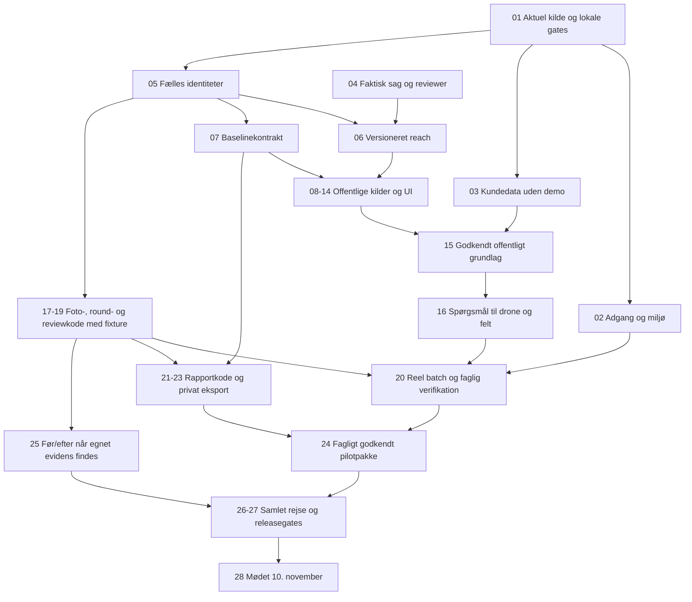

# Haderslev: klassificeret opgaverække frem mod 10. november 2026

Oprettet 13. oktober 2026 efter Jespers instruktion om at begynde arbejdet og løse opgaverne i prioriteret rækkefølge. Dette er den konkrete arbejdsrække til [Haderslev-planen](HADERSLEV_PLAN_2026-11-10.md), baseret på de fire audits. Kodegrundlaget er `JESRI-C/freyra-hub`, branch `codex/gofreyra-p0`, auditeret SHA `97782c0986d13971fd684240662a79eb70296db6`.

**Udførelsescheckpoint 13. oktober 2026:** den aktive appcheckout er `udvikling/freyra-hub`, branch `codex/haderslev-delivery`, startet fra den auditerede P0-SHA. Det tidligere verificerede CI6-head er `610764b14f5a8b534dbef7c408e2fb2e9de74f4d`; [CI6](https://github.com/JESRI-C/freyra-hub/actions/runs/38392959494) har både app- og DB-job SUCCESS. [Kladde-PR #15](https://github.com/JESRI-C/freyra-hub/pull/15) og [udførelsesloggen](https://github.com/JESRI-C/freyra-hub/blob/codex/haderslev-delivery/docs/HADERSLEV_EXECUTION.md) samler beviserne. Auditgrundlaget bevares. **Opgave 01 er afsluttet som arbejdscheckout og frisk appgatebaseline. Opgave 02/27 er delvist gennemført og fortsat I GANG; den fulde kommunale brugerrejse og mødeleverancen 10. november 2026 er ikke accepteret; syntetisk credential-båret QA er siden bestået.**

**Leverancerækkefølgen er: afgræns sag → offentlige data først → konkrete spørgsmål til drone/felt → originalupload og verifikation → faglig godkendelse → faktisk rapport og datapakke.** Teknisk uploadkode kan udvikles parallelt, men kundens observationer og rapport må ikke godkendes uden den tilknyttede baseline. Eksisterende optagelser bruges som retrospektiv verifikation med deres rigtige datoer.

## Aktuelt runtimecheckpoint — 13. oktober 2026

**Datafordeler-kildecheckpoint, 13. oktober:** konto/login/aktivt **GoFreyra Staging** IT-system og krypteret `DATAFORDELER_API_KEY` kun på `gofreyra-p0-staging` er etableret; nøglemetadata: **GoFreyra staging offentlige data**, udløb **13. oktober 2028**, ingen værdier registreret. Efter det historiske første 401 gav autentificerede capabilities/schema/GetFeature og præcise navne-/ID-opslag **HTTP 200**. Brugeren har nu nævnt **Bykær Bæk som én af pilotsagerne**; den er ikke den eneste. Endepunkter, reviewer og øvrige cases er ikke valgt. [Kilde-/adgangsbeviser og AOI-afklaring](haderslev-audit/datafordeler-adgang-2026-10-13.md). CI8/CI9 og `ca333c8`/`0fe72b06` bevares som tidligere checkpoints.

**Aktuel pushed og deployet kode:** **`972524e298d0bbad1cbefb2e6e39d0a2c5886017`**, staging Worker **`c07618c5-17d3-49ff-8341-b336744aab1f`**. Applikationstræet er identisk med den byggede `bf67149161ec0681d383569d802b5b0b76cdf799`; den efterfølgende SQL-rettelse ændrer ikke det byggede applikationstræ. [CI11](https://github.com/JESRI-C/freyra-hub/actions/runs/38425940663) er fuldt **SUCCESS**: **94 testfiler/1.024 tests**, appgates og fresh disposable LOCAL migrationsreplay med **5 SQL-filer/268 TAP-punkter PASS**. De fire serverbindingsnavne, inklusive Datafordeler, er bevaret uden registrerede værdier.

**Tidligere delkontroller:** parser61, baseline/reach46 inklusive 12 datocases samt promotion/auth11, reader17 og retry-helper12 PASS. Første fuldsuite stoppede på Windows TEMP-cache EPERM før tests; workspace TEMP/TMP gav derefter 94/1.012 før de 12 datocases. Den aktuelle samlede gate er CI11's 94/1.024. CI10 på `bf67149` fejlede 1/268 ved `OLD.original_role` recordplanning; en separat IF rettede fejlen uden at svække tests. De tidligere planlagte SQL-punkter er nu afløst af det faktiske fresh replay med 268 TAP-punkter.

**Canonical/reference-schema applied kun på staging `xdvqdzdpyceojbdknofi`:** repo `20261013144725` → hosted `20261013160451` (**promote_drone_original**), repo `20261013151039` → hosted `20261013160458` (**datafordeler_watercourse_reference**). Canonical-service, privat reader, upload-retry og Datafordeler/v1-v2-proveniens er committed/deployet med CI11-gates. Hosted baseline- og canonical promotion-QA er nu teknisk bestået; round-/spørgsmålsbinding, fagligt review, reel batch og rapportleverance er fortsat åbne.

**Hosted canonical promotion-QA PASS — 33 checkpoints:** media `df98d250-fb09-4fa5-b275-e5e06cbb9ab5`, primær origin `c7d8f058-f747-4b5b-a211-d304d3df8034`, dubletorigin `492464e0-5cd5-408f-b8ff-20a8621851eb`, dublet-TUS `00b7b90f-eef9-4b84-a87b-4a8a0c95fbac`. **1 canonical / 2 fysiske originaler / 3 requests og 3 auditevents**; retry/dedup bevarer ID. Almindelig owner og viewer læser private bytes med HTTP 200 og verificeret SHA; foreign/anon nægtes, reserverede kolonner/service-RPC giver 42501, samme-JWT revoke og præcis membershiprestore PASS. Owner-overwrite nægtes; delete nægtes/0 fjernet. Begge faktiske filer er 137 bytes med samme hash; objectpins/DB-graf er uændret. 60-sekunders signed URL gav 400 efter 72 sekunder. [Bevis](haderslev-audit/staging-canonical-promotion-qa-2026-10-13.json). Dette lukker den tekniske canonical-slice, ikke round/review/batch/rapport; fixture har `review_required`, ingen EXIF/GPS.

**Hosted moderne baseline-QA PASS — 31 checkpoints:** syntetisk projekt `24046b35-20cf-46f6-83de-1190b2d6a285`, zone `1b88e5f3-f1ec-43d6-b70e-025e732812f6`, faktisk Bykær-provider/reference `1233766a-1fdb-6b98-e053-d480220a5a3f`, statisk dataversion **2025-09**, **308 vertices**. Baseline v2 `3f5ec8bc-ac7d-476a-ad0f-2dd61243bb12`, version **1**, hash `32f9b05a8a30c2a8a0d118f14a4f36bfb98e5b34c5bc88786c5b5599a8bcd6c3`. Save/retry/get/list bevarer ID/hash og én faktisk række; viewer-læsning, foreign/anon-denial, samme-JWT revoke og præcis membershiprestore PASS. [Bevis](haderslev-audit/staging-modern-baseline-qa-2026-10-13.json). Dette er teknisk persistensaccept på syntetisk QA, ikke en kommunalt godkendt baseline.

**Faktiske syv kilder i QA-baselinen:** officiel reference **complete**; DMI **no_coverage / 0 målinger** fra det aktuelle stationsvalg; Sentinel **partial / 9 scener**, katalogdata uden lokal pixel-/sky-QA; regulativ, ortofoto/terræn, vandplan/natur og offentlige vandmålestationer **not_implemented**. DMI-undersøgelsen fandt valgt nærmeste station **Oksenvad `26050`, Inactive**, uden døgnværdier; dette konkluderer ikke manglende dækning fra alle DMI-stationer. QA har fortsat **0 droneflyvninger/drone_assets/observationer/rapporter**, og baselinen er uændret efter promotion. Opgave 15's faglige accept, fuld kildedækning, AOI/reviewer og rapport er åbne. **Opgave 16's planpersistens er I GANG**.

**Verificeret staging-postflight efter de nye QA-kontroller:** **7 projekter/15 uploads/1 baseline/2 raw-originalvalidations/1 canonical/2 origins/3 requests**; syntetisk QA har **0 flyvninger/observationer/rapporter**. Kode-/build-/CI11-/Worker-/migrationmapping og faktisk sikkerhedskatalog/adgang er samlet i [postflight](haderslev-audit/staging-modern-chain-postflight-2026-10-13.json). Tallene er teknisk QA, ikke kommunal indlæsning eller rapportaccept.

**Efterfølgende kodekandidater, endnu ikke deployet/accepteret:**09 bruger faktisk DMI operation-/validperiode og max 3 bounded kandidater efter komplette tomme svar; den valgte Oksenvad 26050 har operationTo 2009-04-02 trods validTo:null.16 implementerer immutable planstore uden godkendelse/ny sourcefetch. En kildelink-UI-rettelse skal åbne offentlig produktbeskrivelse frem for et uautentificeret GetFeature-link; gemt sourceURL/hash ændres ikke af den kandidat.

**Kommunal AOI-accept er fortsat åben:** read-only staging-UI på det eksisterende **Bykær Bæk–førregistrering**-projekt viste 22,07 ha, manuelt tegnet centroid **55.9991 N / 10.5008 E** og fejlen “Kunne ikke læse en gemt vandløbsstreng”; Datafordeler-testreferencens koordinater var omtrent **55.365 / 9.268**. Afvigelsen er ikke afklaret. Ingen eksisterende kundegeometri er ændret, og hverken registergeometri eller bbox er accepteret som kommunal delstrækning. [Detaljer](haderslev-audit/datafordeler-adgang-2026-10-13.md).

Supabase-staging er autentificeret, og eksisterende privat service-role samt staging-URL/publishable-konfiguration er provisioneret **kun** til `gofreyra-p0-staging`. Dashboardlogin er gennemført. Første midlertidige Worker-version var `95278d2f-5833-4765-8644-f213b9962dfd`. Hosted H08-/adgangsbevis gælder nu **`5ee102da-cf82-4ca0-ba6a-3e26ca479969`** på **`a010b9f8004f1cceda83125eaa9dbaf9cf4cac60`**. Ingen credentialværdier registreres her, og produktion er uændret.

**Tidligere verificeret committed/deployet kodecheckpoint:** `ca333c810656ca7cc5901d3aa32c4919d16c6433` er deployet på staging Worker **`0fe72b06-db07-48d5-b7de-440d942e7d22`**. Lokale **88 filer/911 tests**, 77 scopetests, typecheck/scoped lint og `build:staging` (1 min. 24 sek.) PASS. [CI8](https://github.com/JESRI-C/freyra-hub/actions/runs/38412877024) har begge jobs SUCCESS: [app](https://github.com/JESRI-C/freyra-hub/actions/runs/38412877024/job/115349509771) 88/911 samt type/lint/faktorer/build, [DB](https://github.com/JESRI-C/freyra-hub/actions/runs/38412877024/job/115349509167) fresh reset/replay og tre suiter/165 TAP-punkter PASS med seks kendte katalogverificerede PostGIS-begrænsninger. På den endelige Worker består cached original-retry/reload med samme ID/validationhash, uden ny upload eller ny første bytesvalidering. [Final postflight](haderslev-audit/staging-final-postflight-2026-10-13.json).

- **02/27 fortsat I GANG:** stagingmigrationer/RLS/grants er verificeret; tre krævede serverbindinger valideres ved deployment. **39 hostede adgangskontroller PASS**: anonymous/fremmed organisation, afgrænset viewer-read men nægtet write/RPC/reserverede kolonner (42501), private links, samme-JWT scoped revoke og gendannede roller. Owner-link var 200 og efter 72 sekunder 400 med 60 sekunders TTL; allerede udstedt bearerlink forblev gyldigt indtil TTL. Samlet Auth/cleanup/ingest/cron og kunderelease er ikke accepteret af dette syntetiske forløb.
- **03/H05 DELVIST IMPLEMENTERET:** den faktiske UI's faste 91 %, “3 min”, Q2/demo og Lavbund-mock ved DB-fejl er fjernet fra kundetilstand eller begrænset til eksplicit offline demo. Mangler bliver ikke gemt som falske nuller.
- **Projektoprettelse:** den observerede INSERT RETURNING/42501 er rettet til insert uden returnerende SELECT efterfulgt af læsning af den lagrede række. UI-recovery bruger faktisk projekt-ID; den fulde kommunale brugerrejse forbliver åben, mens slutdeploy/CI8 er bestået som teknisk checkpoint.
- **17/18 fortsat DELVIST:** faktisk privat TUS/finalize og hosted originalkontrol er verificeret på samme syntetiske 137-byte-JPEG; retry/read bevarer ID/hash. **`uploads.status` er fortsat `awaiting_validation`; separat `original_validation.status` er `review_required`.** Manual-redirect-/ikke-2xx-rettelsen i H08/DMI/Sentinel er runtimeverificeret. `pixelDecoded`, `georeferenced`, `reportEligible` og `cameraPositionEligible` er alle false. En lille teknisk fixture lukker ikke canonical aktiver, round-/baseline-/spørgsmålsbinding, review eller 10/120-batch.
- **08/10 og offentligt grundlag:** Datafordeler-kald og adapter/referencebinding er committed/deployet, stagingapply og CI11 PASS; hosted moderne baseline-QA31 PASS med én syntetisk version og idempotens/adgang. Fire kilder er not_implemented, Sentinel er katalog-only og DMI's Inactive Oksenvad 26050 giver no_coverage; alle DMI-stationers dækning er ikke afklaret. Faglig baselineaccept/AOI/reviewer og øvrige cases er åbne; Bykær er én af pilotsagerne.
- **Tidligere lokalt kodebevis:** `a010b9f8004f1cceda83125eaa9dbaf9cf4cac60`: **88 filer/903 tests**, typecheck, lint **0 errors/23 eksisterende warnings**, faktorer og `build:staging` PASS. Outputscan: 766 filer/0 privileged-JWT-/secretværdier. Målrettede 65/76/39 kilde-/kunde-/projekttests er delkørsler, ikke ekstra unikke tests. Nyt hosted CI- og deploybevis mangler efter denne kodeændring.

**Historisk H08-QA-optælling, før baseline/promotion:** 7 projekter/14 uploads/0 drone_assets/0 baselines/**1 servervalideret original — kun syntetisk 137-byte-JPEG**; QA-scope har 0 observationer/rapporter. Projekt `24046b35-20cf-46f6-83de-1190b2d6a285` og upload `f54883ff-6cb1-4cb3-9879-b4ebdb2b005a` er syntetiske. **04's kommunale sag/reviewer, 15's godkendte offentlige grundlag og 19–24's faglige review/rapport/eksport forbliver åbne. Mødeleverancen 10. november 2026 er ikke accepteret.**

QA-bevis er renskrevet og scannet uden credential-/privatværdier: [originalkontrol](haderslev-audit/staging-original-qa-2026-10-13.json) og [adgang/download](haderslev-audit/staging-isolation-qa-2026-10-13.json). Lavbund-orgafgrænsningen i `ca333c8` har nu slutbuild/deploy/CI8 PASS; de faglige og sagsbundne acceptkrav er fortsat åbne. Historisk [CI7](https://github.com/JESRI-C/freyra-hub/actions/runs/38395038009) på `0969110dbfbf82a2155516ff22dcac7d7a6eeb90` er SUCCESS med 84/810 app-tests og 165 TAP-punkter; det ligger før de seneste rettelser.

## Status og arbejderegler

Auditten og den første plan er **AFSLUTTET som dokumentation**. Det betyder ikke, at appen, datakilderne eller den kommunale leverance er accepteret. Alle implementerings- og leveranceopgaver stod ved oprettelsen **IKKE STARTET**; faktisk igangsat arbejde opdateres i tabellerne og opgaveloggen. Ældre implementering genbruges, og septemberens testresultater er historisk bevis; de lukker ikke en ny acceptopgave.

En opgave skifter til **I GANG**, når konkret implementering eller accept begynder. **DELVIST IMPLEMENTERET** betyder, at en konkret kode-/datadel er bygget og kontrolleret, mens opgavens øvrige kode, runtimekontrol eller faglige accept stadig mangler. Den skifter til **AFSLUTTET** først med fil/commit, kontrolresultat og eventuelt faglig godkendelse i opgaveloggen. En adgangsafhængighed beskrives med konkret manglende miljø/kilde; kodeløsning og fixtureaccept kan stadig gennemføres. `AFVENTER` eller en grøn UI-markering er ikke færdigt arbejde.

- **P0:** nødvendig for den valgte mødeleverance eller dens dataintegritet/adgang. P0-opgaverne gennemføres først.
- **P0 betinget:** nødvendig, hvis mødeleverancen lover den angivne funktion. Fuld Før/Efter-P0 er ikke afsluttet ved kun at levere en FØR-rapport.
- **P1:** efter en fungerende og accepteret kommunal kæde. Et konkret kommunalt behov kan flytte en P1-opgave frem med dokumenteret afhængighed.
- **Udvikling:** kan implementeres og kontrolleres selvstændigt med kontrollerede fixtures. **Sag** og **Faglig accept** kræver faktisk beslutning eller godkendelse fra Jesper/kommunen/en udpeget fagperson. De er ikke kodeopgaver.

Den eksisterende `P0_BACKLOG.md` har bindende sikkerhedsrækkefølge. SEC-/AUTH-gates færdiggøres før private kundeoriginaler indlæses eller kommunale brugere får adgang. Staging var INACTIVE i den oprindelige audit og er siden reaktiveret til ACTIVE_HEALTHY. Aktuel fresh LOCAL replay/pgTAP/DB-lint består, og de to nye stagingmigrations er applied; stagingbinding er siden provisioneret. Samlet Worker-/credential-/releaseaccept er fortsat åben. Lokal kode, offentlige read-only kilder og kontrollerede fixtures kan udvikles parallelt. Kilder, database, appdeploy og release-SHA registreres hver for sig.

### Tidligere delresultater — CI6 og første schemaaccept

Disse delresultater er læst fra den aktuelle udførelseslog og CI6-/stagingbeviser 13. oktober. Et adapterkald til en testregion er ikke en godkendt pilotkilde. SQL-runtimebevis gælder det dokumenterede disposable LOCAL miljø; stagingapply og faglig accept registreres særskilt.

**Teknisk checkpoint, CI6:** [CI6](https://github.com/JESRI-C/freyra-hub/actions/runs/38392959494) på head `610764b14f5a8b534dbef7c408e2fb2e9de74f4d` har begge jobs **SUCCESS**. [App-jobbet](https://github.com/JESRI-C/freyra-hub/actions/runs/38392959494/job/115281013363) består med **84 testfiler/810 tests PASS** og de øvrige appgates. Hele fresh disposable LOCAL DB-replay og alle tre pgTAP-suiter er OK: 128 tenant + 19 original + 18 baseline = **165 TAP-punkter**, med katalogbetinget lokal historietest/skip. DB-lintklassifikationen har **0 appblokkerende fund** og **6 bekræftet PostGIS-owned begrænsninger**; raw lint, extensionejerskab og klassifikation findes i [DB-gateartefakt 11810472109](https://github.com/JESRI-C/freyra-hub/actions/runs/38392959494/artifacts/11810472109), SHA-256 `a835421fa32ea983815e3ffcd17dce39f82833cac74e9e9c9230b453f5421894`. Fixtures er kun kørt mod disposable LOCAL metadata; hosted/private Storage-delete-guard er ikke deaktiveret eller gennemløbet af denne testharness.

**Tidligere stagingcheckpoint (CI6/schemaapply):** de to nye migrations er applied på `xdvqdzdpyceojbdknofi`: lokal `20261013062924_project_baseline_snapshots.sql` er registreret som `20261013115313`, og lokal `20261013063920_drone_original_validation.sql` som `20261013115314`. Postflight af privat RLS/grants består. Rækketallene er uændrede: **6 projekter, 13 uploads, 0 drone_assets, 0 baseline-snapshots og 0 servervaliderede originaler**. Worker er ikke opdateret; service-role-/ingest-/cron-secrets mangler, CLI er ikke autentificeret, og dashboardlogin afventer. Schemaapply er ikke et credential-båret gem/genåbn-/upload-/downloadbevis.

| Område / opgaver  | Faktisk delresultat                                                                                                                                                                                                                                                                                                                                                                                                | Det, der stadig holder opgaven åben                                                                                                                                                                                                                                                         |
| ----------------- | ------------------------------------------------------------------------------------------------------------------------------------------------------------------------------------------------------------------------------------------------------------------------------------------------------------------------------------------------------------------------------------------------------------------ | ------------------------------------------------------------------------------------------------------------------------------------------------------------------------------------------------------------------------------------------------------------------------------------------- |
| H01 · 01          | **AFSLUTTET som checkout/appgatebaseline:** Node 22.14.0/npm 10.9.2, ren install af 842 pakker efter SheetJS 0.20.3 og fire præcise sikkerhedsrettelser. Hosted appgates er grønne, senest CI6 på `610764b14f5a8b534dbef7c408e2fb2e9de74f4d` med **84 testfiler/810 tests PASS**. Tidligere app-suite på `67df4be`: 81 filer/773 tests PASS. Aktuelle appdetaljer registreres i udførelsesloggen.                  | Opgave 01 afslutter ikke credential-båret Worker-/Auth-/Storage-/browser-/releaseaccept eller faglig accept i 02/27.                                                                                                                                                                        |
| H03 · 02/27       | **DELVIST GENNEMFØRT / I GANG:** CI6 app+DB SUCCESS; hele fresh LOCAL replay og tre TAP-suiter/165 punkter OK med katalogbetinget historietest/skip. Lint: 0 appblokkerende fund/6 bekræftet PostGIS-owned begrænsninger. To nye stagingmigrations applied; privat RLS/grant-postflight PASS og rækketal uændrede. Frisk npm audit efter fire rettelser: **38 fund, 0 critical/20 high/11 moderate/7 low**.        | Worker er ikke opdateret; service-role-/ingest-/cron-secrets og dashboardlogin mangler, CLI er ikke autentificeret. Credential-båret rollematrix, privat signer/download/expiry/revoke, Auth/browser, Worker-/memoryaccept og resterende advisorytriage mangler. Produktion er ikke ændret. |
| H05 · 03/12       | Automatisk projektseed, skjult fallback ved kundefejl og falske rapport-ID'er fjernet. Eksplicit offline demo kræver demotilstand uden database. Kundetomme reads bevares. Kilder uden konfiguration/geometri eller med fejl giver ingen preview; estimeret NDVI/centroidprøver giver ingen målte projekt-/natur-/CO₂-/vandindikatorer. Fiktive alarmtal, sensorer og live-/integrationsdata skjules i kundesagen. | Historiske kundedata og øvrige moduler er ikke samlet accepteret eller slettet. Reelle raster-/domæneberegninger og hele rapportkædens inputkontrol mangler fortsat.                                                                                                                        |
| H04 · 05/07/14    | **DELVIST IMPLEMENTERET:** privat immutable baseline med source-/geometry-/dato-/hashbinding, auth/idempotens og reads uden sourcefetch; versionslisten er 30 summaries. 15 source-render-tests/3 paneltests består. Baseline-suiten 18 TAP-punkter OK i CI6; stagingmigration mapped til `20261013115313` applied og privat RLS/grant-postflight PASS.                                                            | Staging har fortsat 0 snapshots. Credential-båret gem/genåbn, Workerdeploy, visuel browseraccept, komplette sagsspecifikke kilder og faglig baselinegodkendelse mangler. Reach/round/review/rapportmodellen er ikke færdig.                                                                 |
| H06 DMI · 09      | Officielle nedbørsdøgn med station, interval, enhed, QC/gyldighed og versionsspor; begrænset pagination/størrelse/tid og konservativ sum. **27 adaptertests** består; ukendt/manglende gyldighed frigiver ingen fuld periodesum. Direkte read-only kildekontrol gav 14 værdier fra Vojens Airport i en testregion.                                                                                                 | Pilotens datoer, oplandsrelevans og tilstrækkelig 1/7/30-døgnsdækning er ikke godkendt. Manglende eller ufuldstændig dækning giver ingen opdigtet sum. Testregionen er ikke den kommunale sag.                                                                                              |
| H06 Sentinel · 12 | CDSE STAC giver geografiske Sentinel-2 L2A-kandidater med ID/dato/footprint/global skyprocent. 19 adaptertests består; direkte read-only prøve gav 10 kandidater.                                                                                                                                                                                                                                                  | Billedbånd og lokal sky-/skygge-/nodata-QA mangler. Scenekataloget er ikke målt NDVI eller dokumentation for lokal brugbarhed. Regulativ, ortofoto/DHM, natur/vandområdeplan og relevante vandmålestationer i 08/10/11/13 er fortsat åbne kildeopgaver.                                     |
| H07 · 16          | Stabile kildebundne spørgeudkast med område, dato, usikkerhed og beviskrav; manglende kilder vises som datahuller. AOI/reference-overlap bruges kun til et konservativt stedmatchspørgsmål.                                                                                                                                                                                                                        | Vedvarende review-/godkendelsesmodel og navngiven faglig accept mangler. Katalog- eller vejrdata er ikke i sig selv vedligeholdelses-/hydraulikfund.                                                                                                                                        |
| H08/H09 · 17/18   | **DELVIST IMPLEMENTERET:** SHA-256/EXIF/XMP fra private JPEG-bytes med 32 MiB/20 sekunders grænse; medlemskabs-/Storage-versionscheck, sekventiel UI-kontrol, bevaret upload-ID og retry efter reload. Original-suiten 19 TAP-punkter OK i CI6 med katalogbetinget lokal historietest/skip; stagingmigration mapped til `20261013115314` applied og privat RLS/grant-postflight PASS.                              | Staging har 0 servervaliderede originaler/0 drone_assets. Worker-/secret-/credentialaccept mangler. Strukturkontrol er ikke pixeldecoding eller footprint-/faglig godkendelse. Canonical assets, dublet-/round-/baseline-/questionbinding og rigtig 10/120-batch mangler.                   |

Sagsvalget og revieweren i **04**, faglig baselineaccept i **15**, review i **19–20** og hele programrapporten i **21–24** er fortsat åbne. Den eksisterende Bykær v1.0-pakke er en bevaret faglig reference; den beviser ikke appens rapport- eller eksportflow. Før/efter **25**, samlet kommunerejse **26** og mødeaccept **28** er heller ikke afsluttet.

## Dataklassifikation: hvad må blive til hvilket output?

Hvert resultat skal både have en **evidenstype** og en **kildestatus**. Det forhindrer, at preview, manglende dækning og en lokal observation bliver til et officielt fund eller en måling.

| Klasse                | Eksempler fra systemet                                    | Tilladt output og nødvendig kontrol                                                                                                            |
| --------------------- | --------------------------------------------------------- | ---------------------------------------------------------------------------------------------------------------------------------------------- |
| Officiel registrering | Vandløbs-ID, regulativ, vandområdeplan, §3-lag, station   | Dateret kontekst med udbyder, ID/version og kilde. Ingen registrering er ikke bevis for fravær af beskyttelse.                                 |
| Måling/optagelse      | DMI-observation, egnet Sentinel-bånd, originalt dronefoto | Bevar dato, enhed/opløsning, kvalitet, geometri og originalreference. Et foto er en optagelse, ikke automatisk en miljømåling.                 |
| Beregning             | Dokumenteret NDVI, nedbørssum, kontrolleret areal         | Metode-/kodeversion, konkrete input og usikkerhed kræves. Beregning fra preview eller sæsonformel må ikke mærkes målt NDVI.                    |
| Billedobservation     | Synlig vegetation, spærring, vandflade                    | Sporbar original, optagedato, kamera-/objektgeometri, kvalitet og menneskelig review. Ingen sikker art, dybde eller årsag uden relevant bevis. |
| Faglig fortolkning    | Prioriteret besigtigelse, vedligeholdelsesforslag         | Begrundelse, sted, usikkerhed, næste kontrol og navngiven reviewer. Fortolkning ændrer ikke officiel klassifikation.                           |
| Model/estimat         | HIP, klimaformel, thumbnail-/sæson-NDVI                   | Særskilt metode og status; ingen skjult overgang til målt eller godkendt fund.                                                                 |
| Demo/preview          | Faste sites, mockrapporter, simuleret livefeed            | Kun eksplicit demotilstand. Må ikke indgå i godkendt kundebaseline eller rapport.                                                              |
| Manglende/fejlet      | Ingen scene, adgangsmangel, timeout, ukendt tid/position  | Synlig mangelsstatus og begrundelse. Må ikke erstattes af nul, grøn risiko, projektcentroid eller “online/synket nu”.                          |

Baselinekildestatus skal mindst skelne `available`, `no_coverage`, `insufficient_resolution`, `needs_access`, `fetch_failed` og `not_requested`. Måle-/observationsstatus er et andet felt. For dronekæden skelnes modtaget, valideret, klar til review, godkendt og afvist. Browserens metadata er preview, indtil serveren har verificeret originalen.

Fælles provenance: projekt/reach-ID og geometriversion; udbyder og endpoint/dokumentreference; datasæt/produkt-ID og version; optage-/observationsperiode og hentetid; CRS/opløsning/enhed; licens/kreditering; svar-/filreference og checksum; metode-/kodeversion; kvalitets- og mangelsflag. Godkendt rapport binder disse ID'er og versioner i ét låst manifest.

## Fase 0 — fælles kilde, sikre data og konkret sag

Der er ingen afhængighed af et bestemt vandløbsnavn for at løse 01–03 og kodekontrakterne i 05–06. Sagen må ikke lydløst antages at være Bykær, Byskov eller Skallebæk.

| Nr. | Opgave / H-ID / eksisterende P0-ID                                                                                                                                                                          | Klasse               | Status                        | Acceptbevis                                                                                                                                                                                                                                                                                                            | Blokerer / kan køre parallelt                                                                                                                                                                                                    |
| --- | ----------------------------------------------------------------------------------------------------------------------------------------------------------------------------------------------------------- | -------------------- | ----------------------------- | ---------------------------------------------------------------------------------------------------------------------------------------------------------------------------------------------------------------------------------------------------------------------------------------------------------------------- | -------------------------------------------------------------------------------------------------------------------------------------------------------------------------------------------------------------------------------- |
| 01  | Etablér aktuel arbejdscheckout, versionskort og frisk lokal gatebaseline. **H01 → QA-P0-01**                                                                                                                | P0 · Udvikling       | AFSLUTTET · checkout/appgates | Repo/branch/SHA er registreret. Ren install, typecheck, lint, faktor/checksum, tests og build har hosted appbeviser; senest CI6 på `610764b14f5a8b534dbef7c408e2fb2e9de74f4d` SUCCESS med **84 testfiler/810 tests PASS**. Tidligere testtal bevares i den kronologiske log.                                           | Fælles kodebaseline er etableret. Worker-/credential-/releaseaccept i 02/27 og faglig accept er fortsat åbne. Sagsvalg 04 kan ske parallelt.                                                                                     |
| 02  | Inventér migrationer, effektiv RLS, buckets, serversecrets og resterende auth-/download-/cleanupaccept; lav og verificér nødvendige rettelser. **H03 → SEC-P0-01A, SEC-P0-01B, SEC-P0-02, AUTH-P0-01**      | P0 · Udvikling/miljø | I GANG · delvist gennemført   | Historisk CI6/CI7 fresh LOCAL replay/165 TAP/klassificeret DB-lint PASS; stagingmigrationer/RLS/grants, stagingbinding og syntetisk H08/39 adgangskontroller PASS på a010b9f/Worker 5ee102da. Fuld kunderejse, Auth/cleanup/ingest/cron og den reelle kommunale release er åbne; orgrettelsen har slutdeploy/CI8 PASS. | Staginglogin/serverbinding er verificeret. Private pilotdata venter stadig på samlet adgangs-/kunderejseaccept. Teknisk fixtureaccept beviser ikke offentligt baselinegrundlag, fagligt review, batch eller kommunal aflevering. |
| 03  | Fjern opdigtet startdata og skjult demo-fallback i kundesager; stop falsk online-/synktid, bevar tomme lister. **H05 → ny dataintegritetsopgave; understøtter REPORT-P0-01**                                | P0 · Udvikling       | DELVIST IMPLEMENTERET         | Almindelig projektoprettelse giver ingen seed-sites på 12,4/3,1 ha, ingen fiktive indikatorer og ingen kilde-sync uden fetch. Tomme målinger/alarmer forbliver tomme. Demo kræver eksplicit valg. Regression viser, at kundedata ikke forveksles med demo.                                                             | Før baselinegodkendelse 15 og rapport 21. Kan løses uden kommunens sagsvalg, parallelt med 02. **Første konkrete produktkodeopgave efter 01.**                                                                                   |
| 04  | Fastlæg beslutningsspørgsmål, pilotvandløb, delstrækning/endepunkter, regulativ-/indsatsreference, relevante datoer, dataset og reviewer. **H02 → GEO-P0-02; BA-P0-01 datasæt; REPORT-P0-01 formål**        | P0 · Sag             | I GANG · Bykær blandt cases   | Brugeren har nævnt Bykær Bæk som én af pilotsagerne. Godkendt sagskort kræver stadig geometri/ID/endepunkter, formål, datoer og navngiven reviewer; øvrige cases er ikke valgt. UI-/Datafordeler-koordinatafvigelse er ikke afklaret.                                                                                  | Blokerer konkret faglig pilotaccept; generiske kontrakter og syntetisk QA kan fortsætte. Registergeometri/bbox er ikke aftalt reach; ingen eksisterende kundegeometri er ændret. Jesper/kommunen fastlægger scope/reviewer.      |
| 05  | Definér fælles identiteter og transitions for reach-version, baseline, spørgsmål, round, foto, observation, review og rapportversion. **H02/H04/H07–11 → GEO-P0-01/02, BA-P0-01, MEAS-P0-01, REPORT-P0-01** | P0 · Udvikling       | DELVIST IMPLEMENTERET         | Valideret datakontrakt og migrationsplan; alle relationer har same-project/same-tenant-gates. Ingen godkendelse kan referere til mutable preview eller forkert projekt. Kontrollerede fixtures dækker FØR uden EFTER.                                                                                                  | Efter 01. Fælles kontrakt før parallel baseline/upload/rapportudvikling. Kode kan udvikles før 04; faktisk kundebinding venter på sagen.                                                                                         |
| 06  | Versionér geometri og implementér entydig officiel delstrækning, stationering/reference og samtidighedskontrol. **H02 → GEO-P0-01, GEO-P0-02**                                                              | P0 · Udvikling       | IKKE STARTET                  | Gyldig geometri/reach genåbnes uændret; fejl/ukendt CRS afvises; nyt reach giver ny version; parallel første write skaber ikke dublet; source-/hashmanipulation afvises. Autoritativt pilotvalg valideres efter 04.                                                                                                    | Efter 05; konkret accept efter 04/02. Kan køre med baselineadaptere.                                                                                                                                                             |

## Fase 1 — offentligt stedgrundlag før droneverifikation

Alle P0-kilder skal enten være hentet/importeret med bevis eller have en synlig dokumenteret mangelsstatus. En versionsstyret officiel filimport er en adapter med samme provenancekrav; den mærkes importeret og tæller ikke som automatiseret API-hentning.

| Nr. | Opgave / H-ID / eksisterende P0-ID                                                                                                                                | Klasse                         | Status                         | Acceptbevis                                                                                                                                                                                                                                                                                | Blokerer / kan køre parallelt                                                                                                                                                                                                                        |
| --- | ----------------------------------------------------------------------------------------------------------------------------------------------------------------- | ------------------------------ | ------------------------------ | ------------------------------------------------------------------------------------------------------------------------------------------------------------------------------------------------------------------------------------------------------------------------------------------ | ---------------------------------------------------------------------------------------------------------------------------------------------------------------------------------------------------------------------------------------------------- |
| 07  | Implementér projektbundet kildekatalog, source-fetch/importlog og immutable baseline-snapshot. **H04 → MARS-P0-01 katalog/provenance; ny baselinekontrakt**       | P0 · Udvikling                 | DELVIST IMPLEMENTERET          | Snapshot har reach-version, perioder, source-ID'er, licens, filer/svar/checksum og alle mangelsstatusser. Genåbning kræver ingen ny fetch; en ny fetch skaber ny baselineversion. Rolle-/tenantnegative tests består.                                                                      | Efter 05; reel baseline efter 04/06. Kontrakten frigør 08–13 til parallel kodeudvikling.                                                                                                                                                             |
| 08  | Tilslut officiel hydroreference og kommunale dokumenter som dateret sagsgrundlag. **H06 → GEO-P0-02 + MARS-P0-01 provenanceprincip**                              | P0 · Udvikling/data            | DELVIST · teknisk runtime PASS | Autentificerede WFS/schema/ID-/navne-/aksebeviser, committed/deployet referencebinding, stagingapply og CI11 PASS. Hosted baseline-QA31: faktisk syntetisk version, retry/get/list samme ID/hash/række og rolle/revoke/restore PASS.                                                       | Fuld kildedækning, kommunale dokumenter/stationering og 15's faglige accept mangler. Bykær er én af sagerne; AOI/endepunkter/reviewer/øvrige cases åbne. DMI-stationsvalg er under rettelse; den nye kandidat er ikke deployet.                      |
| 09  | Tilslut historiske DMI-data og relevante nedbørs-/vind-/temperatur-/vandstandsserier. **H06 → ny vejradapter + MARS-P0-01 provenanceprincip**                     | P0 · Udvikling/data            | I GANG · stationsvalgskandidat | Historiske adapter-/live-read-beviser bevares. Den aktuelle baseline valgte Inactive Oksenvad 26050, operationTo 2009-04-02 trods validTo:null, uden døgnværdier. Ny kandidat bruger faktisk drifts-/gyldighedsperiode og bounded fallback op til 3 kandidater efter komplette tomme svar. | Kandidaten er endnu ikke deployet/runtimeaccepteret. Øvrig DMI-stationsdækning er ikke konkluderet; verificér aktiv station, periode/QC/enhed og fuld pagination uden opdigtet nul eller ukomplet sum. Sagsspecifik faglig relevans skal accepteres. |
| 10  | Tilslut dateret ortofoto og DHM med adgangs-/importadapter og visnings-/analyseadskillelse. **H06 → MARS-P0-01 lagkontrakt + ny rasteradapter**                   | P0 · Udvikling/data            | IKKE STARTET                   | Source-år/optagetid, pixel/gridafstand, CRS/højdesystem, dækningsområde og kreditering gemmes. WMS er visning; analysemåling kræver faktisk raster. Manglende konto/adgang vises som needs_access.                                                                                         | Efter 07. Afhænger af faktisk Datafordeler-adgang eller officiel import, ikke af droneupload.                                                                                                                                                        |
| 11  | Tilslut gældende vandområdeplan og §3/naturlag med korrekt geometri og version. **H06 → MARS-P0-01**                                                              | P0 · Udvikling/data            | IKKE STARTET                   | Kilde/endpoints/lag/licens er verificeret; planversion og basisanalyse holdes adskilt. Polygonoverlap/afstand har faktisk metode. Upstreamfejl eller ingen registrering bliver ikke nul natur/grøn risiko. Ukendt officiel tilstand bevares.                                               | Efter 07. Kan køre parallelt med 09–10/12–13.                                                                                                                                                                                                        |
| 12  | Saml Sentinel-2-sceneinventar, lokal sky/skygge/nodata-QA og sikre beregningsregler. **H05/H06 → ny Sentinel-kvalitetsslice; MARS-P0-01 kildeprincip**            | P0 · Udvikling/data            | DELVIST IMPLEMENTERET          | Produkt-ID, periode, AOI, fravalg og lokal brugbarhed gemmes. Thumbnail/sæsonfallback gemmes aldrig som målt ndvi_mean/vegetation_index. Beregning har egnede bånd/input/metode; ingen brugbar scene er gyldigt resultat.                                                                  | Efter 07. Efter 03 må simulerede input ikke godkendes. Konto/kvoter kan kræves for download/processing; katalogkode kan fortsætte.                                                                                                                   |
| 13  | Inventér relevante officielle målestationer og importér tilgængelig serie, ellers dokumentér hullet. **H06 → ny stationsadapter; MEAS-P0-01 når målinger indgår** | P0 inventar · Udvikling/data   | IKKE STARTET                   | Stations-ID, geografisk forbindelse/tilløb, parameter, periode, enhed, metode og rettigheder er registreret. Nærmeste station kobles ikke automatisk til bækken. Ingen serie giver dokumenteret datamangel.                                                                                | Efter 07/06; fuld biologisk/kemisk/hydrometrisk integration er P1 uden konkret pilotbehov.                                                                                                                                                           |
| 14  | Byg baselinebrugerflade med hent/import, datoer, lag, mangler og versionsvalg. **H04/H06 → ny baseline-UI; GEO-P0-01/02 kortbinding**                             | P0 · Udvikling                 | DELVIST IMPLEMENTERET          | Grundlag kan gennemgås før første dronefoto. Reload viser samme version; sourcefejl er forståelig; “online/synket” afledes kun af rigtig log. Projektets fremdrift kommer fra gemte records.                                                                                               | Efter 07; kan bygges med fixtures under 08–13.                                                                                                                                                                                                       |
| 15  | Gennemgå og godkend baseline på den valgte pilotstrækning. **H04–06 → baselineaccept**                                                                            | P0 · Sag/faglig accept         | IKKE STARTET                   | Dækning, datoer, metode og begrænsninger er gennemgået; godkendelsen binder præcis reach-/baselineversion og reviewer. Alle P0-kilder er hentet/importeret eller har dokumenteret mangelsstatus.                                                                                           | Efter 03/04/06–14 og sikker persistens 02. Blokerer faglig verifikation/rapportgodkendelse. Udvikling kan forberede fixtures videre.                                                                                                                 |
| 16  | Opret prioriteret drone-/feltverifikationsplan fra baseline. **H07 → ny spørgemodel; BA-P0-01 kildeadskillelse**                                                  | P0 · Udvikling + faglig accept | I GANG · planpersistens        | Kildebundne udkast findes; ny immutable planstore implementeres uden ny sourcefetch eller faglig godkendelse. Accept kræver stabilt ID, baselinekilde/dato/område/hypotese/prioritet/usikkerhed/beviskrav og faktisk reload af samme plan.                                                 | Konkret fagligt godkendt plan efter 15. Den nye kandidat er ikke deployet/runtimeaccepteret; fagperson skal godkende spørgsmål/metode. Syntetisk udvikling kan fortsætte.                                                                            |

## Fase 2 — originale billeder, observationer og review

Første vertikale test er ét kontrolleret originalfoto fra round og baseline til et ægte rapportudkast. Derfra udvides til 10 og 120 filer og det aftalte pilotdatasæt. Rigtig privat pilotimport kræver 02; baselinekvalitet og spørgebinding kræves før faglig godkendelse.

| Nr. | Opgave / H-ID / eksisterende P0-ID                                                                                                                                       | Klasse                         | Status                           | Acceptbevis                                                                                                                                                                                                                                                                                                              | Blokerer / kan køre parallelt                                                                                                                                                                                                                              |
| --- | ------------------------------------------------------------------------------------------------------------------------------------------------------------------------ | ------------------------------ | -------------------------------- | ------------------------------------------------------------------------------------------------------------------------------------------------------------------------------------------------------------------------------------------------------------------------------------------------------------------------ | ---------------------------------------------------------------------------------------------------------------------------------------------------------------------------------------------------------------------------------------------------------- |
| 17  | Servergenudtræk originalhash, EXIF, optagetid/tidszonestatus, kvalitet og canonical fotoaktiv; idempotente jobs/retry. **H08 → BA-P0-01; SEC-P0-02 reserveret metadata** | P0 · Udvikling                 | DELVIST · canonical runtime PASS | Migration/service/reader/retry committed/deployet, stagingapply og CI11 PASS. Hosted promotion-QA33:1 canonical/2 fysiske originaler/3 requests og auditevents, dedup/retry stabilt ID, owner/viewer bytes 200/SHA, deny/revoke/restore, overwrite/delete afvist/0 fjernet og URL 400 efter 72 sekunder/TTL 60 sekunder. | Teknisk 137-byte-fixture er review_required uden EXIF/GPS. Reel batch, øvrige formater/runtimegrænser, round-/baseline-/spørgsmålsbinding og review mangler. Canonical-slicen er teknisk accepteret; hele opgaven/kommunal foto- og rapportaccept er åben. |
| 18  | Knyt FØR-upload til round, baseline og spørgsmål; thumbnails, liste/kort og per-fil-status med resume/dubletter. **H09 → BA-P0-01 + SEC-P0-02 Storage/intents**          | P0 · Udvikling                 | DELVIST IMPLEMENTERET            | Reload bevarer round/batch; thumbnail er afledt aktiv; kamera og objekt er adskilt; fotos uden GPS kan reviewes uden centroidfallback. Afbrudt 10/120-batch genoptages uden ekstra originaler eller tab.                                                                                                                 | Efter 17/05; spørgsmålbinding efter 16. Kan bygges parallelt med rapportskabelonen.                                                                                                                                                                        |
| 19  | Gem konservativ observation/analyse med metode-/inputversion og menneskelig reviewtransition. **H09 → BA-P0-01; MEAS-P0-01 ved målinger**                                | P0 · Udvikling                 | IKKE STARTET                     | Godkend/ret/afvis har reviewer, tid, begrundelse og original-/baseline-ID. Kandidater er kandidater. Fejlet analyse er aldrig klar. Offentlige artsforekomster er kontekst; ingen RGB-afledning af usynlig biomasse, dybde eller hydraulik.                                                                              | Efter 16–18. Ét foto skal gennemløbe review og udkast 21, før batchudvidelsen accepteres.                                                                                                                                                                  |
| 20  | Importér og review reel pilotbatch, inklusive geografisk opdeling og eksisterende lokale registre. **H09 → BA-P0-01 datasæt-/reviewaccept**                              | P0 · Udvikling + faglig accept | IKKE STARTET                     | 120-fils resume-/dubletaccept og aftalt reel batch dokumenteret; modtaget/valideret/reviewet/afvist tælles særskilt. 397 JPEG bliver ikke 397 observationer: materialet har 274 unikke fotos. Bykær, Barsbøl, Ørsted Å og sammenløb holdes adskilt.                                                                      | Efter 02/04/15–19 og første-foto-udkast 21. Fagperson afgør fund; den eksisterende v1.0-leverance bevares som reference.                                                                                                                                   |

## Fase 3 — programgenereret beslutningsrapport og låst aflevering

Rapportkode og snapshot-layout kan udvikles tidligt efter 05/07. Nummereringen her beskriver endelig accept: en status `approved` eller `exported` er ikke et leveret dokument. Et udkast kan gennemløbes på første fixturefoto, mens reel batchreview fortsætter.

| Nr. | Opgave / H-ID / eksisterende P0-ID                                                                                                                                  | Klasse                                  | Status       | Acceptbevis                                                                                                                                                                                                                                                                             | Blokerer / kan køre parallelt                                                                                                                                        |
| --- | ------------------------------------------------------------------------------------------------------------------------------------------------------------------- | --------------------------------------- | ------------ | --------------------------------------------------------------------------------------------------------------------------------------------------------------------------------------------------------------------------------------------------------------------------------------- | -------------------------------------------------------------------------------------------------------------------------------------------------------------------- |
| 21  | Implementér selvstændig FØR-rapport fra struktureret projekt/baseline/round/review med beslutningsside og evidensbilag. **H10 → REPORT-P0-01**                      | P0 · Udvikling                          | IKKE STARTET | Første reviewede foto giver rigtigt projektbundet udkast i programmet; ikke hardcodet Skallebæk, mock-KPI eller artsfund fra kandidat. Manglende obligatoriske input giver fejl. Tekst viser datamangler; ingen udokumenteret “signifikant tendens/ingen risiko”.                       | Kontraktkode efter 05/07; første-fotoaccept efter 19. Endeligt pilotudkast efter 20. Kan bygges samtidig med 17–19.                                                  |
| 22  | Implementér immutable rapportversion, inputmanifest, faglig godkendelse og regeneration som ny version. **H11 → REPORT-P0-01; SEC-P0-02 adgang**                    | P0 · Udvikling                          | IKKE STARTET | Godkendelse binder geometri, baseline, rounds, originale/afledte billeder, observationer, metode, reviewer og inputhash. Senere data/review kan ikke ændre godkendt snapshot. Rollen og tiden er serverregistreret.                                                                     | Efter 21 og kontrakt 05; negative samtidigheds-/adgangstests. Kan kodeudvikles med fixtures før reel faglig accept.                                                  |
| 23  | Generér og arkivér faktisk PDF+manifest+CSV+GeoJSON i privat Storage med checksum, retry og download efter reload. **H11 → REPORT-P0-01 + SEC-P0-02**               | P0 · Udvikling                          | IKKE STARTET | Download er en faktisk gemt fil. Eksporterne har samme projekt-/rapportversion og observations-ID'er. PDF-hash matcher lagret blob; retry efter fejl laver ikke falsk exported-status; signer bruger eksakt autoriseret databasepath.                                                   | Efter 21–22; runtime/privat accept kræver 02. Blokerer aflevering.                                                                                                   |
| 24  | Faglig gennemgang af prioriterede steder/handlinger og læsbar PDF/datapakke, derefter godkendelse af pilotversion. **H10–11 → REPORT-P0-01 faglig accept**          | P0 · Faglig accept                      | IKKE STARTET | Reviewer bekræfter sted, dato, bevis, usikkerhed og næste handling. Eksport/kort/register matcher. PDF er visuelt gennemgået; ingen arts-/effekt-/arealpåstand overstiger evidensen. Godkendt version og checksum er dokumenteret.                                                      | Efter 04/15/20–23. Faglig godkendelse kan ikke erstattes af udviklerens test.                                                                                        |
| 25  | Survey rounds og reviewede før/efter-par med sammenlignelighed, vejrforskelle og varigt udvalg. **H12 → BA-P0-01; MEAS-P0-01 ved målinger; REPORT-P0-01 før/efter** | P0 betinget · Udvikling + faglig accept | IKKE STARTET | To rounds/datasæt og par genfindes efter reload. Afstand/retning/tid/reviewer/vejr og afviste par fremgår. Swipe/side-by-side/opacity virker. Egnede par giver kun den tilladte observation; mindst 90 % af P0-fotopunkter er godkendte ved fuld BA-P0-01-accept. Baseline ændres ikke. | Efter 18–19/21 og faktisk egnede EFTER-input. Blokerer før/efterløfte; selvstændig FØR-pakke 24 kan afleveres uden 25. Den fulde eksisterende P0-kontrakt kræver 25. |

## Fase 4 — releaseaccept og mødet

| Nr. | Opgave / H-ID / eksisterende P0-ID                                                                                                                                                | Klasse                  | Status                      | Acceptbevis                                                                                                                                                                                                                                                                  | Blokerer / kan køre parallelt                                                                                                                                                                                                                                 |
| --- | --------------------------------------------------------------------------------------------------------------------------------------------------------------------------------- | ----------------------- | --------------------------- | ---------------------------------------------------------------------------------------------------------------------------------------------------------------------------------------------------------------------------------------------------------------------------- | ------------------------------------------------------------------------------------------------------------------------------------------------------------------------------------------------------------------------------------------------------------- |
| 26  | Frisk samlet rejse med ny konto/session og rolle-/organisationnegative cases på faktisk release-SHA. **H13 → QA-P0-01, SEC-P0-01A/01B/02, AUTH-P0-01 og relevante GEO/BA/REPORT** | P0 · Udvikling/accept   | IKKE STARTET                | Projekt → offentligt grundlag → spørgsmål → originaler → review → godkendelse → download består. Reset/logout/refresh/reload samt privat adgang og inputlås genkontrolleres. Samme kode/schema/deploy er dokumenteret. Sensor-ingest/cron bliver ikke stiltiende accepteret. | Efter 01–24; også 25 hvis før/efter indgår. Blokerer betegnelsen færdig mødeversion.                                                                                                                                                                          |
| 27  | Afslut CI-/migration-/lint-/advisorygates og releasebeslutning på samme SHA. **H01/H03/H13 → QA-P0-01 + SEC/AUTH**                                                                | P0 · Udvikling/release  | I GANG · delvist gennemført | CI11 på 972524e SUCCESS:app 94/1.024/appgates og fresh LOCAL replay/5 SQL-filer/268 TAP PASS; stagingapply og Worker c07618c5. Hosted baseline-QA31/canonical promotion-QA33 PASS på syntetisk QA; postflightkatalog/adgang/optælling verificeret.                           | Samlet kommunal Auth/Storage/browser/cleanup/ingest/cron, advisorytriage, faglig pilot, reel batch/rapport/E2E og releasebeslutning har egne gates. Nye DMI-/plan-/kildelinkkandidater er ikke deployet/accepteret. Grøn teknik er ikke færdig mødeleverance. |
| 28  | Stabiliser 7–9 november og forbered konkret mødegennemløb, godkendt pakke, kendte mangler og næste kundekrav. **H14 → ny mødeopgave**                                             | P0 · Udvikling + Jesper | IKKE STARTET                | Gentaget demoagenda viser sag → baseline → verifikation → prioriterede handlinger → faktisk download. Den godkendte pakke kan genfindes; mødemateriale har præcis release-/teststatus.                                                                                       | Efter 24/26–27. Hvis gate ikke består, dokumentér afgrænset teststatus; kald ikke appen lanceret. Kravliste kan samles løbende.                                                                                                                               |

## Fase 5 — øvrige moduler og udvidelser efter accepteret kæde

Disse opgaver er klassificeret, så de ikke forsvinder, når vandløbspiloten prioriteres. De har egne outputkrav; skærmene alene er ikke accept. Sensor-/ingestsikkerhed i eksisterende SEC-P0-ID'er gælder også, hvis modulerne ikke bruges til mødet.

| Nr. | Opgave / mapping                                                                                                                  | Klasse                         | Status       | Acceptbevis / konkret output                                                                                                                                                          | Afhængighed                                                                                    |
| --- | --------------------------------------------------------------------------------------------------------------------------------- | ------------------------------ | ------------ | ------------------------------------------------------------------------------------------------------------------------------------------------------------------------------------- | ---------------------------------------------------------------------------------------------- |
| 29  | Flere automatiske offentlige adaptere: fuld Kemidata/VanDa/hydrometri, Sentinel-1 og HIP. **H06 udvidelse; MARS-P0-01 princip**   | P1 · Udvikling/data            | IKKE STARTET | Reelle lokale serier/raster med rettigheder, metode, datodækning og model/måling-skille; genåbnes fra baselineversion.                                                                | 07–15 og dokumenteret kommunalt spørgsmål.                                                     |
| 30  | Kontrolleret ortomosaik/COG/fotogrammetri, video/SRT/ZIP-import og areal-/ændringsmåling. **BA-P0-01 / MEAS-P0-01 udvidelse**     | P1 · Udvikling + faglig accept | IKKE STARTET | Faktisk behandlet produkt med kontrolpunkter/QA, metadata og tolerancer; upload-GPS sælges ikke som footprint eller præcis måling.                                                    | 17–25, egnet flyvning og målemetode. Krævede konkrete målinger løftes til P0 i valgt scope.    |
| 31  | Virkelig sensor-/monitoringrejse: enheder, kvalitet, alarmer, automatiske jobs og opfølgning. **SEC-P0-01A/01B + MEAS-P0-01**     | P1 funktion · Udvikling        | IKKE STARTET | Målt serie med enheder/kalibrering/kvalitetsfravalg; rigtig ingest/scheduler og historik; ingen simuleret livefeed eller demoalarmer i kundesag.                                      | Sikkerhedsgates 02 og reelt måle-/driftsbehov. Endpointprovisionering er fortsat egen P0-gate. |
| 32  | Lavbund med selvstændig baseline/målt effekt, faktorer, ledger og revisionsfast rapport.                                          | P1 · Udvikling + faglig accept | IKKE STARTET | Reelt lavbundsprojekt giver kildebelagt revisionspakke; lovet/målt, faktorversion og usikkerhed er adskilt.                                                                           | 22–27 genbruges som principper; egen domæneaccept og kundedata.                                |
| 33  | DecisionsIQ: prioritering/scenarier baseret på godkendte observationer og kundens kriterier.                                      | P1 · Udvikling + faglig accept | IKKE STARTET | Hver anbefaling kan spores til godkendt input, kriterium og antagelse. Et generisk scorekort er ikke beslutningsbevis.                                                                | 19–24 og kommunale beslutningskriterier.                                                       |
| 34  | ESG/Impact/credits kun med passende metoder og dokumenterede resultater.                                                          | P1 · Udvikling + faglig accept | IKKE STARTET | Godkendte målinger og kildefaktorer kan spores til rapportversion; effekt-/creditpåstand kræver domænets konkrete bevis.                                                              | Dokumenteret efterspørgsel, egen metode-/måleaccept.                                           |
| 35  | Organisationsdrift, invitation/deling, standardskabeloner og skaleret eksport; øvrige adminfunktioner. **SEC-P0-02 / AUTH-P0-01** | P1 funktion · Udvikling        | IKKE STARTET | Gem-knapper persisterer, invitation/rolleændring har faktisk backend, deling har autoritativ relation og audit. Ingen mock-2FA/readiness som driftstatus.                             | 02/22–27 og konkret flerbrugerbehov. Billing kræver eget produktkrav.                          |
| 36  | Redigerbar DOCX og kommunal journal-/GIS-afleveringsintegration. **REPORT-P0-01 udvidelse**                                       | P1 · Udvikling                 | IKKE STARTET | Redigerbar eksport viser oprindelig rapportversion og redigeringsstatus; redigeret fil fremstår ikke som uændret systemgodkendt PDF. Faktisk kommunalt modtagelsesformat verificeret. | 23–24 og kommunens afleveringskrav; kan løftes frem, hvis nødvendigt til mødet.                |

## Samlet H-/P0-mapping

Dette er sporbarhed til den eksisterende backlog, ikke en påstand om, at gamle opgaver er afsluttet eller erstattet. Nye baseline-/DMI-/kvalitetsslices føjes ind under sikkerheds- og dataintegritetsgates. MARS-P0-01's konkrete MARS-adapter lukkes kun ved dens egne capabilities-/lag-/livekrav; et generelt kildekatalog er ikke nok.

| Haderslev-ID | Arbejdsnumre  | Eksisterende P0-ID / ny slice                                   |
| ------------ | ------------- | --------------------------------------------------------------- |
| H01          | 01, 27        | QA-P0-01, release-/miljøversionskort                            |
| H02          | 04–06         | GEO-P0-01, GEO-P0-02                                            |
| H03          | 02, 26–27     | SEC-P0-01A, SEC-P0-01B, SEC-P0-02, AUTH-P0-01                   |
| H04          | 05, 07, 14–15 | Ny baseline-/snapshot-slice; MARS-P0-01 katalog/provenance      |
| H05          | 03, 12, 15    | Ny dataintegritet-/demo-/satellitkvalitet-slice                 |
| H06          | 08–15         | MARS-P0-01; GEO-P0-02; nye DMI/raster/stationsadaptere          |
| H07          | 16            | Ny verifikationsplan; BA-P0-01 offentlig kontekst               |
| H08          | 17            | BA-P0-01 metadata/canonical assets; SEC-P0-02 backendstatus     |
| H09          | 18–20         | BA-P0-01; MEAS-P0-01 når målinger indgår                        |
| H10          | 21, 24        | REPORT-P0-01; faglig rapportaccept                              |
| H11          | 22–24         | REPORT-P0-01; SEC-P0-02 Storage/adgang                          |
| H12          | 25            | BA-P0-01; MEAS-P0-01; REPORT-P0-01 før/efter                    |
| H13          | 26–27         | QA-P0-01 og genaccept af relevante sikkerheds-/auth-/domænekrav |
| H14          | 28            | Møde-/opfølgningsopgave                                         |

## Afhængigheder og parallel fremdrift

Pilen fra 25 til 26–27 gælder, når før/efter er del af leverancen. De tekniske parallelspor ændrer ikke den faglige rækkefølge: offentligt grundlag godkendes før drone-/feltverifikation, og godkendt evidens ligger før godkendt rapport.

**Næste prioriterede arbejde:**09 DMI-stationsvalg og16 planpersistens er i gang efter teknisk PASS af hosted baseline31/canonical33, CI11, stagingapply og deploy. Nye kandidater er endnu ikke runtimeaccepteret. Afklar fire manglende kilder, Bykær-AOI/endepunkter/beslutningsbehov/reviewer og øvrige cases; Bykær er én af pilotsagerne. Én syntetisk QA-baseline/canonical godkender ikke 15's faglige grundlag. Derefter følger reel batch/round-/spørgsmålsbinding → review → faktisk FØR-udkast og versionsfast godkendelse/eksport. Offentlige data først → droneverifikation → godkendt rapport gælder fortsat.

## Opgavelog og acceptbeviser

For hver ændring registreres opgavenummer, status, filer/commit, faktisk testkommando/resultat, miljø/SHA, resterende afhængighed og næste opgave. Kun afsluttede resultater tæller som afleveringsfremdrift. Teknisk implementering og faglig pilotaccept kan logges som to separate delresultater; den samlede opgave er åben, til begge krævede dele består.

Loggen er kronologisk. Tidligere testtal og afventende/fejlede checkpoints nedenfor er historik. Aktuelt runtimebevis står øverst: a010b9f/Worker 5ee102da med syntetisk H08/39 adgangskontroller, og 88 filer/903 lokale tests PASS. CI8/slutdeploy og cached genåbning er siden bestået på ca333c8. Offentligt baselinegrundlag og faglig kommunal accept er fortsat åbne.

| Dato                                            | Nr./område                                            | Status                                  | Faktisk bevis                                                                                                                                                                                                                                                                                                                                                                                                                                                                                                                                                                                                                                                                                                                                                                   | Næste arbejde                                                                                                                                                                                                                                         |
| ----------------------------------------------- | ----------------------------------------------------- | --------------------------------------- | ------------------------------------------------------------------------------------------------------------------------------------------------------------------------------------------------------------------------------------------------------------------------------------------------------------------------------------------------------------------------------------------------------------------------------------------------------------------------------------------------------------------------------------------------------------------------------------------------------------------------------------------------------------------------------------------------------------------------------------------------------------------------------- | ----------------------------------------------------------------------------------------------------------------------------------------------------------------------------------------------------------------------------------------------------- |
| 13.10.2026                                      | Audit, hovedplan og opgaveklassifikation              | AFSLUTTET · dokumentation               | [Plan](HADERSLEV_PLAN_2026-11-10.md), fire audits nedenfor og den eksisterende P0-backlog læst på `97782c0`. Ingen produktkode eller miljøaccept i denne klassifikation.                                                                                                                                                                                                                                                                                                                                                                                                                                                                                                                                                                                                        | 01, derefter 03; parallel 02/04 og fælles kontrakt 05.                                                                                                                                                                                                |
| 13.10.2026                                      | 01 / aktuel kodecheckout og nye lokale kontroller     | I GANG                                  | Arbejdet foregår nu i `udvikling/freyra-hub`. `npm run typecheck` exit 0 efter livekildeslicen; dens otte berørte/nye filer har scoped ESLint exit 0. Samlet CI/build/migrations-/miljøaccept kræver egne resultater.                                                                                                                                                                                                                                                                                                                                                                                                                                                                                                                                                           | Saml alle gatebeviser på den faktiske arbejds-/release-SHA; fortsæt kontrakt og baseline.                                                                                                                                                             |
| 13.10.2026                                      | 03/H05 / livekilder uden falsk preview                | I GANG · delresultat lokalt verificeret | `live-data.functions.ts`, `live-data-client.ts` og DMI/Miljøportal/Dataforsyningen/Copernicus-klienterne returnerer `data:null` ved manglende konfiguration/geometri/key og kildefejl. Preview kræver eksplicit offline demo. Gyldig tom DMI er `no_coverage`; andre reelle vejrparametre er gyldige uden temperatur. §3-fejl giver ikke nul natur, HTTP429 og timeout forbliver fejl. To målrettede testfiler: **49/49 PASS**. Ingen schema-/livewrites eller leveranceaccept.                                                                                                                                                                                                                                                                                                 | Saml H05's øvrige seed/fallback-/satellit-/miljøkontekstændringer; byg derefter den versionsfaste baseline i 05/07.                                                                                                                                   |
| 13.10.2026 · nyere checkpoint                   | 03/05/07/09/12/14/16/17/18 · H04–H08 og første H09-UI | DELVIST IMPLEMENTERET                   | De konkrete kode-, adapter-, live-read- og lokale testbeviser står i checkpointtabellen ovenfor. De to nye migrations-/SQL-testkandidater er skrevet, men ikke runtimeaccepteret. De fire oprindelige audits bevares som historik og kopieres sammen med plan/opgaver ind i appcheckout.                                                                                                                                                                                                                                                                                                                                                                                                                                                                                        | DB- og credentialaccept; manglende offentlige kilder; canonical foto/round/review; valgt sag/reviewer; faktisk FØR-rapport og immutable privat eksport.                                                                                               |
| 13.10.2026 · nyere checkpoint                   | 01/02/27 · lokale og eksterne releasegates            | I GANG                                  | Global lint/typecheck/faktor-checksum/build og den seneste samlede suite (79 filer/764 tests) består før den efterfølgende SheetJS 0.20.3-opdatering. Isoleret staging er reaktiveret. Secretsfri disposable LOCAL database-CI er defineret; ingen linked/production reset eller livepersistens er påstået.                                                                                                                                                                                                                                                                                                                                                                                                                                                                     | Endelig suite på aktuel SHA, første hosted CI/DB-job, staging schema/app-match, server-only adgang, Auth/Storage/browser og advisorytriage.                                                                                                           |
| 13.10.2026 · tidligere appgatecheckpoint        | 01 / arbejdscheckout og frisk appbaseline             | AFSLUTTET · checkout/appgates           | [PR #15](https://github.com/JESRI-C/freyra-hub/pull/15): [første app-job](https://github.com/JESRI-C/freyra-hub/actions/runs/38388197224/job/115265096589) PASS for head `ea04195` (PR merge-SHA `e5f6e600ae057593497dbacd587819ee70817f65`, 79 filer/764 tests); [andet app-job](https://github.com/JESRI-C/freyra-hub/actions/runs/38388923330/job/115267540469) PASS for head `67df4be`, 81 filer/773 tests. Ren install 842 pakker efter fire sikkerhedsrettelser inkl. SheetJS 0.20.3; typecheck/lint/faktor-checksum/build PASS.                                                                                                                                                                                                                                          | Opgave 01 er afsluttet inden for sit checkout/appgatescope. DB-/runtime-/releaseaccept i 02/27 og faglig accept forbliver åbne.                                                                                                                       |
| 13.10.2026 · tidligere DB-/dependencycheckpoint | 02/27 / migrationer og releasegates                   | I GANG                                  | [Første DB-job](https://github.com/JESRI-C/freyra-hub/actions/runs/38388197224/job/115265096380) fejlede ved 007's manglende demoparent; [andet DB-job](https://github.com/JESRI-C/freyra-hub/actions/runs/38388923330/job/115267540450) passerede 007 og fejlede ved optional `enqueue_email`. Aktuelt head `e702752` tilføjer existenceguards og seks beståede SQL-filkontraktchecks; tredje CI afventer. Frisk audit: 38 fund, 0 critical/20 high/11 moderate/7 low.                                                                                                                                                                                                                                                                                                         | Fresh replay/pgTAP/DB-lint skal bestå; derefter schema/app-match og credential-båret Auth/Storage/Worker/browseraccept. Filchecks er ikke SQL-runtimebevis. Ingen produktion ændret eller kommunal release godkendt.                                  |
| 13.10.2026 · CI6 og stagingcheckpoint           | 01/02/27 samt 05/07/17/18                             | 01 AFSLUTTET; øvrige DELVIST / I GANG   | [CI6](https://github.com/JESRI-C/freyra-hub/actions/runs/38392959494) på `610764b14f5a8b534dbef7c408e2fb2e9de74f4d`: begge jobs SUCCESS; app **84 testfiler/810 tests PASS**; hele fresh LOCAL replay, tre suiter/165 TAP-punkter OK med katalogbetinget lokal historietest/skip; 0 appblokkerende lintfund/6 bekræftet PostGIS-owned begrænsninger. [DB-gateartefakt 11810472109](https://github.com/JESRI-C/freyra-hub/actions/runs/38392959494/artifacts/11810472109) SHA-256 `a835421fa32ea983815e3ffcd17dce39f82833cac74e9e9c9230b453f5421894`. Staging `xdvqdzdpyceojbdknofi`: baseline `20261013115313` og original `20261013115314` applied; privat RLS/grant-postflight PASS; 6 projekter/13 uploads/0 assets/0 snapshots/0 servervaliderede originaler, uændrede tal. | LOCAL fixtures er ikke hosted/private testharnessaccept. Worker uændret; server-only/ingest/cron-secrets og dashboardlogin mangler, CLI ikke autentificeret. Credential-båret apprejse, canonical/round/review/rapport og faglig pilotaccept mangler. |

## Grundlag

- [GitHub/Lovable og versionskort](haderslev-audit/github-og-lovable.md)
- [Platformfunktioner og konkrete kodefejl](haderslev-audit/platform-funktioner.md)
- [Eksisterende rapport/drone og fagligt output](haderslev-audit/rapport-og-drone.md)
- [Offentlige datakilder, rettigheder og acceptkrav](haderslev-audit/offentlige-data.md)
- [Eksisterende P0_BACKLOG på auditeret SHA](https://github.com/JESRI-C/freyra-hub/blob/97782c0986d13971fd684240662a79eb70296db6/docs/P0_BACKLOG.md)
- [Vandløbsmetodekontrakten](https://github.com/JESRI-C/freyra-hub/blob/97782c0986d13971fd684240662a79eb70296db6/docs/4dm-watercourse-monitoring-method.md)
