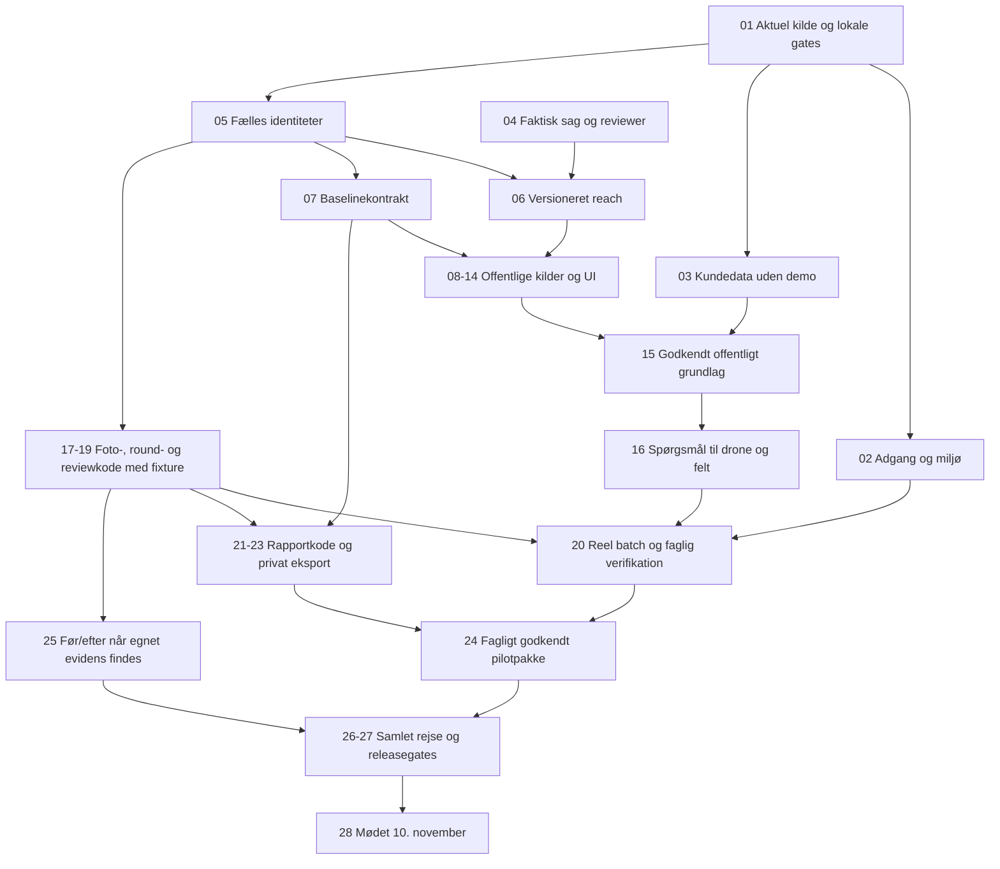

# Haderslev: klassificeret opgaverække frem mod 10. november 2026

## Opfølgning 15. oktober 2026 — automatisk lokalisering og billedspørgsmål

Arbejdsgangen er nu i testmiljøet: upload → serverkontrolleret GPS og vandløbsforslag → bekræft sted/dato → offentligt datagrundlag → gemt undersøgelse og præcise billedreferencer → billed-AI med den konkrete kildeversion → gemte svar og tekstkladde til rapportgrundlag.

**Release:** kode `e1fc83db2f4c7386245f8ffa8f72655322034269` på staging-Worker `0ac20aec-7540-4a54-a60a-3d3c595a732b`. [CI33](https://github.com/JESRI-C/freyra-hub/actions/runs/38705505371) består med **142 testfiler / 2378 tests**, typekontrol, faktorgrundlag, build og lint (0 fejl / 23 eksisterende advarsler). Databasen består med **11 SQL-filer / 675 kontroller**, **25 samtidighedsscenarier** og oprydning. Billed- og modelkompatibilitetsmigrationerne er anvendt i staging; faktisk bygning og nøglescan består.

**Faktiske stagingprøver:** **26 kontroller består** i kæden fra en tydeligt mærket syntetisk JPEG til gemt kildeversion, billedkladde og svar. GPS og optagetid aflæses uden browserfunktioner; denne BBOX-søgning har status complete og 0 nære kandidater. Gemma lykkes på forsøg 1; billedvurderingen har 0 foreslåede visuelle fund og fører sammen med kildekonteksten til 4 faste opfølgende spørgsmål. Gemte svar, læsebrugerens genåbning, afvist fremmed adgang og genforsøg uden ny analyse består. Historiske Qwen-resultater og svar kan genåbnes uden ommærkning eller nye versioner; gamle rækker i den afgrænsede inputgraf er bevaret.

En **særskilt positiv lokalisering med 16 kontroller består** med syntetisk tildelt GPS: registergeometrien findes, og kamera-til-vandløbsafstanden er 0 m. Den prøve kalder ikke billed-AI og er ikke en måling af en virkelig flyvnings nøjagtighed. Den vælger heller ikke kommunens delstrækning. Begge prøver er teknisk API-accept på samme release. Den normale brugers Undersøgelse- og Rapport og levering-faner samt synlig/aktiv uploadknap er læst i browseren på denne version; egne fotos, faktisk UI-upload og hosted tekstdownload er endnu ikke brugeraccepteret. [Afgrænset bevis](haderslev-audit/staging-drone-intake-checkpoint-2026-10-15.json), SHA-256 `43121842b451383d3e963aa7cf37fd8fbbd338738ac0f9f38a3a1fb1cde46c21`.

**Kildedækning er fortsat delvis:** officiel reference: komplet; regulativ: ikke tilsluttet; ortofoto/terræn: delvist; DMI: delvist; vandplan/natur: delvist; Sentinel: tidsgrænse; undersøgelsessteder: delvist; måleserier er ikke hentet. Tidsgrænser og mangler bevares i den gemte kildeversion og må ikke beskrives som fuld datadækning eller faglig accept. Satellitkataloger er ikke analyserede satellitpixels.

Der analyseres højst **12 fotos ad gangen** efter kildehentning og tilknytning. JPEG-originaler over 20 MB bevares og tilknyttes, men afventer billed-AI. Testdriftens grænser er 40 analyseforsøg pr. projekt / 200 samlet pr. døgn på tværs af modeller og 3 forsøg pr. præcist billede/model/prompt/metode/kildeversion. Genforsøg i samme model genbruger samme analyse; et modelskift får egne forsøgsnumre og ændrer ikke historiske resultater.

Tidligere Qwen-forsøg ramte tidsgrænser på 65 og 100 sekunder. Et særskilt genforsøg på den første release lykkedes; på en senere release blev svaret efter 64.392 ms afvist som `invalid_output`. Tokenudtømning og koldstart er ikke bevist. Den nye release bruger `@cf/google/gemma-4-26b-a4b-it`, konfigureret med thinking deaktiveret og en tidsgrænse på 100 sekunder. Minimerede fasetider indeholder ingen billeddata eller identifikatorer. Kamera-GPS og søgeområde er ikke et footprint eller en kommunalt godkendt delstrækning.

**Fortsat åbent:** egne optagelser og reel 10/120-batch, fem faktiske brugerafprøvninger, Bykærs delstrækning/formål, regulativ og faglig godkender samt en samlet godkendt kommunerapport/PDF og genhentelig afleveringspakke. Tekstgrundlaget er en kladde. Satellitkataloger er ikke analyserede satellitpixels eller dokumenteret naturtilstand. Tidligere daterede beviser nedenfor bevares på deres oprindelige versioner.

## Historisk workflowcheckpoint — 14. oktober 2026

Fem simulerede brugerperspektiver har prioriteret en samlet dronearbejdsgang. Undersøgelse er nu projektets startside med direkte batchupload, én eksplicit handling til datagrundlag → faktisk plan → FØR-runde, samlet fotovalg, kort og manuelle noter. Rapport og levering samler rapportoversigten og PDF-kladden; fane og præcis runde bevares i adressen. GPS fra en tidligere fil overføres ikke længere ved filskift. [Fund og resterende accept for alle fem grupper](HADERSLEV_BRUGERTEST.md).

Kode d338936adc9c1e6aefa3d41baaa4e145b491a7f6 er på staging-Worker 8b6dbad5-fe40-4f74-8665-30b4738b00db. [CI26](https://github.com/JESRI-C/freyra-hub/actions/runs/38603055037) består med 130 filer/2.111 tests, typekontrol, faktorer, build og lint (0 fejl/23 eksisterende advarsler); 10 SQL-filer/601 assertions og 25 samtidighedscases samt oprydning består. Lokalt består den fulde 2.110-testbaseline på8bca og 39 målrettede tests efter den sidste browserrettelse. Det normale 4 GiB-stagingbuild og faktisk nøglescan består; fire eksisterende krypterede bindingsnavne er bevaret. Den nye navigation og uploaddialog er browserafprøvet uden nye filer eller faglige registreringer. Ingen ny databaseændring eller produktion. [Nyt afgrænset bevis](haderslev-audit/staging-workflow-checkpoint-2026-10-14.json), SHA 6ec1d6d5d53a9538fea2aeb070b53665a52a95ad0fbf070a096b24808c2725a2.

Næste prioriterede opgaver: (1) rigtig fil og 10/120-batch, inkl. genoptagelse og valg af en faktisk flyvning; (2) relevant dataindhold og brugbare observationer, herunder afprøvet billed-/satellitanalyse; (3) faglig gennemgang og kommunal FØR-rapport; (4) låst, genhentelig afleveringspakke; (5) samlet pilot og mødeprøve. Den nuværende plan danner højst ét regelbaseret referencespørgsmål. Automatisk lokalisering, adaptive AI-spørgsmål, billedfortolkning og færdig kommunerapport er ikke leveret af denne ændring. Bykærs konkrete delstrækning og godkender er fortsat uafklaret. Tidligere 40/81/68/67-beviser bevares på deres oprindelige versioner.

## Historisk notecheckpoint — 14. oktober 2026

**Manuelle kladdenoter er teknisk stagingafprøvet:** kode `70028af7845632d7f9f0fa85583c35334e39c59e` på Worker-version `97c603d4-3133-40bb-940a-1d8de0cee4db` har bestået **67 faktiske notechecks**. To selvstændige syntetiske noter er gemt som `draft_unreviewed` til de eksisterende før-/kontrolbindinger og det præcise referencespørgsmål. Begge er `inconclusive` med prioritet `not_assessed`; retry/get/list/cursor, aktuelle adgangsafvisninger, privat original og same-JWT revoke/exact restore består. Den tidligere inputgraf og begge billedbindinger er uændrede; højst to egne nye noter er tilføjet.

**Aktuel release:** [CI23](https://github.com/JESRI-C/freyra-hub/actions/runs/38524924406) SUCCESS med **124 testfiler/1.968 tests**, **10 SQL-filer/601 assertions** og **25 samtidighedscases** samt disposable cleanup PASS. Notemigration `20261014061314` er applied som `20261014070017`; samme kode er bygget og deployet. Buildscan **759 repo-/798 outputfiler** gav 0 nøglelækager/privilegerede bundletokens, og fire krypterede bindingsnavne er bevaret.

**Afgrænsning og næste arbejde:** QA kørte i den særskilte syntetiske API-testsag. Den normale brugers tomme testsag er bevaret; egne fotos og M1-formularens hosted browserforløb er endnu ikke afprøvet. En manuel kladdenote er ingen fagligt godkendt observation. Fagligt review, gemt FØR-rapport/godkendelse, faktisk hosted PDF-download/arkiv, reel 10/120-batch, kommunalt scope og samlet mødeleverance mangler stadig. Offline syntetiske querymålinger er ikke hosted CPU-/latens- eller batchaccept.

**Historik bevares:** M0-beviset på8eff, medie-QA68 på5c og SOURCE13-QA40/Round-QA81 på81 forbliver daterede, byteuændrede beviser; de er ikke omdøbt til nye tests på70028. Ingen nye fotobytes eller kildeindsamling er udført. Bykærs83m/AOI/endepunkter/reviewer og øvrige cases er fortsat uafklaret; produktion og kundedata er uændrede.

[Nyt minimeret notebevis](haderslev-audit/staging-round-note-checkpoint-2026-10-14.json), SHA `48b5fc279ce9cecbb175216bdd237b86ba3ae17a5b442b956ad2a624ff0fcab6`.

## Historisk rapport- og mediecheckpoint — 14. oktober 2026

**Rapportvisning frigivet efter mediecheckpointet:** kode `8eff057` er på staging-Worker `b3198a45-7c3c-43d2-9653-7b00c0954a06`. [CI22](https://github.com/JESRI-C/freyra-hub/actions/runs/38519621399) SUCCESS: **119 filer/1.812 tests**, **9 SQL-filer/534 assertions** og **18 samtidighedscases**, cleanup PASS. Direkte rapportbygger, rapportcenter og den faktiske testsags rapportfane er læst i browseren og viser kladde/ukendt periode/manglende fagligt review. To syntetiske PDF’er/tre sider er renderet og visuelt gennemgået; faktisk hosted download og arkiv er ikke accepteret. [Nyt rapportvisningsbevis](haderslev-audit/staging-report-ui-checkpoint-2026-10-14.json), SHA `683baea041b13747ca049512ae5f2f4f6e6f796531831b56f09d36d3f612d613`. De nedenstående 68-checks er fortsat historiske på 5c; de er ikke genmærket som en ny kørsel.

**Originaler kan nu knyttes til gemte runder i staging:** hosted medie-QA **68 checks PASS** på kode `5cbb1df9c8a34108d76b39851dd22d504f4c041b` og Worker-version `da24329a-bd0c-4017-a2ed-188f40f25991`. Samme eksisterende syntetiske original er knyttet til før- og kontrolrunden med præcise inputhashes og valgte spørgsmål. Save/retry/get/list, privat genhentning, adgangsafvisninger og same-JWT revoke/exact restore består. Kun to nye draftbindinger er oprettet; gamle baselines, planer, runder og originalgraf er uændrede. Der er ikke uploadet nye billedbytes.

**Releasegates består:** [CI21](https://github.com/JESRI-C/freyra-hub/actions/runs/38517531986) har **116 testfiler/1.797 tests**, **9 SQL-filer/534 assertions** og **18 faktisk udførte samtidighedscases** samt disposable cleanup PASS. Mediemigrationen `20261014051726` er applied som stagingversion `20261014054744`; nyt build og Worker er verificeret. Den request-lokale baselinekontrol er med i releasen. En separat read-only prøve gav seks HTTP200; seks faktiske tailrecords viste CPU30–88 ms og wall203–632 ms. Der er ikke isoleret cold/warm eller bevist en før/efter-CPU-besparelse eller varig tilgængelighed. Fire krypterede bindingsnavne er bevaret; buildscan 734 repo-/794 outputfiler gav 0 lækager/privilegerede bundletokens.

**Din første afprøvning kan begynde:** [Brugertest Haderslev – 14. oktober 2026](https://gofreyra-p0-staging.gofreyra-jesri-staging.workers.dev/app/projects/ae3012ca-662e-4ae0-9f84-234d08428ec9) er oprettet gennem den almindelige projektformular med din eksisterende bruger. Sagen er tom og tydeligt syntetisk; vælg først testområde og reference. Der er endnu ikke valgt faktisk AOI/reference eller egne fotos. [Brugertesten](HADERSLEV_BRUGERTEST.md) beskriver runde A–D. Den tekniske mediebinding er tilgængelig i staging, mens faktisk brugeraccept med ét foto og 10/120-batch stadig mangler.

**Historiske accepter bevares:** SOURCE13-QA40, Round-QA81, baseline4, plan3 og de to rundedrafts blev accepteret på 81/f4 med metadata-SHA `c08c52a76bdf023451a78929903073f1b0e1e158f19e2b4af7ee4e770c522ca2`. De er uændrede inputs til den nye QA, ikke genkørte 40/81-checks på 5c. Ny medie-QA bruger en separat metadatafil/SHA `f1bdcad02c4ddee285147be70f4f586203c0ceb1c98a243f9e5b26f1f6a01b1e`; ingen kilde er genindsamlet.

**Mødeleverancen 10. november er stadig ikke færdig:** M0-rapportarbejdsfladens 20 reviewede filer er nu frigivet som 8eff057 efter QA68 og de ovenstående CI22-/build-/stagingkontroller. Det er en rettelse af kladdevisningen, ikke accept af en færdig kommunerapport. Noter M1 er en uaccepteret kladde. Næste arbejde er manuelle noter/konservative observationer og fagligt review → brugbar gemt FØR-rapport → låst godkendelse og faktisk privat PDF/manifest/CSV/GeoJSON → reel batch, pilot og samlet brugerrejse. Bykærs delstrækning/83 m, formål, AOI/endepunkter, regulativ, reviewer og øvrige cases er fortsat åbne. Kildeinventaret er partial; miniature-QA er ingen pixel-, georeference-, faglig-, rapport- eller kommunal accept. Produktion og kundedata er uændrede.

**Nyt slutbevis:** [mediebinding og brugeradgang](haderslev-audit/staging-round-media-checkpoint-2026-10-14.json), SHA `dacf7aa31a7d8668b3cc0e21278e4e639c1522d8b8dd8965ace8967f9e17f63e`. [Det historiske 81-bevis](haderslev-audit/staging-source13-survey-round-checkpoint-2026-10-14.json) bevares byteuændret.

## Historisk 81-checkpoint — 14. oktober 2026

**Teknisk stagingkæde accepteret:** SOURCE13 **40 checks PASS** og undersøgelsesrunder **81 checks PASS**. Baseline4, plan3 og to separate før-/kontroludkast kan gemmes, genåbnes og pagineres med de præcise inputhashes. Det afsluttende forsøg genbrugte de eksisterende request-id’er og rækker: **0 nye runder ved resume**. Mødeleverancen til **10. november er stadig ikke færdig**: originalbinding, manuelle noter/fagligt review og faktisk gemt rapport/PDF/datapakke mangler.

**Accepteret deploy:** kode `81e229e0b99a91803b9b46bdf8b1202329b3efcd`, Worker-version `f4d6e4d7-6226-47ad-b205-60896a37ffc3` aktiv på 100 %; [CI20](https://github.com/JESRI-C/freyra-hub/actions/runs/38512714618) SUCCESS med app **110 filer/1.627 tests**, fresh disposable LOCAL **8 SQL-filer/470 TAP** og **13 faktiske samtidighedscases**. Begge release-migrationer er applied i staging. SOURCE13 og Round bruger samme uændrede metadata-SHA `c08c52a76bdf023451a78929903073f1b0e1e158f19e2b4af7ee4e770c522ca2`; fire krypterede bindingsnavne er bevaret, og kodebuildscan 712 repo-/793 outputfiler gav 0 nøglelækager/privilegerede bundletokens.

**Afsluttende hosted accept:** Round-forsøg3 sluttede **05:27:36 UTC** med uændrede gamle baselines/planer/runder/canonicalgraf samt same-JWT revoke og exact membership restore PASS. Efter brugerens egen betalingsafslutning gav seks afgrænsede baseline-/rundereads **HTTP200**; ingen kilde blev genindsamlet. Frisk read-only DB **05:28:56 UTC**: **7 projekter/15 uploads/4 baselines/3 planer/2 runder/1 canonical/2 origins/3 promotionrequests**; syntetisk 0 observationer/rapporter/flyvninger. Dette er teknisk syntetisk accept, ikke reel batch- eller faglig godkendelse.

**Tidligere CPU-stop er historik:** forsøg1/2 stoppede med HTTP503/Cloudflare1102, og en faktisk tail viste `exceededCpu`, 17 ms CPU/365 ms wall på samme Worker. Brugeren så Workers Paid-checkout og meldte selv betalingen gennemført; agenten indsendte ingen betaling eller Worker-indstillingsændring. Billing-API-plan og faktisk fakturabeløb er ikke selvstændigt verificeret. Det efterfølgende beståede forløb er afgrænset ovenfor; ingen optimering af CPU-forbruget eller varig tilgængelighed er afledt heraf. [Officiel CPU-dokumentation](https://developers.cloudflare.com/workers/platform/limits/#cpu-time). Den gamle generiske HTTP-probes rå fil blev senere overskrevet; dens observerede genese findes i det bevarede minimerede checkpoint, ikke i rekonstruerede rå bytes.

**Datagrundlaget er stadig partial:** baseline4 `99edc17a-2f82-4fe9-80f9-af6346de06a3`, manifest `b5f7264271141ab3c87dd56f66c836b40bb7dd208a5653bcda07ca85b32f9053`, har 45 rasterfilmetadata/3 produkter, 89 natur-/VP3-kandidater (82/4/3), **7 generiske VanDa-undersøgelsessteder**, 15 DMI-døgn/total null og 9 Sentinel-katalogscener. Stederne er ikke verificerede hydrometriske stationer; relationer/måleserier, rasterpixels/dato/NoData/koter, lokal satellit-/NDVI-QA, DMI-periode/opland og faglig/juridisk naturbetydning er åbne. Regulativ er ikke tilsluttet. Monitoring-QA-validatoren er selvstændigt kompileret fra samme committed browserkilde og er ikke en deployet SSR-chunk. Baseline4s 277.941 bytes er Postgres `jsonb::text`, ikke HTTP-respons- eller canonical-hashtekst.

**Nyt lokalt arbejde er ikke denne deploy:** 21 mediefiler og CLI-migration `20261014051726_survey_round_media_versions.sql` er kopieret. Typecheck og produktlint **0 fejl/23 eksisterende warnings** består. Den seneste fulde lokale kørsel havde 112 beståede filer/1.752 tests og 2 suiteimportfejl; efter smal child-mockrettelse består de to berørte filer/7 tests. Ny samlet suite, SQL/18 samtidighedscases, CI/build/deploy og hosted medieaccept er endnu ikke kørt.

**Næste prioritet:** saml lokal mediebinding og relevant baselinekontekst → fulde lokale/SQL-/CI-/buildgates → stagingmigration/deploy/hosted medie- og browser-QA → manuelle noter/observationer og fagligt review → faktisk gemt FØR-rapport, låst godkendelse og privat PDF/manifest/CSV/GeoJSON. Reel 10/120-billedbatch og pilot-/E2E-/releaseaccept mangler. Scope og relevante offentlige kilder afklares parallelt.

**Kommunalt scope:** Bykær Bæk er én af flere cases; de omtalte **83 m er stadig uafklaret**. AOI/endepunkter, formål, regulativ, reviewer og øvrige cases er åbne. Før-/kontroludkast er ingen faktisk før/efter-vurdering. Ingen pixel-/georeference-/faglig-/rapport-/kommunal godkendelse er afledt af QA; produktionskode/-kundedata er uændret.

**Slutbevis:** [SOURCE13 og undersøgelsesrunder](haderslev-audit/staging-source13-survey-round-checkpoint-2026-10-14.json), SHA `73739a2783e682474c6fed1885aa7e2fd19f93fd7c6ea3b8525db47005105e1d`. Tidligere fejl og proofs bevares med deres oprindelige genese.

## Historisk SOURCE11-checkpoint — 13. oktober 2026

**Kode/releasegates:** `296af078116f1cf56b600df36ffda3a012f8f70a` på Worker **`2006a0ea-8899-4a54-b11b-66a4a917c065`**. [CI16/run 38449984520](https://github.com/JESRI-C/freyra-hub/actions/runs/38449984520): app **103 testfiler/1.357 tests** og fresh disposable LOCAL DB **6 SQL-filer/325 TAP PASS**, seks kendte ejerskabsverificerede PostGIS-begrænsninger. Type/lint/faktorer/build/deploy PASS; lint 0 fejl/23 eksisterende warnings. Fire krypterede serverbindingsnavne er bevaret uden værdilæsning. Kodebuildscan **675 repo-/789 outputfiler**, separat docscheckpoint-scan **679/789**: 0 lækager/privilegerede bundletokens. Legacyfalsk 0/opdigtet 1 ha/presence-writes og WFS credential-echo er rettet og reviewet; WFS-scope80 PASS.

**Hosted teknisk accept:** read-only naturkatalog **QA10 PASS** for main/viewer med 82 natur-/4 beskyttede vandløbskandidater og afvisning af fremmed/anonym/ugyldig bearer. Combined kildeinventarbaseline **QA36 PASS**, **version 3**: `08a8ff1d-647b-4e67-a17c-d78fd289ff29`, manifest **`3916e31a036d2635f2814126aa188ce47c24f63ed74b1ee87ddfcab3c9eb19d8`**. Create/retry/get/list, RLS/skriveafvisning og same-JWT revoke/restore er verificeret. De to gamle baselines/hash, canonicalgrafen og **to planer på gammel baseline** er bevaret; ingen ny plan er oprettet. Native geometri findes i privat baselinepayload; offentligt QA-bevis indeholder ingen rå geometri.

**Aktuelt datagrundlag/counts:** version 3 indeholder **45 rasterfilmetadata/3 produkter, 89 natur-/VP3-kandidater (82/4/3), 15 DMI-døgnværdier/total null og 9 Sentinel-katalogscener**. Frisk SQL **19:17:28 UTC**: **7 projekter/15 uploads/3 baselines/2 planer/1 canonical/2 origins/3 promotions**; syntetisk 9 audits og **0 flights/observations/reports**. **SurveyRound-tabellen mangler: count null/PGRST205**. Frisk Bykær-WFS er genoprettet: HTTP200 **19:00:34 UTC**, headers842ms/total864ms/12.152 bytes/8 segmenter; tidligere500 er dateret historik, ikke aktuel fejl.

**Åben leverance:** kildeinventar er partial og kun teknisk accepteret. Rasterpixels/optagedato/NoData/koter/hældning, lokal Sentinel-/NDVI-QA, DMI-perioder/opland og naturens overlap/juridiske/faglige betydning mangler accept. Kommunalt regulativ/målestationer er not_implemented; source13 er kun inert kladde (7 VanDa-stedkandidater, ingen godkendt vandløbskobling). Bykær er én af flere cases; **83 m er udtrykkeligt uafklaret**, AOI/endepunkter/reviewer/øvrige cases åbne. Reel batch/round/review og versionsfast godkendt rapport/eksport mangler. **Mødeleverancen 10. november 2026 er ikke accepteret; produktion er uændret.**

**Slutbeviser:** [inventarbaseline-QA36](haderslev-audit/staging-public-inventory-baseline-qa-2026-10-13.json), SHA **`b0ccb2855cf181a6b1c2c592845b646af491221c417fc84c4bb3413faf1d87f7`**; [source11-slutpostflight](haderslev-audit/staging-source11-postflight-2026-10-13.json), SHA **`3f8d9297c0325cc66c9cd808608379e8f41fa80150ef2ec826cae0ef9ffec9d2`**. Postflight binder aktuelle counts/versioner/gates og semantiske begrænsninger til samme kode/Worker. [Hosted katalog-QA10](haderslev-audit/staging-nature-candidates-qa-2026-10-13.json), [før-commit adapterprobe](haderslev-audit/public-source11-adapter-probe-2026-10-13.json) og [WFS-recovery](haderslev-audit/datafordeler-wfs-recovered-2026-10-13.json) bevarer hver deres genese; før-commit/uncommitted-metadata omskrives ikke. Ældre CI14/c0 og tidligere proofs følger nedenfor.

## Historisk c0a20a79/CI14 og delvis stagingaccept — 13. oktober 2026

**Historisk committed og pushed kode:** **`c0a20a79f09fdbeba4bd7b1205871bca3b2d6f9e`**. [PR #15](https://github.com/JESRI-C/freyra-hub/pull/15) hedder **Haderslev: versionsstyret datagrundlag og sikker droneverifikation**. [CI14](https://github.com/JESRI-C/freyra-hub/actions/runs/38442953665) er fuldt **SUCCESS**: [app-job](https://github.com/JESRI-C/freyra-hub/actions/runs/38442953665/job/115453948750) **101 testfiler/1.243 tests**, typecheck/lint/faktorer/build PASS; [DB-job](https://github.com/JESRI-C/freyra-hub/actions/runs/38442953665/job/115453948274) fresh disposable LOCAL replay **6 SQL-filer/325 TAP-punkter PASS**. De seks kendte, ejerskabsverificerede PostGIS-begrænsninger er uændrede. Friske lokale post-review-gates er også PASS: 101/1.243, typecheck, lint **0 fejl/23 eksisterende warnings**, faktorer og stagingbuild. Faktisk scan af **663 repofiler/785 outputfiler fandt 0 secretlækager og 0 privilegerede browserbindingsværdier**.

**Historisk deployet c0-runtime; rasterbaseline dengang ikke accepteret:** c0a20a79 er deployet på Worker **`86824008-1926-417d-8e4a-fbbe8968ec36`**; fire krypterede serverbindingsnavne er verificeret bevaret uden værdier. Den faktiske rasterbaseline-QA standsede på obligatorisk frisk WFS-reference: **10-sekunders deadline i tre forsøg**, før rastercollector blev nået. **Fire checks før create PASS; kun de to ældre baseline-rækker findes**, ingen ny rasterbaseline er gemt. Almindelig auth/rækkelæsning/cached reference er faktisk bestået. Den efterfølgende afgrænsede WFS-diagnose og hosted AI-authkontrol fremgår nedenfor. Kode-/CI-/deployment er bestået; fuld ny hosted kilde-/persistensaccept er åben. Produktion er uændret. [Slutpostflight med delvis accept](haderslev-audit/staging-source10-postflight-2026-10-13.json), faktisk eksisterende fil, SHA-256 **`b9041a700e0dbb3ae64c6f99291c8751576d2cc317e5ffb0d1fc96763b7d9d2a`**. Historisk c537/c54, upgraded-baseline 34 og plan 34 samt deres genese bevares; begge ældre baseline-ID/hash og de to planversioner med samme manifesthash er bevaret i postflighten.

**Faktisk WFS-tilgængelighedskontrol:** én præcis Bykær-WFS-forespørgsel under en separat **20-sekunders probegrænse** gav **HTTP 500** ved headers efter **15,256 sekunder (15 256 ms)**, observeret **18:16:38 UTC**. Responsebody blev ikke gemt. Dette ene svar beviser hverken generel providernedetid eller ugyldig nøgle/konfiguration; appens 10-sekunders gate blev bevaret. [Bevis](haderslev-audit/datafordeler-wfs-availability-2026-10-13.json), SHA-256 **`af5fefcda47600977495fe01e1b708962d3e6939a0138f429198b7d996f3ba33`**.

**Historisk hosted AI-authgrænser PASS på c0 — 14 checkpoints:** **8 faktiske serverfunktion-HTTP-authdenials**, fire anonyme og fire forsætligt ugyldige bearer, og **0 autentificerede AI-kald**. Der er ingen positiv hosted generation, verificeret provider-/nøgleaktivering eller forbrugspåstand; de positive SDK-kontroller er lokale med mocked transport. Review af beviserne fandt ingen blokkerende fund inden for denne negative authgrænse. [Bevis](haderslev-audit/staging-ai-boundaries-qa-2026-10-13.json), SHA-256 **`80d704bda20dcb4b01b84b7a51ee2593240e82061a3e0ee9a113af3340a1a4f5`**.

**Historisk read-only c0-postflight — 18:23:40 UTC:** **7 projekter/15 uploads/2 baselines/2 planversioner/1 canonical/2 origins/3 promotionrequests/9 syntetiske auditevents**. Syntetisk scope har **0 flyvninger/observationer/rapporter**; **SurveyRound-tabellen er fraværende**, ikke en tabel med 0 rækker. Plan-RLS er aktiveret; browser-INSERT/-UPDATE og service-role UPDATE på baseline er ikke tilladt. Canonical-grafen og de historiske versioner er bevaret. [Slutpostflight](haderslev-audit/staging-source10-postflight-2026-10-13.json) knytter counts, versioner og delvis accept til c0a20a79/Worker 86824008. Før evidensfilerne var scannet 663 repofiler/785 output; den efterfølgende checkpointscan er **666 repofiler/785 outputfiler med 0 forekomster af den faktiske Datafordelernøgle og 0 privilegerede bundletokens**.

**Source 10 — rastermetadata, kode-/CI-verificeret og deployet delresultat:** serveradapter og collector/UI er nu integreret i c0a20a79, med tre faste produkter: **GeoDKO10cm, GeoDKO12,5cm og DHM Terræn**. Den faktiske offentlige tekniske probe gav **15 filmetadata pr. produkt/45 i alt**. Det er kandidatfiler, ikke 45 validerede billeder; **0 rasterbytes** er hentet. Katalogforespørgslen bruger bufferet native **EPSG:25832** og en erklæret WGS84/ETRS89 datum-/epochantagelse. Sammenligningen af 308 referencevertices med højst 0,00378 m numerisk forskel beviser koordinattransport, ikke jordnøjagtighed. Faktisk optagedato, NoData, pixeldækning, rasteropløsning/CRS, terrænkoter og hældning mangler accept. Opgave 10 er derfor fortsat **I GANG**; ny hosted metadata-/persistensaccept er ikke bestået, fordi frisk WFS-reference stoppede før collector.

**AI og dependencyrettelser — lokale beviser, særskilt aktiveringsgate:** fire AI-serverfunktioner kræver login før nøgleadgang/kald. Hele generationen har **15 sekunders deadline, 0 retries og 128 KiB success-/fejlbodygrænse**; artsinput er kun canonical inline JPEG/PNG/WebP med **2 MiB** bytegrænse. Rasterets JSON-escaped credential-echo og AI's indre JSON/final-output-echo blev fundet som **to P1**, rettet og uafhængigt reviewet før CI14. AI-scope **73 tests PASS**; indre completion-JSON kontrolleres før SDK/field-strip, færdigt callbackoutput kontrolleres, og artsparsing sker inden for samme guard/deadline uden rå modeltekst til klienten. Præcise overrides er **provider-utils 4.0.33/fast-uri 3.1.8**. Fuld install-audit **38→33** og samme production-only audit **34→29 berørte pakkeentries** er to forskellige scopes; ingen totalsammenblanding eller påstand om fem selvstændige exploits/all-clean. [Patchnotat og arkivhashes](haderslev-audit/dependency-patches-2026-10-13.json) bevarer det tidligere snapshot; dets pre-CI14 releasepending-felter er historisk checkpoint, mens den friske kodegate fremgår her. De resterende **29 production-entries**, global rate-/ressource-/costbudget og provider-/nøgleaktivering kræver særskilt triage/accept. Online AI-adgang/nøgleværdier er ikke undersøgt; pixeldekodning, projektbinding og fagligt godkendt output er ikke accepteret.

**Historisk source 11-discovery før 296af078:** read-only discovery på **`dai:bes_naturtyper`/`dai:bes_vandloeb`** hos arealeditering-dist-geo og **`vp3_2endelig2025:vp3_2e2025_vandloeb_samlet`** hos wfs2-miljoegis/vp3_2endelig2025 gav henholdsvis **64/4/3** elementer i den oprindelige tekniske referencebbox og **82/4/3** i den større QA-bbox. Vandområdeplanens genbesøg er publiceret **18. december 2025**, med virkning **1. januar 2026**. Det er rå kandidatantal, ikke accepteret lokal naturtilstand, polygonoverlap eller gældende vandplan. Fire source 11-filer er hashverificeret, frisk review fandt ingen P1/P2, og de er kopieret til aktive kildefiler som **på daværende tidspunkt uncommitted kode**. Collector/UI-integration og legacyrettelser var under arbejde efter c0a20a79; source 11 havde da ingen committed/deployet accept eller genkørte fulde gates. Denne tidligere genese er siden afløst af 296af078-kodecheckpointet ovenfor. De konkrete ældre fund med HTML fra et naturendpoint, falsk 0 ved fejl og opdigtet 1 ha er **daværende åbne P1-dataintegritetsopgaver**. De er nu kodemæssigt rettet i 296af078; CI16/deploy/teknisk hosted accept og fortsat åben faglig/kommunal accept fremgår ovenfor.

**Kommunalt scope og leveranceaccept:** Bykær Bæk er én af flere cases. Brugeren har udtrykkeligt sagt, at den omtalte **83 m-strækning endnu ikke er afklaret**; reviewer, endepunkter og øvrige cases er åbne. Offentligt grundlag først → droneverifikation → fagligt godkendt rapport frem mod **10. november 2026**. Kode-/CI-/metadatafund er delbeviser; samlet mødeleverance, reel batch, faglig baselineaccept og rapport/eksport er ikke accepteret.

Oprettet 13. oktober 2026 efter Jespers instruktion om at begynde arbejdet og løse opgaverne i prioriteret rækkefølge. Dette er den konkrete arbejdsrække til [Haderslev-planen](HADERSLEV_PLAN_2026-11-10.md), baseret på de fire audits. Kodegrundlaget er `JESRI-C/freyra-hub`, branch `codex/gofreyra-p0`, auditeret SHA `97782c0986d13971fd684240662a79eb70296db6`.

**Udførelsescheckpoint 13. oktober 2026:** den aktive appcheckout er `udvikling/freyra-hub`, branch `codex/haderslev-delivery`, startet fra den auditerede P0-SHA. Det tidligere verificerede CI6-head er `610764b14f5a8b534dbef7c408e2fb2e9de74f4d`; [CI6](https://github.com/JESRI-C/freyra-hub/actions/runs/38392959494) har både app- og DB-job SUCCESS. [Kladde-PR #15](https://github.com/JESRI-C/freyra-hub/pull/15) og [udførelsesloggen](https://github.com/JESRI-C/freyra-hub/blob/codex/haderslev-delivery/docs/HADERSLEV_EXECUTION.md) samler beviserne. Auditgrundlaget bevares. **Opgave 01 er afsluttet som arbejdscheckout og frisk appgatebaseline. Opgave 02/27 er delvist gennemført og fortsat I GANG; den fulde kommunale brugerrejse og mødeleverancen 10. november 2026 er ikke accepteret; syntetisk credential-båret QA er siden bestået.**

**Leverancerækkefølgen er: afgræns sag → offentlige data først → konkrete spørgsmål til drone/felt → originalupload og verifikation → faglig godkendelse → faktisk rapport og datapakke.** Teknisk uploadkode kan udvikles parallelt, men kundens observationer og rapport må ikke godkendes uden den tilknyttede baseline. Eksisterende optagelser bruges som retrospektiv verifikation med deres rigtige datoer.

## Tidligere accepteret runtimecheckpoint — 13. oktober 2026

**Datafordeler-kildecheckpoint, 13. oktober:** konto/login/aktivt **GoFreyra Staging** IT-system og krypteret `DATAFORDELER_API_KEY` kun på `gofreyra-p0-staging` er etableret; nøglemetadata: **GoFreyra staging offentlige data**, udløb **13. oktober 2028**, ingen værdier registreret. Efter det historiske første 401 gav autentificerede capabilities/schema/GetFeature og præcise navne-/ID-opslag **HTTP 200**. Brugeren har nu nævnt **Bykær Bæk som én af pilotsagerne**; den er ikke den eneste. Endepunkter, reviewer og øvrige cases er ikke valgt. [Kilde-/adgangsbeviser og AOI-afklaring](haderslev-audit/datafordeler-adgang-2026-10-13.md). CI8/CI9 og `ca333c8`/`0fe72b06` bevares som tidligere checkpoints.

**Historisk accepteret CI12-kode og runtime:** **`c5374e50db76641f2ab9b80a6202e013ebc83b52`**, staging Worker **`c54c6163-d871-4c2b-bb8d-effe82918b1e`**, deployment PASS med fire bevarede serverbindinger uden værdier. [CI12](https://github.com/JESRI-C/freyra-hub/actions/runs/38432905812) er fuldt **SUCCESS**: [app](https://github.com/JESRI-C/freyra-hub/actions/runs/38432905812/job/115419415697) **97 testfiler/1.104 tests**, typecheck/lint/faktorer/build PASS; [DB](https://github.com/JESRI-C/freyra-hub/actions/runs/38432905812/job/115419416149) fresh disposable LOCAL migrationsreplay med **6 SQL-filer/325 TAP-punkter**, inklusive **57 plan-TAP**, PASS. Seks kendte PostGIS-begrænsninger er uændrede. Lokalt 97/1.104, typecheck, lint **0 fejl/23 eksisterende warnings** og `build:staging` PASS; faktisk scan af **647 repofiler/781 outputfiler fandt 0 secretlækager**.

**Historisk CI11/deploy-checkpoint:** kode `972524e298d0bbad1cbefb2e6e39d0a2c5886017`, Worker `c07618c5-17d3-49ff-8341-b336744aab1f`, bygget applikationstræ identisk med `bf67149161ec0681d383569d802b5b0b76cdf799`. [CI11](https://github.com/JESRI-C/freyra-hub/actions/runs/38425940663) 94/1.024 og fresh 5 SQL-filer/268 TAP PASS; [daværende postflight](haderslev-audit/staging-modern-chain-postflight-2026-10-13.json). De tilknyttede baseline 31/canonical33-beviser nedenfor beholder denne genese.

**Plan-DDL og reviewrettelse:** repo `20261013161017_verification_plan_versions.sql` → hosted **`20261013164947`**, applied **kun på staging `xdvqdzdpyceojbdknofi`**. Review fandt en P1: `FOR SHARE` på den immutable baseline krævede UPDATE-privilegium. Låsen blev fjernet fra baseline-read **før CI/apply**; projekt-/membershiplocks og composite FK er bevaret, baselineinput har fortsat **ingen UPDATE-grant**, og en eksplicit least-privilege-pgTAP består. Planversioner er immutable udkast, ikke faglige godkendelser.

**Historiske delkontroller:** parser 61, baseline/reach 46, promotion/auth 11, reader 17 og retry-helper 12 PASS. Første suite fik TEMP-cache EPERM før tests; workspace TEMP/TMP gav 94/1.012 før de supplerende datocases. CI10's `OLD.original_role` recordplanning-fejl blev rettet med separat IF uden svækkede tests. CI11/94/1.024/268 TAP er historik; CI12/97/1.104/325 TAP er historisk accepteret genese; CI14/101/1.243/325 TAP er historisk bestået releasegate; seneste kode-/deploymentgate er 296af078/CI16/103/1.357/325 TAP PASS; hosted naturkatalogread og immutable inventarbaselineversion 3 er teknisk accepteret; faglig/kommunal/rapportaccept afventer.

**Canonical/reference-schema applied kun på staging `xdvqdzdpyceojbdknofi`:** repo `20261013144725` → hosted `20261013160451` (**promote_drone_original**), repo `20261013151039` → hosted `20261013160458` (**datafordeler_watercourse_reference**). Canonical-service, privat reader, upload-retry og Datafordeler/v1-v2-proveniens er committed/deployet med CI11-gates. Hosted baseline- og canonical promotion-QA er nu teknisk bestået; round-/spørgsmålsbinding, fagligt review, reel batch og rapportleverance er fortsat åbne.

**Hosted canonical promotion-QA PASS — 33 checkpoints:** media `df98d250-fb09-4fa5-b275-e5e06cbb9ab5`, primær origin `c7d8f058-f747-4b5b-a211-d304d3df8034`, dubletorigin `492464e0-5cd5-408f-b8ff-20a8621851eb`, dublet-TUS `00b7b90f-eef9-4b84-a87b-4a8a0c95fbac`. **1 canonical / 2 fysiske originaler / 3 requests og 3 auditevents**; retry/dedup bevarer ID. Almindelig owner og viewer læser private bytes med HTTP 200 og verificeret SHA; foreign/anon nægtes, reserverede kolonner/service-RPC giver 42501, samme-JWT revoke og præcis membershiprestore PASS. Owner-overwrite nægtes; delete nægtes/0 fjernet. Begge faktiske filer er 137 bytes med samme hash; objectpins/DB-graf er uændret. 60-sekunders signed URL gav 400 efter 72 sekunder. [Bevis](haderslev-audit/staging-canonical-promotion-qa-2026-10-13.json). Dette lukker den tekniske canonical-slice, ikke round/review/batch/rapport; fixture har `review_required`, ingen EXIF/GPS.

**Historisk hosted moderne baseline-QA PASS — 31 checkpoints:** syntetisk projekt `24046b35-20cf-46f6-83de-1190b2d6a285`, zone `1b88e5f3-f1ec-43d6-b70e-025e732812f6`, Bykær-reference `1233766a-1fdb-6b98-e053-d480220a5a3f`, statisk 2025-09/308 vertices. Baseline v2 `3f5ec8bc-ac7d-476a-ad0f-2dd61243bb12`, version 1, hash `32f9b05a8a30c2a8a0d118f14a4f36bfb98e5b34c5bc88786c5b5599a8bcd6c3`; save/retry/get/list/adgang/revoke/restore PASS. [Daværende bevis](haderslev-audit/staging-modern-baseline-qa-2026-10-13.json). Den version er bevaret; dens DMI no_coverage-status beskriver det daværende stationsvalg.

**Hosted opgraderet baseline-QA PASS — 34 checkpoints:** ny baseline v2, version **2**, ID **`690ba491-f23c-4ed6-830d-453195acc08a`**, hash **`a66cf324f35a50fe3cb9148be3cb5b9e0ac1e3d9b8a2d8d324a1490dcd49c93e`**. DMI hentede faktisk **15 døgnværdier fra Vojens `05384`** efter et komplet tomt svar fra `06110`; Oksenvad `26050` blev fravalgt som lukket i 2009. Status er **partial**, UTC-periodens grænser matcher ikke døgnværdierne præcist, **totalMm er null**, og oplandsrelevans er **not_assessed**. Den tidligere baseline `3f5ec8bc-ac7d-476a-ad0f-2dd61243bb12` og hash `32f9b05a8a30c2a8a0d118f14a4f36bfb98e5b34c5bc88786c5b5599a8bcd6c3` er bevaret. [Bevis](haderslev-audit/staging-upgraded-baseline-qa-2026-10-13.json).

**Hosted verifikationsplan-QA PASS — 34 checkpoints:** planversion **1**, ID **`a951c82e-84f7-4e61-b05a-6e9fec769745`**, og planversion **2**, ID **`e8519f53-356b-465d-9cf1-0904128314d2`**, bevarer samme manifesthash **`0d7b0ee3b52bb8196acd70267f691c203c6f3c64d5889fe32afb34177d747491`** og præcis baselinebinding/frossen **v1-generator**. Ét stedmatchspørgsmål er gemt som **draft**, resultat **null**. Retry/read/cursor, RLS/grants, service-only RPC, aktuelt JWT-revoke og præcis rollegenskabelse PASS. [Bevis](haderslev-audit/staging-verification-plan-qa-2026-10-13.json). Ingen observationer, rapporter eller flyvninger blev oprettet; canonical-grafen er uændret. **SurveyRound-tabellen mangler (`PGRST205`); den må ikke opgøres som 0 runder.** Den første QA-harness' HEAD/null-count-fejl blev rettet til GET før writes, uden appændring eller svækkede tests.

**Kildemangler i de to historiske CI12-baselines og åbne acceptgrænser:** officiel reference er tilgængelig; ny DMI-serie har 15 faktiske værdier med partial/inexact UTC-grænser, ingen fuld periodesum eller vurderet oplandskobling. Sentinel er fortsat katalogdata med lokal pixel-/sky-QA åben. Regulativ, ortofoto/terræn, vandplan/natur og offentlige vandmålestationer er fortsat **not_implemented** i baselinekæden. DMI-perioder **1/7/30 dage** og faglig oplands-/sagsrelevans mangler samlet accept. **Opgave 09 og 16 er DELVIST gennemført med teknisk runtime PASS**; plan 16 dækker kun ét stedmatchudkast uden godkendelse eller flere faglige kriterier. Fuld kildedækning, 15's faglige accept, AOI/reviewer og rapport er åbne.

**Historisk accepteret CI12-postflight:** kode c5374e50, Worker c54c6163, staging-only planmapping og upgraded-baseline-/planbeviser står i [postflight](haderslev-audit/staging-plan-dmi-postflight-2026-10-13.json), som nu faktisk findes. SQL verificerer **7 projekter/15 uploads/2 baselines/2 planversioner/1 canonical/2 origins/3 requests**. Syntetisk QA har ingen nye flyvninger/observationer/rapporter, og **SurveyRound-tabellen er fraværende**, ikke en tabel med 0 rækker. CI11-postflighten nedenfor beholder sine historiske rækketal/versioner.

**Historisk source 10-start før CI14:** metadata-/projektionadapter var under arbejde og ikke baselineintegreret/deployet i c537. `proj4` **2.22.0** er installeret som tre nye pakker til kandidaten med `--ignore-scripts`. Oversigt HTTP200/79 poster og versioneret GetAvailableRasterFileDownloads-metadata HTTP200 har faktiske camelCase-felter. En offentlig native-/WGS84-sammenligning af **308 vertices** gav højst **0,00378 m** numerisk afvigelse; dette er en koordinattransportkontrol, **ikke præcision mod terræn eller kontrolpunkter**. Den efterfølgende bounded probe gav 45 filmetadata; den nye integrerede CI14-kandidat og afventende hosted accept er beskrevet ovenfor. Ingen rasterpixels, optagedatoer, terræn-/hældnings-/dækningsresultater eller rapportaccept er bevist.

**Historisk CI11-stagingpostflight:** 7 projekter/15 uploads/1 baseline/2 raw-originalvalidations/1 canonical/2 origins/3 requests på det daværende checkpoint. [Bevis med CI11-genese](haderslev-audit/staging-modern-chain-postflight-2026-10-13.json). Siden er baselineversion2 og to immutable planversioner runtimeverificeret på c537/Worker c54c; gamle optællinger erstatter ikke den nye postflight. SurveyRound mangler/PGRST205; ingen nye observationer/rapporter/flyvninger blev skabt, og canonical er uændret.

**Kode-/kildekontrakter i CI12:** gemt v1/v2-vandløbsreference læses nu som autoriseret geometry/hash/proveniensvalideret snapshot uden kildekald, providerkonvertering eller nye datoer. Preview/save og ny baseline beholder frisk kilde-/provider-/geometrikontrol. [To offentlige VVM-PDF-kandidater med hashes](haderslev-audit/bykaer-public-source-candidates-2026-10-13.json) er fundet; de er **ikke et regulativ eller valgt kommunal sag**. Rastermetadataoversigt gav **HTTP 200/79 poster** med eksisterende adgang; opgave 10 havde på CI12 ingen rasterintegration; den efterfølgende metadata-only integration i CI14 har separat hosted accept ovenfor.

**Kommunal AOI-accept er fortsat åben:** Bykær Bæk er én af pilotsagerne; den omtalte **83 m-strækning er udtrykkeligt endnu ikke afklaret**. Reviewer/endepunkter/øvrige cases er åbne. Read-only browsergenåbning på Worker **c54c6163** viser nu den eksisterende gemte legacy-reference med **308 punkter/8 kurver/4,47 km**, **uden source-load-fejl**, med tydelig DAWA-udfasningslabel og offentlig credentialfri dokumentationslink. Visningens længde accepterer ikke en kommunal delstrækning. Ingen eksisterende sag eller kundegeometri er ændret; **22,07 ha og manuelt centroid 55.9991 N/10.5008 E er fortsat uaccepterede**. Den tidligere læsefejl er historisk, og registergeometri/bbox vælger ikke aftalt reach. [Detaljer](haderslev-audit/datafordeler-adgang-2026-10-13.md).

Supabase-staging er autentificeret, og eksisterende privat service-role samt staging-URL/publishable-konfiguration er provisioneret **kun** til `gofreyra-p0-staging`. Dashboardlogin er gennemført. Første midlertidige Worker-version var `95278d2f-5833-4765-8644-f213b9962dfd`. Hosted H08-/adgangsbevis gælder nu **`5ee102da-cf82-4ca0-ba6a-3e26ca479969`** på **`a010b9f8004f1cceda83125eaa9dbaf9cf4cac60`**. Ingen credentialværdier registreres her, og produktion er uændret.

**Tidligere verificeret committed/deployet kodecheckpoint:** `ca333c810656ca7cc5901d3aa32c4919d16c6433` er deployet på staging Worker **`0fe72b06-db07-48d5-b7de-440d942e7d22`**. Lokale **88 filer/911 tests**, 77 scopetests, typecheck/scoped lint og `build:staging` (1 min. 24 sek.) PASS. [CI8](https://github.com/JESRI-C/freyra-hub/actions/runs/38412877024) har begge jobs SUCCESS: [app](https://github.com/JESRI-C/freyra-hub/actions/runs/38412877024/job/115349509771) 88/911 samt type/lint/faktorer/build, [DB](https://github.com/JESRI-C/freyra-hub/actions/runs/38412877024/job/115349509167) fresh reset/replay og tre suiter/165 TAP-punkter PASS med seks kendte katalogverificerede PostGIS-begrænsninger. På den endelige Worker består cached original-retry/reload med samme ID/validationhash, uden ny upload eller ny første bytesvalidering. [Final postflight](haderslev-audit/staging-final-postflight-2026-10-13.json).

- **02/27 fortsat I GANG:** stagingmigrationer/RLS/grants er verificeret; tre krævede serverbindinger valideres ved deployment. **39 hostede adgangskontroller PASS**: anonymous/fremmed organisation, afgrænset viewer-read men nægtet write/RPC/reserverede kolonner (42501), private links, samme-JWT scoped revoke og gendannede roller. Owner-link var 200 og efter 72 sekunder 400 med 60 sekunders TTL; allerede udstedt bearerlink forblev gyldigt indtil TTL. Samlet Auth/cleanup/ingest/cron og kunderelease er ikke accepteret af dette syntetiske forløb.
- **03/H05 DELVIST IMPLEMENTERET:** den faktiske UI's faste 91 %, “3 min”, Q2/demo og Lavbund-mock ved DB-fejl er fjernet fra kundetilstand eller begrænset til eksplicit offline demo. Mangler bliver ikke gemt som falske nuller.
- **Projektoprettelse:** den observerede INSERT RETURNING/42501 er rettet til insert uden returnerende SELECT efterfulgt af læsning af den lagrede række. UI-recovery bruger faktisk projekt-ID; den fulde kommunale brugerrejse forbliver åben, mens slutdeploy/CI8 er bestået som teknisk checkpoint.
- **17/18 fortsat DELVIST:** faktisk privat TUS/finalize og hosted originalkontrol er verificeret på samme syntetiske 137-byte-JPEG; retry/read bevarer ID/hash. **`uploads.status` er fortsat `awaiting_validation`; separat `original_validation.status` er `review_required`.** Manual-redirect-/ikke-2xx-rettelsen i H08/DMI/Sentinel er runtimeverificeret. `pixelDecoded`, `georeferenced`, `reportEligible` og `cameraPositionEligible` er alle false. En lille teknisk fixture lukker ikke canonical aktiver, round-/baseline-/spørgsmålsbinding, review eller 10/120-batch.
- **08/09/10 og offentligt grundlag:** c537/c54c og CI12 er verificeret; upgraded baseline 34 har faktiske15 Vojens-døgn med konservativ partial/null-sum/oplandsstatus. På CI12 havde source 10 HTTP200/79 metadatarecords, men ingen rasteradapter; CI14 integrerer metadataadapter/collector/UI. Worker 86824008 er deployet, mens hosted metadata-/persistensaccept afventer efter WFS-deadline før collector. To offentlige VVM-PDF-kandidater med hashes er fundet; intet regulativ eller valgt sagsgrundlag er godkendt. Fire kilder, Sentinel pixel-QA, perioder1/7/30/opland samt AOI/reviewer/faglig baselineaccept er åbne.
- **Tidligere lokalt kodebevis:** `a010b9f8004f1cceda83125eaa9dbaf9cf4cac60`: **88 filer/903 tests**, typecheck, lint **0 errors/23 eksisterende warnings**, faktorer og `build:staging` PASS. Outputscan: 766 filer/0 privileged-JWT-/secretværdier. Målrettede 65/76/39 kilde-/kunde-/projekttests er delkørsler, ikke ekstra unikke tests. Nyt hosted CI- og deploybevis mangler efter denne kodeændring.

**Historisk H08-QA-optælling, før baseline/promotion:** 7 projekter/14 uploads/0 drone_assets/0 baselines/**1 servervalideret original — kun syntetisk 137-byte-JPEG**; QA-scope har 0 observationer/rapporter. Projekt `24046b35-20cf-46f6-83de-1190b2d6a285` og upload `f54883ff-6cb1-4cb3-9879-b4ebdb2b005a` er syntetiske. **04's kommunale sag/reviewer, 15's godkendte offentlige grundlag og 19–24's faglige review/rapport/eksport forbliver åbne. Mødeleverancen 10. november 2026 er ikke accepteret.**

QA-bevis er renskrevet og scannet uden credential-/privatværdier: [originalkontrol](haderslev-audit/staging-original-qa-2026-10-13.json) og [adgang/download](haderslev-audit/staging-isolation-qa-2026-10-13.json). Lavbund-orgafgrænsningen i `ca333c8` har nu slutbuild/deploy/CI8 PASS; de faglige og sagsbundne acceptkrav er fortsat åbne. Historisk [CI7](https://github.com/JESRI-C/freyra-hub/actions/runs/38395038009) på `0969110dbfbf82a2155516ff22dcac7d7a6eeb90` er SUCCESS med 84/810 app-tests og 165 TAP-punkter; det ligger før de seneste rettelser.

## Status og arbejderegler

Auditten og den første plan er **AFSLUTTET som dokumentation**. Det betyder ikke, at appen, datakilderne eller den kommunale leverance er accepteret. Alle implementerings- og leveranceopgaver stod ved oprettelsen **IKKE STARTET**; faktisk igangsat arbejde opdateres i tabellerne og opgaveloggen. Ældre implementering genbruges, og septemberens testresultater er historisk bevis; de lukker ikke en ny acceptopgave.

En opgave skifter til **I GANG**, når konkret implementering eller accept begynder. **DELVIST IMPLEMENTERET** betyder, at en konkret kode-/datadel er bygget og kontrolleret, mens opgavens øvrige kode, runtimekontrol eller faglige accept stadig mangler. Den skifter til **AFSLUTTET** først med fil/commit, kontrolresultat og eventuelt faglig godkendelse i opgaveloggen. En adgangsafhængighed beskrives med konkret manglende miljø/kilde; kodeløsning og fixtureaccept kan stadig gennemføres. `AFVENTER` eller en grøn UI-markering er ikke færdigt arbejde.

- **P0:** nødvendig for den valgte mødeleverance eller dens dataintegritet/adgang. P0-opgaverne gennemføres først.
- **P0 betinget:** nødvendig, hvis mødeleverancen lover den angivne funktion. Fuld Før/Efter-P0 er ikke afsluttet ved kun at levere en FØR-rapport.
- **P1:** efter en fungerende og accepteret kommunal kæde. Et konkret kommunalt behov kan flytte en P1-opgave frem med dokumenteret afhængighed.
- **Udvikling:** kan implementeres og kontrolleres selvstændigt med kontrollerede fixtures. **Sag** og **Faglig accept** kræver faktisk beslutning eller godkendelse fra Jesper/kommunen/en udpeget fagperson. De er ikke kodeopgaver.

Den eksisterende `P0_BACKLOG.md` har bindende sikkerhedsrækkefølge. SEC-/AUTH-gates færdiggøres før private kundeoriginaler indlæses eller kommunale brugere får adgang. Staging var INACTIVE i den oprindelige audit og er siden reaktiveret til ACTIVE_HEALTHY. Senest accepterede fresh LOCAL replay/pgTAP/DB-lint på CI16 består: 6 SQL-filer/325 TAP og seks kendte ejerskabsverificerede PostGIS-begrænsninger. De dokumenterede stagingmigrations er applied, og stagingbinding er provisioneret. Samlet Worker-/credential-/releaseaccept er fortsat åben. Lokal kode, offentlige read-only kilder og kontrollerede fixtures kan udvikles parallelt. Kilder, database, appdeploy og release-SHA registreres hver for sig.

### Tidligere delresultater — CI6 og første schemaaccept

Disse delresultater er læst fra den aktuelle udførelseslog og CI6-/stagingbeviser 13. oktober. Et adapterkald til en testregion er ikke en godkendt pilotkilde. SQL-runtimebevis gælder det dokumenterede disposable LOCAL miljø; stagingapply og faglig accept registreres særskilt.

**Teknisk checkpoint, CI6:** [CI6](https://github.com/JESRI-C/freyra-hub/actions/runs/38392959494) på head `610764b14f5a8b534dbef7c408e2fb2e9de74f4d` har begge jobs **SUCCESS**. [App-jobbet](https://github.com/JESRI-C/freyra-hub/actions/runs/38392959494/job/115281013363) består med **84 testfiler/810 tests PASS** og de øvrige appgates. Hele fresh disposable LOCAL DB-replay og alle tre pgTAP-suiter er OK: 128 tenant + 19 original + 18 baseline = **165 TAP-punkter**, med katalogbetinget lokal historietest/skip. DB-lintklassifikationen har **0 appblokkerende fund** og **6 bekræftet PostGIS-owned begrænsninger**; raw lint, extensionejerskab og klassifikation findes i [DB-gateartefakt 11810472109](https://github.com/JESRI-C/freyra-hub/actions/runs/38392959494/artifacts/11810472109), SHA-256 `a835421fa32ea983815e3ffcd17dce39f82833cac74e9e9c9230b453f5421894`. Fixtures er kun kørt mod disposable LOCAL metadata; hosted/private Storage-delete-guard er ikke deaktiveret eller gennemløbet af denne testharness.

**Tidligere stagingcheckpoint (CI6/schemaapply):** de to nye migrations er applied på `xdvqdzdpyceojbdknofi`: lokal `20261013062924_project_baseline_snapshots.sql` er registreret som `20261013115313`, og lokal `20261013063920_drone_original_validation.sql` som `20261013115314`. Postflight af privat RLS/grants består. Rækketallene er uændrede: **6 projekter, 13 uploads, 0 drone_assets, 0 baseline-snapshots og 0 servervaliderede originaler**. Worker er ikke opdateret; service-role-/ingest-/cron-secrets mangler, CLI er ikke autentificeret, og dashboardlogin afventer. Schemaapply er ikke et credential-båret gem/genåbn-/upload-/downloadbevis.

| Område / opgaver  | Faktisk delresultat                                                                                                                                                                                                                                                                                                                                                                                                | Det, der stadig holder opgaven åben                                                                                                                                                                                                                                                         |
| ----------------- | ------------------------------------------------------------------------------------------------------------------------------------------------------------------------------------------------------------------------------------------------------------------------------------------------------------------------------------------------------------------------------------------------------------------ | ------------------------------------------------------------------------------------------------------------------------------------------------------------------------------------------------------------------------------------------------------------------------------------------- |
| H01 · 01          | **AFSLUTTET som checkout/appgatebaseline:** Node 22.14.0/npm 10.9.2, ren install af 842 pakker efter SheetJS 0.20.3 og fire præcise sikkerhedsrettelser. Hosted appgates er grønne, senest CI6 på `610764b14f5a8b534dbef7c408e2fb2e9de74f4d` med **84 testfiler/810 tests PASS**. Tidligere app-suite på `67df4be`: 81 filer/773 tests PASS. Aktuelle appdetaljer registreres i udførelsesloggen.                  | Opgave 01 afslutter ikke credential-båret Worker-/Auth-/Storage-/browser-/releaseaccept eller faglig accept i 02/27.                                                                                                                                                                        |
| H03 · 02/27       | **DELVIST GENNEMFØRT / I GANG:** CI6 app+DB SUCCESS; hele fresh LOCAL replay og tre TAP-suiter/165 punkter OK med katalogbetinget historietest/skip. Lint: 0 appblokkerende fund/6 bekræftet PostGIS-owned begrænsninger. To nye stagingmigrations applied; privat RLS/grant-postflight PASS og rækketal uændrede. Frisk npm audit efter fire rettelser: **38 fund, 0 critical/20 high/11 moderate/7 low**.        | Worker er ikke opdateret; service-role-/ingest-/cron-secrets og dashboardlogin mangler, CLI er ikke autentificeret. Credential-båret rollematrix, privat signer/download/expiry/revoke, Auth/browser, Worker-/memoryaccept og resterende advisorytriage mangler. Produktion er ikke ændret. |
| H05 · 03/12       | Automatisk projektseed, skjult fallback ved kundefejl og falske rapport-ID'er fjernet. Eksplicit offline demo kræver demotilstand uden database. Kundetomme reads bevares. Kilder uden konfiguration/geometri eller med fejl giver ingen preview; estimeret NDVI/centroidprøver giver ingen målte projekt-/natur-/CO₂-/vandindikatorer. Fiktive alarmtal, sensorer og live-/integrationsdata skjules i kundesagen. | Historiske kundedata og øvrige moduler er ikke samlet accepteret eller slettet. Reelle raster-/domæneberegninger og hele rapportkædens inputkontrol mangler fortsat.                                                                                                                        |
| H04 · 05/07/14    | **DELVIST IMPLEMENTERET:** privat immutable baseline med source-/geometry-/dato-/hashbinding, auth/idempotens og reads uden sourcefetch; versionslisten er 30 summaries. 15 source-render-tests/3 paneltests består. Baseline-suiten 18 TAP-punkter OK i CI6; stagingmigration mapped til `20261013115313` applied og privat RLS/grant-postflight PASS.                                                            | Staging har fortsat 0 snapshots. Credential-båret gem/genåbn, Workerdeploy, visuel browseraccept, komplette sagsspecifikke kilder og faglig baselinegodkendelse mangler. Reach/round/review/rapportmodellen er ikke færdig.                                                                 |
| H06 DMI · 09      | Officielle nedbørsdøgn med station, interval, enhed, QC/gyldighed og versionsspor; begrænset pagination/størrelse/tid og konservativ sum. **27 adaptertests** består; ukendt/manglende gyldighed frigiver ingen fuld periodesum. Direkte read-only kildekontrol gav 14 værdier fra Vojens Airport i en testregion.                                                                                                 | Pilotens datoer, oplandsrelevans og tilstrækkelig 1/7/30-døgnsdækning er ikke godkendt. Manglende eller ufuldstændig dækning giver ingen opdigtet sum. Testregionen er ikke den kommunale sag.                                                                                              |
| H06 Sentinel · 12 | CDSE STAC giver geografiske Sentinel-2 L2A-kandidater med ID/dato/footprint/global skyprocent. 19 adaptertests består; direkte read-only prøve gav 10 kandidater.                                                                                                                                                                                                                                                  | Billedbånd og lokal sky-/skygge-/nodata-QA mangler. Scenekataloget er ikke målt NDVI eller dokumentation for lokal brugbarhed. Regulativ, ortofoto/DHM, natur/vandområdeplan og relevante vandmålestationer i 08/10/11/13 er fortsat åbne kildeopgaver.                                     |
| H07 · 16          | Stabile kildebundne spørgeudkast med område, dato, usikkerhed og beviskrav; manglende kilder vises som datahuller. AOI/reference-overlap bruges kun til et konservativt stedmatchspørgsmål.                                                                                                                                                                                                                        | Vedvarende review-/godkendelsesmodel og navngiven faglig accept mangler. Katalog- eller vejrdata er ikke i sig selv vedligeholdelses-/hydraulikfund.                                                                                                                                        |
| H08/H09 · 17/18   | **DELVIST IMPLEMENTERET:** SHA-256/EXIF/XMP fra private JPEG-bytes med 32 MiB/20 sekunders grænse; medlemskabs-/Storage-versionscheck, sekventiel UI-kontrol, bevaret upload-ID og retry efter reload. Original-suiten 19 TAP-punkter OK i CI6 med katalogbetinget lokal historietest/skip; stagingmigration mapped til `20261013115314` applied og privat RLS/grant-postflight PASS.                              | Staging har 0 servervaliderede originaler/0 drone_assets. Worker-/secret-/credentialaccept mangler. Strukturkontrol er ikke pixeldecoding eller footprint-/faglig godkendelse. Canonical assets, dublet-/round-/baseline-/questionbinding og rigtig 10/120-batch mangler.                   |

Sagsvalget og revieweren i **04**, faglig baselineaccept i **15**, review i **19–20** og hele programrapporten i **21–24** er fortsat åbne. Den eksisterende Bykær v1.0-pakke er en bevaret faglig reference; den beviser ikke appens rapport- eller eksportflow. Før/efter **25**, samlet kommunerejse **26** og mødeaccept **28** er heller ikke afsluttet.

## Dataklassifikation: hvad må blive til hvilket output?

Hvert resultat skal både have en **evidenstype** og en **kildestatus**. Det forhindrer, at preview, manglende dækning og en lokal observation bliver til et officielt fund eller en måling.

| Klasse                | Eksempler fra systemet                                    | Tilladt output og nødvendig kontrol                                                                                                            |
| --------------------- | --------------------------------------------------------- | ---------------------------------------------------------------------------------------------------------------------------------------------- |
| Officiel registrering | Vandløbs-ID, regulativ, vandområdeplan, §3-lag, station   | Dateret kontekst med udbyder, ID/version og kilde. Ingen registrering er ikke bevis for fravær af beskyttelse.                                 |
| Måling/optagelse      | DMI-observation, egnet Sentinel-bånd, originalt dronefoto | Bevar dato, enhed/opløsning, kvalitet, geometri og originalreference. Et foto er en optagelse, ikke automatisk en miljømåling.                 |
| Beregning             | Dokumenteret NDVI, nedbørssum, kontrolleret areal         | Metode-/kodeversion, konkrete input og usikkerhed kræves. Beregning fra preview eller sæsonformel må ikke mærkes målt NDVI.                    |
| Billedobservation     | Synlig vegetation, spærring, vandflade                    | Sporbar original, optagedato, kamera-/objektgeometri, kvalitet og menneskelig review. Ingen sikker art, dybde eller årsag uden relevant bevis. |
| Faglig fortolkning    | Prioriteret besigtigelse, vedligeholdelsesforslag         | Begrundelse, sted, usikkerhed, næste kontrol og navngiven reviewer. Fortolkning ændrer ikke officiel klassifikation.                           |
| Model/estimat         | HIP, klimaformel, thumbnail-/sæson-NDVI                   | Særskilt metode og status; ingen skjult overgang til målt eller godkendt fund.                                                                 |
| Demo/preview          | Faste sites, mockrapporter, simuleret livefeed            | Kun eksplicit demotilstand. Må ikke indgå i godkendt kundebaseline eller rapport.                                                              |
| Manglende/fejlet      | Ingen scene, adgangsmangel, timeout, ukendt tid/position  | Synlig mangelsstatus og begrundelse. Må ikke erstattes af nul, grøn risiko, projektcentroid eller “online/synket nu”.                          |

Baselinekildestatus skal mindst skelne `available`, `no_coverage`, `insufficient_resolution`, `needs_access`, `fetch_failed` og `not_requested`. Måle-/observationsstatus er et andet felt. For dronekæden skelnes modtaget, valideret, klar til review, godkendt og afvist. Browserens metadata er preview, indtil serveren har verificeret originalen.

Fælles provenance: projekt/reach-ID og geometriversion; udbyder og endpoint/dokumentreference; datasæt/produkt-ID og version; optage-/observationsperiode og hentetid; CRS/opløsning/enhed; licens/kreditering; svar-/filreference og checksum; metode-/kodeversion; kvalitets- og mangelsflag. Godkendt rapport binder disse ID'er og versioner i ét låst manifest.

## Fase 0 — fælles kilde, sikre data og konkret sag

Der er ingen afhængighed af et bestemt vandløbsnavn for at løse 01–03 og kodekontrakterne i 05–06. Sagen må ikke lydløst antages at være Bykær, Byskov eller Skallebæk.

| Nr. | Opgave / H-ID / eksisterende P0-ID                                                                                                                                                                          | Klasse               | Status                        | Acceptbevis                                                                                                                                                                                                                                                                                                                                                                                                                                                                                              | Blokerer / kan køre parallelt                                                                                                                                                                                                        |
| --- | ----------------------------------------------------------------------------------------------------------------------------------------------------------------------------------------------------------- | -------------------- | ----------------------------- | -------------------------------------------------------------------------------------------------------------------------------------------------------------------------------------------------------------------------------------------------------------------------------------------------------------------------------------------------------------------------------------------------------------------------------------------------------------------------------------------------------- | ------------------------------------------------------------------------------------------------------------------------------------------------------------------------------------------------------------------------------------ |
| 01  | Etablér aktuel arbejdscheckout, versionskort og frisk lokal gatebaseline. **H01 → QA-P0-01**                                                                                                                | P0 · Udvikling       | AFSLUTTET · checkout/appgates | Repo/branch/SHA er registreret. Seneste committed 296af078/CI16 har 103 testfiler/1.357 tests, typecheck/lint 0+23/faktorer/review/build PASS; fresh LOCAL 6 SQL-filer/325 TAP og Worker2006 deployment PASS. Historisk c0a20a79/CI14 har 101/1.243, appgates og fresh LOCAL 6 SQL-filer/325 TAP PASS. Tidligere CI6/84/810 og øvrige testtal bevares i den kronologiske log.                                                                                                                            | Fælles kodebaseline er etableret. Worker-/credential-/releaseaccept i 02/27 og faglig accept er fortsat åbne. Sagsvalg 04 kan ske parallelt.                                                                                         |
| 02  | Inventér migrationer, effektiv RLS, buckets, serversecrets og resterende auth-/download-/cleanupaccept; lav og verificér nødvendige rettelser. **H03 → SEC-P0-01A, SEC-P0-01B, SEC-P0-02, AUTH-P0-01**      | P0 · Udvikling/miljø | I GANG · delvist gennemført   | Historisk CI6/CI7 fresh LOCAL replay/165 TAP/klassificeret DB-lint PASS; stagingmigrationer/RLS/grants, stagingbinding og syntetisk H08/39 adgangskontroller PASS på a010b9f/Worker 5ee102da. Fuld kunderejse, Auth/cleanup/ingest/cron og den reelle kommunale release er åbne; orgrettelsen har slutdeploy/CI8 PASS.                                                                                                                                                                                   | Staginglogin/serverbinding er verificeret. Private pilotdata venter stadig på samlet adgangs-/kunderejseaccept. Teknisk fixtureaccept beviser ikke offentligt baselinegrundlag, fagligt review, batch eller kommunal aflevering.     |
| 03  | Fjern opdigtet startdata og skjult demo-fallback i kundesager; stop falsk online-/synktid, bevar tomme lister. **H05 → ny dataintegritetsopgave; understøtter REPORT-P0-01**                                | P0 · Udvikling       | DELVIST IMPLEMENTERET         | Almindelig projektoprettelse giver ingen seed-sites på 12,4/3,1 ha, ingen fiktive indikatorer og ingen kilde-sync uden fetch. Tomme målinger/alarmer forbliver tomme. Demo kræver eksplicit valg. Regression viser, at kundedata ikke forveksles med demo. De konkrete legacy-naturfund (HTML-svar, falsk 0/opdigtet 1 ha/presence-writes) er kodemæssigt rettet i 296af078; CI16/deploy og hosted source 11 read-only katalog-QA10 PASS; inventarbaseline-QA36 er teknisk PASS; faglig accept afventer. | Før baselinegodkendelse 15 og rapport 21. Kan løses uden kommunens sagsvalg, parallelt med 02. **Første konkrete produktkodeopgave efter 01.**                                                                                       |
| 04  | Fastlæg beslutningsspørgsmål, pilotvandløb, delstrækning/endepunkter, regulativ-/indsatsreference, relevante datoer, dataset og reviewer. **H02 → GEO-P0-02; BA-P0-01 datasæt; REPORT-P0-01 formål**        | P0 · Sag             | I GANG · Bykær blandt cases   | Bykær er én af pilotsagerne, ikke den eneste. Brugeren har eksplicit sagt, at83 m endnu ikke er afklaret; endepunkter/AOI, formål, datoer, reviewer og øvrige cases mangler sagsaccept. PublicVVM-PDF-kandidater er ikke regulativ/valgt sag.                                                                                                                                                                                                                                                            | Blokerer faglig pilotaccept; generiske kontrakter og syntetisk QA kan fortsætte. Registergeometri/bbox må ikke blive aftalt reach automatisk; ingen eksisterende kundegeometri er ændret. Jesper/kommunen fastlægger scope/reviewer. |
| 05  | Definér fælles identiteter og transitions for reach-version, baseline, spørgsmål, round, foto, observation, review og rapportversion. **H02/H04/H07–11 → GEO-P0-01/02, BA-P0-01, MEAS-P0-01, REPORT-P0-01** | P0 · Udvikling       | DELVIST IMPLEMENTERET         | Valideret datakontrakt og migrationsplan; alle relationer har same-project/same-tenant-gates. Ingen godkendelse kan referere til mutable preview eller forkert projekt. Kontrollerede fixtures dækker FØR uden EFTER.                                                                                                                                                                                                                                                                                    | Efter 01. Fælles kontrakt før parallel baseline/upload/rapportudvikling. Kode kan udvikles før 04; faktisk kundebinding venter på sagen.                                                                                             |
| 06  | Versionér geometri og implementér entydig officiel delstrækning, stationering/reference og samtidighedskontrol. **H02 → GEO-P0-01, GEO-P0-02**                                                              | P0 · Udvikling       | IKKE STARTET                  | Gyldig geometri/reach genåbnes uændret; fejl/ukendt CRS afvises; nyt reach giver ny version; parallel første write skaber ikke dublet; source-/hashmanipulation afvises. Autoritativt pilotvalg valideres efter 04.                                                                                                                                                                                                                                                                                      | Efter 05; konkret accept efter 04/02. Kan køre med baselineadaptere.                                                                                                                                                                 |

## Fase 1 — offentligt stedgrundlag før droneverifikation

Alle P0-kilder skal enten være hentet/importeret med bevis eller have en synlig dokumenteret mangelsstatus. En versionsstyret officiel filimport er en adapter med samme provenancekrav; den mærkes importeret og tæller ikke som automatiseret API-hentning.

| Nr. | Opgave / H-ID / eksisterende P0-ID                                                                                                                                | Klasse                         | Status                                          | Acceptbevis                                                                                                                                                                                                                                                                                                                                                                   | Blokerer / kan køre parallelt                                                                                                                                                                                                                                                                                                                                                              |
| --- | ----------------------------------------------------------------------------------------------------------------------------------------------------------------- | ------------------------------ | ----------------------------------------------- | ----------------------------------------------------------------------------------------------------------------------------------------------------------------------------------------------------------------------------------------------------------------------------------------------------------------------------------------------------------------------------- | ------------------------------------------------------------------------------------------------------------------------------------------------------------------------------------------------------------------------------------------------------------------------------------------------------------------------------------------------------------------------------------------ |
| 07  | Implementér projektbundet kildekatalog, source-fetch/importlog og immutable baseline-snapshot. **H04 → MARS-P0-01 katalog/provenance; ny baselinekontrakt**       | P0 · Udvikling                 | DELVIST IMPLEMENTERET                           | Snapshot har reach-version, perioder, source-ID'er, licens, filer/svar/checksum og alle mangelsstatusser. Genåbning kræver ingen ny fetch; en ny fetch skaber ny baselineversion. Rolle-/tenantnegative tests består.                                                                                                                                                         | Efter 05; reel baseline efter 04/06. Kontrakten frigør 08–13 til parallel kodeudvikling.                                                                                                                                                                                                                                                                                                   |
| 08  | Tilslut officiel hydroreference og kommunale dokumenter som dateret sagsgrundlag. **H06 → GEO-P0-02 + MARS-P0-01 provenanceprincip**                              | P0 · Udvikling/data            | DELVIST · teknisk runtime PASS                  | 296af078/CI16/Worker2006: frisk officiel reference og immutable inventarbaseline version 3 er hosted QA36 PASS. Version 3 har 308 vertices/8 segmenter; to gamle baselines/hash bevares. Historisk c537/c54c/CI12 og de to VVM-PDF-kandidater bevarer genese.                                                                                                                 | Teknisk reference/persistens er accepteret; fuld kildedækning, regulativ/dokumentstationering og opgave 15’s faglige accept mangler. PDF-kandidaterne er ikke regulativ eller valgt sag. Bykær er én af flere cases; 83 m/AOI/endepunkter/reviewer/øvrige cases er åbne.                                                                                                                   |
| 09  | Tilslut historiske DMI-data og relevante nedbørs-/vind-/temperatur-/vandstandsserier. **H06 → ny vejradapter + MARS-P0-01 provenanceprincip**                     | P0 · Udvikling/data            | DELVIST · teknisk runtime PASS                  | Seneste version 3/QA36 på 296af078/CI16/Worker2006 bevarer 15 Vojens 05384-døgn, partial/inexact UTC/totalMm null/catchment not_assessed. Oksenvad 26050 er lukket og fravalgt; komplet tom 06110 efterfølges af faktisk Vojens-serie. Historisk stationsvalg/QA34 på c537/CI12 bevares.                                                                                      | 1/7/30-dagesaccept, relevante øvrige parametre/stationer og faglig oplands-/pilotperiodeaccept mangler. Serien er kontekst, ikke vandføring eller hydraulisk/vedligeholdelsesmæssigt fund.                                                                                                                                                                                                 |
| 10  | Tilslut dateret ortofoto og DHM med adgangs-/importadapter og visnings-/analyseadskillelse. **H06 → MARS-P0-01 lagkontrakt + ny rasteradapter**                   | P0 · Udvikling/data            | DELVIST · metadata/persistens teknisk PASS | 81e229e0/CI20/staging/SOURCE13-QA40: baseline4 indeholder 45 filmetadata/3 produkter; ingen rasterpixels eller verificeret optagedato/NoData/kote/hældning. | Færdiggør de relevante pixel-/dato-/CRS-/NoData-/terrænkontroller og faglig accept før rapportpåstande. |
| 11  | Tilslut gældende vandområdeplan og §3/naturlag med korrekt geometri og version. **H06 → MARS-P0-01**                                                              | P0 · Udvikling/data            | DELVIST · katalog/persistens teknisk PASS | Baseline4 har 89 natur-/VP3-kandidater (82/4/3), provenance og immutable input; SOURCE13-QA40 PASS. Kandidatantal er ikke accepteret polygonoverlap eller lokal tilstand. | Lokalt overlap, gældende regulativ/vandplan og faglig/juridisk betydning skal afklares og reviewes. |
| 12  | Saml Sentinel-2-sceneinventar, lokal sky/skygge/nodata-QA og sikre beregningsregler. **H05/H06 → ny Sentinel-kvalitetsslice; MARS-P0-01 kildeprincip**            | P0 · Udvikling/data            | DELVIST IMPLEMENTERET                           | Produkt-ID, periode, AOI, fravalg og lokal brugbarhed gemmes. Thumbnail/sæsonfallback gemmes aldrig som målt ndvi_mean/vegetation_index. Beregning har egnede bånd/input/metode; ingen brugbar scene er gyldigt resultat.                                                                                                                                                     | Efter 07. Efter 03 må simulerede input ikke godkendes. Konto/kvoter kan kræves for download/processing; katalogkode kan fortsætte.                                                                                                                                                                                                                                                         |
| 13  | Inventér relevante officielle målestationer og importér tilgængelig serie, ellers dokumentér hullet. **H06 → ny stationsadapter; MEAS-P0-01 når målinger indgår** | P0 inventar · Udvikling/data   | DELVIST · generisk katalog/persistens teknisk PASS | SOURCE13-QA40 PASS: 7 generiske VanDa-undersøgelsessteder i baseline4. Navne er udeladt; station-/vandløbs-/oplandsrelationer not_verified og måleserier ikke hentet. | Dokumentér faktisk hydrometrisk station/kobling og relevant måleserie eller det konkrete datahul. Markér ikke 7 steder som 7 målestationer. |
| 14  | Byg baselinebrugerflade med hent/import, datoer, lag, mangler og versionsvalg. **H04/H06 → ny baseline-UI; GEO-P0-01/02 kortbinding**                             | P0 · Udvikling                 | DELVIST IMPLEMENTERET                           | Grundlag kan gennemgås før første dronefoto. Reload viser samme version; sourcefejl er forståelig; “online/synket” afledes kun af rigtig log. Projektets fremdrift kommer fra gemte records.                                                                                                                                                                                  | Efter 07; kan bygges med fixtures under 08–13.                                                                                                                                                                                                                                                                                                                                             |
| 15  | Gennemgå og godkend baseline på den valgte pilotstrækning. **H04–06 → baselineaccept**                                                                            | P0 · Sag/faglig accept         | IKKE STARTET                                    | Dækning, datoer, metode og begrænsninger er gennemgået; godkendelsen binder præcis reach-/baselineversion og reviewer. Alle P0-kilder er hentet/importeret eller har dokumenteret mangelsstatus.                                                                                                                                                                              | Efter 03/04/06–14 og sikker persistens 02. Blokerer faglig verifikation/rapportgodkendelse. Udvikling kan forberede fixtures videre.                                                                                                                                                                                                                                                       |
| 16  | Opret prioriteret drone-/feltverifikationsplan fra baseline. **H07 → ny spørgemodel; BA-P0-01 kildeadskillelse**                                                  | P0 · Udvikling + faglig accept | DELVIST · plan/rundedraft teknisk PASS | Plan3 på baseline4 og to separate før-/kontroludkast: Round-QA81 PASS med præcise baseline-/planhashes, faktiske spørgsmål og 0 nye runder ved resume. Resultat null/godkendelser false. | Faglig prioritering kræver scope-/baselineaccept; ny mediebinding, manuelle noter/observationer og fagligt review mangler. |

## Fase 2 — originale billeder, observationer og review

Første vertikale test er ét kontrolleret originalfoto fra round og baseline til et ægte rapportudkast. Derfra udvides til 10 og 120 filer og det aftalte pilotdatasæt. Rigtig privat pilotimport kræver 02; baselinekvalitet og spørgebinding kræves før faglig godkendelse.

| Nr. | Opgave / H-ID / eksisterende P0-ID                                                                                                                                       | Klasse                         | Status                           | Acceptbevis                                                                                                                                                                                                                                                                                                              | Blokerer / kan køre parallelt                                                                                                                                                                                                                              |
| --- | ------------------------------------------------------------------------------------------------------------------------------------------------------------------------ | ------------------------------ | -------------------------------- | ------------------------------------------------------------------------------------------------------------------------------------------------------------------------------------------------------------------------------------------------------------------------------------------------------------------------ | ---------------------------------------------------------------------------------------------------------------------------------------------------------------------------------------------------------------------------------------------------------- |
| 17  | Servergenudtræk originalhash, EXIF, optagetid/tidszonestatus, kvalitet og canonical fotoaktiv; idempotente jobs/retry. **H08 → BA-P0-01; SEC-P0-02 reserveret metadata** | P0 · Udvikling                 | DELVIST · canonical runtime PASS | Migration/service/reader/retry committed/deployet, stagingapply og CI11 PASS. Hosted promotion-QA33:1 canonical/2 fysiske originaler/3 requests og auditevents, dedup/retry stabilt ID, owner/viewer bytes 200/SHA, deny/revoke/restore, overwrite/delete afvist/0 fjernet og URL 400 efter 72 sekunder/TTL 60 sekunder. | Teknisk 137-byte-fixture er review_required uden EXIF/GPS. Reel batch, øvrige formater/runtimegrænser, round-/baseline-/spørgsmålsbinding og review mangler. Canonical-slicen er teknisk accepteret; hele opgaven/kommunal foto- og rapportaccept er åben. |
| 18 | Knyt FØR-upload til round, baseline og spørgsmål; liste, status, resume og dubletter. **H09 → BA-P0-01 + SEC-P0-02** | P0 · Udvikling | DELVIST · stagingbinding PASS; reel batch åben | Release5c/CI21 og hosted medie-QA68 PASS: to immutable draftbindinger til samme eksisterende original, præcise spørgsmål/hash, retry/get/list/privat download og adgangsafvisninger; gammel graf bevaret. | Brugerafprøv ét faktisk originalfoto, derefter 10/120-batch, afbrydelse/genoptagelse og fagligt review. Miniature-QA er ingen batchaccept. |
| 19 | Gem konservativ observation/analyse med metode-/inputversion og menneskelig reviewtransition. **H09 → BA-P0-01; MEAS-P0-01 ved målinger** | P0 · Udvikling + faglig accept | DELVIST · manuelle noter teknisk PASS; fagligt review åbent | 67 hosted checks PASS på70028: to syntetiske inconclusive/not_assessed-kladdenoter med præcis billed-/runde-/baseline-/plan-/spørgsmålsbinding og aktuelle adgangsafvisninger. Ingen fagligt godkendt observation eller rettelses-/reviewtransition er accepteret. | Afprøv den faktiske noteformular med egne fotos; færdiggør fagligt review og rapportinput før reel batch-/pilotaccept. |
| 20  | Importér og review reel pilotbatch, inklusive geografisk opdeling og eksisterende lokale registre. **H09 → BA-P0-01 datasæt-/reviewaccept**                              | P0 · Udvikling + faglig accept | IKKE STARTET                     | 120-fils resume-/dubletaccept og aftalt reel batch dokumenteret; modtaget/valideret/reviewet/afvist tælles særskilt. 397 JPEG bliver ikke 397 observationer: materialet har 274 unikke fotos. Bykær, Barsbøl, Ørsted Å og sammenløb holdes adskilt.                                                                      | Efter 02/04/15–19 og første-foto-udkast 21. Fagperson afgør fund; den eksisterende v1.0-leverance bevares som reference.                                                                                                                                   |

## Fase 3 — programgenereret beslutningsrapport og låst aflevering

Rapportkode og snapshot-layout kan udvikles tidligt efter 05/07. Nummereringen her beskriver endelig accept: en status `approved` eller `exported` er ikke et leveret dokument. Et udkast kan gennemløbes på første fixturefoto, mens reel batchreview fortsætter.

| Nr. | Opgave / H-ID / eksisterende P0-ID                                                                                                                                  | Klasse                                  | Status       | Acceptbevis                                                                                                                                                                                                                                                                             | Blokerer / kan køre parallelt                                                                                                                                        |
| --- | ------------------------------------------------------------------------------------------------------------------------------------------------------------------- | --------------------------------------- | ------------ | --------------------------------------------------------------------------------------------------------------------------------------------------------------------------------------------------------------------------------------------------------------------------------------- | -------------------------------------------------------------------------------------------------------------------------------------------------------------------- |
| 21 | Implementér selvstændig FØR-rapport fra struktureret projekt/baseline/round/review med beslutningsside og evidensbilag. **H10 → REPORT-P0-01** | P0 · Udvikling | DELVIST · M0 deployet; FØR-rapport åben | M0s 20 peer-reviewede filer er deployet som 8eff057/Worker b319. CI22: 119 filer/1.812 tests PASS; rapportcenter, direkte bygger og testsagens rapportfane er læst i browseren. Faktisk hosted PDF-download og arkiv er ikke accepteret; ingen godkendt kommunerapport foreligger. | Bind faktiske observationer/review og frosne inputs til den gemte FØR-rapport. Første-fotoaccept efter19; endeligt pilotudkast efter20. |
| 22  | Implementér immutable rapportversion, inputmanifest, faglig godkendelse og regeneration som ny version. **H11 → REPORT-P0-01; SEC-P0-02 adgang**                    | P0 · Udvikling                          | IKKE STARTET | Godkendelse binder geometri, baseline, rounds, originale/afledte billeder, observationer, metode, reviewer og inputhash. Senere data/review kan ikke ændre godkendt snapshot. Rollen og tiden er serverregistreret.                                                                     | Efter 21 og kontrakt 05; negative samtidigheds-/adgangstests. Kan kodeudvikles med fixtures før reel faglig accept.                                                  |
| 23  | Generér og arkivér faktisk PDF+manifest+CSV+GeoJSON i privat Storage med checksum, retry og download efter reload. **H11 → REPORT-P0-01 + SEC-P0-02**               | P0 · Udvikling                          | IKKE STARTET | Download er en faktisk gemt fil. Eksporterne har samme projekt-/rapportversion og observations-ID'er. PDF-hash matcher lagret blob; retry efter fejl laver ikke falsk exported-status; signer bruger eksakt autoriseret databasepath.                                                   | Efter 21–22; runtime/privat accept kræver 02. Blokerer aflevering.                                                                                                   |
| 24  | Faglig gennemgang af prioriterede steder/handlinger og læsbar PDF/datapakke, derefter godkendelse af pilotversion. **H10–11 → REPORT-P0-01 faglig accept**          | P0 · Faglig accept                      | IKKE STARTET | Reviewer bekræfter sted, dato, bevis, usikkerhed og næste handling. Eksport/kort/register matcher. PDF er visuelt gennemgået; ingen arts-/effekt-/arealpåstand overstiger evidensen. Godkendt version og checksum er dokumenteret.                                                      | Efter 04/15/20–23. Faglig godkendelse kan ikke erstattes af udviklerens test.                                                                                        |
| 25  | Survey rounds og reviewede før/efter-par med sammenlignelighed, vejrforskelle og varigt udvalg. **H12 → BA-P0-01; MEAS-P0-01 ved målinger; REPORT-P0-01 før/efter** | P0 betinget · Udvikling + faglig accept | DELVIST · Round PASS; par/effekt åbne | To separate schema1-før-/kontroludkast er hosted accepteret. Planlagte kalenderperioder er ikke fotodækning; ingen EFTER-batch, reviewede sammenligningspar eller effektmåling er accepteret. | Efter medie-/reviewkæden og faktisk egnet EFTER-materiale; selvstændig FØR-leverance kan færdiggøres først. |

## Fase 4 — releaseaccept og mødet

| Nr. | Opgave / H-ID / eksisterende P0-ID                                                                                                                                                | Klasse                  | Status                                            | Acceptbevis                                                                                                                                                                                                                                                                                                                                | Blokerer / kan køre parallelt                                                                                                                                                                                                                                                                                       |
| --- | --------------------------------------------------------------------------------------------------------------------------------------------------------------------------------- | ----------------------- | ------------------------------------------------- | ------------------------------------------------------------------------------------------------------------------------------------------------------------------------------------------------------------------------------------------------------------------------------------------------------------------------------------------ | ------------------------------------------------------------------------------------------------------------------------------------------------------------------------------------------------------------------------------------------------------------------------------------------------------------------- |
| 26  | Frisk samlet rejse med ny konto/session og rolle-/organisationnegative cases på faktisk release-SHA. **H13 → QA-P0-01, SEC-P0-01A/01B/02, AUTH-P0-01 og relevante GEO/BA/REPORT** | P0 · Udvikling/accept   | IKKE STARTET                                      | Projekt → offentligt grundlag → spørgsmål → originaler → review → godkendelse → download består. Reset/logout/refresh/reload samt privat adgang og inputlås genkontrolleres. Samme kode/schema/deploy er dokumenteret. Sensor-ingest/cron bliver ikke stiltiende accepteret.                                                               | Efter 01–24; også 25 hvis før/efter indgår. Blokerer betegnelsen færdig mødeversion.                                                                                                                                                                                                                                |
| 27 | Afslut CI-/migration-/lint-/advisorygates og releasebeslutning på samme SHA. **H01/H03/H13 → QA-P0-01 + SEC/AUTH** | P0 · Udvikling/release | DELVIST · release70028 teknisk PASS | CI23: app124/1.968, LOCAL10/601 +25 samtidighedscases og cleanup PASS; notemigration20261014070017, build/deploy og hosted note-QA67 PASS. De gamle M0-/68-/40-/81-beviser bevares med deres genese. | M1-formular/egne fotos, reel batch, fagligt review, gemt rapport/arkiv, E2E, relevante drifts-/advisorygates og samlet releasebeslutning mangler. |
| 28  | Stabiliser 7–9 november og forbered konkret mødegennemløb, godkendt pakke, kendte mangler og næste kundekrav. **H14 → ny mødeopgave**                                             | P0 · Udvikling + Jesper | IKKE STARTET                                      | Gentaget demoagenda viser sag → baseline → verifikation → prioriterede handlinger → faktisk download. Den godkendte pakke kan genfindes; mødemateriale har præcis release-/teststatus.                                                                                                                                                     | Efter 24/26–27. Hvis gate ikke består, dokumentér afgrænset teststatus; kald ikke appen lanceret. Kravliste kan samles løbende.                                                                                                                                                                                     |

## Fase 5 — øvrige moduler og udvidelser efter accepteret kæde

Disse opgaver er klassificeret, så de ikke forsvinder, når vandløbspiloten prioriteres. De har egne outputkrav; skærmene alene er ikke accept. Sensor-/ingestsikkerhed i eksisterende SEC-P0-ID'er gælder også, hvis modulerne ikke bruges til mødet.

| Nr. | Opgave / mapping                                                                                                                  | Klasse                         | Status       | Acceptbevis / konkret output                                                                                                                                                          | Afhængighed                                                                                    |
| --- | --------------------------------------------------------------------------------------------------------------------------------- | ------------------------------ | ------------ | ------------------------------------------------------------------------------------------------------------------------------------------------------------------------------------- | ---------------------------------------------------------------------------------------------- |
| 29  | Flere automatiske offentlige adaptere: fuld Kemidata/VanDa/hydrometri, Sentinel-1 og HIP. **H06 udvidelse; MARS-P0-01 princip**   | P1 · Udvikling/data            | IKKE STARTET | Reelle lokale serier/raster med rettigheder, metode, datodækning og model/måling-skille; genåbnes fra baselineversion.                                                                | 07–15 og dokumenteret kommunalt spørgsmål.                                                     |
| 30  | Kontrolleret ortomosaik/COG/fotogrammetri, video/SRT/ZIP-import og areal-/ændringsmåling. **BA-P0-01 / MEAS-P0-01 udvidelse**     | P1 · Udvikling + faglig accept | IKKE STARTET | Faktisk behandlet produkt med kontrolpunkter/QA, metadata og tolerancer; upload-GPS sælges ikke som footprint eller præcis måling.                                                    | 17–25, egnet flyvning og målemetode. Krævede konkrete målinger løftes til P0 i valgt scope.    |
| 31  | Virkelig sensor-/monitoringrejse: enheder, kvalitet, alarmer, automatiske jobs og opfølgning. **SEC-P0-01A/01B + MEAS-P0-01**     | P1 funktion · Udvikling        | IKKE STARTET | Målt serie med enheder/kalibrering/kvalitetsfravalg; rigtig ingest/scheduler og historik; ingen simuleret livefeed eller demoalarmer i kundesag.                                      | Sikkerhedsgates 02 og reelt måle-/driftsbehov. Endpointprovisionering er fortsat egen P0-gate. |
| 32  | Lavbund med selvstændig baseline/målt effekt, faktorer, ledger og revisionsfast rapport.                                          | P1 · Udvikling + faglig accept | IKKE STARTET | Reelt lavbundsprojekt giver kildebelagt revisionspakke; lovet/målt, faktorversion og usikkerhed er adskilt.                                                                           | 22–27 genbruges som principper; egen domæneaccept og kundedata.                                |
| 33  | DecisionsIQ: prioritering/scenarier baseret på godkendte observationer og kundens kriterier.                                      | P1 · Udvikling + faglig accept | IKKE STARTET | Hver anbefaling kan spores til godkendt input, kriterium og antagelse. Et generisk scorekort er ikke beslutningsbevis.                                                                | 19–24 og kommunale beslutningskriterier.                                                       |
| 34  | ESG/Impact/credits kun med passende metoder og dokumenterede resultater.                                                          | P1 · Udvikling + faglig accept | IKKE STARTET | Godkendte målinger og kildefaktorer kan spores til rapportversion; effekt-/creditpåstand kræver domænets konkrete bevis.                                                              | Dokumenteret efterspørgsel, egen metode-/måleaccept.                                           |
| 35  | Organisationsdrift, invitation/deling, standardskabeloner og skaleret eksport; øvrige adminfunktioner. **SEC-P0-02 / AUTH-P0-01** | P1 funktion · Udvikling        | IKKE STARTET | Gem-knapper persisterer, invitation/rolleændring har faktisk backend, deling har autoritativ relation og audit. Ingen mock-2FA/readiness som driftstatus.                             | 02/22–27 og konkret flerbrugerbehov. Billing kræver eget produktkrav.                          |
| 36  | Redigerbar DOCX og kommunal journal-/GIS-afleveringsintegration. **REPORT-P0-01 udvidelse**                                       | P1 · Udvikling                 | IKKE STARTET | Redigerbar eksport viser oprindelig rapportversion og redigeringsstatus; redigeret fil fremstår ikke som uændret systemgodkendt PDF. Faktisk kommunalt modtagelsesformat verificeret. | 23–24 og kommunens afleveringskrav; kan løftes frem, hvis nødvendigt til mødet.                |

## Samlet H-/P0-mapping

Dette er sporbarhed til den eksisterende backlog, ikke en påstand om, at gamle opgaver er afsluttet eller erstattet. Nye baseline-/DMI-/kvalitetsslices føjes ind under sikkerheds- og dataintegritetsgates. MARS-P0-01's konkrete MARS-adapter lukkes kun ved dens egne capabilities-/lag-/livekrav; et generelt kildekatalog er ikke nok.

| Haderslev-ID | Arbejdsnumre  | Eksisterende P0-ID / ny slice                                   |
| ------------ | ------------- | --------------------------------------------------------------- |
| H01          | 01, 27        | QA-P0-01, release-/miljøversionskort                            |
| H02          | 04–06         | GEO-P0-01, GEO-P0-02                                            |
| H03          | 02, 26–27     | SEC-P0-01A, SEC-P0-01B, SEC-P0-02, AUTH-P0-01                   |
| H04          | 05, 07, 14–15 | Ny baseline-/snapshot-slice; MARS-P0-01 katalog/provenance      |
| H05          | 03, 12, 15    | Ny dataintegritet-/demo-/satellitkvalitet-slice                 |
| H06          | 08–15         | MARS-P0-01; GEO-P0-02; nye DMI/raster/stationsadaptere          |
| H07          | 16            | Ny verifikationsplan; BA-P0-01 offentlig kontekst               |
| H08          | 17            | BA-P0-01 metadata/canonical assets; SEC-P0-02 backendstatus     |
| H09          | 18–20         | BA-P0-01; MEAS-P0-01 når målinger indgår                        |
| H10          | 21, 24        | REPORT-P0-01; faglig rapportaccept                              |
| H11          | 22–24         | REPORT-P0-01; SEC-P0-02 Storage/adgang                          |
| H12          | 25            | BA-P0-01; MEAS-P0-01; REPORT-P0-01 før/efter                    |
| H13          | 26–27         | QA-P0-01 og genaccept af relevante sikkerheds-/auth-/domænekrav |
| H14          | 28            | Møde-/opfølgningsopgave                                         |

## Afhængigheder og parallel fremdrift

Pilen fra 25 til 26–27 gælder, når før/efter er del af leverancen. De tekniske parallelspor ændrer ikke den faglige rækkefølge: offentligt grundlag godkendes før drone-/feltverifikation, og godkendt evidens ligger før godkendt rapport.

**Næste prioriterede arbejde:** brugerafprøvning A/testområde/reference og derefter ét originalfoto/B → manuelle noter/observationer og review19 → faktisk gemt FØR-rapport/godkendelse/privat eksport21–23 → reel batch20/faglig pilot24 og E2E/release26–27. Scope/kilder/baselineaccept15 parallelt; før/efter25 er betinget af egnet EFTER-evidens. Medie-QA68 er teknisk accepteret; M0 er deployet som 8eff057/b319 med CI22 PASS, uden hosted PDF-/arkivaccept; M1s manuelle kladdenoter er teknisk stagingafprøvet; eget fotoforløb og fagligt review mangler.

## Opgavelog og acceptbeviser

For hver ændring registreres opgavenummer, status, filer/commit, faktisk testkommando/resultat, miljø/SHA, resterende afhængighed og næste opgave. Kun afsluttede resultater tæller som afleveringsfremdrift. Teknisk implementering og faglig pilotaccept kan logges som to separate delresultater; den samlede opgave er åben, til begge krævede dele består.

Loggen er kronologisk. Tidligere testtal og afventende/fejlede checkpoints nedenfor er historik. Tidligere H08-runtimebevis: a010b9f/Worker 5ee102da med syntetisk H08/39 adgangskontroller og 88 filer/903 lokale tests PASS. Aktuel kode-/deploy-/QA-status står i åbningscheckpointet. CI8/slutdeploy og cached genåbning er siden bestået på ca333c8. Offentligt baselinegrundlag og faglig kommunal accept er fortsat åbne.

| Dato                                            | Nr./område                                            | Status                                  | Faktisk bevis                                                                                                                                                                                                                                                                                                                                                                                                                                                                                                                                                                                                                                                                                                                                                                   | Næste arbejde                                                                                                                                                                                                                                         |
| ----------------------------------------------- | ----------------------------------------------------- | --------------------------------------- | ------------------------------------------------------------------------------------------------------------------------------------------------------------------------------------------------------------------------------------------------------------------------------------------------------------------------------------------------------------------------------------------------------------------------------------------------------------------------------------------------------------------------------------------------------------------------------------------------------------------------------------------------------------------------------------------------------------------------------------------------------------------------------- | ----------------------------------------------------------------------------------------------------------------------------------------------------------------------------------------------------------------------------------------------------- |
| 13.10.2026                                      | Audit, hovedplan og opgaveklassifikation              | AFSLUTTET · dokumentation               | [Plan](HADERSLEV_PLAN_2026-11-10.md), fire audits nedenfor og den eksisterende P0-backlog læst på `97782c0`. Ingen produktkode eller miljøaccept i denne klassifikation.                                                                                                                                                                                                                                                                                                                                                                                                                                                                                                                                                                                                        | 01, derefter 03; parallel 02/04 og fælles kontrakt 05.                                                                                                                                                                                                |
| 13.10.2026                                      | 01 / aktuel kodecheckout og nye lokale kontroller     | I GANG                                  | Arbejdet foregår nu i `udvikling/freyra-hub`. `npm run typecheck` exit 0 efter livekildeslicen; dens otte berørte/nye filer har scoped ESLint exit 0. Samlet CI/build/migrations-/miljøaccept kræver egne resultater.                                                                                                                                                                                                                                                                                                                                                                                                                                                                                                                                                           | Saml alle gatebeviser på den faktiske arbejds-/release-SHA; fortsæt kontrakt og baseline.                                                                                                                                                             |
| 13.10.2026                                      | 03/H05 / livekilder uden falsk preview                | I GANG · delresultat lokalt verificeret | `live-data.functions.ts`, `live-data-client.ts` og DMI/Miljøportal/Dataforsyningen/Copernicus-klienterne returnerer `data:null` ved manglende konfiguration/geometri/key og kildefejl. Preview kræver eksplicit offline demo. Gyldig tom DMI er `no_coverage`; andre reelle vejrparametre er gyldige uden temperatur. §3-fejl giver ikke nul natur, HTTP429 og timeout forbliver fejl. To målrettede testfiler: **49/49 PASS**. Ingen schema-/livewrites eller leveranceaccept.                                                                                                                                                                                                                                                                                                 | Saml H05's øvrige seed/fallback-/satellit-/miljøkontekstændringer; byg derefter den versionsfaste baseline i 05/07.                                                                                                                                   |
| 13.10.2026 · nyere checkpoint                   | 03/05/07/09/12/14/16/17/18 · H04–H08 og første H09-UI | DELVIST IMPLEMENTERET                   | De konkrete kode-, adapter-, live-read- og lokale testbeviser står i checkpointtabellen ovenfor. De to nye migrations-/SQL-testkandidater er skrevet, men ikke runtimeaccepteret. De fire oprindelige audits bevares som historik og kopieres sammen med plan/opgaver ind i appcheckout.                                                                                                                                                                                                                                                                                                                                                                                                                                                                                        | DB- og credentialaccept; manglende offentlige kilder; canonical foto/round/review; valgt sag/reviewer; faktisk FØR-rapport og immutable privat eksport.                                                                                               |
| 13.10.2026 · nyere checkpoint                   | 01/02/27 · lokale og eksterne releasegates            | I GANG                                  | Global lint/typecheck/faktor-checksum/build og den seneste samlede suite (79 filer/764 tests) består før den efterfølgende SheetJS 0.20.3-opdatering. Isoleret staging er reaktiveret. Secretsfri disposable LOCAL database-CI er defineret; ingen linked/production reset eller livepersistens er påstået.                                                                                                                                                                                                                                                                                                                                                                                                                                                                     | Endelig suite på aktuel SHA, første hosted CI/DB-job, staging schema/app-match, server-only adgang, Auth/Storage/browser og advisorytriage.                                                                                                           |
| 13.10.2026 · tidligere appgatecheckpoint        | 01 / arbejdscheckout og frisk appbaseline             | AFSLUTTET · checkout/appgates           | [PR #15](https://github.com/JESRI-C/freyra-hub/pull/15): [første app-job](https://github.com/JESRI-C/freyra-hub/actions/runs/38388197224/job/115265096589) PASS for head `ea04195` (PR merge-SHA `e5f6e600ae057593497dbacd587819ee70817f65`, 79 filer/764 tests); [andet app-job](https://github.com/JESRI-C/freyra-hub/actions/runs/38388923330/job/115267540469) PASS for head `67df4be`, 81 filer/773 tests. Ren install 842 pakker efter fire sikkerhedsrettelser inkl. SheetJS 0.20.3; typecheck/lint/faktor-checksum/build PASS.                                                                                                                                                                                                                                          | Opgave 01 er afsluttet inden for sit checkout/appgatescope. DB-/runtime-/releaseaccept i 02/27 og faglig accept forbliver åbne.                                                                                                                       |
| 13.10.2026 · tidligere DB-/dependencycheckpoint | 02/27 / migrationer og releasegates                   | I GANG                                  | [Første DB-job](https://github.com/JESRI-C/freyra-hub/actions/runs/38388197224/job/115265096380) fejlede ved 007's manglende demoparent; [andet DB-job](https://github.com/JESRI-C/freyra-hub/actions/runs/38388923330/job/115267540450) passerede 007 og fejlede ved optional `enqueue_email`. Aktuelt head `e702752` tilføjer existenceguards og seks beståede SQL-filkontraktchecks; tredje CI afventer. Frisk audit: 38 fund, 0 critical/20 high/11 moderate/7 low.                                                                                                                                                                                                                                                                                                         | Fresh replay/pgTAP/DB-lint skal bestå; derefter schema/app-match og credential-båret Auth/Storage/Worker/browseraccept. Filchecks er ikke SQL-runtimebevis. Ingen produktion ændret eller kommunal release godkendt.                                  |
| 13.10.2026 · CI6 og stagingcheckpoint           | 01/02/27 samt 05/07/17/18                             | 01 AFSLUTTET; øvrige DELVIST / I GANG   | [CI6](https://github.com/JESRI-C/freyra-hub/actions/runs/38392959494) på `610764b14f5a8b534dbef7c408e2fb2e9de74f4d`: begge jobs SUCCESS; app **84 testfiler/810 tests PASS**; hele fresh LOCAL replay, tre suiter/165 TAP-punkter OK med katalogbetinget lokal historietest/skip; 0 appblokkerende lintfund/6 bekræftet PostGIS-owned begrænsninger. [DB-gateartefakt 11810472109](https://github.com/JESRI-C/freyra-hub/actions/runs/38392959494/artifacts/11810472109) SHA-256 `a835421fa32ea983815e3ffcd17dce39f82833cac74e9e9c9230b453f5421894`. Staging `xdvqdzdpyceojbdknofi`: baseline `20261013115313` og original `20261013115314` applied; privat RLS/grant-postflight PASS; 6 projekter/13 uploads/0 assets/0 snapshots/0 servervaliderede originaler, uændrede tal. | LOCAL fixtures er ikke hosted/private testharnessaccept. Worker uændret; server-only/ingest/cron-secrets og dashboardlogin mangler, CLI ikke autentificeret. Credential-båret apprejse, canonical/round/review/rapport og faglig pilotaccept mangler. |

## Grundlag

- [GitHub/Lovable og versionskort](haderslev-audit/github-og-lovable.md)
- [Platformfunktioner og konkrete kodefejl](haderslev-audit/platform-funktioner.md)
- [Eksisterende rapport/drone og fagligt output](haderslev-audit/rapport-og-drone.md)
- [Offentlige datakilder, rettigheder og acceptkrav](haderslev-audit/offentlige-data.md)
- [Eksisterende P0_BACKLOG på auditeret SHA](https://github.com/JESRI-C/freyra-hub/blob/97782c0986d13971fd684240662a79eb70296db6/docs/P0_BACKLOG.md)
- [Vandløbsmetodekontrakten](https://github.com/JESRI-C/freyra-hub/blob/97782c0986d13971fd684240662a79eb70296db6/docs/4dm-watercourse-monitoring-method.md)
