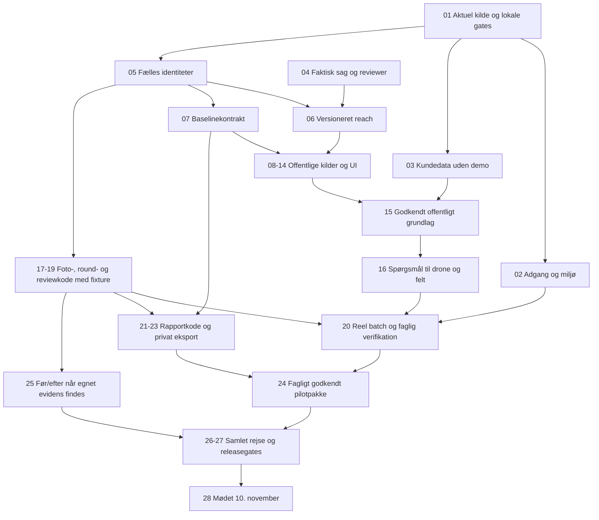

# Haderslev: klassificeret opgaverække frem mod 10. november 2026

Oprettet 13. oktober 2026 efter Jespers instruktion om at begynde arbejdet og løse opgaverne i prioriteret rækkefølge. Dette er den konkrete arbejdsrække til [Haderslev-planen](HADERSLEV_PLAN_2026-11-10.md), baseret på de fire audits. Kodegrundlaget er `JESRI-C/freyra-hub`, branch `codex/gofreyra-p0`, auditeret SHA `97782c0986d13971fd684240662a79eb70296db6`.

**Udførelsescheckpoint 13. oktober 2026:** den aktive appcheckout er nu `udvikling/freyra-hub`, branch `codex/haderslev-delivery`, startet fra den auditerede P0-SHA. Denne opgaverække og de fire oprindelige audits er kopieret ind i appens `docs`. Det oprindelige auditgrundlag bevares; nyere delresultater nedenfor og `docs/HADERSLEV_EXECUTION.md` i appcheckout beskriver udførelsen. **Mødeleverancen 10. november 2026 er ikke accepteret.**

**Leverancerækkefølgen er: afgræns sag → offentlige data først → konkrete spørgsmål til drone/felt → originalupload og verifikation → faglig godkendelse → faktisk rapport og datapakke.** Teknisk uploadkode kan udvikles parallelt, men kundens observationer og rapport må ikke godkendes uden den tilknyttede baseline. Eksisterende optagelser bruges som retrospektiv verifikation med deres rigtige datoer.

## Status og arbejderegler

Auditten og den første plan er **AFSLUTTET som dokumentation**. Det betyder ikke, at appen, datakilderne eller den kommunale leverance er accepteret. Alle implementerings- og leveranceopgaver stod ved oprettelsen **IKKE STARTET**; faktisk igangsat arbejde opdateres i tabellerne og opgaveloggen. Ældre implementering genbruges, og septemberens testresultater er historisk bevis; de lukker ikke en ny acceptopgave.

En opgave skifter til **I GANG**, når konkret implementering eller accept begynder. **DELVIST IMPLEMENTERET** betyder, at en konkret kode-/datadel er bygget og kontrolleret, mens opgavens øvrige kode, runtimekontrol eller faglige accept stadig mangler. Den skifter til **AFSLUTTET** først med fil/commit, kontrolresultat og eventuelt faglig godkendelse i opgaveloggen. En adgangsafhængighed beskrives med konkret manglende miljø/kilde; kodeløsning og fixtureaccept kan stadig gennemføres. `AFVENTER` eller en grøn UI-markering er ikke færdigt arbejde.

- **P0:** nødvendig for den valgte mødeleverance eller dens dataintegritet/adgang. P0-opgaverne gennemføres først.
- **P0 betinget:** nødvendig, hvis mødeleverancen lover den angivne funktion. Fuld Før/Efter-P0 er ikke afsluttet ved kun at levere en FØR-rapport.
- **P1:** efter en fungerende og accepteret kommunal kæde. Et konkret kommunalt behov kan flytte en P1-opgave frem med dokumenteret afhængighed.
- **Udvikling:** kan implementeres og kontrolleres selvstændigt med kontrollerede fixtures. **Sag** og **Faglig accept** kræver faktisk beslutning eller godkendelse fra Jesper/kommunen/en udpeget fagperson. De er ikke kodeopgaver.

Den eksisterende `P0_BACKLOG.md` har bindende sikkerhedsrækkefølge. SEC-/AUTH-gates færdiggøres før private kundeoriginaler indlæses eller kommunale brugere får adgang. Staging var INACTIVE i den oprindelige audit og er siden reaktiveret til ACTIVE_HEALTHY; nye migrationer og den samlede credential-bårne runtimeaccept er stadig ikke gennemført. Lokal kode, offentlige read-only kilder og kontrollerede fixtures kan udvikles parallelt. Kilder, database, appdeploy og release-SHA registreres hver for sig.

### Delresultater og resterende accept

Disse delresultater er læst fra den aktuelle udførelseslog 13. oktober. Et adapterkald til en testregion er ikke en godkendt pilotkilde, og en SQL-testfil er ikke en bestået databasetest.

| Område / opgaver | Faktisk delresultat | Det, der stadig holder opgaven åben |
| --- | --- | --- |
| H01/H03 · 01/02/27 | Ren install af 850 låste pakker på Node 22.14.0/npm 10.9.2; global ESLint exit 0 med 0 errors/23 eksisterende warnings; typecheck, faktor-/checksumkontrol og normalt build består. Seneste root-checkpoint: **79 filer/764 tests PASS** og typecheck PASS. Efterfølgende SheetJS 0.20.3-opdatering kræver ny gatekørsel. Staging er ACTIVE_HEALTHY med tre private buckets og uden observerede dev/self-insert-policies. | Endelig kontrol på aktuel SHA, hosted CI, fresh disposable DB-replay, SQL-/rollematrix, signed download/expiry/revoke, auth/browser og credential-båret Workeraccept mangler. Produktion er ikke ændret. Resten af afhængighedernes sikkerhedstriage er ikke afsluttet. |
| H05 · 03/12 | Automatisk projektseed, skjult fallback ved kundefejl og falske rapport-ID'er fjernet. Eksplicit offline demo kræver demotilstand uden database. Kundetomme reads bevares. Kilder uden konfiguration/geometri eller med fejl giver ingen preview; estimeret NDVI/centroidprøver giver ingen målte projekt-/natur-/CO₂-/vandindikatorer. Fiktive alarmtal, sensorer og live-/integrationsdata skjules i kundesagen. | Historiske kundedata og øvrige moduler er ikke samlet accepteret eller slettet. Reelle raster-/domæneberegninger og hele rapportkædens inputkontrol mangler fortsat. |
| H04 · 05/07/14 | Privat, dateret og immutable baseline-manifest med kilde-/hash-/dækningsstatus, idempotens og auth før sourcefetch. Gemte versioner genhenter ikke kilder; versionslisten begrænses til 30 metadatarecords. Grundlag-fanen viser gemte DMI-/scenedata og synlige sourcefejl. 14 source-render-tests og 3 paneltests består. | Migrationskandidaten `20261013062924_project_baseline_snapshots.sql` har 18 pgTAP-checks, som afventer runtime. Credential-båret gem/genåbn, visuel browseraccept, alle relevante kilder og faglig baselinegodkendelse mangler. Den fulde reach/round/review/rapportmodel er ikke færdig. |
| H06 DMI · 09 | Officielle nedbørsdøgn med station, interval, enhed, QC/gyldighed og versionsspor; begrænset pagination/størrelse/tid og konservativ sum. 25 adaptertests består. Direkte read-only kildekontrol gav 14 værdier fra Vojens Airport i en testregion. | Pilotens datoer, oplandsrelevans og tilstrækkelig 1/7/30-døgnsdækning er ikke godkendt. Manglende eller ufuldstændig dækning giver ingen opdigtet sum. Testregionen er ikke den kommunale sag. |
| H06 Sentinel · 12 | CDSE STAC giver geografiske Sentinel-2 L2A-kandidater med ID/dato/footprint/global skyprocent. 19 adaptertests består; direkte read-only prøve gav 10 kandidater. | Billedbånd og lokal sky-/skygge-/nodata-QA mangler. Scenekataloget er ikke målt NDVI eller dokumentation for lokal brugbarhed. Regulativ, ortofoto/DHM, natur/vandområdeplan og relevante vandmålestationer i 08/10/11/13 er fortsat åbne kildeopgaver. |
| H07 · 16 | Stabile kildebundne spørgeudkast med område, dato, usikkerhed og beviskrav; manglende kilder vises som datahuller. AOI/reference-overlap bruges kun til et konservativt stedmatchspørgsmål. | Vedvarende review-/godkendelsesmodel og navngiven faglig accept mangler. Katalog- eller vejrdata er ikke i sig selv vedligeholdelses-/hydraulikfund. |
| H08/H09 · 17/18 | Serverudtræk af SHA-256/EXIF/XMP fra canonical private JPEG-bytes med 32 MiB/20 sekunders grænse. Prepare/persist-RPCer genkontrollerer medlemskab og aktuel Storage-version. Sekventiel kontrol efter finalize, særskilt modtaget/kontrolstatus, bevaret upload-ID og retry efter reload er implementeret. | Migrationskandidaten `20261013063920_drone_original_validation.sql` har 19 rollback-pgTAP-assertions, som afventer runtime. Strukturkontrol er ikke pixeldecoding eller footprintgodkendelse. Canonical `drone_assets`, dubletbinding på tværs af uploads, round/baseline/spørgsmålsbinding og rigtig 10/120-batch mangler. |

Sagsvalget og revieweren i **04**, faglig baselineaccept i **15**, review i **19–20** og hele programrapporten i **21–24** er fortsat åbne. Den eksisterende Bykær v1.0-pakke er en bevaret faglig reference; den beviser ikke appens rapport- eller eksportflow. Før/efter **25**, samlet kommunerejse **26** og mødeaccept **28** er heller ikke afsluttet.

## Dataklassifikation: hvad må blive til hvilket output?

Hvert resultat skal både have en **evidenstype** og en **kildestatus**. Det forhindrer, at preview, manglende dækning og en lokal observation bliver til et officielt fund eller en måling.

| Klasse | Eksempler fra systemet | Tilladt output og nødvendig kontrol |
| --- | --- | --- |
| Officiel registrering | Vandløbs-ID, regulativ, vandområdeplan, §3-lag, station | Dateret kontekst med udbyder, ID/version og kilde. Ingen registrering er ikke bevis for fravær af beskyttelse. |
| Måling/optagelse | DMI-observation, egnet Sentinel-bånd, originalt dronefoto | Bevar dato, enhed/opløsning, kvalitet, geometri og originalreference. Et foto er en optagelse, ikke automatisk en miljømåling. |
| Beregning | Dokumenteret NDVI, nedbørssum, kontrolleret areal | Metode-/kodeversion, konkrete input og usikkerhed kræves. Beregning fra preview eller sæsonformel må ikke mærkes målt NDVI. |
| Billedobservation | Synlig vegetation, spærring, vandflade | Sporbar original, optagedato, kamera-/objektgeometri, kvalitet og menneskelig review. Ingen sikker art, dybde eller årsag uden relevant bevis. |
| Faglig fortolkning | Prioriteret besigtigelse, vedligeholdelsesforslag | Begrundelse, sted, usikkerhed, næste kontrol og navngiven reviewer. Fortolkning ændrer ikke officiel klassifikation. |
| Model/estimat | HIP, klimaformel, thumbnail-/sæson-NDVI | Særskilt metode og status; ingen skjult overgang til målt eller godkendt fund. |
| Demo/preview | Faste sites, mockrapporter, simuleret livefeed | Kun eksplicit demotilstand. Må ikke indgå i godkendt kundebaseline eller rapport. |
| Manglende/fejlet | Ingen scene, adgangsmangel, timeout, ukendt tid/position | Synlig mangelsstatus og begrundelse. Må ikke erstattes af nul, grøn risiko, projektcentroid eller “online/synket nu”. |

Baselinekildestatus skal mindst skelne `available`, `no_coverage`, `insufficient_resolution`, `needs_access`, `fetch_failed` og `not_requested`. Måle-/observationsstatus er et andet felt. For dronekæden skelnes modtaget, valideret, klar til review, godkendt og afvist. Browserens metadata er preview, indtil serveren har verificeret originalen.

Fælles provenance: projekt/reach-ID og geometriversion; udbyder og endpoint/dokumentreference; datasæt/produkt-ID og version; optage-/observationsperiode og hentetid; CRS/opløsning/enhed; licens/kreditering; svar-/filreference og checksum; metode-/kodeversion; kvalitets- og mangelsflag. Godkendt rapport binder disse ID'er og versioner i ét låst manifest.

## Fase 0 — fælles kilde, sikre data og konkret sag

Der er ingen afhængighed af et bestemt vandløbsnavn for at løse 01–03 og kodekontrakterne i 05–06. Sagen må ikke lydløst antages at være Bykær, Byskov eller Skallebæk.

| Nr. | Opgave / H-ID / eksisterende P0-ID | Klasse | Status | Acceptbevis | Blokerer / kan køre parallelt |
| --- | --- | --- | --- | --- | --- |
| 01 | Etablér aktuel arbejdscheckout, versionskort og frisk lokal gatebaseline. **H01 → QA-P0-01** | P0 · Udvikling | I GANG | Repo/branch/SHA er registreret; ren install, typecheck, relevante tests, lint og build har aktuelle resultater. Kendte globale fejl er synlige. CI/deploy/schema er ikke angivet som accepteret uden deres egne resultater. | Før kodeændringer og ny releaseaccept. Sagsvalg 04 kan ske parallelt. |
| 02 | Inventér migrationer, effektiv RLS, buckets, serversecrets og resterende auth-/download-/cleanupaccept; lav og verificér nødvendige rettelser. **H03 → SEC-P0-01A, SEC-P0-01B, SEC-P0-02, AUTH-P0-01** | P0 · Udvikling/miljø | I GANG | Rolle-/tenantmatrix med to organisationer, ingen self-insert/self-admin, size/MIME/path/owner-regler, privat signer/expiry/revoke og fail-closed routes. Fresh migration replay/pgTAP/DB-lint og reset/logout/refresh/reload knyttet til miljøversion. | Hård gate før private originaler og kundelogin. Offentlig data- og fixturekode 03/05–15 kan bygges parallelt efter 01. Staging er nu ACTIVE_HEALTHY; ny schema-/runtimeaccept mangler. |
| 03 | Fjern opdigtet startdata og skjult demo-fallback i kundesager; stop falsk online-/synktid, bevar tomme lister. **H05 → ny dataintegritetsopgave; understøtter REPORT-P0-01** | P0 · Udvikling | DELVIST IMPLEMENTERET | Almindelig projektoprettelse giver ingen seed-sites på 12,4/3,1 ha, ingen fiktive indikatorer og ingen kilde-sync uden fetch. Tomme målinger/alarmer forbliver tomme. Demo kræver eksplicit valg. Regression viser, at kundedata ikke forveksles med demo. | Før baselinegodkendelse 15 og rapport 21. Kan løses uden kommunens sagsvalg, parallelt med 02. **Første konkrete produktkodeopgave efter 01.** |
| 04 | Fastlæg beslutningsspørgsmål, pilotvandløb, delstrækning/endepunkter, regulativ-/indsatsreference, relevante datoer, dataset og reviewer. **H02 → GEO-P0-02; BA-P0-01 datasæt; REPORT-P0-01 formål** | P0 · Sag | IKKE STARTET | Godkendt sagskort med navn, geometri, ID'er, strækning, kommunalt formål og navngiven faglig reviewer. Skel mellem myndighedsprojekt og større flyvekorridor. Foreløbig arbejdsperiode mærkes foreløbig. | Blokerer konkret pilotindlæsning og faglig accept; blokerer ikke generiske kontrakter/fixturekode. Jesper/kommunen vælger sagen. |
| 05 | Definér fælles identiteter og transitions for reach-version, baseline, spørgsmål, round, foto, observation, review og rapportversion. **H02/H04/H07–11 → GEO-P0-01/02, BA-P0-01, MEAS-P0-01, REPORT-P0-01** | P0 · Udvikling | DELVIST IMPLEMENTERET | Valideret datakontrakt og migrationsplan; alle relationer har same-project/same-tenant-gates. Ingen godkendelse kan referere til mutable preview eller forkert projekt. Kontrollerede fixtures dækker FØR uden EFTER. | Efter 01. Fælles kontrakt før parallel baseline/upload/rapportudvikling. Kode kan udvikles før 04; faktisk kundebinding venter på sagen. |
| 06 | Versionér geometri og implementér entydig officiel delstrækning, stationering/reference og samtidighedskontrol. **H02 → GEO-P0-01, GEO-P0-02** | P0 · Udvikling | IKKE STARTET | Gyldig geometri/reach genåbnes uændret; fejl/ukendt CRS afvises; nyt reach giver ny version; parallel første write skaber ikke dublet; source-/hashmanipulation afvises. Autoritativt pilotvalg valideres efter 04. | Efter 05; konkret accept efter 04/02. Kan køre med baselineadaptere. |

## Fase 1 — offentligt stedgrundlag før droneverifikation

Alle P0-kilder skal enten være hentet/importeret med bevis eller have en synlig dokumenteret mangelsstatus. En versionsstyret officiel filimport er en adapter med samme provenancekrav; den mærkes importeret og tæller ikke som automatiseret API-hentning.

| Nr. | Opgave / H-ID / eksisterende P0-ID | Klasse | Status | Acceptbevis | Blokerer / kan køre parallelt |
| --- | --- | --- | --- | --- | --- |
| 07 | Implementér projektbundet kildekatalog, source-fetch/importlog og immutable baseline-snapshot. **H04 → MARS-P0-01 katalog/provenance; ny baselinekontrakt** | P0 · Udvikling | DELVIST IMPLEMENTERET | Snapshot har reach-version, perioder, source-ID'er, licens, filer/svar/checksum og alle mangelsstatusser. Genåbning kræver ingen ny fetch; en ny fetch skaber ny baselineversion. Rolle-/tenantnegative tests består. | Efter 05; reel baseline efter 04/06. Kontrakten frigør 08–13 til parallel kodeudvikling. |
| 08 | Tilslut officiel hydroreference og kommunale dokumenter som dateret sagsgrundlag. **H06 → GEO-P0-02 + MARS-P0-01 provenanceprincip** | P0 · Udvikling/data | IKKE STARTET | Verificeret fil/API-source og afgrænsning; dokument-ID/version/side og stationering fremgår. Manglende regulativ vises; ingen regulativoverholdelse erklæres uden grundlag. | Efter 07; konkret valg efter 04/06. Dokumenttilvejebringelse kan kræve kommunen; adapterkode kan fortsætte. |
| 09 | Reparér DMI til historiske survey-/indsatsdatoer med stations-/cellevalg og 1/7/30 døgns nedbør. **H06 → ny dateret DMI-slice i baseline** | P0 · Udvikling/data | DELVIST IMPLEMENTERET | Faktisk serie, query, station/afstand/celle, enheder, tidszone og tidsdækning gemmes. Facitfixture kontrollerer summer; missing observationer bliver ikke nul; timeout giver fetch_failed. Flyvedato er adskilt fra hentetid. | Efter 07; repræsentative kildekald uden kundedata kan køre parallelt med øvrige adaptere. |
| 10 | Tilslut dateret ortofoto og DHM med adgangs-/importadapter og visnings-/analyseadskillelse. **H06 → MARS-P0-01 lagkontrakt + ny rasteradapter** | P0 · Udvikling/data | IKKE STARTET | Source-år/optagetid, pixel/gridafstand, CRS/højdesystem, dækningsområde og kreditering gemmes. WMS er visning; analysemåling kræver faktisk raster. Manglende konto/adgang vises som needs_access. | Efter 07. Afhænger af faktisk Datafordeler-adgang eller officiel import, ikke af droneupload. |
| 11 | Tilslut gældende vandområdeplan og §3/naturlag med korrekt geometri og version. **H06 → MARS-P0-01** | P0 · Udvikling/data | IKKE STARTET | Kilde/endpoints/lag/licens er verificeret; planversion og basisanalyse holdes adskilt. Polygonoverlap/afstand har faktisk metode. Upstreamfejl eller ingen registrering bliver ikke nul natur/grøn risiko. Ukendt officiel tilstand bevares. | Efter 07. Kan køre parallelt med 09–10/12–13. |
| 12 | Saml Sentinel-2-sceneinventar, lokal sky/skygge/nodata-QA og sikre beregningsregler. **H05/H06 → ny Sentinel-kvalitetsslice; MARS-P0-01 kildeprincip** | P0 · Udvikling/data | DELVIST IMPLEMENTERET | Produkt-ID, periode, AOI, fravalg og lokal brugbarhed gemmes. Thumbnail/sæsonfallback gemmes aldrig som målt ndvi_mean/vegetation_index. Beregning har egnede bånd/input/metode; ingen brugbar scene er gyldigt resultat. | Efter 07. Efter 03 må simulerede input ikke godkendes. Konto/kvoter kan kræves for download/processing; katalogkode kan fortsætte. |
| 13 | Inventér relevante officielle målestationer og importér tilgængelig serie, ellers dokumentér hullet. **H06 → ny stationsadapter; MEAS-P0-01 når målinger indgår** | P0 inventar · Udvikling/data | IKKE STARTET | Stations-ID, geografisk forbindelse/tilløb, parameter, periode, enhed, metode og rettigheder er registreret. Nærmeste station kobles ikke automatisk til bækken. Ingen serie giver dokumenteret datamangel. | Efter 07/06; fuld biologisk/kemisk/hydrometrisk integration er P1 uden konkret pilotbehov. |
| 14 | Byg baselinebrugerflade med hent/import, datoer, lag, mangler og versionsvalg. **H04/H06 → ny baseline-UI; GEO-P0-01/02 kortbinding** | P0 · Udvikling | DELVIST IMPLEMENTERET | Grundlag kan gennemgås før første dronefoto. Reload viser samme version; sourcefejl er forståelig; “online/synket” afledes kun af rigtig log. Projektets fremdrift kommer fra gemte records. | Efter 07; kan bygges med fixtures under 08–13. |
| 15 | Gennemgå og godkend baseline på den valgte pilotstrækning. **H04–06 → baselineaccept** | P0 · Sag/faglig accept | IKKE STARTET | Dækning, datoer, metode og begrænsninger er gennemgået; godkendelsen binder præcis reach-/baselineversion og reviewer. Alle P0-kilder er hentet/importeret eller har dokumenteret mangelsstatus. | Efter 03/04/06–14 og sikker persistens 02. Blokerer faglig verifikation/rapportgodkendelse. Udvikling kan forberede fixtures videre. |
| 16 | Opret prioriteret drone-/feltverifikationsplan fra baseline. **H07 → ny spørgemodel; BA-P0-01 kildeadskillelse** | P0 · Udvikling + faglig accept | DELVIST IMPLEMENTERET | Hvert spørgsmål har stabilt ID, baselinekilde, dato, område, hypotese, prioritet, usikkerhed og nødvendigt bevis. Mulige resultater: understøttet, afkræftet, ikke afgørligt eller kræver besigtigelse. Retrospektive billeder er mærket retrospektive. | Kode efter 05/07; konkret plan efter 15. Fagperson godkender spørgsmål/metode, udvikling leverer UI/persistens. |

## Fase 2 — originale billeder, observationer og review

Første vertikale test er ét kontrolleret originalfoto fra round og baseline til et ægte rapportudkast. Derfra udvides til 10 og 120 filer og det aftalte pilotdatasæt. Rigtig privat pilotimport kræver 02; baselinekvalitet og spørgebinding kræves før faglig godkendelse.

| Nr. | Opgave / H-ID / eksisterende P0-ID | Klasse | Status | Acceptbevis | Blokerer / kan køre parallelt |
| --- | --- | --- | --- | --- | --- |
| 17 | Servergenudtræk originalhash, EXIF, optagetid/tidszonestatus, kvalitet og canonical fotoaktiv; idempotente jobs/retry. **H08 → BA-P0-01; SEC-P0-02 reserveret metadata** | P0 · Udvikling | DELVIST IMPLEMENTERET | Originale bytes kontrolleres server-side; samme upload/hash skaber ikke ny original; malformed JPEG/metadata og processingfejl er synlige. Ukendt tidszone og GPS bevares ukendt. Browserpreview kan ikke skrive valideret status. | Efter 05 og relevant 02-kildekontrakt; kan udvikles med fixture samtidig med offentlig baseline. Privat runtimeaccept venter på 02. |
| 18 | Knyt FØR-upload til round, baseline og spørgsmål; thumbnails, liste/kort og per-fil-status med resume/dubletter. **H09 → BA-P0-01 + SEC-P0-02 Storage/intents** | P0 · Udvikling | DELVIST IMPLEMENTERET | Reload bevarer round/batch; thumbnail er afledt aktiv; kamera og objekt er adskilt; fotos uden GPS kan reviewes uden centroidfallback. Afbrudt 10/120-batch genoptages uden ekstra originaler eller tab. | Efter 17/05; spørgsmålbinding efter 16. Kan bygges parallelt med rapportskabelonen. |
| 19 | Gem konservativ observation/analyse med metode-/inputversion og menneskelig reviewtransition. **H09 → BA-P0-01; MEAS-P0-01 ved målinger** | P0 · Udvikling | IKKE STARTET | Godkend/ret/afvis har reviewer, tid, begrundelse og original-/baseline-ID. Kandidater er kandidater. Fejlet analyse er aldrig klar. Offentlige artsforekomster er kontekst; ingen RGB-afledning af usynlig biomasse, dybde eller hydraulik. | Efter 16–18. Ét foto skal gennemløbe review og udkast 21, før batchudvidelsen accepteres. |
| 20 | Importér og review reel pilotbatch, inklusive geografisk opdeling og eksisterende lokale registre. **H09 → BA-P0-01 datasæt-/reviewaccept** | P0 · Udvikling + faglig accept | IKKE STARTET | 120-fils resume-/dubletaccept og aftalt reel batch dokumenteret; modtaget/valideret/reviewet/afvist tælles særskilt. 397 JPEG bliver ikke 397 observationer: materialet har 274 unikke fotos. Bykær, Barsbøl, Ørsted Å og sammenløb holdes adskilt. | Efter 02/04/15–19 og første-foto-udkast 21. Fagperson afgør fund; den eksisterende v1.0-leverance bevares som reference. |

## Fase 3 — programgenereret beslutningsrapport og låst aflevering

Rapportkode og snapshot-layout kan udvikles tidligt efter 05/07. Nummereringen her beskriver endelig accept: en status `approved` eller `exported` er ikke et leveret dokument. Et udkast kan gennemløbes på første fixturefoto, mens reel batchreview fortsætter.

| Nr. | Opgave / H-ID / eksisterende P0-ID | Klasse | Status | Acceptbevis | Blokerer / kan køre parallelt |
| --- | --- | --- | --- | --- | --- |
| 21 | Implementér selvstændig FØR-rapport fra struktureret projekt/baseline/round/review med beslutningsside og evidensbilag. **H10 → REPORT-P0-01** | P0 · Udvikling | IKKE STARTET | Første reviewede foto giver rigtigt projektbundet udkast i programmet; ikke hardcodet Skallebæk, mock-KPI eller artsfund fra kandidat. Manglende obligatoriske input giver fejl. Tekst viser datamangler; ingen udokumenteret “signifikant tendens/ingen risiko”. | Kontraktkode efter 05/07; første-fotoaccept efter 19. Endeligt pilotudkast efter 20. Kan bygges samtidig med 17–19. |
| 22 | Implementér immutable rapportversion, inputmanifest, faglig godkendelse og regeneration som ny version. **H11 → REPORT-P0-01; SEC-P0-02 adgang** | P0 · Udvikling | IKKE STARTET | Godkendelse binder geometri, baseline, rounds, originale/afledte billeder, observationer, metode, reviewer og inputhash. Senere data/review kan ikke ændre godkendt snapshot. Rollen og tiden er serverregistreret. | Efter 21 og kontrakt 05; negative samtidigheds-/adgangstests. Kan kodeudvikles med fixtures før reel faglig accept. |
| 23 | Generér og arkivér faktisk PDF+manifest+CSV+GeoJSON i privat Storage med checksum, retry og download efter reload. **H11 → REPORT-P0-01 + SEC-P0-02** | P0 · Udvikling | IKKE STARTET | Download er en faktisk gemt fil. Eksporterne har samme projekt-/rapportversion og observations-ID'er. PDF-hash matcher lagret blob; retry efter fejl laver ikke falsk exported-status; signer bruger eksakt autoriseret databasepath. | Efter 21–22; runtime/privat accept kræver 02. Blokerer aflevering. |
| 24 | Faglig gennemgang af prioriterede steder/handlinger og læsbar PDF/datapakke, derefter godkendelse af pilotversion. **H10–11 → REPORT-P0-01 faglig accept** | P0 · Faglig accept | IKKE STARTET | Reviewer bekræfter sted, dato, bevis, usikkerhed og næste handling. Eksport/kort/register matcher. PDF er visuelt gennemgået; ingen arts-/effekt-/arealpåstand overstiger evidensen. Godkendt version og checksum er dokumenteret. | Efter 04/15/20–23. Faglig godkendelse kan ikke erstattes af udviklerens test. |
| 25 | Survey rounds og reviewede før/efter-par med sammenlignelighed, vejrforskelle og varigt udvalg. **H12 → BA-P0-01; MEAS-P0-01 ved målinger; REPORT-P0-01 før/efter** | P0 betinget · Udvikling + faglig accept | IKKE STARTET | To rounds/datasæt og par genfindes efter reload. Afstand/retning/tid/reviewer/vejr og afviste par fremgår. Swipe/side-by-side/opacity virker. Egnede par giver kun den tilladte observation; mindst 90 % af P0-fotopunkter er godkendte ved fuld BA-P0-01-accept. Baseline ændres ikke. | Efter 18–19/21 og faktisk egnede EFTER-input. Blokerer før/efterløfte; selvstændig FØR-pakke 24 kan afleveres uden 25. Den fulde eksisterende P0-kontrakt kræver 25. |

## Fase 4 — releaseaccept og mødet

| Nr. | Opgave / H-ID / eksisterende P0-ID | Klasse | Status | Acceptbevis | Blokerer / kan køre parallelt |
| --- | --- | --- | --- | --- | --- |
| 26 | Frisk samlet rejse med ny konto/session og rolle-/organisationnegative cases på faktisk release-SHA. **H13 → QA-P0-01, SEC-P0-01A/01B/02, AUTH-P0-01 og relevante GEO/BA/REPORT** | P0 · Udvikling/accept | IKKE STARTET | Projekt → offentligt grundlag → spørgsmål → originaler → review → godkendelse → download består. Reset/logout/refresh/reload samt privat adgang og inputlås genkontrolleres. Samme kode/schema/deploy er dokumenteret. Sensor-ingest/cron bliver ikke stiltiende accepteret. | Efter 01–24; også 25 hvis før/efter indgår. Blokerer betegnelsen færdig mødeversion. |
| 27 | Afslut CI-/migration-/lint-/advisorygates og releasebeslutning på samme SHA. **H01/H03/H13 → QA-P0-01 + SEC/AUTH** | P0 · Udvikling/release | I GANG | Ren install, typecheck, relevante tests, faktor-/checksumkontrol, build, migrationsaccept og browseraccept er aktuelle. Berørte filer har 0 lintfejl; global P0-lintgate kræver exit 0. Advisories er triageret/løst efter releasekrav. Hosted CI-resultat er registreret. | Løbende efter 01, endelig efter 26. Ingen historiske grønne tests som ny evidens. |
| 28 | Stabiliser 7–9 november og forbered konkret mødegennemløb, godkendt pakke, kendte mangler og næste kundekrav. **H14 → ny mødeopgave** | P0 · Udvikling + Jesper | IKKE STARTET | Gentaget demoagenda viser sag → baseline → verifikation → prioriterede handlinger → faktisk download. Den godkendte pakke kan genfindes; mødemateriale har præcis release-/teststatus. | Efter 24/26–27. Hvis gate ikke består, dokumentér afgrænset teststatus; kald ikke appen lanceret. Kravliste kan samles løbende. |

## Fase 5 — øvrige moduler og udvidelser efter accepteret kæde

Disse opgaver er klassificeret, så de ikke forsvinder, når vandløbspiloten prioriteres. De har egne outputkrav; skærmene alene er ikke accept. Sensor-/ingestsikkerhed i eksisterende SEC-P0-ID'er gælder også, hvis modulerne ikke bruges til mødet.

| Nr. | Opgave / mapping | Klasse | Status | Acceptbevis / konkret output | Afhængighed |
| --- | --- | --- | --- | --- | --- |
| 29 | Flere automatiske offentlige adaptere: fuld Kemidata/VanDa/hydrometri, Sentinel-1 og HIP. **H06 udvidelse; MARS-P0-01 princip** | P1 · Udvikling/data | IKKE STARTET | Reelle lokale serier/raster med rettigheder, metode, datodækning og model/måling-skille; genåbnes fra baselineversion. | 07–15 og dokumenteret kommunalt spørgsmål. |
| 30 | Kontrolleret ortomosaik/COG/fotogrammetri, video/SRT/ZIP-import og areal-/ændringsmåling. **BA-P0-01 / MEAS-P0-01 udvidelse** | P1 · Udvikling + faglig accept | IKKE STARTET | Faktisk behandlet produkt med kontrolpunkter/QA, metadata og tolerancer; upload-GPS sælges ikke som footprint eller præcis måling. | 17–25, egnet flyvning og målemetode. Krævede konkrete målinger løftes til P0 i valgt scope. |
| 31 | Virkelig sensor-/monitoringrejse: enheder, kvalitet, alarmer, automatiske jobs og opfølgning. **SEC-P0-01A/01B + MEAS-P0-01** | P1 funktion · Udvikling | IKKE STARTET | Målt serie med enheder/kalibrering/kvalitetsfravalg; rigtig ingest/scheduler og historik; ingen simuleret livefeed eller demoalarmer i kundesag. | Sikkerhedsgates 02 og reelt måle-/driftsbehov. Endpointprovisionering er fortsat egen P0-gate. |
| 32 | Lavbund med selvstændig baseline/målt effekt, faktorer, ledger og revisionsfast rapport. | P1 · Udvikling + faglig accept | IKKE STARTET | Reelt lavbundsprojekt giver kildebelagt revisionspakke; lovet/målt, faktorversion og usikkerhed er adskilt. | 22–27 genbruges som principper; egen domæneaccept og kundedata. |
| 33 | DecisionsIQ: prioritering/scenarier baseret på godkendte observationer og kundens kriterier. | P1 · Udvikling + faglig accept | IKKE STARTET | Hver anbefaling kan spores til godkendt input, kriterium og antagelse. Et generisk scorekort er ikke beslutningsbevis. | 19–24 og kommunale beslutningskriterier. |
| 34 | ESG/Impact/credits kun med passende metoder og dokumenterede resultater. | P1 · Udvikling + faglig accept | IKKE STARTET | Godkendte målinger og kildefaktorer kan spores til rapportversion; effekt-/creditpåstand kræver domænets konkrete bevis. | Dokumenteret efterspørgsel, egen metode-/måleaccept. |
| 35 | Organisationsdrift, invitation/deling, standardskabeloner og skaleret eksport; øvrige adminfunktioner. **SEC-P0-02 / AUTH-P0-01** | P1 funktion · Udvikling | IKKE STARTET | Gem-knapper persisterer, invitation/rolleændring har faktisk backend, deling har autoritativ relation og audit. Ingen mock-2FA/readiness som driftstatus. | 02/22–27 og konkret flerbrugerbehov. Billing kræver eget produktkrav. |
| 36 | Redigerbar DOCX og kommunal journal-/GIS-afleveringsintegration. **REPORT-P0-01 udvidelse** | P1 · Udvikling | IKKE STARTET | Redigerbar eksport viser oprindelig rapportversion og redigeringsstatus; redigeret fil fremstår ikke som uændret systemgodkendt PDF. Faktisk kommunalt modtagelsesformat verificeret. | 23–24 og kommunens afleveringskrav; kan løftes frem, hvis nødvendigt til mødet. |

## Samlet H-/P0-mapping

Dette er sporbarhed til den eksisterende backlog, ikke en påstand om, at gamle opgaver er afsluttet eller erstattet. Nye baseline-/DMI-/kvalitetsslices føjes ind under sikkerheds- og dataintegritetsgates. MARS-P0-01's konkrete MARS-adapter lukkes kun ved dens egne capabilities-/lag-/livekrav; et generelt kildekatalog er ikke nok.

| Haderslev-ID | Arbejdsnumre | Eksisterende P0-ID / ny slice |
| --- | --- | --- |
| H01 | 01, 27 | QA-P0-01, release-/miljøversionskort |
| H02 | 04–06 | GEO-P0-01, GEO-P0-02 |
| H03 | 02, 26–27 | SEC-P0-01A, SEC-P0-01B, SEC-P0-02, AUTH-P0-01 |
| H04 | 05, 07, 14–15 | Ny baseline-/snapshot-slice; MARS-P0-01 katalog/provenance |
| H05 | 03, 12, 15 | Ny dataintegritet-/demo-/satellitkvalitet-slice |
| H06 | 08–15 | MARS-P0-01; GEO-P0-02; nye DMI/raster/stationsadaptere |
| H07 | 16 | Ny verifikationsplan; BA-P0-01 offentlig kontekst |
| H08 | 17 | BA-P0-01 metadata/canonical assets; SEC-P0-02 backendstatus |
| H09 | 18–20 | BA-P0-01; MEAS-P0-01 når målinger indgår |
| H10 | 21, 24 | REPORT-P0-01; faglig rapportaccept |
| H11 | 22–24 | REPORT-P0-01; SEC-P0-02 Storage/adgang |
| H12 | 25 | BA-P0-01; MEAS-P0-01; REPORT-P0-01 før/efter |
| H13 | 26–27 | QA-P0-01 og genaccept af relevante sikkerheds-/auth-/domænekrav |
| H14 | 28 | Møde-/opfølgningsopgave |

## Afhængigheder og parallel fremdrift

Pilen fra 25 til 26–27 gælder, når før/efter er del af leverancen. De tekniske parallelspor ændrer ikke den faglige rækkefølge: offentligt grundlag godkendes før drone-/feltverifikation, og godkendt evidens ligger før godkendt rapport.

**Næste prioriterede accept:** 02/27's fresh disposable DB-replay og begge nye SQL-suiter, derefter ét syntetisk originalfoto og credential-båret baseline-gem/genåbn på samme schema/app-SHA. Private pilotoriginaler venter på adgangsaccept. **Næste sammenhængende kodeopgave:** færdiggør de manglende identiteter i 05 og kæden 17–19 med canonical foto, round/baseline/spørgsmålsbinding og en gemt reviewbeslutning, så 21 kan danne det første faktiske projektbundne FØR-udkast. De resterende offentlige kildeadaptere 08/10/11/13 kan bygges parallelt; 04's sagsvalg og 15's faglige baselinegodkendelse kan ikke erstattes af fixturekode. Først derefter følger reel batch og låst aflevering.

## Opgavelog og acceptbeviser

For hver ændring registreres opgavenummer, status, filer/commit, faktisk testkommando/resultat, miljø/SHA, resterende afhængighed og næste opgave. Kun afsluttede resultater tæller som afleveringsfremdrift. Teknisk implementering og faglig pilotaccept kan logges som to separate delresultater; den samlede opgave er åben, til begge krævede dele består.

Loggen er kronologisk. De første scoped testresultater nedenfor er bevaret som delresultater; tabellen ovenfor og appens `HADERSLEV_EXECUTION.md` beskriver det nyere checkpoint. Det nyere root-checkpoint har 79 filer/764 tests PASS; efterfølgende SheetJS-opdatering kræver ny gatekørsel, som registreres i udførelsesloggen før releaseaccept.

| Dato | Nr./område | Status | Faktisk bevis | Næste arbejde |
| --- | --- | --- | --- | --- |
| 13.10.2026 | Audit, hovedplan og opgaveklassifikation | AFSLUTTET · dokumentation | [Plan](HADERSLEV_PLAN_2026-11-10.md), fire audits nedenfor og den eksisterende P0-backlog læst på `97782c0`. Ingen produktkode eller miljøaccept i denne klassifikation. | 01, derefter 03; parallel 02/04 og fælles kontrakt 05. |
| 13.10.2026 | 01 / aktuel kodecheckout og nye lokale kontroller | I GANG | Arbejdet foregår nu i `udvikling/freyra-hub`. `npm run typecheck` exit 0 efter livekildeslicen; dens otte berørte/nye filer har scoped ESLint exit 0. Samlet CI/build/migrations-/miljøaccept kræver egne resultater. | Saml alle gatebeviser på den faktiske arbejds-/release-SHA; fortsæt kontrakt og baseline. |
| 13.10.2026 | 03/H05 / livekilder uden falsk preview | I GANG · delresultat lokalt verificeret | `live-data.functions.ts`, `live-data-client.ts` og DMI/Miljøportal/Dataforsyningen/Copernicus-klienterne returnerer `data:null` ved manglende konfiguration/geometri/key og kildefejl. Preview kræver eksplicit offline demo. Gyldig tom DMI er `no_coverage`; andre reelle vejrparametre er gyldige uden temperatur. §3-fejl giver ikke nul natur, HTTP429 og timeout forbliver fejl. To målrettede testfiler: **49/49 PASS**. Ingen schema-/livewrites eller leveranceaccept. | Saml H05's øvrige seed/fallback-/satellit-/miljøkontekstændringer; byg derefter den versionsfaste baseline i 05/07. |
| 13.10.2026 · nyere checkpoint | 03/05/07/09/12/14/16/17/18 · H04–H08 og første H09-UI | DELVIST IMPLEMENTERET | De konkrete kode-, adapter-, live-read- og lokale testbeviser står i checkpointtabellen ovenfor. De to nye migrations-/SQL-testkandidater er skrevet, men ikke runtimeaccepteret. De fire oprindelige audits bevares som historik og kopieres sammen med plan/opgaver ind i appcheckout. | DB- og credentialaccept; manglende offentlige kilder; canonical foto/round/review; valgt sag/reviewer; faktisk FØR-rapport og immutable privat eksport. |
| 13.10.2026 · nyere checkpoint | 01/02/27 · lokale og eksterne releasegates | I GANG | Global lint/typecheck/faktor-checksum/build og den seneste samlede suite (79 filer/764 tests) består før den efterfølgende SheetJS 0.20.3-opdatering. Isoleret staging er reaktiveret. Secretsfri disposable LOCAL database-CI er defineret; ingen linked/production reset eller livepersistens er påstået. | Endelig suite på aktuel SHA, første hosted CI/DB-job, staging schema/app-match, server-only adgang, Auth/Storage/browser og advisorytriage. |

## Grundlag

- [GitHub/Lovable og versionskort](haderslev-audit/github-og-lovable.md)
- [Platformfunktioner og konkrete kodefejl](haderslev-audit/platform-funktioner.md)
- [Eksisterende rapport/drone og fagligt output](haderslev-audit/rapport-og-drone.md)
- [Offentlige datakilder, rettigheder og acceptkrav](haderslev-audit/offentlige-data.md)
- [Eksisterende P0_BACKLOG på auditeret SHA](https://github.com/JESRI-C/freyra-hub/blob/97782c0986d13971fd684240662a79eb70296db6/docs/P0_BACKLOG.md)
- [Vandløbsmetodekontrakten](https://github.com/JESRI-C/freyra-hub/blob/97782c0986d13971fd684240662a79eb70296db6/docs/4dm-watercourse-monitoring-method.md)
