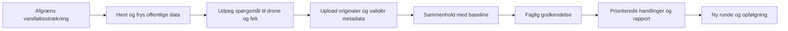

# Freyra status og plan frem mod Haderslevmødet 10 november 2026

Status 13. oktober 2026. Mødedatoen er oplyst af Jesper. Planen er et arbejdsgrundlag til færdiggørelse af den eksisterende GoFreyra-platform og dens kommunale vandløbsleverance.

Freyra har en omfattende brugerflade, flere fungerende dele og en selvstændig faglig Bykær Bæk-leverance. Den samlede rejse gennem programmet fra offentlige data til droneverifikation og godkendt kommunerapport er endnu ikke færdig. Det vigtigste arbejde de næste fire uger er at få denne rejse til at fungere på én reel sag og gøre dens output konkret for kommunen.

Målet til 10. november er en gennemprøvet vandløbspilot i programmet med en faktisk downloadbar beslutningspakke. Generel produktionslancering kræver de samme dokumenterede kvalitets- og adgangskrav; mødedatoen er ikke i sig selv en godkendelse af uafsluttede funktioner. Tidsplanen er et mål, ikke et verificeret udviklingsestimat. Kapacitet, datadækning og resterende migrationsarbejde skal afklares i første milepæl.

## Udførelsescheckpoint 13. oktober 2026

Jesper har godkendt at udføre de klassificerede opgaver i rækkefølge. Den aktive appcheckout er `udvikling/freyra-hub`, branch `codex/haderslev-delivery`, startet fra P0-SHA `97782c0986d13971fd684240662a79eb70296db6`. Planen, [den prioriterede opgaverække](HADERSLEV_OPGAVER.md) og de fire oprindelige audits er nu lagt i appens `docs`. Den løbende udførelseslog er `docs/HADERSLEV_EXECUTION.md` i appcheckout.

Planens oprindelige status- og versionstabeller nedenfor samt auditnoterne bevares som **historisk audit før implementeringen**. Deres INACTIVE-staging og tidligere lint-/testtal er ikke den nyeste drifts-/kodestatus. Nyere dokumenterede delresultater er:

| Område | Aktuel implementeringsstatus | Manglende accept |
| --- | --- | --- |
| H01/H03 | Aktuel arbejdsbranch og ren låst installation. Seneste root-checkpoint: **79 testfiler/764 tests PASS**, typecheck PASS og global lint **0 errors/23 eksisterende warnings**. Faktor-/checksumkontrol og normalt build består i det foregående checkpoint. Isoleret staging er reaktiveret til ACTIVE_HEALTHY. | Root opdaterer efterfølgende SheetJS til 0.20.3; gates skal gentages efter ændringen. Fresh disposable DB-replay/SQL-suiter og første hosted CI er endnu ikke gennemført. Credential-båret Auth/Storage/Worker/browseraccept og samlet advisorytriage mangler. Produktion er ikke ændret. |
| H05 | **DELVIST IMPLEMENTERET:** kundeseed, skjult fejlfallback, fiktive rapport-ID'er, KPI'er og live-/sensordata er fjernet eller begrænset til eksplicit offline demo. Kilde-/konfigurationsfejl giver ikke preview eller nul. Estimeret NDVI/centroidprøver er blokeret som kundemålinger. | Øvrige moduler og historiske data er ikke samlet accepteret. Reelle raster-/domæneberegninger og den fulde rapport-inputkontrol mangler. |
| H04 | **DELVIST IMPLEMENTERET:** dateret privat, immutable baseline-manifest, versionsvalg, kilde-/dækningsstatus, auth/idempotens og visning af gemte DMI-/scenedata. 14 source-render-tests og 3 paneltests består. | Kandidatmigration med 18 pgTAP-checks afventer runtime. Credential-båret gem/genåbn, visuel browseraccept, komplet sagsspecifikt grundlag og faglig baselinegodkendelse mangler. |
| H06 | **DELVIST IMPLEMENTERET:** historisk DMI-nedbør (25 adaptertests) og CDSE Sentinel-2 L2A-katalog (19 adaptertests). Faktiske read-only prøver gav 14 DMI-værdier ved Vojens Airport og 10 scenekandidater i en testregion. | Testregionen er ikke en godkendt pilot. Oplands-/periodeaccept, regulativ, ortofoto/DHM, natur/vandområdeplan og vandmålestationer mangler. Sentinel-bånd og lokal sky-/skygge-/nodata-QA er ikke hentet eller accepteret; scenekataloget er ikke målt NDVI. |
| H07 | **DELVIST IMPLEMENTERET:** stabile kildebundne spørgeudkast med område, dato, usikkerhed, mangler og beviskrav. | Vedvarende faglig godkendelse/review og konkret pilotplan mangler. Ingen vedligeholdelses- eller hydraulikfund udledes alene fra vejret eller kataloget. |
| H08 / første H09-UI | **DELVIST IMPLEMENTERET:** server-SHA-256/EXIF/XMP fra private JPEG-originaler, 32 MiB/20 sekunders grænse, medlemskabs-/aktuel Storage-versionskontrol, særskilt upload-/kontrolstatus og retry efter reload. | Kandidatmigration med 19 rollback-pgTAP-assertions afventer runtime. Canonical drone_assets, dubletbinding på tværs af uploads, round/baseline/spørgsmålsbinding og 10/120-batchaccept mangler. Strukturkontrol er ikke pixeldecoding, footprint eller faglig godkendelse. |

**Leverancen er fortsat ikke klar.** Valgt kommunal delstrækning, beslutningsspørgsmål og reviewer skal fastlægges. Reviewkæden, selvstændig programgenereret FØR-rapport, låst godkendelse, faktisk privat PDF/manifest/CSV/GeoJSON og samlet E2E er endnu åbne. Bykær v1.0 bevares som faglig reference. Udførelsesrækkefølgen og deadline **10. november 2026** fastholdes: offentlige data først → drone-/feltverifikation → fagligt godkendt rapport.

## Hvad kommunen skal modtage

Kommunen skal kunne finde ud af, hvor den bør besigtige eller følge op, hvilket grundlag der støtter anbefalingen, hvad der er ændret mellem optagelserne, og hvad der stadig kræver måling eller lokal kontrol. Den foreløbige produktretning er derfor prioritering og dokumentation af vandløbsindsatser. Kommunens præcise beslutningsspørgsmål er endnu ikke oplyst.

| Leverance fra programmet | Indhold | Praktisk anvendelse |
| --- | --- | --- |
| Dateret stedgrundlag | Valgt vandløbsstrækning, offentlige kort, terræn, plan- og naturkontekst, vejrhistorik, satellitoptagelser og datamangler | Forstå den konkrete sag og planlæg næste undersøgelse |
| Liste til drone og feltverifikation | Sted, kildeindikation, spørgsmål, usikkerhed og nødvendigt bevis | Flyv og besigtig med et klart formål |
| Kort og observationsregister | Godkendte observationer, foto-ID, optagedato, geografisk sikkerhed, kilder og reviewer | Efterprøv vurderingen og genfind lokaliteten |
| Prioriterede handlinger | Hvad, hvor, hvorfor, prioritet, nødvendig lokal afklaring og foreslået ansvarlig funktion | Bestil besigtigelse, planlæg vedligeholdelse eller afklar naturforbedring |
| Godkendt rapport og datapakke | PDF, CSV, GeoJSON og manifest over låste input; redigerbar eksport efter behov | Journalisering, intern behandling, GIS og senere sammenligning |

Rapporten skal åbne med en kort beslutningsside. Et stedkort eller en anbefaling skal altid have stedreference, dato, observation, bevis, usikkerhed og næste handling. Generelle ESG-tal og dekorative AI-resuméer må ikke erstatte disse felter.

De eksisterende Bykær-poster PL02/PL03 og PL05/PL13 viser allerede et anvendeligt format: første henholdsvis anden prioritet for besigtigelse, med nødvendige lokale kontroller. De er eksisterende billedbaserede vurderinger, ikke nye verificerede plantningsbeslutninger. [Rapportaudit](haderslev-audit/rapport-og-drone.md).

## Hvor langt programmet var ved den oprindelige audit

Status er vurderet ud fra kode, GitHub/Lovable-metadata, eksisterende rapportmateriale og enkelte aktuelle read-only databaseopslag. Ingen procentdel er angivet: antallet af skærme fortæller ikke, hvor mange kundeleverancer der kan gennemføres.

| Område | Konkret status | Det afgørende næste skridt |
| --- | --- | --- |
| Arbejdsversion | Septemberarbejdet ligger på `freyra-hub/codex/gofreyra-p0`, 35 commits foran juli-main/Lovable | Brug én dokumenteret udviklings- og releasekilde |
| Login og projekt | Rigtig login, projektoprettelse og reload er dokumenteret på staging i september | Gentag nu; reset/logout/refresh og rollematrix mangler samlet accept |
| Kort og geometri | Polygon og officiel Bykær-vandløbsreference er gemt i tidligere stagingtest | Vælg præcis delstrækning, forbind kortvisning og versionér geometri |
| Offentlige data | Der findes connectorer og analysekode, men også preview, estimater og fallback | Et fælles dateret baseline-snapshot med ægte dækning og mangler |
| Droneupload | Privat, genoptagelig FØR-upload og sikker modtagelse er implementeret i P0 | Betroet serverekstraktion, canonical billedregister og rigtig batchaccept |
| Billedanalyse og review | Upload stopper ved afventende validering; den komplette reviewkæde mangler | Ét foto hele vejen til godkendt observation, derefter flerfilflow |
| Før og efter | UI-komponenter og metodekontrakt findes | Daterede runder, vurderbare par og reviewede ændringer |
| Rapportering | Generisk PDF findes; flere rapportskærme bruger demo eller lokal UI-state | Projektbundet rapport, rigtig godkendelse, låste input og faktisk eksport |
| Bykær fagligt output | Lokal v1.0 med PDF/DOCX/ZIP, 274 fotos og prioriterede besigtigelsesposter | Genbrug registrene som data i platformen frem for projektspecifik Python-tekst |
| Lavbund og øvrige moduler | Betydeligt særskilt udviklingsarbejde findes | Genbrug design, kilde- og revisionsprincipper; særskilt domæneaccept |
| Drift og release | Seneste P0-dokumentation angiver NO-GO; staging er nu INACTIVE | Genetablér testmulighed, kør aktuelle gates og dokumentér releaseversion |

Samlet vurdering: Fundament og fagligt referenceprodukt kan genbruges. Vandløbsleverancen er ikke klar som en gennemført programfunktion. Se [platformaudit](haderslev-audit/platform-funktioner.md) og [versionsaudit](haderslev-audit/github-og-lovable.md).

## Versionskort og driftsfund fra den oprindelige audit

Den oprindelige audit pegede på [JESRI-C/freyra-hub](https://github.com/JESRI-C/freyra-hub/tree/codex/gofreyra-p0), med genbrug af `PRODUCT_SCOPE`, `P0_BACKLOG`, `EXECUTION_STATE`, `QA_MATRIX`, `DECISIONS` og vandløbsmetodekontrakten. Videreudviklingen foregår nu i den nye arbejdsbranch og checkout angivet i checkpointet ovenfor; dokumenterne er indarbejdet dér. Der oprettes ikke en ny kundedata-platform i denne gamle dashboardmappe.

| Kilde | Verificeret status 13 oktober | Betydning |
| --- | --- | --- |
| Aktuelt workspace `Freyra-dashboard 28032025` | Lokal `6da1a86`; statisk React-dashboard med eksempeldata | Indeholder faglig lokal leverance og denne audit, men er ikke aktiv appkode |
| Lokal søstermappe `freyra-hub` | Ren juli-main `03dca07`, kontrolleret Git-status | Skal ikke fejlagtigt behandles som septemberversionen |
| GitHub P0 | `97782c0986d13971fd684240662a79eb70296db6`, 13. september | Seneste fundne produktarbejde; 35 commits og 141 filer foran main |
| GitHub main og Lovable | `03dca0727fb4bef4b16d07732bbd6318f4707a49`, 18. juli | Forklarer at nye P0-funktioner ikke ses i den normale Lovable-version |
| Cloudflare-staging | Septemberloggen dokumenterer appcommit `f337920`; sidste rettelse `97782c0` ikke deployet | Historisk deployevidens; den aktive Worker-version skal genkontrolleres |
| Stagingdatabase | Supabase-projektmetadata returnerer INACTIVE | Septemberens ACTIVE_HEALTHY gælder ikke som aktuel driftsstatus |
| Lovable-database | 12 projekter, 4 rapportposter, 1 dokument; 0 uploads, droneflyvninger, droneaktiver, projektmedier, connectorlogs, observationer og lavbundsrækker | Ingen eksisterende gennemført drone-/baselineleverance er påvist her |

De fire rapportposter er Q1/Q2 2024 og årsrapport 2023 for Skallebæk samt baseline 2023 for Vejle Ådal; tre har status `approved`. Det beviser ikke en Haderslev-rapport eller et fungerende eksportflow. Databaseskemaet for rapporter mangler selv en PDF-reference; dokumenttabellen har separat Storage-path/version.

Et aktuelt policyopslag viser fortsat `project_members` self-insert via `user_id = auth.uid()` i Lovable-databasen. Det er netop et forhold, som P0-grenen har arbejdet på at lukke i staging. Det er et konkret adgangsproblem, der skal valideres og lukkes før kommunale brugere får adgang. Ingen exploit eller adgang til andre brugeres filer er forsøgt. Af de tre kontrollerede buckets findes kun `monitoring-uploads`; den er privat, men har ingen konfigureret størrelse-/MIME-grænse i bucketmetadata. Produktion og staging har altså forskellige migrationstilstande.

Septemberens 542 grønne tests og build er historiske. Der er ingen hosted workflowrun for P0-head; global lint var rød, og fuld migrations-/Storageaccept var uafsluttet. Den nye miljøtest skal være knyttet til den faktiske release-SHA. [Versionsaudit](haderslev-audit/github-og-lovable.md), [EXECUTION_STATE](https://github.com/JESRI-C/freyra-hub/blob/97782c0986d13971fd684240662a79eb70296db6/docs/EXECUTION_STATE.md).

Kodeauditten viser desuden, at projektoprettelse kan indlæse faste eksempelarealer og mærke datakilder som online med aktuel synktid uden et faktisk kildekald. Tomme målings-/alarmlister kan blive erstattet af eksempeldata. I en kundesag skal tomt betyde tomt, og synktid skal stamme fra et reelt svar. Demo skal vælges eksplicit og må ikke levere input til godkendte rapporter. [Modulmatrix og kildekode](haderslev-audit/github-og-lovable.md).

## Den ønskede arbejdsgang

Baseline er projektets offentlige stedgrundlag. Den skal kunne eksistere og gennemgås, før der er dronebilleder. En FØR-registrering skal kunne afsluttes som selvstændig rapport uden at vente på EFTER. Når eksisterende august-/septemberbilleder bruges, er det en retrospektiv gennemgang; en baseline hentet i oktober må ikke fremstilles som en flyveplan fra august.

For hvert spørgsmål gemmes et stabilt ID, kildeindikation, geografisk afgrænsning, datoperiode og verifikationsmetode. Drone-/feltreviewet svarer: understøttet, afkræftet, ikke afgørligt eller kræver besigtigelse. Et lokalt billede ændrer ikke automatisk officiel miljøklassifikation.

Projektets brugerflade bør følge arbejdet i fem tydelige faner: **Grundlag**, **Verifikationsplan**, **Registreringer**, **Kort** og **Rapport**. Grundlag viser kildehentning, datoer, dækning og en gemt version. Registreringer viser runder, uploadstatus og review. Rapport viser kun den valgte version og dens faktiske fil. Projektets fremdrift skal afspejle gemte data og godkendelser; en lokal knapmarkering kan ikke gøre et trin færdigt.

Kameraets GPS-position, fotoets synsfelt, observeret objekt og projektgrænse er fire forskellige geometrier. Rapporten skal vise den forskel. Skrå RGB-fotos kan dokumentere synlige forhold; præcise arealer kræver passende georeferering og kontrol. Artsfund, hydraulik og økologisk effekt kræver deres egne evidens- og metodekrav. [Vandløbsmetodekontrakt](https://github.com/JESRI-C/freyra-hub/blob/97782c0986d13971fd684240662a79eb70296db6/docs/4dm-watercourse-monitoring-method.md).

## Offentlige data i første leverance

Det automatiske job skal undersøge alle relevante kilder i et afgrænset katalog og vise, hvad der findes, hvad der mangler, og hvad der kan bruges til det konkrete spørgsmål. En ambition om alle offentlige data kan ikke implementeres som en uafgrænset søgning uden dækning, versionering og metode.

| Første prioritet | Output i piloten |
| --- | --- |
| Officiel vandløbsreference og kommunalt regulativ | Navn, ID, valgt delstrækning og dokumentreference; kommunal stationering hvor tilgængelig |
| Ortofoto og DHM | Dateret kort-/terrænkontekst med datadækning og faktisk kildeår |
| DMI | Historik omkring de faktiske optagedatoer, med nedbør 1/7/30 døgn, enhed og stations-/celledækning |
| Gældende vandområdeplan og naturregistreringer | Officiel målsætning/tilstand og §3-screening med lagversion; ukendt forbliver ukendt |
| Sentinel-2 | Katalog over relevante scener og brugbarhed i projektområdet; kun dokumenterede målinger fra egnede data |
| Offentlige målestationer | Inventar og geografisk relevans; importér tilgængelig officiel serie, ellers vis datamanglen |

DMI kan aktuelt tilgås uden API-nøgle. Datafordeler-adgang til ortofoto/DHM kræver den relevante konto og systemadgang. Sentinel-2 er især kontekst for opland og korridor: 10 m-bånd giver ikke præcis opmåling af en smal bæk. Fravær af en brugbar skyfri optagelse er et gyldigt resultat. [Offentlige data med primærkilder](haderslev-audit/offentlige-data.md).

De eksisterende connectorer skal rettes frem for blot at få flere badges. Særligt skal preview/sæsonestimat aldrig gemmes eller eksporteres som målt NDVI; en kildefejl må ikke blive til nul naturfund eller grøn risiko. Seneste temperatur eller sidste års nedbør er ikke tilstrækkeligt til at forklare forholdene omkring en konkret flyvning.

API-hentning er standard for tilgængelige kilder. Versioneret filimport i programmet er en første adapter for officielle data uden stabil API/adgang, med samme metadata- og kvalitetskrav. Den skal mærkes som importeret; den tæller ikke som fuldt automatiseret dataindsamling. Efter mødet udvides automatisk dækning med konkrete manglende adaptere, Sentinel-1, HIP og relevante overvågningsserier.

## Droneupload og behandling

Upload skal foregå i den valgte sag og registreringsrunde. Første scope er originale JPEG i batch med genoptagelig overførsel og synlig status for hver fil. Video, SRT, ortomosaik og ZIP får særskilte importkontrakter, når JPEG-kæden fungerer.

1. Vælg projekt og runde, og se hvilket baselinegrundlag billederne skal sammenholdes med.
2. Tilføj originaler. Vis antal, størrelse, filnavn og mulige dubletter før import.
3. Modtag filerne privat med genoptagelse. En afbrudt upload eller gentagelse må ikke skabe nye originalkopier eller skjult datatab.
4. Beregn hash og udtræk metadata på serveren. Browserens preview er ikke betroet dokumentation. Optagetid med ukendt tidszone skal bevares som ukendt, indtil den er afklaret.
5. Opret canonical fotoaktiv med originalreference, dato, kameraposition, metadata, kvalitet og runde; lav thumbnail som afledt fil.
6. Vis alle filer på kort/liste med problemer og dækning. Fotos uden GPS skal stadig kunne reviewes, men må ikke placeres på et gættet punkt.
7. Foreslå strukturerede observationer og eventuelle før/efter-par. Reviewer godkender, retter eller afviser med sporbar begrundelse.

Brugerfladen skal skelne mellem modtaget, valideret, klar til review, godkendt og afvist. En modtaget fil må ikke automatisk blive et godkendt fund. Første analysevertikal er ét billede hele vejen til rapport; derefter testes 10, 120 og til sidst det aftalte reelle pilotdatasæt.

Eksisterende Bykær-materiale omfatter flere vandløb. Importen skal bevare den geografiske opdeling og dubletinformationen: 397 JPEG er 274 unikke fotos, ikke 397 forskellige observationer. Ingen art er verificeret i den eksisterende leverance. [Rapportaudit](haderslev-audit/rapport-og-drone.md).

## Rapportmotor og rapportindhold

Første kommunerapport bygger på strukturerede, godkendte resultater i den valgte sag. Generering, godkendelse og eksport skal være reelle server-/databasehandlinger. En ændret status eller en lokal knapmarkering er ikke en downloadbar rapport.

Foreslået fast struktur:

1. Beslutningsside med prioriterede steder, begrundelser og nødvendig opfølgning.
2. Projekt, præcis strækning, formål og datoperiode.
3. Offentligt datagrundlag med datodækning, mangler og kort.
4. Drone-/feltmetode og hvad materialet kan vise.
5. Godkendte observationer pr. delstrækning med billeder og kildereferencer.
6. Før/efter, når vurderbare par findes; ellers selvstændig FØR-status.
7. Anbefalede handlinger, usikkerhed og næste registreringsrunde.
8. Metode-, kilde- og databilag.

Hvert resultat har type: offentlig registrering, billedobservation, måling, beregning eller faglig fortolkning. Rapportteksten må ikke hæve evidensniveauet. AI kan hjælpe med formulering og forslag, mens strukturerede input og reviewer bestemmer de godkendte konklusioner.

Godkendelse låser geometri, baseline, runder, observationer, analyseversion, billeder og reviewerbeslutninger. En ny kilde eller rettet observation skaber ny rapportversion. Genereret PDF gemmes i privat Storage sammen med manifest og checksum. Senere kildehentning må ikke ændre en allerede godkendt rapport.

Den eksisterende generiske PDF-kode kan genbruges, men den opretter nu kun metadata for dokumentet og gemmer hverken PDF-blob, Storage-path eller checksum. Dokumentlisten kan derfor ikke tilbyde senere download af den genererede fil gennem den beskrevne kæde. Det skal lukkes sammen med den faktiske godkendelses- og versionsbinding. [Platformaudit](haderslev-audit/platform-funktioner.md).

PDF, CSV og GeoJSON skal have samme projekt-/rapportversion og de samme observations-ID'er. DOCX kan tilføjes, når kommunen har behov for redigering; redigerede dokumenter må ikke fremstå som den uændrede systemgodkendte udgave. Fotoatlas og originale filer behøver ikke være indlejret i PDF'en, men kontrolleret adgang og tilstrækkelige billedbilag skal fungere.

## Milepæle frem mod 10 november

Rollerne nedenfor er ansvarsfunktioner, ikke aftalte navngivne bemandinger. Jesper fastlægger kundeformål og strækning; udviklingsansvarlig leverer appen; en udpeget fagperson godkender observationer og konklusioner. Kapacitet og reviewer skal aftales ved første checkpoint.

| Periode | Leverance | Accept og afhængighed | Ansvar |
| --- | --- | --- | --- |
| 13–16 oktober | Fælles arbejds-/testversion og låst pilotscope | Rigtigt repo/branch, migrationer og testmulighed afklaret; strækning, beslutningsspørgsmål, datasæt og reviewer valgt. Datafordeler/CDSE-adgang, endpoints, lokal dækning og officielle importkilder kontrolleret. Start H03 og dokumentér adgang/Storage før originale kundedata indlæses. | Jesper og udvikling |
| 17–23 oktober | Dateret offentligt baselinegrundlag og første fotokæde | H05 består før baseline godkendes. Baseline kan genåbnes uden nye fetches; datamangler synlige. Efter H03 kan ét servervalideret originalfoto reviewes og blive del af et ægte rapportudkast i appen; brug kontrolleret fixture indtil da. | Udvikling, data og fagperson |
| 24–30 oktober | Upload/review på reel batch og første komplette FØR-rapport | 120-fils test med afbrydelse/genoptagelse/dubletter; godkendte observationer knyttet til baseline. Projektbundet PDF kan hentes med manifest og samme data som kortet. | Udvikling og fagperson |
| 31 oktober–3 november | Godkendt pilotpakke og relevante før/efter-par | Faglig kontrol af konklusioner, geografi og sammenlignelighed. Prioriterede handlinger og CSV/GIS matcher PDF. | Fagperson og Jesper |
| 4–6 november | Samlet accept og beslutning om mødeversion | Ny konto/organisation kan gennemføre rejsen; negativ adgangstest, reset/reload, privat download, inputlås og releasegates består på aktuel SHA. | Udvikling og Jesper |
| 7–9 november | Stabilisering og mødeforberedelse | Ingen ny feature-scope. Gentaget mødegennemløb, godkendt PDF/datapakke og kort demoagenda klar. | Jesper og udvikling |
| 10 november | Møde med Haderslev Kommune | Vis sag → offentligt grundlag → verifikation → prioriterede handlinger → rigtig rapportdownload; afklar næste pilot og kommunens krav. | Jesper |

Data-/rapportarbejde og serverekstraktion kan udvikles parallelt efter fælles identitets- og datakontrakt. Et fuldt gennemløb skal virke tidligt på ét foto, så rapportbinding ikke først opdages i sidste uge.

Hvis første checkpoint viser væsentligt større migrations- eller adgangsarbejde, ændres datoerne og mødescope åbent. Hvis accepten ikke består 6. november, præsenteres den afgrænsede testversion og den fagligt godkendte rapportpakke med klar status; programmet betegnes ikke som færdigt eller lanceret. Den selvstændige eksisterende rapport kan være reference, men opfylder ikke målet om programgenereret output.

## Prioriteret implementeringsbacklog

Alle nye opgaver nedenfor er planlagte, ikke udført i denne audit. ID'erne mapper til eksisterende P0-arbejde uden at erstatte den detaljerede sikkerhedsbacklog.

| ID og prioritet | Konkret opgave | Færdig når | Afhængighed |
| --- | --- | --- | --- |
| H01 P0 | Saml versions- og releaseforløb | Aktuel P0-checkout, schema, testmiljø og appversion stemmer; frisk CI/testresultat knyttet til SHA | Første miljøcheckpoint |
| H02 P0 | Bekræft projekt og delstrækning | Navn, endepunkter, geometri, kommunal reference og geografisk opdeling er godkendt | Jespers/kommunens sagsgrundlag |
| H03 P0 | Genbekræft tenant-/Storage-/authgates | Relevante roller og fremmed organisation kan ikke læse/skrive/hente hinandens sag; kendt self-insert og buckets er afklaret | H01, eksisterende SEC/AUTH-backlog |
| H04 P0 | Gem offentligt baseline-snapshot | Hver kilde har version, dato, licens, geometri, svarreference og dækningsstatus; genåbning bevarer input | H02, H05 før godkendelse |
| H05 P0 | Adskil kundedata, demo og kildekvalitet | Projektoprettelse seeder ingen fiktive arealer/synktider; tomme lister bevares. Fejl/no coverage/simulation kan ikke blive en måling eller godkendt rapportværdi | H01–H02, projekt-/connector-/NDVI-/naturkode |
| H06 P0 | Knyt DMI og officielle lag til dato og strækning | Historisk serie og valgte kortlag har korrekt dækning; alternativ officiel import får samme provenance | H04 og kildelæsning/adgang |
| H07 P0 | Opret drone-/feltspørgsmål fra baseline | Hypotese og område kan kobles til nødvendig verifikation og senere reviewresultat | H04–H06 |
| H08 P0 | Servervalidér modtagne originaler | Serverhash og EXIF/dato/kvalitet gemmes idempotent som canonical aktiver; fejlede filer forbliver synlige | H03, eksisterende intake |
| H09 P0 | Færdiggør batchupload og billedreview | Runde, resume, dubletter, kort/liste, thumbnail, afvisning og godkendelse virker på reel batch | H07–H08 |
| H10 P0 | Bind rapport til godkendte data | Selvstændig FØR-rapport dannes fra korrekt projekt og frosne input; ingen hardcodet Skallebæk eller demo-KPI | H04, H09 |
| H11 P0 | Gem godkendelse og faktisk eksport | Privat PDF+manifest kan hentes, version låses, retry taber ikke status, CSV/GIS matcher | H10, H03 |
| H12 P0 ved før/efter-leverance | Understøt reviewede før/efter-par | Vurderbar sted-/datokobling med usikkerhed; afviste par giver ingen effektpåstand | H09–H10, egnede EFTER-billeder |
| H13 P0 | Verificér den samlede kommunerejse | Ny session går fra projekt til download med korrekt adgang, datoer, billeder og prioriterede handlinger | H01–H11; også H12 når før/efter indgår |
| H14 P0 | Forbered møde og opfølgning | Demo, godkendt rapport, synlige begrænsninger, kravliste og næste kommunale pilot er klar | H13 eller eksplicit afgrænset teststatus |

H03's adgangsarbejde skal løses før rigtige originaler eller andre private kundedata indlæses i testmiljøet og før kommunal brug. Offentlige read-only kilder, lokal dokumentation og kontrollerede testfixtures kan bruges imens. Adgangsaccepten gentages på releaseversionen i november. Sensor-cron og observations-ingest er ikke nødvendige for at skrive en billedbaseret pilotrapport, medmindre målte sensordata indgår i det aftalte spørgsmål; deres eksisterende sikkerhedskrav bortfalder ikke.

En selvstændig FØR-pilot er planens mødeminimum. H12 indgår, når de egnede EFTER-data og det kommunale spørgsmål er på plads. En FØR-pilot opfylder ikke alene den eksisterende fulde P0-kontrakt for Før/Efter; generel P0-frigivelse kræver fortsat dens samlede kriterier. Der vises ikke en færdig før/efter-funktion, før dens egen accept består.

## Accept før en færdig mødeversion

1. Det godkendte projektnavn og den præcise strækning går igen i app, kort, rapport og datapakke.
2. Offentlige data hentes eller importeres i programmet og fryses, før verifikationsresultater godkendes. Metoden skelner mellem retrospektivt materiale og planlagt flyvning.
3. Manglende data, sky-/skyggedækning, utilstrækkelig opløsning, kildefejl og adgangsmangel er synlige. Ingen fejlværdi erstattes af et målt nul eller et grønt scorekort.
4. Originalfiler har servervalideret identitet og metadata. En afbrudt eller gentaget 120-fils upload kan afsluttes uden ekstra originaler eller skjult tab af filer.
5. Hvert godkendt fund har billede/kilde, dato, geografisk sikkerhed og reviewer. Uverificerede artskandidater vises som kandidater.
6. Før/efter viser sammenlignelighed og relevante vejr-/observationsforskelle. Uden egnet evidens gives ingen præcis effekt-, areal- eller hydraulikpåstand.
7. En selvstændig FØR-rapport kan godkendes og hentes uden EFTER-data.
8. PDF, manifest, CSV og GeoJSON viser samme låste input og resultater; en senere rettelse skaber ny version.
9. Konto-/organisation-/projektadgang og privat Storage er verificeret med negative tests. Password reset, logout, refresh og direkte reload virker i releaseforløbet.
10. Install/migrationskæde, typecheck, relevante tests, lint, build og browseraccept har aktuelle resultater. Historiske grønne tests tæller ikke som nye gates; global lint og sikkerhedsadvisories er triageret og løst efter releasekravene.
11. En kommunal fagbruger kan finde et sted, læse beviset og forstå næste handling uden hjælp fra udvikleren.

## Hvad der kan færdiggøres efter mødet

Det øvrige system skal fortsat udvikles, men modulerne får deres egne leverancekrav, efter vandløbskæden er gennemført:

| Område | Retning efter mødet | Betingelse for prioritering |
| --- | --- | --- |
| Offentlige data | Flere automatiske adaptere, Sentinel-1, HIP og overvågningsserier | Dokumenteret behov og faktisk lokal datadækning |
| Drone/geodata | Kontrolleret fotogrammetri, ortomosaik/COG, areal- og ændringsanalyse | Flyvemateriale og kontrolmålinger passer til metoden |
| Monitoring/sensorer | Virkelig måleserie, enheder, kvalitetsfravalg, alarmer og opfølgning | Kommunen har et konkret måle-/driftsbehov |
| Lavbund | Særskilt baseline/målt effekt, kildefaktorer og revisionsfast rapport | Reelt lavbundsprojekt og datagrundlag; særskilt accept |
| DecisionsIQ | Anbefalinger og scenarier direkte fra godkendte observationer | Ingen generiske scorekort uden kundens beslutningskriterier |
| ESG/Impact/credits | Kun dokumenterede resultater og passende metoder | Relevant efterspørgsel og verificerede målinger |
| Organisation og rapportdrift | Deling, genbesøg, standardskabeloner og skaleret eksport | Rolle-/adgangs- og versioneringsmodel består |

En bred udvidelse skal ikke øge mængden af demoer. Hver ny funktion skal ende i et konkret, anvendeligt output og gennemgå samme kilde-, review- og eksportkæde.

## Afklaringer der låser den endelige plan

Mødedatoen er afklaret: 10. november 2026. Følgende beslutninger mangler og kan afklares parallelt med første miljø- og datakontraktarbejde:

- Hvilken beslutning skal Haderslev først bruge produktet til: vedligeholdelse, før/efter-dokumentation, naturforbedring eller en bestemt kombination?
- Er pilotens strækning Bykær Bæk, eller er Byskov Bæk et andet eksempel? Hvilke præcise endepunkter og stationering gælder?
- Hvilken bestilling, indsatslog, regulativ-/opmålingsreference og verificeret arbejdsperiode skal indgå?
- Hvem foretager faglig godkendelse, og skal kommunen have pilotlogin eller primært modtage rapport/GIS?
- Er eksisterende fotos tilstrækkelige til mødespørgsmålet, eller er ny feltkontrol/flyvning nødvendig?
- Hvilken udviklingskapacitet og dataadgang er faktisk til rådighed de næste fire uger?

Disse forhold kan ændre scope og tidsplan. Der må ikke indlæses et eksempelvandløb som den faktiske kundesag uden afklaring.

## Auditgrundlag og næste konkrete arbejde

Fund og detaljer findes i [GitHub og Lovable](haderslev-audit/github-og-lovable.md), [platformfunktioner](haderslev-audit/platform-funktioner.md), [rapport og drone](haderslev-audit/rapport-og-drone.md) og [offentlige data](haderslev-audit/offentlige-data.md). Teknisk kildebaseline er P0-SHA `97782c0`; den lokale faglige baseline er `arbejde/PROJECT_STATUS.md` og `leverance/Bykaer_Baek_v1.0`.

Denne audit har ikke ændret appkode, originalbilleder, leverede rapporter eller eksterne miljøer. Aktuelle databasefund er metadata/counts og policyopslag; fuld authenticated browseraccept, API-dækning, PDF-genrendering og ny testkørsel er ikke gennemført. Kilderne i offentlige-data-notatet dokumenterer udbydernes muligheder, ikke at alle lag er hentet for piloten.

Den oprindelige næste opgave var H01/H02; den aktive checkout og de første kode-/kildeslices er siden gennemført som beskrevet ovenfor. Næste accept er fresh disposable DB-replay/SQL-suiter og derefter credential-båret baseline-gem/genåbn samt ét syntetisk originalfoto. Den næste sammenhængende kodekæde er canonical foto/round/spørgsmålsbinding → gemt review → faktisk FØR-udkast. Resterende offentlige kildeadaptere kan bygges parallelt; reel pilot og faglig godkendelse kræver den valgte sag og reviewer. Den samlede rejse skal styre resten af udviklingen frem mod mødet.
