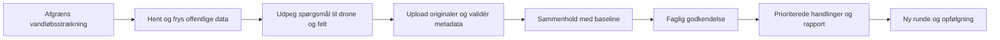

# Freyra status og plan frem mod Haderslevmødet 10 november 2026

## Aktuelt notecheckpoint — 14. oktober 2026

**Manuelle kladdenoter er teknisk stagingafprøvet:** kode `70028af7845632d7f9f0fa85583c35334e39c59e` på Worker-version `97c603d4-3133-40bb-940a-1d8de0cee4db` har bestået **67 faktiske notechecks**. To selvstændige syntetiske noter er gemt som `draft_unreviewed` til de eksisterende før-/kontrolbindinger og det præcise referencespørgsmål. Begge er `inconclusive` med prioritet `not_assessed`; retry/get/list/cursor, aktuelle adgangsafvisninger, privat original og same-JWT revoke/exact restore består. Den tidligere inputgraf og begge billedbindinger er uændrede; højst to egne nye noter er tilføjet.

**Aktuel release:** [CI23](https://github.com/JESRI-C/freyra-hub/actions/runs/38524924406) SUCCESS med **124 testfiler/1.968 tests**, **10 SQL-filer/601 assertions** og **25 samtidighedscases** samt disposable cleanup PASS. Notemigration `20261014061314` er applied som `20261014070017`; samme kode er bygget og deployet. Buildscan **759 repo-/798 outputfiler** gav 0 nøglelækager/privilegerede bundletokens, og fire krypterede bindingsnavne er bevaret.

**Afgrænsning og næste arbejde:** QA kørte i den særskilte syntetiske API-testsag. Den normale brugers tomme testsag er bevaret; egne fotos og M1-formularens hosted browserforløb er endnu ikke afprøvet. En manuel kladdenote er ingen fagligt godkendt observation. Fagligt review, gemt FØR-rapport/godkendelse, faktisk hosted PDF-download/arkiv, reel 10/120-batch, kommunalt scope og samlet mødeleverance mangler stadig. Offline syntetiske querymålinger er ikke hosted CPU-/latens- eller batchaccept.

**Historik bevares:** M0-beviset på8eff, medie-QA68 på5c og SOURCE13-QA40/Round-QA81 på81 forbliver daterede, byteuændrede beviser; de er ikke omdøbt til nye tests på70028. Ingen nye fotobytes eller kildeindsamling er udført. Bykærs83m/AOI/endepunkter/reviewer og øvrige cases er fortsat uafklaret; produktion og kundedata er uændrede.

[Nyt minimeret notebevis](haderslev-audit/staging-round-note-checkpoint-2026-10-14.json), SHA `48b5fc279ce9cecbb175216bdd237b86ba3ae17a5b442b956ad2a624ff0fcab6`.

## Historisk rapport- og mediecheckpoint — 14. oktober 2026

**Rapportvisning frigivet efter mediecheckpointet:** kode `8eff057` er på staging-Worker `b3198a45-7c3c-43d2-9653-7b00c0954a06`. [CI22](https://github.com/JESRI-C/freyra-hub/actions/runs/38519621399) SUCCESS: **119 filer/1.812 tests**, **9 SQL-filer/534 assertions** og **18 samtidighedscases**, cleanup PASS. Direkte rapportbygger, rapportcenter og den faktiske testsags rapportfane er læst i browseren og viser kladde/ukendt periode/manglende fagligt review. To syntetiske PDF’er/tre sider er renderet og visuelt gennemgået; faktisk hosted download og arkiv er ikke accepteret. [Nyt rapportvisningsbevis](haderslev-audit/staging-report-ui-checkpoint-2026-10-14.json), SHA `683baea041b13747ca049512ae5f2f4f6e6f796531831b56f09d36d3f612d613`. De nedenstående 68-checks er fortsat historiske på 5c; de er ikke genmærket som en ny kørsel.

**Originaler kan nu knyttes til gemte runder i staging:** hosted medie-QA **68 checks PASS** på kode `5cbb1df9c8a34108d76b39851dd22d504f4c041b` og Worker-version `da24329a-bd0c-4017-a2ed-188f40f25991`. Samme eksisterende syntetiske original er knyttet til før- og kontrolrunden med præcise inputhashes og valgte spørgsmål. Save/retry/get/list, privat genhentning, adgangsafvisninger og same-JWT revoke/exact restore består. Kun to nye draftbindinger er oprettet; gamle baselines, planer, runder og originalgraf er uændrede. Der er ikke uploadet nye billedbytes.

**Releasegates består:** [CI21](https://github.com/JESRI-C/freyra-hub/actions/runs/38517531986) har **116 testfiler/1.797 tests**, **9 SQL-filer/534 assertions** og **18 faktisk udførte samtidighedscases** samt disposable cleanup PASS. Mediemigrationen `20261014051726` er applied som stagingversion `20261014054744`; nyt build og Worker er verificeret. Den request-lokale baselinekontrol er med i releasen. En separat read-only prøve gav seks HTTP200; seks faktiske tailrecords viste CPU30–88 ms og wall203–632 ms. Der er ikke isoleret cold/warm eller bevist en før/efter-CPU-besparelse eller varig tilgængelighed. Fire krypterede bindingsnavne er bevaret; buildscan 734 repo-/794 outputfiler gav 0 lækager/privilegerede bundletokens.

**Din første afprøvning kan begynde:** [Brugertest Haderslev – 14. oktober 2026](https://gofreyra-p0-staging.gofreyra-jesri-staging.workers.dev/app/projects/ae3012ca-662e-4ae0-9f84-234d08428ec9) er oprettet gennem den almindelige projektformular med din eksisterende bruger. Sagen er tom og tydeligt syntetisk; vælg først testområde og reference. Der er endnu ikke valgt faktisk AOI/reference eller egne fotos. [Brugertesten](HADERSLEV_BRUGERTEST.md) beskriver runde A–D. Den tekniske mediebinding er tilgængelig i staging, mens faktisk brugeraccept med ét foto og 10/120-batch stadig mangler.

**Historiske accepter bevares:** SOURCE13-QA40, Round-QA81, baseline4, plan3 og de to rundedrafts blev accepteret på 81/f4 med metadata-SHA `c08c52a76bdf023451a78929903073f1b0e1e158f19e2b4af7ee4e770c522ca2`. De er uændrede inputs til den nye QA, ikke genkørte 40/81-checks på 5c. Ny medie-QA bruger en separat metadatafil/SHA `f1bdcad02c4ddee285147be70f4f586203c0ceb1c98a243f9e5b26f1f6a01b1e`; ingen kilde er genindsamlet.

**Mødeleverancen 10. november er stadig ikke færdig:** M0-rapportarbejdsfladens 20 reviewede filer er nu frigivet som 8eff057 efter QA68 og de ovenstående CI22-/build-/stagingkontroller. Det er en rettelse af kladdevisningen, ikke accept af en færdig kommunerapport. Noter M1 er en uaccepteret kladde. Næste arbejde er manuelle noter/konservative observationer og fagligt review → brugbar gemt FØR-rapport → låst godkendelse og faktisk privat PDF/manifest/CSV/GeoJSON → reel batch, pilot og samlet brugerrejse. Bykærs delstrækning/83 m, formål, AOI/endepunkter, regulativ, reviewer og øvrige cases er fortsat åbne. Kildeinventaret er partial; miniature-QA er ingen pixel-, georeference-, faglig-, rapport- eller kommunal accept. Produktion og kundedata er uændrede.

**Nyt slutbevis:** [mediebinding og brugeradgang](haderslev-audit/staging-round-media-checkpoint-2026-10-14.json), SHA `dacf7aa31a7d8668b3cc0e21278e4e639c1522d8b8dd8965ace8967f9e17f63e`. [Det historiske 81-bevis](haderslev-audit/staging-source13-survey-round-checkpoint-2026-10-14.json) bevares byteuændret.

## Historisk 81-checkpoint — 14. oktober 2026

**Teknisk stagingkæde accepteret:** SOURCE13 **40 checks PASS** og undersøgelsesrunder **81 checks PASS**. Baseline4, plan3 og to separate før-/kontroludkast kan gemmes, genåbnes og pagineres med de præcise inputhashes. Det afsluttende forsøg genbrugte de eksisterende request-id’er og rækker: **0 nye runder ved resume**. Mødeleverancen til **10. november er stadig ikke færdig**: originalbinding, manuelle noter/fagligt review og faktisk gemt rapport/PDF/datapakke mangler.

**Accepteret deploy:** kode `81e229e0b99a91803b9b46bdf8b1202329b3efcd`, Worker-version `f4d6e4d7-6226-47ad-b205-60896a37ffc3` aktiv på 100 %; [CI20](https://github.com/JESRI-C/freyra-hub/actions/runs/38512714618) SUCCESS med app **110 filer/1.627 tests**, fresh disposable LOCAL **8 SQL-filer/470 TAP** og **13 faktiske samtidighedscases**. Begge release-migrationer er applied i staging. SOURCE13 og Round bruger samme uændrede metadata-SHA `c08c52a76bdf023451a78929903073f1b0e1e158f19e2b4af7ee4e770c522ca2`; fire krypterede bindingsnavne er bevaret, og kodebuildscan 712 repo-/793 outputfiler gav 0 nøglelækager/privilegerede bundletokens.

**Afsluttende hosted accept:** Round-forsøg3 sluttede **05:27:36 UTC** med uændrede gamle baselines/planer/runder/canonicalgraf samt same-JWT revoke og exact membership restore PASS. Efter brugerens egen betalingsafslutning gav seks afgrænsede baseline-/rundereads **HTTP200**; ingen kilde blev genindsamlet. Frisk read-only DB **05:28:56 UTC**: **7 projekter/15 uploads/4 baselines/3 planer/2 runder/1 canonical/2 origins/3 promotionrequests**; syntetisk 0 observationer/rapporter/flyvninger. Dette er teknisk syntetisk accept, ikke reel batch- eller faglig godkendelse.

**Tidligere CPU-stop er historik:** forsøg1/2 stoppede med HTTP503/Cloudflare1102, og en faktisk tail viste `exceededCpu`, 17 ms CPU/365 ms wall på samme Worker. Brugeren så Workers Paid-checkout og meldte selv betalingen gennemført; agenten indsendte ingen betaling eller Worker-indstillingsændring. Billing-API-plan og faktisk fakturabeløb er ikke selvstændigt verificeret. Det efterfølgende beståede forløb er afgrænset ovenfor; ingen optimering af CPU-forbruget eller varig tilgængelighed er afledt heraf. [Officiel CPU-dokumentation](https://developers.cloudflare.com/workers/platform/limits/#cpu-time). Den gamle generiske HTTP-probes rå fil blev senere overskrevet; dens observerede genese findes i det bevarede minimerede checkpoint, ikke i rekonstruerede rå bytes.

**Datagrundlaget er stadig partial:** baseline4 `99edc17a-2f82-4fe9-80f9-af6346de06a3`, manifest `b5f7264271141ab3c87dd56f66c836b40bb7dd208a5653bcda07ca85b32f9053`, har 45 rasterfilmetadata/3 produkter, 89 natur-/VP3-kandidater (82/4/3), **7 generiske VanDa-undersøgelsessteder**, 15 DMI-døgn/total null og 9 Sentinel-katalogscener. Stederne er ikke verificerede hydrometriske stationer; relationer/måleserier, rasterpixels/dato/NoData/koter, lokal satellit-/NDVI-QA, DMI-periode/opland og faglig/juridisk naturbetydning er åbne. Regulativ er ikke tilsluttet. Monitoring-QA-validatoren er selvstændigt kompileret fra samme committed browserkilde og er ikke en deployet SSR-chunk. Baseline4s 277.941 bytes er Postgres `jsonb::text`, ikke HTTP-respons- eller canonical-hashtekst.

**Nyt lokalt arbejde er ikke denne deploy:** 21 mediefiler og CLI-migration `20261014051726_survey_round_media_versions.sql` er kopieret. Typecheck og produktlint **0 fejl/23 eksisterende warnings** består. Den seneste fulde lokale kørsel havde 112 beståede filer/1.752 tests og 2 suiteimportfejl; efter smal child-mockrettelse består de to berørte filer/7 tests. Ny samlet suite, SQL/18 samtidighedscases, CI/build/deploy og hosted medieaccept er endnu ikke kørt.

**Næste prioritet:** saml lokal mediebinding og relevant baselinekontekst → fulde lokale/SQL-/CI-/buildgates → stagingmigration/deploy/hosted medie- og browser-QA → manuelle noter/observationer og fagligt review → faktisk gemt FØR-rapport, låst godkendelse og privat PDF/manifest/CSV/GeoJSON. Reel 10/120-billedbatch og pilot-/E2E-/releaseaccept mangler. Scope og relevante offentlige kilder afklares parallelt.

**Kommunalt scope:** Bykær Bæk er én af flere cases; de omtalte **83 m er stadig uafklaret**. AOI/endepunkter, formål, regulativ, reviewer og øvrige cases er åbne. Før-/kontroludkast er ingen faktisk før/efter-vurdering. Ingen pixel-/georeference-/faglig-/rapport-/kommunal godkendelse er afledt af QA; produktionskode/-kundedata er uændret.

**Slutbevis:** [SOURCE13 og undersøgelsesrunder](haderslev-audit/staging-source13-survey-round-checkpoint-2026-10-14.json), SHA `73739a2783e682474c6fed1885aa7e2fd19f93fd7c6ea3b8525db47005105e1d`. Tidligere fejl og proofs bevares med deres oprindelige genese.

## Historisk SOURCE11-checkpoint — 13. oktober 2026

**Kode/releasegates:** `296af078116f1cf56b600df36ffda3a012f8f70a` på Worker **`2006a0ea-8899-4a54-b11b-66a4a917c065`**. [CI16/run 38449984520](https://github.com/JESRI-C/freyra-hub/actions/runs/38449984520): app **103 testfiler/1.357 tests** og fresh disposable LOCAL DB **6 SQL-filer/325 TAP PASS**, seks kendte ejerskabsverificerede PostGIS-begrænsninger. Type/lint/faktorer/build/deploy PASS; lint 0 fejl/23 eksisterende warnings. Fire krypterede serverbindingsnavne er bevaret uden værdilæsning. Kodebuildscan **675 repo-/789 outputfiler**, separat docscheckpoint-scan **679/789**: 0 lækager/privilegerede bundletokens. Legacyfalsk 0/opdigtet 1 ha/presence-writes og WFS credential-echo er rettet og reviewet; WFS-scope80 PASS.

**Hosted teknisk accept:** read-only naturkatalog **QA10 PASS** for main/viewer med 82 natur-/4 beskyttede vandløbskandidater og afvisning af fremmed/anonym/ugyldig bearer. Combined kildeinventarbaseline **QA36 PASS**, **version 3**: `08a8ff1d-647b-4e67-a17c-d78fd289ff29`, manifest **`3916e31a036d2635f2814126aa188ce47c24f63ed74b1ee87ddfcab3c9eb19d8`**. Create/retry/get/list, RLS/skriveafvisning og same-JWT revoke/restore er verificeret. De to gamle baselines/hash, canonicalgrafen og **to planer på gammel baseline** er bevaret; ingen ny plan er oprettet. Native geometri findes i privat baselinepayload; offentligt QA-bevis indeholder ingen rå geometri.

**Aktuelt datagrundlag/counts:** version 3 indeholder **45 rasterfilmetadata/3 produkter, 89 natur-/VP3-kandidater (82/4/3), 15 DMI-døgnværdier/total null og 9 Sentinel-katalogscener**. Frisk SQL **19:17:28 UTC**: **7 projekter/15 uploads/3 baselines/2 planer/1 canonical/2 origins/3 promotions**; syntetisk 9 audits og **0 flights/observations/reports**. **SurveyRound-tabellen mangler: count null/PGRST205**. Frisk Bykær-WFS er genoprettet: HTTP200 **19:00:34 UTC**, headers842ms/total864ms/12.152 bytes/8 segmenter; tidligere500 er dateret historik, ikke aktuel fejl.

**Åben leverance:** kildeinventar er partial og kun teknisk accepteret. Rasterpixels/optagedato/NoData/koter/hældning, lokal Sentinel-/NDVI-QA, DMI-perioder/opland og naturens overlap/juridiske/faglige betydning mangler accept. Kommunalt regulativ/målestationer er not_implemented; source13 er kun inert kladde (7 VanDa-stedkandidater, ingen godkendt vandløbskobling). Bykær er én af flere cases; **83 m er udtrykkeligt uafklaret**, AOI/endepunkter/reviewer/øvrige cases åbne. Reel batch/round/review og versionsfast godkendt rapport/eksport mangler. **Mødeleverancen 10. november 2026 er ikke accepteret; produktion er uændret.**

**Slutbeviser:** [inventarbaseline-QA36](haderslev-audit/staging-public-inventory-baseline-qa-2026-10-13.json), SHA **`b0ccb2855cf181a6b1c2c592845b646af491221c417fc84c4bb3413faf1d87f7`**; [source11-slutpostflight](haderslev-audit/staging-source11-postflight-2026-10-13.json), SHA **`3f8d9297c0325cc66c9cd808608379e8f41fa80150ef2ec826cae0ef9ffec9d2`**. Postflight binder aktuelle counts/versioner/gates og semantiske begrænsninger til samme kode/Worker. [Hosted katalog-QA10](haderslev-audit/staging-nature-candidates-qa-2026-10-13.json), [før-commit adapterprobe](haderslev-audit/public-source11-adapter-probe-2026-10-13.json) og [WFS-recovery](haderslev-audit/datafordeler-wfs-recovered-2026-10-13.json) bevarer hver deres genese; før-commit/uncommitted-metadata omskrives ikke. Ældre CI14/c0 og tidligere proofs følger nedenfor.

## Historisk c0a20a79/CI14 og delvis stagingaccept — 13. oktober 2026

**Historisk committed og pushed kode:** **`c0a20a79f09fdbeba4bd7b1205871bca3b2d6f9e`**. [PR #15](https://github.com/JESRI-C/freyra-hub/pull/15) hedder **Haderslev: versionsstyret datagrundlag og sikker droneverifikation**. [CI14](https://github.com/JESRI-C/freyra-hub/actions/runs/38442953665) er fuldt **SUCCESS**: [app-job](https://github.com/JESRI-C/freyra-hub/actions/runs/38442953665/job/115453948750) **101 testfiler/1.243 tests**, typecheck/lint/faktorer/build PASS; [DB-job](https://github.com/JESRI-C/freyra-hub/actions/runs/38442953665/job/115453948274) fresh disposable LOCAL replay **6 SQL-filer/325 TAP-punkter PASS**. De seks kendte, ejerskabsverificerede PostGIS-begrænsninger er uændrede. Friske lokale post-review-gates er også PASS: 101/1.243, typecheck, lint **0 fejl/23 eksisterende warnings**, faktorer og stagingbuild. Faktisk scan af **663 repofiler/785 outputfiler fandt 0 secretlækager og 0 privilegerede browserbindingsværdier**.

**Historisk deployet c0-runtime; rasterbaseline dengang ikke accepteret:** c0a20a79 er deployet på Worker **`86824008-1926-417d-8e4a-fbbe8968ec36`**; fire krypterede serverbindingsnavne er verificeret bevaret uden værdier. Den faktiske rasterbaseline-QA standsede på obligatorisk frisk WFS-reference: **10-sekunders deadline i tre forsøg**, før rastercollector blev nået. **Fire checks før create PASS; kun de to ældre baseline-rækker findes**, ingen ny rasterbaseline er gemt. Almindelig auth/rækkelæsning/cached reference er faktisk bestået. Den efterfølgende afgrænsede WFS-diagnose og hosted AI-authkontrol fremgår nedenfor. Kode-/CI-/deployment er bestået; fuld ny hosted kilde-/persistensaccept er åben. Produktion er uændret. [Slutpostflight med delvis accept](haderslev-audit/staging-source10-postflight-2026-10-13.json), faktisk eksisterende fil, SHA-256 **`b9041a700e0dbb3ae64c6f99291c8751576d2cc317e5ffb0d1fc96763b7d9d2a`**. Historisk c537/c54, upgraded-baseline 34 og plan 34 samt deres genese bevares; begge ældre baseline-ID/hash og de to planversioner med samme manifesthash er bevaret i postflighten.

**Faktisk WFS-tilgængelighedskontrol:** én præcis Bykær-WFS-forespørgsel under en separat **20-sekunders probegrænse** gav **HTTP 500** ved headers efter **15,256 sekunder (15 256 ms)**, observeret **18:16:38 UTC**. Responsebody blev ikke gemt. Dette ene svar beviser hverken generel providernedetid eller ugyldig nøgle/konfiguration; appens 10-sekunders gate blev bevaret. [Bevis](haderslev-audit/datafordeler-wfs-availability-2026-10-13.json), SHA-256 **`af5fefcda47600977495fe01e1b708962d3e6939a0138f429198b7d996f3ba33`**.

**Historisk hosted AI-authgrænser PASS på c0 — 14 checkpoints:** **8 faktiske serverfunktion-HTTP-authdenials**, fire anonyme og fire forsætligt ugyldige bearer, og **0 autentificerede AI-kald**. Der er ingen positiv hosted generation, verificeret provider-/nøgleaktivering eller forbrugspåstand; de positive SDK-kontroller er lokale med mocked transport. Review af beviserne fandt ingen blokkerende fund inden for denne negative authgrænse. [Bevis](haderslev-audit/staging-ai-boundaries-qa-2026-10-13.json), SHA-256 **`80d704bda20dcb4b01b84b7a51ee2593240e82061a3e0ee9a113af3340a1a4f5`**.

**Historisk read-only c0-postflight — 18:23:40 UTC:** **7 projekter/15 uploads/2 baselines/2 planversioner/1 canonical/2 origins/3 promotionrequests/9 syntetiske auditevents**. Syntetisk scope har **0 flyvninger/observationer/rapporter**; **SurveyRound-tabellen er fraværende**, ikke en tabel med 0 rækker. Plan-RLS er aktiveret; browser-INSERT/-UPDATE og service-role UPDATE på baseline er ikke tilladt. Canonical-grafen og de historiske versioner er bevaret. [Slutpostflight](haderslev-audit/staging-source10-postflight-2026-10-13.json) knytter counts, versioner og delvis accept til c0a20a79/Worker 86824008. Før evidensfilerne var scannet 663 repofiler/785 output; den efterfølgende checkpointscan er **666 repofiler/785 outputfiler med 0 forekomster af den faktiske Datafordelernøgle og 0 privilegerede bundletokens**.

**Source 10 — rastermetadata, kode-/CI-verificeret og deployet delresultat:** serveradapter og collector/UI er nu integreret i c0a20a79, med tre faste produkter: **GeoDKO10cm, GeoDKO12,5cm og DHM Terræn**. Den faktiske offentlige tekniske probe gav **15 filmetadata pr. produkt/45 i alt**. Det er kandidatfiler, ikke 45 validerede billeder; **0 rasterbytes** er hentet. Katalogforespørgslen bruger bufferet native **EPSG:25832** og en erklæret WGS84/ETRS89 datum-/epochantagelse. Sammenligningen af 308 referencevertices med højst 0,00378 m numerisk forskel beviser koordinattransport, ikke jordnøjagtighed. Faktisk optagedato, NoData, pixeldækning, rasteropløsning/CRS, terrænkoter og hældning mangler accept. Opgave 10 er derfor fortsat **I GANG**; ny hosted metadata-/persistensaccept er ikke bestået, fordi frisk WFS-reference stoppede før collector.

**AI og dependencyrettelser — lokale beviser, særskilt aktiveringsgate:** fire AI-serverfunktioner kræver login før nøgleadgang/kald. Hele generationen har **15 sekunders deadline, 0 retries og 128 KiB success-/fejlbodygrænse**; artsinput er kun canonical inline JPEG/PNG/WebP med **2 MiB** bytegrænse. Rasterets JSON-escaped credential-echo og AI's indre JSON/final-output-echo blev fundet som **to P1**, rettet og uafhængigt reviewet før CI14. AI-scope **73 tests PASS**; indre completion-JSON kontrolleres før SDK/field-strip, færdigt callbackoutput kontrolleres, og artsparsing sker inden for samme guard/deadline uden rå modeltekst til klienten. Præcise overrides er **provider-utils 4.0.33/fast-uri 3.1.8**. Fuld install-audit **38→33** og samme production-only audit **34→29 berørte pakkeentries** er to forskellige scopes; ingen totalsammenblanding eller påstand om fem selvstændige exploits/all-clean. [Patchnotat og arkivhashes](haderslev-audit/dependency-patches-2026-10-13.json) bevarer det tidligere snapshot; dets pre-CI14 releasepending-felter er historisk checkpoint, mens den friske kodegate fremgår her. De resterende **29 production-entries**, global rate-/ressource-/costbudget og provider-/nøgleaktivering kræver særskilt triage/accept. Online AI-adgang/nøgleværdier er ikke undersøgt; pixeldekodning, projektbinding og fagligt godkendt output er ikke accepteret.

**Historisk source 11-discovery før 296af078:** read-only discovery på **`dai:bes_naturtyper`/`dai:bes_vandloeb`** hos arealeditering-dist-geo og **`vp3_2endelig2025:vp3_2e2025_vandloeb_samlet`** hos wfs2-miljoegis/vp3_2endelig2025 gav henholdsvis **64/4/3** elementer i den oprindelige tekniske referencebbox og **82/4/3** i den større QA-bbox. Vandområdeplanens genbesøg er publiceret **18. december 2025**, med virkning **1. januar 2026**. Det er rå kandidatantal, ikke accepteret lokal naturtilstand, polygonoverlap eller gældende vandplan. Fire source 11-filer er hashverificeret, frisk review fandt ingen P1/P2, og de er kopieret til aktive kildefiler som **på daværende tidspunkt uncommitted kode**. Collector/UI-integration og legacyrettelser var under arbejde efter c0a20a79; source 11 havde da ingen committed/deployet accept eller genkørte fulde gates. Denne tidligere genese er siden afløst af 296af078-kodecheckpointet ovenfor. De konkrete ældre fund med HTML fra et naturendpoint, falsk 0 ved fejl og opdigtet 1 ha er **daværende åbne P1-dataintegritetsopgaver**. De er nu kodemæssigt rettet i 296af078; CI16/deploy/teknisk hosted accept og fortsat åben faglig/kommunal accept fremgår ovenfor.

**Kommunalt scope og leveranceaccept:** Bykær Bæk er én af flere cases. Brugeren har udtrykkeligt sagt, at den omtalte **83 m-strækning endnu ikke er afklaret**; reviewer, endepunkter og øvrige cases er åbne. Offentligt grundlag først → droneverifikation → fagligt godkendt rapport frem mod **10. november 2026**. Kode-/CI-/metadatafund er delbeviser; samlet mødeleverance, reel batch, faglig baselineaccept og rapport/eksport er ikke accepteret.

Status 13. oktober 2026. Mødedatoen er oplyst af Jesper. Planen er et arbejdsgrundlag til færdiggørelse af den eksisterende GoFreyra-platform og dens kommunale vandløbsleverance.

Freyra har en omfattende brugerflade, flere fungerende dele og en selvstændig faglig Bykær Bæk-leverance. Den samlede rejse gennem programmet fra offentlige data til droneverifikation og godkendt kommunerapport er endnu ikke færdig. Det vigtigste arbejde de næste fire uger er at få denne rejse til at fungere på én reel sag og gøre dens output konkret for kommunen.

Målet til 10. november er en gennemprøvet vandløbspilot i programmet med en faktisk downloadbar beslutningspakke. Generel produktionslancering kræver de samme dokumenterede kvalitets- og adgangskrav; mødedatoen er ikke i sig selv en godkendelse af uafsluttede funktioner. Tidsplanen er et mål, ikke et verificeret udviklingsestimat. Kapacitet, datadækning og resterende migrationsarbejde skal afklares i første milepæl.

## Tidligere accepteret runtimecheckpoint 13. oktober 2026

**Datafordeler-kildecheckpoint, 13. oktober:** konto/login/aktivt **GoFreyra Staging** IT-system og krypteret `DATAFORDELER_API_KEY` kun på `gofreyra-p0-staging` er etableret; nøglemetadata: **GoFreyra staging offentlige data**, udløb **13. oktober 2028**, ingen værdier registreret. Efter det historiske første 401 gav autentificerede capabilities/schema/GetFeature og præcise navne-/ID-opslag **HTTP 200**. Brugeren har nu nævnt **Bykær Bæk som én af pilotsagerne**; den er ikke den eneste. Endepunkter, reviewer og øvrige cases er ikke valgt. [Kilde-/adgangsbeviser og AOI-afklaring](haderslev-audit/datafordeler-adgang-2026-10-13.md). CI8/CI9 og `ca333c8`/`0fe72b06` bevares som tidligere checkpoints.

**Historisk accepteret CI12-kode og runtime:** **`c5374e50db76641f2ab9b80a6202e013ebc83b52`**, staging Worker **`c54c6163-d871-4c2b-bb8d-effe82918b1e`**, deployment PASS med fire bevarede serverbindinger uden værdier. [CI12](https://github.com/JESRI-C/freyra-hub/actions/runs/38432905812) er fuldt **SUCCESS**: [app](https://github.com/JESRI-C/freyra-hub/actions/runs/38432905812/job/115419415697) **97 testfiler/1.104 tests**, typecheck/lint/faktorer/build PASS; [DB](https://github.com/JESRI-C/freyra-hub/actions/runs/38432905812/job/115419416149) fresh disposable LOCAL migrationsreplay med **6 SQL-filer/325 TAP-punkter**, inklusive **57 plan-TAP**, PASS. Seks kendte PostGIS-begrænsninger er uændrede. Lokalt 97/1.104, typecheck, lint **0 fejl/23 eksisterende warnings** og `build:staging` PASS; faktisk scan af **647 repofiler/781 outputfiler fandt 0 secretlækager**.

**Historisk CI11/deploy-checkpoint:** kode `972524e298d0bbad1cbefb2e6e39d0a2c5886017`, Worker `c07618c5-17d3-49ff-8341-b336744aab1f`, bygget applikationstræ identisk med `bf67149161ec0681d383569d802b5b0b76cdf799`. [CI11](https://github.com/JESRI-C/freyra-hub/actions/runs/38425940663) 94/1.024 og fresh 5 SQL-filer/268 TAP PASS; [daværende postflight](haderslev-audit/staging-modern-chain-postflight-2026-10-13.json). De tilknyttede baseline 31/canonical33-beviser nedenfor beholder denne genese.

**Plan-DDL og reviewrettelse:** repo `20261013161017_verification_plan_versions.sql` → hosted **`20261013164947`**, applied **kun på staging `xdvqdzdpyceojbdknofi`**. Review fandt en P1: `FOR SHARE` på den immutable baseline krævede UPDATE-privilegium. Låsen blev fjernet fra baseline-read **før CI/apply**; projekt-/membershiplocks og composite FK er bevaret, baselineinput har fortsat **ingen UPDATE-grant**, og en eksplicit least-privilege-pgTAP består. Planversioner er immutable udkast, ikke faglige godkendelser.

**Historiske delkontroller:** parser 61, baseline/reach 46, promotion/auth 11, reader 17 og retry-helper 12 PASS. Første suite fik TEMP-cache EPERM før tests; workspace TEMP/TMP gav 94/1.012 før de supplerende datocases. CI10's `OLD.original_role` recordplanning-fejl blev rettet med separat IF uden svækkede tests. CI11/94/1.024/268 TAP er historik; CI12/97/1.104/325 TAP er historisk accepteret genese; CI14/101/1.243/325 TAP er historisk bestået releasegate; seneste kode-/deploymentgate er 296af078/CI16/103/1.357/325 TAP PASS; hosted naturkatalogread og immutable inventarbaselineversion 3 er teknisk accepteret; faglig/kommunal/rapportaccept afventer.

**Canonical/reference-schema applied kun på staging `xdvqdzdpyceojbdknofi`:** repo `20261013144725` → hosted `20261013160451` (**promote_drone_original**), repo `20261013151039` → hosted `20261013160458` (**datafordeler_watercourse_reference**). Canonical-service, privat reader, upload-retry og Datafordeler/v1-v2-proveniens er committed/deployet med CI11-gates. Hosted baseline- og canonical promotion-QA er nu teknisk bestået; round-/spørgsmålsbinding, fagligt review, reel batch og rapportleverance er fortsat åbne.

**Hosted canonical promotion-QA PASS — 33 checkpoints:** media `df98d250-fb09-4fa5-b275-e5e06cbb9ab5`, primær origin `c7d8f058-f747-4b5b-a211-d304d3df8034`, dubletorigin `492464e0-5cd5-408f-b8ff-20a8621851eb`, dublet-TUS `00b7b90f-eef9-4b84-a87b-4a8a0c95fbac`. **1 canonical / 2 fysiske originaler / 3 requests og 3 auditevents**; retry/dedup bevarer ID. Almindelig owner og viewer læser private bytes med HTTP 200 og verificeret SHA; foreign/anon nægtes, reserverede kolonner/service-RPC giver 42501, samme-JWT revoke og præcis membershiprestore PASS. Owner-overwrite nægtes; delete nægtes/0 fjernet. Begge faktiske filer er 137 bytes med samme hash; objectpins/DB-graf er uændret. 60-sekunders signed URL gav 400 efter 72 sekunder. [Bevis](haderslev-audit/staging-canonical-promotion-qa-2026-10-13.json). Dette lukker den tekniske canonical-slice, ikke round/review/batch/rapport; fixture har `review_required`, ingen EXIF/GPS.

**Historisk hosted moderne baseline-QA PASS — 31 checkpoints:** syntetisk projekt `24046b35-20cf-46f6-83de-1190b2d6a285`, zone `1b88e5f3-f1ec-43d6-b70e-025e732812f6`, Bykær-reference `1233766a-1fdb-6b98-e053-d480220a5a3f`, statisk 2025-09/308 vertices. Baseline v2 `3f5ec8bc-ac7d-476a-ad0f-2dd61243bb12`, version 1, hash `32f9b05a8a30c2a8a0d118f14a4f36bfb98e5b34c5bc88786c5b5599a8bcd6c3`; save/retry/get/list/adgang/revoke/restore PASS. [Daværende bevis](haderslev-audit/staging-modern-baseline-qa-2026-10-13.json). Den version er bevaret; dens DMI no_coverage-status beskriver det daværende stationsvalg.

**Hosted opgraderet baseline-QA PASS — 34 checkpoints:** ny baseline v2, version **2**, ID **`690ba491-f23c-4ed6-830d-453195acc08a`**, hash **`a66cf324f35a50fe3cb9148be3cb5b9e0ac1e3d9b8a2d8d324a1490dcd49c93e`**. DMI hentede faktisk **15 døgnværdier fra Vojens `05384`** efter et komplet tomt svar fra `06110`; Oksenvad `26050` blev fravalgt som lukket i 2009. Status er **partial**, UTC-periodens grænser matcher ikke døgnværdierne præcist, **totalMm er null**, og oplandsrelevans er **not_assessed**. Den tidligere baseline `3f5ec8bc-ac7d-476a-ad0f-2dd61243bb12` og hash `32f9b05a8a30c2a8a0d118f14a4f36bfb98e5b34c5bc88786c5b5599a8bcd6c3` er bevaret. [Bevis](haderslev-audit/staging-upgraded-baseline-qa-2026-10-13.json).

**Hosted verifikationsplan-QA PASS — 34 checkpoints:** planversion **1**, ID **`a951c82e-84f7-4e61-b05a-6e9fec769745`**, og planversion **2**, ID **`e8519f53-356b-465d-9cf1-0904128314d2`**, bevarer samme manifesthash **`0d7b0ee3b52bb8196acd70267f691c203c6f3c64d5889fe32afb34177d747491`** og præcis baselinebinding/frossen **v1-generator**. Ét stedmatchspørgsmål er gemt som **draft**, resultat **null**. Retry/read/cursor, RLS/grants, service-only RPC, aktuelt JWT-revoke og præcis rollegenskabelse PASS. [Bevis](haderslev-audit/staging-verification-plan-qa-2026-10-13.json). Ingen observationer, rapporter eller flyvninger blev oprettet; canonical-grafen er uændret. **SurveyRound-tabellen mangler (`PGRST205`); den må ikke opgøres som 0 runder.** Den første QA-harness' HEAD/null-count-fejl blev rettet til GET før writes, uden appændring eller svækkede tests.

**Kildemangler i de to historiske CI12-baselines og åbne acceptgrænser:** officiel reference er tilgængelig; ny DMI-serie har 15 faktiske værdier med partial/inexact UTC-grænser, ingen fuld periodesum eller vurderet oplandskobling. Sentinel er fortsat katalogdata med lokal pixel-/sky-QA åben. Regulativ, ortofoto/terræn, vandplan/natur og offentlige vandmålestationer er fortsat **not_implemented** i baselinekæden. DMI-perioder **1/7/30 dage** og faglig oplands-/sagsrelevans mangler samlet accept. **Opgave 09 og 16 er DELVIST gennemført med teknisk runtime PASS**; plan 16 dækker kun ét stedmatchudkast uden godkendelse eller flere faglige kriterier. Fuld kildedækning, 15's faglige accept, AOI/reviewer og rapport er åbne.

**Historisk accepteret CI12-postflight:** kode c5374e50, Worker c54c6163, staging-only planmapping og upgraded-baseline-/planbeviser står i [postflight](haderslev-audit/staging-plan-dmi-postflight-2026-10-13.json), som nu faktisk findes. SQL verificerer **7 projekter/15 uploads/2 baselines/2 planversioner/1 canonical/2 origins/3 requests**. Syntetisk QA har ingen nye flyvninger/observationer/rapporter, og **SurveyRound-tabellen er fraværende**, ikke en tabel med 0 rækker. CI11-postflighten nedenfor beholder sine historiske rækketal/versioner.

**Historisk source 10-start før CI14:** metadata-/projektionadapter var under arbejde og ikke baselineintegreret/deployet i c537. `proj4` **2.22.0** er installeret som tre nye pakker til kandidaten med `--ignore-scripts`. Oversigt HTTP200/79 poster og versioneret GetAvailableRasterFileDownloads-metadata HTTP200 har faktiske camelCase-felter. En offentlig native-/WGS84-sammenligning af **308 vertices** gav højst **0,00378 m** numerisk afvigelse; dette er en koordinattransportkontrol, **ikke præcision mod terræn eller kontrolpunkter**. Den efterfølgende bounded probe gav 45 filmetadata; den nye integrerede CI14-kandidat og afventende hosted accept er beskrevet ovenfor. Ingen rasterpixels, optagedatoer, terræn-/hældnings-/dækningsresultater eller rapportaccept er bevist.

**Historisk CI11-stagingpostflight:** 7 projekter/15 uploads/1 baseline/2 raw-originalvalidations/1 canonical/2 origins/3 requests på det daværende checkpoint. [Bevis med CI11-genese](haderslev-audit/staging-modern-chain-postflight-2026-10-13.json). Siden er baselineversion2 og to immutable planversioner runtimeverificeret på c537/Worker c54c; gamle optællinger erstatter ikke den nye postflight. SurveyRound mangler/PGRST205; ingen nye observationer/rapporter/flyvninger blev skabt, og canonical er uændret.

**Kode-/kildekontrakter i CI12:** gemt v1/v2-vandløbsreference læses nu som autoriseret geometry/hash/proveniensvalideret snapshot uden kildekald, providerkonvertering eller nye datoer. Preview/save og ny baseline beholder frisk kilde-/provider-/geometrikontrol. [To offentlige VVM-PDF-kandidater med hashes](haderslev-audit/bykaer-public-source-candidates-2026-10-13.json) er fundet; de er **ikke et regulativ eller valgt kommunal sag**. Rastermetadataoversigt gav **HTTP 200/79 poster** med eksisterende adgang; opgave 10 havde på CI12 ingen rasterintegration; den efterfølgende metadata-only integration i CI14 har separat hosted accept ovenfor.

**Kommunal AOI-accept er fortsat åben:** Bykær Bæk er én af pilotsagerne; den omtalte **83 m-strækning er udtrykkeligt endnu ikke afklaret**. Reviewer/endepunkter/øvrige cases er åbne. Read-only browsergenåbning på Worker **c54c6163** viser nu den eksisterende gemte legacy-reference med **308 punkter/8 kurver/4,47 km**, **uden source-load-fejl**, med tydelig DAWA-udfasningslabel og offentlig credentialfri dokumentationslink. Visningens længde accepterer ikke en kommunal delstrækning. Ingen eksisterende sag eller kundegeometri er ændret; **22,07 ha og manuelt centroid 55.9991 N/10.5008 E er fortsat uaccepterede**. Den tidligere læsefejl er historisk, og registergeometri/bbox vælger ikke aftalt reach. [Detaljer](haderslev-audit/datafordeler-adgang-2026-10-13.md).

Authenticated Supabase-staging og dashboardlogin er verificeret. Den eksisterende private service-role-binding samt URL/publishable-konfiguration er provisioneret **kun** til `gofreyra-p0-staging`; nøgleværdier dokumenteres ikke. Efter første midlertidige Worker `95278d2f-5833-4765-8644-f213b9962dfd` er hosted H08-/adgangs-QA gennemført på **`5ee102da-cf82-4ca0-ba6a-3e26ca479969`**, kode-SHA **`a010b9f8004f1cceda83125eaa9dbaf9cf4cac60`**. Produktion er uændret.

**Tidligere verificeret committed/deployet kodecheckpoint:** `ca333c810656ca7cc5901d3aa32c4919d16c6433` er deployet på staging Worker **`0fe72b06-db07-48d5-b7de-440d942e7d22`**. Lokale **88 filer/911 tests**, 77 scopetests, typecheck/scoped lint og `build:staging` (1 min. 24 sek.) PASS. [CI8](https://github.com/JESRI-C/freyra-hub/actions/runs/38412877024) har begge jobs SUCCESS: [app](https://github.com/JESRI-C/freyra-hub/actions/runs/38412877024/job/115349509771) 88/911 samt type/lint/faktorer/build, [DB](https://github.com/JESRI-C/freyra-hub/actions/runs/38412877024/job/115349509167) fresh reset/replay og tre suiter/165 TAP-punkter PASS med seks kendte katalogverificerede PostGIS-begrænsninger. På den endelige Worker består cached original-retry/reload med samme ID/validationhash, uden ny upload eller ny første bytesvalidering. [Final postflight](haderslev-audit/staging-final-postflight-2026-10-13.json).

Tidligere på `a010b9f8004f1cceda83125eaa9dbaf9cf4cac60` bestod lokale **88 filer/903 tests**, typecheck, lint **0 errors/23 eksisterende warnings**, faktorer og `build:staging`; scan af 766 outputfiler finder 0 privileged-JWT-/secretværdier. De målrettede kilde-/kunde-/projektkørsler på 65/76/39 tests er delkørsler. Historisk [CI7](https://github.com/JESRI-C/freyra-hub/actions/runs/38395038009) på `0969110dbfbf82a2155516ff22dcac7d7a6eeb90` er SUCCESS med 84/810 app-tests og 165 TAP-punkter; det er ikke hosted accept af de efterfølgende rettelser.

| Område               | Ny faktisk fremdrift                                                                                                                                                                                                                                                                                                                                                                                 | Det, der stadig mangler                                                                                                                                                                                                                                                                                                                                                    |
| -------------------- | ---------------------------------------------------------------------------------------------------------------------------------------------------------------------------------------------------------------------------------------------------------------------------------------------------------------------------------------------------------------------------------------------------- | -------------------------------------------------------------------------------------------------------------------------------------------------------------------------------------------------------------------------------------------------------------------------------------------------------------------------------------------------------------------------- |
| H03 adgang/runtime   | Stagingbinding er verificeret; tre krævede serverbindinger valideres ved deployment. **39 hostede adgangskontroller PASS** med syntetiske konti: anonymous/fremmed organisation, viewer-write/RPC/reserverede kolonner (42501), private links, samme-JWT revoke og restored roles. Owner-link 200→400 efter 72 sekunder med 60 sekunders TTL; tidligere bearerlink virkede indtil TTL som forventet. | Syntetisk QA er ikke samlet Auth/cleanup/ingest/cron eller kunderelease. Orgafgrænsningsrettelsen i `ca333c8` har slutbuild/deploy/CI8 PASS; selvstændig faglig Lavbund-accept mangler.                                                                                                                                                                                    |
| H05/projekt          | Faste 91 %, “3 min”, Q2/demo og Lavbund-mock ved DB-fejl er fjernet fra kundetilstand eller offlineafgrænset. Observeret project INSERT RETURNING/42501 er rettet til insert + faktisk gemt read/ID-recovery.                                                                                                                                                                                        | Fuld brugerrejse på final Worker og resten af modulerne; ingen opsummeret grøn kundestatus eller falske nuller afledes af disse rettelser.                                                                                                                                                                                                                                 |
| H08/H09              | Faktisk TUS/finalize og hosted originalkontrol af privat 137-byte-JPEG er verificeret; retry/read bevarer ID/hash. **`uploads.status` er fortsat `awaiting_validation`; separat `original_validation.status` er `review_required`.** Runtimefix bruger manual redirects og afviser ikke-2xx. Pixeldecoded/georeferenced/reportEligible/cameraPositionEligible er alle false.                         | Canonical photo-media er siden teknisk runtimeverificeret; round-/baseline-/spørgsmålsbinding, review og rigtig 10/120-batch mangler. Ét minimalt teknisk JPEG er ikke kommunal foto-/rapportaccept.                                                                                                                                                                       |
| H04/H06 datagrundlag | Datafordeler-referencebinding og saved-read er committed/deployet på c537/c54c med CI12 PASS. Ny baseline-QA34 bevarer gammelt input og gemmer ny immutable version; DMI giver 15 faktiske Vojens 05384-døgn efter komplet tom 06110 og fravalgt lukket Oksenvad. Plan-QA34 gemmer samme baseline/v1-generator/hash i version 1/2.                                                                   | DMI er partial med inexact UTC-grænser/totalMm null/oplandsrelevans not_assessed;1/7/30-dage og faglig relevans mangler accept. De to CI12-baselines havde fire not_implemented-kilder; source 10-metadata er nu CI14-integreret med hosted accept afventende. Sentinel lokal pixel-QA mangler. 83 m/AOI/endepunkter/reviewer/øvrige cases og 15's faglige accept er åbne. |

**Historisk H08-/CI8-optælling:** 7 projekter/14 uploads/0 drone_assets/0 baselines/1 servervalideret 137-byte-fixture. Siden er én syntetisk baseline og én canonical med to fysiske originaler runtimeverificeret på 972524e/c07618c5; QA har fortsat 0 droneflyvninger/drone_assets/observationer/rapporter. Bykær er én af pilotsagerne, og AOI/endepunkter/reviewer/øvrige cases er åbne. Review, FØR-rapport, faktisk godkendt eksport og mødeleverancen er ikke accepteret.

## Tidligere teknisk checkpoint — CI6 og schemaapply

Jesper har godkendt at udføre de klassificerede opgaver i rækkefølge. Den aktive appcheckout er `udvikling/freyra-hub`, branch `codex/haderslev-delivery`, startet fra P0-SHA `97782c0986d13971fd684240662a79eb70296db6`. Seneste verificerede CI-head er `610764b14f5a8b534dbef7c408e2fb2e9de74f4d`; [CI6](https://github.com/JESRI-C/freyra-hub/actions/runs/38392959494) har både app- og DB-job SUCCESS. Plan/opgaver og auditgrundlag ligger i appens `docs`. [Kladde-PR #15](https://github.com/JESRI-C/freyra-hub/pull/15) og [udførelsesloggen](https://github.com/JESRI-C/freyra-hub/blob/codex/haderslev-delivery/docs/HADERSLEV_EXECUTION.md) samler beviserne.

Planens oprindelige status- og versionstabeller nedenfor samt auditnoterne bevares som **historisk audit før implementeringen**. Deres INACTIVE-staging og tidligere lint-/testtal er ikke den nyeste drifts-/kodestatus. Daværende dokumenterede tekniske checkpoint var:

**Teknisk checkpoint, CI6:** [CI6](https://github.com/JESRI-C/freyra-hub/actions/runs/38392959494) på head `610764b14f5a8b534dbef7c408e2fb2e9de74f4d` har begge jobs **SUCCESS**. [App-jobbet](https://github.com/JESRI-C/freyra-hub/actions/runs/38392959494/job/115281013363) består med **84 testfiler/810 tests PASS** og de øvrige appgates. Hele fresh disposable LOCAL DB-replay og alle tre pgTAP-suiter er OK: 128 tenant + 19 original + 18 baseline = **165 TAP-punkter**, med katalogbetinget lokal historietest/skip. DB-lintklassifikationen har **0 appblokkerende fund** og **6 bekræftet PostGIS-owned begrænsninger**; raw lint, extensionejerskab og klassifikation findes i [DB-gateartefakt 11810472109](https://github.com/JESRI-C/freyra-hub/actions/runs/38392959494/artifacts/11810472109), SHA-256 `a835421fa32ea983815e3ffcd17dce39f82833cac74e9e9c9230b453f5421894`. Fixtures er kun kørt mod disposable LOCAL metadata; hosted/private Storage-delete-guard er ikke deaktiveret eller gennemløbet af denne testharness.

**Stagingcheckpoint:** de to nye migrations er applied på `xdvqdzdpyceojbdknofi`: lokal `20261013062924_project_baseline_snapshots.sql` er registreret som `20261013115313`, og lokal `20261013063920_drone_original_validation.sql` som `20261013115314`. Postflight af privat RLS/grants består. Rækketallene er uændrede: **6 projekter, 13 uploads, 0 drone_assets, 0 baseline-snapshots og 0 servervaliderede originaler**. Worker er ikke opdateret; service-role-/ingest-/cron-secrets mangler, CLI er ikke autentificeret, og dashboardlogin afventer. Schemaapply er ikke et credential-båret gem/genåbn-/upload-/downloadbevis.

Nyere delresultater og resterende accept:

| Område              | Implementeringsstatus ved CI6                                                                                                                                                                                                                                                                                                                                                                               | Manglende accept                                                                                                                                                                                                                                                                            |
| ------------------- | ----------------------------------------------------------------------------------------------------------------------------------------------------------------------------------------------------------------------------------------------------------------------------------------------------------------------------------------------------------------------------------------------------------- | ------------------------------------------------------------------------------------------------------------------------------------------------------------------------------------------------------------------------------------------------------------------------------------------- |
| H01 / opgave 01     | **AFSLUTTET som checkout/appgatebaseline:** Node 22.14.0/npm 10.9.2, ren install af 842 pakker efter SheetJS 0.20.3 og fire præcise sikkerhedsrettelser. Hosted appgates er grønne, senest CI6 på `610764b14f5a8b534dbef7c408e2fb2e9de74f4d` med **84 testfiler/810 tests PASS**. Tidligere app-suite på `67df4be`: 81 filer/773 tests PASS. Aktuelle appdetaljer registreres i udførelsesloggen.           | Opgave 01 er afsluttet inden for checkout/appgates. Worker-/secret-/credential-/releaseaccepten i 02/27 og faglig pilotaccept er fortsat åbne.                                                                                                                                              |
| H03 / opgave 02/27  | **DELVIST GENNEMFØRT / I GANG:** CI6 app+DB SUCCESS; hele fresh LOCAL replay og tre TAP-suiter/165 punkter OK med katalogbetinget historietest/skip. Lint: 0 appblokkerende fund/6 bekræftet PostGIS-owned begrænsninger. To nye stagingmigrations applied; privat RLS/grant-postflight PASS og rækketal uændrede. Frisk npm audit efter fire rettelser: **38 fund, 0 critical/20 high/11 moderate/7 low**. | Worker er ikke opdateret; service-role-/ingest-/cron-secrets og dashboardlogin mangler, CLI er ikke autentificeret. Credential-båret rollematrix, privat signer/download/expiry/revoke, Auth/browser, Worker-/memoryaccept og resterende advisorytriage mangler. Produktion er ikke ændret. |
| H05                 | **DELVIST IMPLEMENTERET:** kundeseed, skjult fejlfallback, fiktive rapport-ID'er, KPI'er og live-/sensordata er fjernet eller begrænset til eksplicit offline demo. Kilde-/konfigurationsfejl giver ikke preview eller nul. Estimeret NDVI/centroidprøver er blokeret som kundemålinger.                                                                                                                    | Øvrige moduler og historiske data er ikke samlet accepteret. Reelle raster-/domæneberegninger og den fulde rapport-inputkontrol mangler.                                                                                                                                                    |
| H04                 | **DELVIST IMPLEMENTERET:** privat immutable baseline med source-/geometry-/dato-/hashbinding, auth/idempotens og reads uden sourcefetch; versionslisten er 30 summaries. 15 source-render-tests/3 paneltests består. Baseline-suiten 18 TAP-punkter OK i CI6; stagingmigration mapped til `20261013115313` applied og privat RLS/grant-postflight PASS.                                                     | Staging har fortsat 0 snapshots. Credential-båret gem/genåbn, Workerdeploy, visuel browseraccept, komplette sagsspecifikke kilder og faglig baselinegodkendelse mangler. Reach/round/review/rapportmodellen er ikke færdig.                                                                 |
| H06                 | **DELVIST IMPLEMENTERET:** historisk DMI-nedbør (**27 adaptertests**) og CDSE Sentinel-2 L2A-katalog (19 adaptertests). Ukendt/manglende gyldighed giver ingen fuld periodesum. Faktiske read-only prøver gav 14 DMI-værdier ved Vojens Airport og 10 scenekandidater i en testregion.                                                                                                                      | Testregionen er ikke en godkendt pilot. Oplands-/periodeaccept, regulativ, ortofoto/DHM, natur/vandområdeplan og vandmålestationer mangler. Sentinel-bånd og lokal sky-/skygge-/nodata-QA er ikke hentet eller accepteret; scenekataloget er ikke målt NDVI.                                |
| H07                 | **DELVIST IMPLEMENTERET:** stabile kildebundne spørgeudkast med område, dato, usikkerhed, mangler og beviskrav.                                                                                                                                                                                                                                                                                             | Vedvarende faglig godkendelse/review og konkret pilotplan mangler. Ingen vedligeholdelses- eller hydraulikfund udledes alene fra vejret eller kataloget.                                                                                                                                    |
| H08 / første H09-UI | **DELVIST IMPLEMENTERET:** SHA-256/EXIF/XMP fra private JPEG-bytes med 32 MiB/20 sekunders grænse; medlemskabs-/Storage-versionscheck, sekventiel UI-kontrol, bevaret upload-ID og retry efter reload. Original-suiten 19 TAP-punkter OK i CI6 med katalogbetinget lokal historietest/skip; stagingmigration mapped til `20261013115314` applied og privat RLS/grant-postflight PASS.                       | Staging har 0 servervaliderede originaler/0 drone_assets. Worker-/secret-/credentialaccept mangler. Strukturkontrol er ikke pixeldecoding eller footprint-/faglig godkendelse. Canonical assets, dublet-/round-/baseline-/questionbinding og rigtig 10/120-batch mangler.                   |

**Leverancen er fortsat ikke klar.** Valgt kommunal delstrækning, beslutningsspørgsmål og reviewer skal fastlægges. Reviewkæden, selvstændig programgenereret FØR-rapport, låst godkendelse, faktisk privat PDF/manifest/CSV/GeoJSON og samlet E2E er endnu åbne. Bykær v1.0 bevares som faglig reference. Udførelsesrækkefølgen og deadline **10. november 2026** fastholdes: offentlige data først → drone-/feltverifikation → fagligt godkendt rapport.

## Hvad kommunen skal modtage

Kommunen skal kunne finde ud af, hvor den bør besigtige eller følge op, hvilket grundlag der støtter anbefalingen, hvad der er ændret mellem optagelserne, og hvad der stadig kræver måling eller lokal kontrol. Den foreløbige produktretning er derfor prioritering og dokumentation af vandløbsindsatser. Kommunens præcise beslutningsspørgsmål er endnu ikke oplyst.

| Leverance fra programmet            | Indhold                                                                                                                   | Praktisk anvendelse                                                       |
| ----------------------------------- | ------------------------------------------------------------------------------------------------------------------------- | ------------------------------------------------------------------------- |
| Dateret stedgrundlag                | Valgt vandløbsstrækning, offentlige kort, terræn, plan- og naturkontekst, vejrhistorik, satellitoptagelser og datamangler | Forstå den konkrete sag og planlæg næste undersøgelse                     |
| Liste til drone og feltverifikation | Sted, kildeindikation, spørgsmål, usikkerhed og nødvendigt bevis                                                          | Flyv og besigtig med et klart formål                                      |
| Kort og observationsregister        | Godkendte observationer, foto-ID, optagedato, geografisk sikkerhed, kilder og reviewer                                    | Efterprøv vurderingen og genfind lokaliteten                              |
| Prioriterede handlinger             | Hvad, hvor, hvorfor, prioritet, nødvendig lokal afklaring og foreslået ansvarlig funktion                                 | Bestil besigtigelse, planlæg vedligeholdelse eller afklar naturforbedring |
| Godkendt rapport og datapakke       | PDF, CSV, GeoJSON og manifest over låste input; redigerbar eksport efter behov                                            | Journalisering, intern behandling, GIS og senere sammenligning            |

Rapporten skal åbne med en kort beslutningsside. Et stedkort eller en anbefaling skal altid have stedreference, dato, observation, bevis, usikkerhed og næste handling. Generelle ESG-tal og dekorative AI-resuméer må ikke erstatte disse felter.

De eksisterende Bykær-poster PL02/PL03 og PL05/PL13 viser allerede et anvendeligt format: første henholdsvis anden prioritet for besigtigelse, med nødvendige lokale kontroller. De er eksisterende billedbaserede vurderinger, ikke nye verificerede plantningsbeslutninger. [Rapportaudit](haderslev-audit/rapport-og-drone.md).

## Hvor langt programmet var ved den oprindelige audit

Status er vurderet ud fra kode, GitHub/Lovable-metadata, eksisterende rapportmateriale og enkelte aktuelle read-only databaseopslag. Ingen procentdel er angivet: antallet af skærme fortæller ikke, hvor mange kundeleverancer der kan gennemføres.

| Område                    | Konkret status                                                                                 | Det afgørende næste skridt                                                     |
| ------------------------- | ---------------------------------------------------------------------------------------------- | ------------------------------------------------------------------------------ |
| Arbejdsversion            | Septemberarbejdet ligger på `freyra-hub/codex/gofreyra-p0`, 35 commits foran juli-main/Lovable | Brug én dokumenteret udviklings- og releasekilde                               |
| Login og projekt          | Rigtig login, projektoprettelse og reload er dokumenteret på staging i september               | Gentag nu; reset/logout/refresh og rollematrix mangler samlet accept           |
| Kort og geometri          | Polygon og officiel Bykær-vandløbsreference er gemt i tidligere stagingtest                    | Vælg præcis delstrækning, forbind kortvisning og versionér geometri            |
| Offentlige data           | Der findes connectorer og analysekode, men også preview, estimater og fallback                 | Et fælles dateret baseline-snapshot med ægte dækning og mangler                |
| Droneupload               | Privat, genoptagelig FØR-upload og sikker modtagelse er implementeret i P0                     | Betroet serverekstraktion, canonical billedregister og rigtig batchaccept      |
| Billedanalyse og review   | Upload stopper ved afventende validering; den komplette reviewkæde mangler                     | Ét foto hele vejen til godkendt observation, derefter flerfilflow              |
| Før og efter              | UI-komponenter og metodekontrakt findes                                                        | Daterede runder, vurderbare par og reviewede ændringer                         |
| Rapportering              | Generisk PDF findes; flere rapportskærme bruger demo eller lokal UI-state                      | Projektbundet rapport, rigtig godkendelse, låste input og faktisk eksport      |
| Bykær fagligt output      | Lokal v1.0 med PDF/DOCX/ZIP, 274 fotos og prioriterede besigtigelsesposter                     | Genbrug registrene som data i platformen frem for projektspecifik Python-tekst |
| Lavbund og øvrige moduler | Betydeligt særskilt udviklingsarbejde findes                                                   | Genbrug design, kilde- og revisionsprincipper; særskilt domæneaccept           |
| Drift og release          | Seneste P0-dokumentation angiver NO-GO; staging er nu INACTIVE                                 | Genetablér testmulighed, kør aktuelle gates og dokumentér releaseversion       |

Samlet vurdering: Fundament og fagligt referenceprodukt kan genbruges. Vandløbsleverancen er ikke klar som en gennemført programfunktion. Se [platformaudit](haderslev-audit/platform-funktioner.md) og [versionsaudit](haderslev-audit/github-og-lovable.md).

## Versionskort og driftsfund fra den oprindelige audit

Den oprindelige audit pegede på [JESRI-C/freyra-hub](https://github.com/JESRI-C/freyra-hub/tree/codex/gofreyra-p0), med genbrug af `PRODUCT_SCOPE`, `P0_BACKLOG`, `EXECUTION_STATE`, `QA_MATRIX`, `DECISIONS` og vandløbsmetodekontrakten. Videreudviklingen foregår nu i den nye arbejdsbranch og checkout angivet i checkpointet ovenfor; dokumenterne er indarbejdet dér. Der oprettes ikke en ny kundedata-platform i denne gamle dashboardmappe.

| Kilde                                         | Verificeret status 13 oktober                                                                                                                      | Betydning                                                                   |
| --------------------------------------------- | -------------------------------------------------------------------------------------------------------------------------------------------------- | --------------------------------------------------------------------------- |
| Aktuelt workspace `Freyra-dashboard 28032025` | Lokal `6da1a86`; statisk React-dashboard med eksempeldata                                                                                          | Indeholder faglig lokal leverance og denne audit, men er ikke aktiv appkode |
| Lokal søstermappe `freyra-hub`                | Ren juli-main `03dca07`, kontrolleret Git-status                                                                                                   | Skal ikke fejlagtigt behandles som septemberversionen                       |
| GitHub P0                                     | `97782c0986d13971fd684240662a79eb70296db6`, 13. september                                                                                          | Seneste fundne produktarbejde; 35 commits og 141 filer foran main           |
| GitHub main og Lovable                        | `03dca0727fb4bef4b16d07732bbd6318f4707a49`, 18. juli                                                                                               | Forklarer at nye P0-funktioner ikke ses i den normale Lovable-version       |
| Cloudflare-staging                            | Septemberloggen dokumenterer appcommit `f337920`; sidste rettelse `97782c0` ikke deployet                                                          | Historisk deployevidens; den aktive Worker-version skal genkontrolleres     |
| Stagingdatabase                               | Supabase-projektmetadata returnerer INACTIVE                                                                                                       | Septemberens ACTIVE_HEALTHY gælder ikke som aktuel driftsstatus             |
| Lovable-database                              | 12 projekter, 4 rapportposter, 1 dokument; 0 uploads, droneflyvninger, droneaktiver, projektmedier, connectorlogs, observationer og lavbundsrækker | Ingen eksisterende gennemført drone-/baselineleverance er påvist her        |

De fire rapportposter er Q1/Q2 2024 og årsrapport 2023 for Skallebæk samt baseline 2023 for Vejle Ådal; tre har status `approved`. Det beviser ikke en Haderslev-rapport eller et fungerende eksportflow. Databaseskemaet for rapporter mangler selv en PDF-reference; dokumenttabellen har separat Storage-path/version.

Et aktuelt policyopslag viser fortsat `project_members` self-insert via `user_id = auth.uid()` i Lovable-databasen. Det er netop et forhold, som P0-grenen har arbejdet på at lukke i staging. Det er et konkret adgangsproblem, der skal valideres og lukkes før kommunale brugere får adgang. Ingen exploit eller adgang til andre brugeres filer er forsøgt. Af de tre kontrollerede buckets findes kun `monitoring-uploads`; den er privat, men har ingen konfigureret størrelse-/MIME-grænse i bucketmetadata. Produktion og staging har altså forskellige migrationstilstande.

Septemberens 542 grønne tests og build er historiske. Der er ingen hosted workflowrun for P0-head; global lint var rød, og fuld migrations-/Storageaccept var uafsluttet. Den nye miljøtest skal være knyttet til den faktiske release-SHA. [Versionsaudit](haderslev-audit/github-og-lovable.md), [EXECUTION_STATE](https://github.com/JESRI-C/freyra-hub/blob/97782c0986d13971fd684240662a79eb70296db6/docs/EXECUTION_STATE.md).

Kodeauditten viser desuden, at projektoprettelse kan indlæse faste eksempelarealer og mærke datakilder som online med aktuel synktid uden et faktisk kildekald. Tomme målings-/alarmlister kan blive erstattet af eksempeldata. I en kundesag skal tomt betyde tomt, og synktid skal stamme fra et reelt svar. Demo skal vælges eksplicit og må ikke levere input til godkendte rapporter. [Modulmatrix og kildekode](haderslev-audit/github-og-lovable.md).

## Den ønskede arbejdsgang

Baseline er projektets offentlige stedgrundlag. Den skal kunne eksistere og gennemgås, før der er dronebilleder. En FØR-registrering skal kunne afsluttes som selvstændig rapport uden at vente på EFTER. Når eksisterende august-/septemberbilleder bruges, er det en retrospektiv gennemgang; en baseline hentet i oktober må ikke fremstilles som en flyveplan fra august.

For hvert spørgsmål gemmes et stabilt ID, kildeindikation, geografisk afgrænsning, datoperiode og verifikationsmetode. Drone-/feltreviewet svarer: understøttet, afkræftet, ikke afgørligt eller kræver besigtigelse. Et lokalt billede ændrer ikke automatisk officiel miljøklassifikation.

Projektets brugerflade bør følge arbejdet i fem tydelige faner: **Grundlag**, **Verifikationsplan**, **Registreringer**, **Kort** og **Rapport**. Grundlag viser kildehentning, datoer, dækning og en gemt version. Registreringer viser runder, uploadstatus og review. Rapport viser kun den valgte version og dens faktiske fil. Projektets fremdrift skal afspejle gemte data og godkendelser; en lokal knapmarkering kan ikke gøre et trin færdigt.

Kameraets GPS-position, fotoets synsfelt, observeret objekt og projektgrænse er fire forskellige geometrier. Rapporten skal vise den forskel. Skrå RGB-fotos kan dokumentere synlige forhold; præcise arealer kræver passende georeferering og kontrol. Artsfund, hydraulik og økologisk effekt kræver deres egne evidens- og metodekrav. [Vandløbsmetodekontrakt](https://github.com/JESRI-C/freyra-hub/blob/97782c0986d13971fd684240662a79eb70296db6/docs/4dm-watercourse-monitoring-method.md).

## Offentlige data i første leverance

Det automatiske job skal undersøge alle relevante kilder i et afgrænset katalog og vise, hvad der findes, hvad der mangler, og hvad der kan bruges til det konkrete spørgsmål. En ambition om alle offentlige data kan ikke implementeres som en uafgrænset søgning uden dækning, versionering og metode.

| Første prioritet                                  | Output i piloten                                                                                         |
| ------------------------------------------------- | -------------------------------------------------------------------------------------------------------- |
| Officiel vandløbsreference og kommunalt regulativ | Navn, ID, valgt delstrækning og dokumentreference; kommunal stationering hvor tilgængelig                |
| Ortofoto og DHM                                   | Dateret kort-/terrænkontekst med datadækning og faktisk kildeår                                          |
| DMI                                               | Historik omkring de faktiske optagedatoer, med nedbør 1/7/30 døgn, enhed og stations-/celledækning       |
| Gældende vandområdeplan og naturregistreringer    | Officiel målsætning/tilstand og §3-screening med lagversion; ukendt forbliver ukendt                     |
| Sentinel-2                                        | Katalog over relevante scener og brugbarhed i projektområdet; kun dokumenterede målinger fra egnede data |
| Offentlige målestationer                          | Inventar og geografisk relevans; importér tilgængelig officiel serie, ellers vis datamanglen             |

DMI kan aktuelt tilgås uden API-nøgle. Datafordeler-adgang til ortofoto/DHM kræver den relevante konto og systemadgang. Sentinel-2 er især kontekst for opland og korridor: 10 m-bånd giver ikke præcis opmåling af en smal bæk. Fravær af en brugbar skyfri optagelse er et gyldigt resultat. [Offentlige data med primærkilder](haderslev-audit/offentlige-data.md).

De eksisterende connectorer skal rettes frem for blot at få flere badges. Særligt skal preview/sæsonestimat aldrig gemmes eller eksporteres som målt NDVI; en kildefejl må ikke blive til nul naturfund eller grøn risiko. Seneste temperatur eller sidste års nedbør er ikke tilstrækkeligt til at forklare forholdene omkring en konkret flyvning.

API-hentning er standard for tilgængelige kilder. Versioneret filimport i programmet er en første adapter for officielle data uden stabil API/adgang, med samme metadata- og kvalitetskrav. Den skal mærkes som importeret; den tæller ikke som fuldt automatiseret dataindsamling. Efter mødet udvides automatisk dækning med konkrete manglende adaptere, Sentinel-1, HIP og relevante overvågningsserier.

## Droneupload og behandling

Upload skal foregå i den valgte sag og registreringsrunde. Første scope er originale JPEG i batch med genoptagelig overførsel og synlig status for hver fil. Video, SRT, ortomosaik og ZIP får særskilte importkontrakter, når JPEG-kæden fungerer.

1. Vælg projekt og runde, og se hvilket baselinegrundlag billederne skal sammenholdes med.
2. Tilføj originaler. Vis antal, størrelse, filnavn og mulige dubletter før import.
3. Modtag filerne privat med genoptagelse. En afbrudt upload eller gentagelse må ikke skabe nye originalkopier eller skjult datatab.
4. Beregn hash og udtræk metadata på serveren. Browserens preview er ikke betroet dokumentation. Optagetid med ukendt tidszone skal bevares som ukendt, indtil den er afklaret.
5. Opret canonical fotoaktiv med originalreference, dato, kameraposition, metadata, kvalitet og runde; lav thumbnail som afledt fil.
6. Vis alle filer på kort/liste med problemer og dækning. Fotos uden GPS skal stadig kunne reviewes, men må ikke placeres på et gættet punkt.
7. Foreslå strukturerede observationer og eventuelle før/efter-par. Reviewer godkender, retter eller afviser med sporbar begrundelse.

Brugerfladen skal skelne mellem modtaget, valideret, klar til review, godkendt og afvist. En modtaget fil må ikke automatisk blive et godkendt fund. Første analysevertikal er ét billede hele vejen til rapport; derefter testes 10, 120 og til sidst det aftalte reelle pilotdatasæt.

Eksisterende Bykær-materiale omfatter flere vandløb. Importen skal bevare den geografiske opdeling og dubletinformationen: 397 JPEG er 274 unikke fotos, ikke 397 forskellige observationer. Ingen art er verificeret i den eksisterende leverance. [Rapportaudit](haderslev-audit/rapport-og-drone.md).

## Rapportmotor og rapportindhold

Første kommunerapport bygger på strukturerede, godkendte resultater i den valgte sag. Generering, godkendelse og eksport skal være reelle server-/databasehandlinger. En ændret status eller en lokal knapmarkering er ikke en downloadbar rapport.

Foreslået fast struktur:

1. Beslutningsside med prioriterede steder, begrundelser og nødvendig opfølgning.
2. Projekt, præcis strækning, formål og datoperiode.
3. Offentligt datagrundlag med datodækning, mangler og kort.
4. Drone-/feltmetode og hvad materialet kan vise.
5. Godkendte observationer pr. delstrækning med billeder og kildereferencer.
6. Før/efter, når vurderbare par findes; ellers selvstændig FØR-status.
7. Anbefalede handlinger, usikkerhed og næste registreringsrunde.
8. Metode-, kilde- og databilag.

Hvert resultat har type: offentlig registrering, billedobservation, måling, beregning eller faglig fortolkning. Rapportteksten må ikke hæve evidensniveauet. AI kan hjælpe med formulering og forslag, mens strukturerede input og reviewer bestemmer de godkendte konklusioner.

Godkendelse låser geometri, baseline, runder, observationer, analyseversion, billeder og reviewerbeslutninger. En ny kilde eller rettet observation skaber ny rapportversion. Genereret PDF gemmes i privat Storage sammen med manifest og checksum. Senere kildehentning må ikke ændre en allerede godkendt rapport.

Den eksisterende generiske PDF-kode kan genbruges, men den opretter nu kun metadata for dokumentet og gemmer hverken PDF-blob, Storage-path eller checksum. Dokumentlisten kan derfor ikke tilbyde senere download af den genererede fil gennem den beskrevne kæde. Det skal lukkes sammen med den faktiske godkendelses- og versionsbinding. [Platformaudit](haderslev-audit/platform-funktioner.md).

PDF, CSV og GeoJSON skal have samme projekt-/rapportversion og de samme observations-ID'er. DOCX kan tilføjes, når kommunen har behov for redigering; redigerede dokumenter må ikke fremstå som den uændrede systemgodkendte udgave. Fotoatlas og originale filer behøver ikke være indlejret i PDF'en, men kontrolleret adgang og tilstrækkelige billedbilag skal fungere.

## Milepæle frem mod 10 november

Rollerne nedenfor er ansvarsfunktioner, ikke aftalte navngivne bemandinger. Jesper fastlægger kundeformål og strækning; udviklingsansvarlig leverer appen; en udpeget fagperson godkender observationer og konklusioner. Kapacitet og reviewer skal aftales ved første checkpoint.

| Periode               | Leverance                                                   | Accept og afhængighed                                                                                                                                                                                                                                                                       | Ansvar                       |
| --------------------- | ----------------------------------------------------------- | ------------------------------------------------------------------------------------------------------------------------------------------------------------------------------------------------------------------------------------------------------------------------------------------- | ---------------------------- |
| 13–16 oktober         | Fælles arbejds-/testversion og låst pilotscope              | Rigtigt repo/branch, migrationer og testmulighed afklaret; strækning, beslutningsspørgsmål, datasæt og reviewer valgt. Datafordeler/CDSE-adgang, endpoints, lokal dækning og officielle importkilder kontrolleret. Start H03 og dokumentér adgang/Storage før originale kundedata indlæses. | Jesper og udvikling          |
| 17–23 oktober         | Dateret offentligt baselinegrundlag og første fotokæde      | H05 består før baseline godkendes. Baseline kan genåbnes uden nye fetches; datamangler synlige. Efter H03 kan ét servervalideret originalfoto reviewes og blive del af et ægte rapportudkast i appen; brug kontrolleret fixture indtil da.                                                  | Udvikling, data og fagperson |
| 24–30 oktober         | Upload/review på reel batch og første komplette FØR-rapport | 120-fils test med afbrydelse/genoptagelse/dubletter; godkendte observationer knyttet til baseline. Projektbundet PDF kan hentes med manifest og samme data som kortet.                                                                                                                      | Udvikling og fagperson       |
| 31 oktober–3 november | Godkendt pilotpakke og relevante før/efter-par              | Faglig kontrol af konklusioner, geografi og sammenlignelighed. Prioriterede handlinger og CSV/GIS matcher PDF.                                                                                                                                                                              | Fagperson og Jesper          |
| 4–6 november          | Samlet accept og beslutning om mødeversion                  | Ny konto/organisation kan gennemføre rejsen; negativ adgangstest, reset/reload, privat download, inputlås og releasegates består på aktuel SHA.                                                                                                                                             | Udvikling og Jesper          |
| 7–9 november          | Stabilisering og mødeforberedelse                           | Ingen ny feature-scope. Gentaget mødegennemløb, godkendt PDF/datapakke og kort demoagenda klar.                                                                                                                                                                                             | Jesper og udvikling          |
| 10 november           | Møde med Haderslev Kommune                                  | Vis sag → offentligt grundlag → verifikation → prioriterede handlinger → rigtig rapportdownload; afklar næste pilot og kommunens krav.                                                                                                                                                      | Jesper                       |

Data-/rapportarbejde og serverekstraktion kan udvikles parallelt efter fælles identitets- og datakontrakt. Et fuldt gennemløb skal virke tidligt på ét foto, så rapportbinding ikke først opdages i sidste uge.

Hvis første checkpoint viser væsentligt større migrations- eller adgangsarbejde, ændres datoerne og mødescope åbent. Hvis accepten ikke består 6. november, præsenteres den afgrænsede testversion og den fagligt godkendte rapportpakke med klar status; programmet betegnes ikke som færdigt eller lanceret. Den selvstændige eksisterende rapport kan være reference, men opfylder ikke målet om programgenereret output.

## Prioriteret implementeringsbacklog

Alle nye opgaver nedenfor er planlagte, ikke udført i denne audit. ID'erne mapper til eksisterende P0-arbejde uden at erstatte den detaljerede sikkerhedsbacklog.

| ID og prioritet                | Konkret opgave                                   | Færdig når                                                                                                                                                       | Afhængighed                                  |
| ------------------------------ | ------------------------------------------------ | ---------------------------------------------------------------------------------------------------------------------------------------------------------------- | -------------------------------------------- |
| H01 P0                         | Saml versions- og releaseforløb                  | Aktuel P0-checkout, schema, testmiljø og appversion stemmer; frisk CI/testresultat knyttet til SHA                                                               | Første miljøcheckpoint                       |
| H02 P0                         | Bekræft projekt og delstrækning                  | Navn, endepunkter, geometri, kommunal reference og geografisk opdeling er godkendt                                                                               | Jespers/kommunens sagsgrundlag               |
| H03 P0                         | Genbekræft tenant-/Storage-/authgates            | Relevante roller og fremmed organisation kan ikke læse/skrive/hente hinandens sag; kendt self-insert og buckets er afklaret                                      | H01, eksisterende SEC/AUTH-backlog           |
| H04 P0                         | Gem offentligt baseline-snapshot                 | Hver kilde har version, dato, licens, geometri, svarreference og dækningsstatus; genåbning bevarer input                                                         | H02, H05 før godkendelse                     |
| H05 P0                         | Adskil kundedata, demo og kildekvalitet          | Projektoprettelse seeder ingen fiktive arealer/synktider; tomme lister bevares. Fejl/no coverage/simulation kan ikke blive en måling eller godkendt rapportværdi | H01–H02, projekt-/connector-/NDVI-/naturkode |
| H06 P0                         | Knyt DMI og officielle lag til dato og strækning | Historisk serie og valgte kortlag har korrekt dækning; alternativ officiel import får samme provenance                                                           | H04 og kildelæsning/adgang                   |
| H07 P0                         | Opret drone-/feltspørgsmål fra baseline          | Hypotese og område kan kobles til nødvendig verifikation og senere reviewresultat                                                                                | H04–H06                                      |
| H08 P0                         | Servervalidér modtagne originaler                | Serverhash og EXIF/dato/kvalitet gemmes idempotent som canonical aktiver; fejlede filer forbliver synlige                                                        | H03, eksisterende intake                     |
| H09 P0                         | Færdiggør batchupload og billedreview            | Runde, resume, dubletter, kort/liste, thumbnail, afvisning og godkendelse virker på reel batch                                                                   | H07–H08                                      |
| H10 P0                         | Bind rapport til godkendte data                  | Selvstændig FØR-rapport dannes fra korrekt projekt og frosne input; ingen hardcodet Skallebæk eller demo-KPI                                                     | H04, H09                                     |
| H11 P0                         | Gem godkendelse og faktisk eksport               | Privat PDF+manifest kan hentes, version låses, retry taber ikke status, CSV/GIS matcher                                                                          | H10, H03                                     |
| H12 P0 ved før/efter-leverance | Understøt reviewede før/efter-par                | Vurderbar sted-/datokobling med usikkerhed; afviste par giver ingen effektpåstand                                                                                | H09–H10, egnede EFTER-billeder               |
| H13 P0                         | Verificér den samlede kommunerejse               | Ny session går fra projekt til download med korrekt adgang, datoer, billeder og prioriterede handlinger                                                          | H01–H11; også H12 når før/efter indgår       |
| H14 P0                         | Forbered møde og opfølgning                      | Demo, godkendt rapport, synlige begrænsninger, kravliste og næste kommunale pilot er klar                                                                        | H13 eller eksplicit afgrænset teststatus     |

H03's adgangsarbejde skal løses før rigtige originaler eller andre private kundedata indlæses i testmiljøet og før kommunal brug. Offentlige read-only kilder, lokal dokumentation og kontrollerede testfixtures kan bruges imens. Adgangsaccepten gentages på releaseversionen i november. Sensor-cron og observations-ingest er ikke nødvendige for at skrive en billedbaseret pilotrapport, medmindre målte sensordata indgår i det aftalte spørgsmål; deres eksisterende sikkerhedskrav bortfalder ikke.

En selvstændig FØR-pilot er planens mødeminimum. H12 indgår, når de egnede EFTER-data og det kommunale spørgsmål er på plads. En FØR-pilot opfylder ikke alene den eksisterende fulde P0-kontrakt for Før/Efter; generel P0-frigivelse kræver fortsat dens samlede kriterier. Der vises ikke en færdig før/efter-funktion, før dens egen accept består.

## Accept før en færdig mødeversion

1. Det godkendte projektnavn og den præcise strækning går igen i app, kort, rapport og datapakke.
2. Offentlige data hentes eller importeres i programmet og fryses, før verifikationsresultater godkendes. Metoden skelner mellem retrospektivt materiale og planlagt flyvning.
3. Manglende data, sky-/skyggedækning, utilstrækkelig opløsning, kildefejl og adgangsmangel er synlige. Ingen fejlværdi erstattes af et målt nul eller et grønt scorekort.
4. Originalfiler har servervalideret identitet og metadata. En afbrudt eller gentaget 120-fils upload kan afsluttes uden ekstra originaler eller skjult tab af filer.
5. Hvert godkendt fund har billede/kilde, dato, geografisk sikkerhed og reviewer. Uverificerede artskandidater vises som kandidater.
6. Før/efter viser sammenlignelighed og relevante vejr-/observationsforskelle. Uden egnet evidens gives ingen præcis effekt-, areal- eller hydraulikpåstand.
7. En selvstændig FØR-rapport kan godkendes og hentes uden EFTER-data.
8. PDF, manifest, CSV og GeoJSON viser samme låste input og resultater; en senere rettelse skaber ny version.
9. Konto-/organisation-/projektadgang og privat Storage er verificeret med negative tests. Password reset, logout, refresh og direkte reload virker i releaseforløbet.
10. Install/migrationskæde, typecheck, relevante tests, lint, build og browseraccept har aktuelle resultater. Historiske grønne tests tæller ikke som nye gates; global lint og sikkerhedsadvisories er triageret og løst efter releasekravene.
11. En kommunal fagbruger kan finde et sted, læse beviset og forstå næste handling uden hjælp fra udvikleren.

## Hvad der kan færdiggøres efter mødet

Det øvrige system skal fortsat udvikles, men modulerne får deres egne leverancekrav, efter vandløbskæden er gennemført:

| Område                       | Retning efter mødet                                                   | Betingelse for prioritering                                 |
| ---------------------------- | --------------------------------------------------------------------- | ----------------------------------------------------------- |
| Offentlige data              | Flere automatiske adaptere, Sentinel-1, HIP og overvågningsserier     | Dokumenteret behov og faktisk lokal datadækning             |
| Drone/geodata                | Kontrolleret fotogrammetri, ortomosaik/COG, areal- og ændringsanalyse | Flyvemateriale og kontrolmålinger passer til metoden        |
| Monitoring/sensorer          | Virkelig måleserie, enheder, kvalitetsfravalg, alarmer og opfølgning  | Kommunen har et konkret måle-/driftsbehov                   |
| Lavbund                      | Særskilt baseline/målt effekt, kildefaktorer og revisionsfast rapport | Reelt lavbundsprojekt og datagrundlag; særskilt accept      |
| DecisionsIQ                  | Anbefalinger og scenarier direkte fra godkendte observationer         | Ingen generiske scorekort uden kundens beslutningskriterier |
| ESG/Impact/credits           | Kun dokumenterede resultater og passende metoder                      | Relevant efterspørgsel og verificerede målinger             |
| Organisation og rapportdrift | Deling, genbesøg, standardskabeloner og skaleret eksport              | Rolle-/adgangs- og versioneringsmodel består                |

En bred udvidelse skal ikke øge mængden af demoer. Hver ny funktion skal ende i et konkret, anvendeligt output og gennemgå samme kilde-, review- og eksportkæde.

## Afklaringer der låser den endelige plan

Mødedatoen er afklaret: 10. november 2026. Følgende beslutninger mangler og kan afklares parallelt med første miljø- og datakontraktarbejde:

- Hvilken beslutning skal Haderslev først bruge produktet til: vedligeholdelse, før/efter-dokumentation, naturforbedring eller en bestemt kombination?
- Hvilke præcise delstrækninger i Bykær Bæk og øvrige cases samt endepunkter/stationering skal indgå? De omtalte 83 m er endnu ikke afklaret.
- Hvilken bestilling, indsatslog, regulativ-/opmålingsreference og verificeret arbejdsperiode skal indgå?
- Hvem foretager faglig godkendelse, og skal kommunen have pilotlogin eller primært modtage rapport/GIS?
- Er eksisterende fotos tilstrækkelige til mødespørgsmålet, eller er ny feltkontrol/flyvning nødvendig?
- Hvilken udviklingskapacitet og dataadgang er faktisk til rådighed de næste fire uger?

Disse forhold kan ændre scope og tidsplan. Der må ikke indlæses et eksempelvandløb som den faktiske kundesag uden afklaring.

## Auditgrundlag og næste konkrete arbejde

Fund og detaljer findes i [GitHub og Lovable](haderslev-audit/github-og-lovable.md), [platformfunktioner](haderslev-audit/platform-funktioner.md), [rapport og drone](haderslev-audit/rapport-og-drone.md) og [offentlige data](haderslev-audit/offentlige-data.md). Teknisk kildebaseline er P0-SHA `97782c0`; den lokale faglige baseline er `arbejde/PROJECT_STATUS.md` og `leverance/Bykaer_Baek_v1.0`.

Ved den oprindelige audit var appkode, originalbilleder, leverede rapporter og eksterne miljøer ikke ændret. Datidens databasefund var metadata/counts og policyopslag; fuld authenticated browseraccept, API-dækning, PDF-genrendering og ny testkørsel var da ikke gennemført. Kilderne i offentlige-data-notatet dokumenterer udbydernes muligheder, ikke at alle lag er hentet for piloten.

Release5c/CI21 og hosted medie-QA68 er teknisk bestået. De gamle SOURCE13-QA40/Round-QA81 på81 er bevaret som historiske inputbeviser; baseline4, plan3, to rundedrafts og originalgrafen er uændrede. Den nye brugertestsag er oprettet gennem normal UI; begynd med testområde/reference og afprøv derefter ét eget foto før batchudvidelse. Næste udviklingskæde er manuelle noter/observationer og review19 → gemt FØR-rapport/godkendt privat eksport21–23. M0s reviewede arbejdsflade er deployet som 8eff057/Worker b319 med CI22 (119 filer/1.812 tests) og afgrænset browserkontrol PASS; hosted PDF-download/arkiv er ikke accepteret. M1s manuelle kladdenoter er teknisk stagingafprøvet; eget fotoforløb og fagligt review mangler. Scope/regulativ/kilder/baselineaccept15, reel batch20, pilot24, E2E/release26–27 og betinget før/efter25 er stadig åbne. Bykærs83m/AOI/endepunkter/reviewer/øvrige cases er uafklaret; historiske fejl/proofs bevares.
