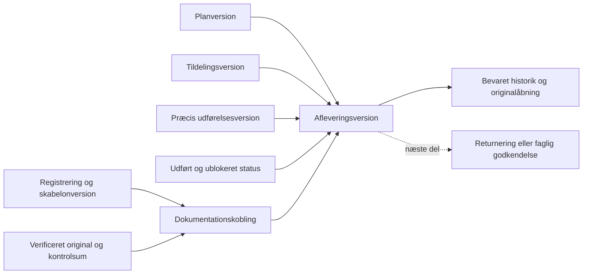

# Afleveringsgrundlag på samme arbejdsopgave

2. november 2026 · S04 / første del af D05 · Kun testmiljøet.

**Efterfølgende leverance:** [S04/D05b](OPGAVE_GENNEMGANG_SAMLING.md) er nu
prøvet på staging og forbinder disse frosne grundlag med aflevering,
uafhængig godkendelse/returnering og genåbning. Beskrivelsen nedenfor
fastholder afgrænsningen og beviset for den første del, D05a.

## Leveret adfærd

Arbejdsopgaven har fået **Aflevering** efter Dokumentation. Brugeren kan
kontrollere mangler og fastholde præcis plan, tildeling, udførelse, status,
registreringsskabeloner, svar og originalreferencer i en gemt version.
Senere rettelser ændrer ikke den version. **Mine opgaver** giver en
autoriseret modtager læseadgang til de samme afleveringer.

Dette er grundlaget til gennemgang. Det registrerer ikke faglig godkendelse
eller skifter operationel status til Afleveret. Eksisterende status og
logbog genbruges; ingen parallel statusmodel er introduceret.

## Kontrakt og genbrug

- Samme organisation, projekt og opgave følger alle kald. Intern skriveret
  og udførelsesret kræves samtidig; ekstern adgang udvides ikke til gemning.
  Aktuel adgang kontrolleres også ved genforsøg.
- Opgaven skal være udført og ublokeret med aktuel plan/tildeling, komplet
  bundet udførelse og mindst én gemt registrering med verificeret original.
  Alle seneste aktive dokumentationskoblinger indgår. Obligatoriske svar
  kontrolleres; `0`, `false` og ukendt holdes adskilt.
- Serveren bygger snapshot fra eksisterende revisioner og ignorerer
  klientens snapshot. Kvittering og det præcise Storage-objekt kontrolleres
  og låses under gemning. Forventet version og SHA-256 af grundlaget
  beskytter mod forældet gemning. Opgavelås, adgangslåse og audit genbruges.
- Samme request-ID giver samme kvittering. Ændret genbrug af ID afvises.
  Et usikkert svar bevarer bemærkningen og gemningsidentiteten i UI.
  Eksisterende editorlåse beskytter kladder og igangværende originalåbning.
- Ingen fil kopieres, og ingen signeret URL gemmes. Originalknappen bruger
  eksisterende signer med aktuel adgangs- og tilbagetrækningskontrol.
  Tidligere udstedte links følger deres eksisterende levetid.
- Kerneregelsæt: `freyra.submission-core/v1`. Mere end 100 aktive koblinger
  eller en pakke over 1 MiB giver synlig mangel. Historik er begrænset til
  fem versioner pr. side med versionsbaseret pagination.

Ny kode: `WorkOrderSubmissionPanel`, `work-order-submission`-kontrakt,
serverfunktioner og service. Opgavearbejdsrum, Mine opgaver,
udførelsesvisning, evidenssigner og samtidighedsharness genbruges.

## Teknisk bevis

| Kontrol | Resultat |
|---|---|
| Appkilde | `06c438b8f78fb4827a5f29a0b63173ac309847ce` |
| Review | [PR38](https://github.com/JESRI-C/freyra-hub/pull/38), kladde oven på PR37; ingen merge |
| CI | [41500655142](https://github.com/JESRI-C/freyra-hub/actions/runs/41500655142), begge jobs bestået |
| App | 3.394 tests i 252 filer; typecheck, lint og build bestået |
| Database | 1.516 pgTAP-kontroller i 23 filer; frisk migrationsreplay, faktisk samtidighed/HTTP, dump/restore og databaselint bestået |
| Lokalt | Fuld typecheck, berørt ESLint, målrettede tests og staging-build bestået |
| Staging-Worker | `bb911f1c-186f-4bc6-8641-d075d5f8c80d`; offentlig buildmetadata matcher appkilden |
| Migration | `20261102180652_work_order_submission_packets.sql`, additiv; staging har 45 migrationer |
| SQL SHA-256 | `c5579a893cccadc204f2a930eedd3d98a6231fb9d41ffc5399f3fd665b233b2f` |
| SQL-readback | Whitespace-normaliseret MD5 `b9c7430c8916ac21c3aacfa1405d17d7` matcher kilden. Kun den nye MCP-genererede ledgerpost er derefter justeret til kildefilens version. |
| Adgang | RLS og SELECT/INSERT-policies aflæst; authenticated har ingen UPDATE/DELETE, anon ingen adgang, service_role kun SELECT på den nye tabel |
| Advisors | 21 eksisterende sikkerhedsfund før/efter; ingen tilføjede eller fjernede enkeltfund. Ingen generel sikkerhedsgodkendelse er givet. |

Nye databaseprøver omfatter forkerte scopes/roller, mangler, forældet
grundlag, manipuleret snapshot, ændret original, bevaret historik efter
planrettelse og audit-rollback. Faktiske PostgreSQL-låsvidner dokumenterer
konkurrerende aflevering, identisk genforsøg, låst originalmetadata og
medlemskab tilbagekaldt før commit. Forældet grundlag giver også HTTP 409.

## Faktisk hosted prøve

[Åbn testopgaven](https://gofreyra-p0-staging.gofreyra-jesri-staging.workers.dev/app/projects/342591a9-5e90-4e34-8777-934a8d2a68dd?tab=handlinger&task=f5ef08af-ecc9-40ac-a7c1-bfbe632280a8)
med eksisterende testlogin og vælg **Aflevering**.
Opgaven hedder **TEST · Fastholdt afleveringsgrundlag 697f6f13**.
Alle udførelsesoplysninger er syntetiske; ingen naturindsats er dokumenteret.

Bestået gennem deployet app og staging-database:

1. Komplet testplan, tildeling, udførelse, udført status, registrering og
   præcis dokumentationskobling danner et afleveringsgrundlag uden mangler.
2. Første vellykkede serverrespons afbrydes efter commit. UI bevarer
   bemærkningen, genbruger request-ID og får én version tilbage.
3. Præcisering af koblingen giver ny aflevering. Hele første række er
   uændret. Antal 0, Nej og ukendt planlagt dato er bevaret.
4. UI åbner originalen gennem eksisterende signer. Downloadens SHA-256 er
   `8343c81af5a4d07b716cf60482c91c5422e7721554eed642f1102e8c2c3be23e`.
5. Tilbagetrækning giver mangel og afvist ny originalåbning. Ny tilknytning
   og tredje aflevering bevarer historikken. Eksisterende original genbruges.
6. Computer og 390-pixel-visning har ingen vandret overflow. Skærmbilleder
   er gennemgået; fysisk telefonaccept er stadig åben.
7. Eksisterende syntetisk ekstern konto læser pakken gennem API og den nye
   visning i **Mine opgaver** ved 390 pixels. Ingen gemmefelter vises.
   Skriveforsøg afvises med `42501`. Tilbagekaldelse afvises gennem API og
   skjuler den cachede historik efter opdatering i browseren. Prøvens
   midlertidige adgang er lukket igen.

Prøven er fastholdt i `scripts/test-work-order-submission-staging.mjs`.
Scriptet kræver `--staging`, korrekte miljøværdier og eksisterende private
QA-fixtures. Credentials, sessions, signerede links og rå fejlsider er
ikke i Git. Screenshots ligger i den ignorerede lokale QA-mappe.

Bevaringskontrol af ID og fuldrækkehash før/efter:

| Eksisterende data | Før | Efter | Ændrede / manglende gamle rækker |
|---|---:|---:|---:|
| Projekter | 52 | 52 | 0 / 0 |
| Opgaver | 22 | 23 | 0 / 0 |
| Mediereferencer | 117 | 117 | 0 / 0 |
| Workspaceposter | 36 | 37 | 0 / 0 |
| Storage-objekter | 260 | 260 | 0 / 0 |

Storage-kontrollen udelader kun læsefeltet `last_accessed_at`. Den nye
workspacepost er testudførelsen. Begge brugerændrede Jobs/Geotag-dokumenter
er hashkontrolleret uændrede. Ingen produktionsændring, mail/invitation,
merge eller aktivering af betalt udbyder er udført.

## Restarbejde

**S04/D05 er delvis.** Næste del skal binde returnering/godkendelse til netop
afleveringsversionen, håndhæve reviewer-/selvreviewregler og afstemme
eksisterende status/logbog. Kategori- og profilspecifikke dokumentationskrav
skal versionsbindes; kerneregelsættet erstatter dem ikke. Rapportbinding
hører til S05/D07 og er stadig åben.

Ekstern nyregistrering/upload, den fulde D03/D04-kort-/listevej, fysisk
telefon og Jespers brugbarhedsaccept er åbne. Kalender, gentagelser, timer,
materialer, booking, ruter, administration og integrationer i
[den samlede Skyhost-plan](SKYHOST_PARITET_OG_RESTARBEJDE_2026-11-02.md)
er fortsat med i målet og er ikke leveret af dette trin.
