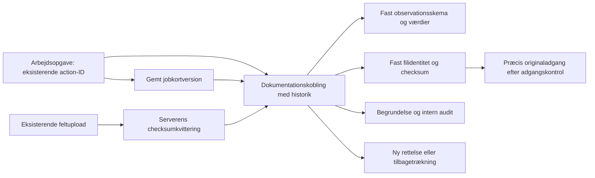

# Arbejdsopgave → feltregistrering → originalfoto

S02 / afgrænset D03-leverance · 2. november 2026.

## Det, som er samlet

Projektets **Plan og opgaver → vælg opgave → Dokumentation** genbruger de
eksisterende gemte jobkort og serververificerede feltfotos. En tilknytning
vælger en bestemt jobkortversion og et bestemt originalfoto. Den kræver en
begrundelse. Rettelse og tilbagetrækning opretter nye versioner; originalen
kopieres eller flyttes ikke.

**Mine opgaver → åbn opgave → Se dokumentation** giver tildelte brugere
læseadgang til opgavens registrerede sammenhænge og præcis originaladgang.
Denne indgang opretter ikke nye registreringer eller projektuploads.

## Hvad bevares og håndhæves

- Opgaveidentitet: `work_orders.action_id` og de eksisterende organisationer,
  projekter og medlems-/opgaverettigheder.
- Observation i denne leverance: en ikke-kladde fra `field_job_versions`.
  Den oprindelige skemadefinition og svar fastholdes i koblingen. Null er
  ukendt; nul og falsk bevares. Tilknytning betyder ikke faglig godkendelse.
- Original: `field_photo_uploads` + en `verified`-kvittering i
  `field_photo_receipts`. Hash, størrelse, Storage-objektets ID, version og
  opdateringstid skal stemme. Filens faktiske bytekontrol genbruges fra den
  eksisterende foto-worker; den gentages ikke i browseren.
- Den nye `work_order_evidence_versions` er koblingshistorik. Sammensatte
  fremmednøgler håndhæver samme opgave/projekt/organisation, også ved direkte
  API-insert. Callerens snapshots og tidspunkt erstattes af databaseværdier.
- Nye versioner kræver forventet version; konkurrerende forfattere får
  konflikt. Samme request-ID og indhold returnerer samme gemning. Ændret
  indhold under samme request-ID afvises. Intern audit sker i samme transaktion.
- Kladden og en usikker gemnings identiteter bevares ved fejl og visningsskift.
  En konflikt rebases ikke automatisk: sammenlign historikken, og start en ny
  rettelse fra den aktuelle version. Andre editorers låse frigives ikke af
  dokumentationspanelet.
- Interne projektbidragydere skal også have udførelsesadgang på opgaven for
  at tilknytte. Tildelte eksterne kan læse den konkrete opgaves snapshots,
  men får hverken projektets kildekatalog eller Storage-enumeration.
- Kildevalg og historik bruger begrænsede cursor-sider. Klientens validering
  kontrollerer også lookahead-rækken, ikke kun de viste rækker.

## Præcis originaladgang

`get_work_order_evidence_original` returnerer kun et eksisterende, tilknyttet
snapshot fra en læsbar opgave. Den kontrollerer den aktuelle Storage-identitet.
Seneste tilbagetrækning lukker også adgang fra de ældre rækker i koblingen.
En rettelse ændrer ikke tidligere registreringers betydning; historiske
originalreferencer kan fortsat læses, indtil koblingen trækkes tilbage.

Serverfunktionen tager kun koblings-ID og opgavens scope fra klienten.
Serverens eksisterende Supabase-adminclient signerer den kontrollerede sti,
og brugerens adgang samt objektidentiteten læses igen bagefter. URL'en skal
have samme Supabase-origin, præcis sti og HTTPS. Den gemmes ikke i metadata,
localStorage eller forespørgselscache. Browserbundlen indeholder ikke den
privilegerede signer eller dens nøglehenvisning.

Et udstedt link er en kortvarig adgangsbillet og kan bruges i **op til 60
sekunder**, også hvis adgang tilbagekaldes lige efter udstedelsen. Dette er
ikke øjeblikkelig tilbagekaldelse af allerede udleverede links. Originalens
bytes er ikke proxyet gennem appen. Den eksisterende serverkonfiguration for
`SUPABASE_URL` og adminclienten skal virke i det miljø, der senere prøves;
bygningen alene verificerer ikke miljøets adgang til signering.

Storage-politikkerne er ikke udvidet. Den smalle databasetrigger bruger
ejerrettigheder til at låse det præcise objekt efter bidrags-/opgavekontrol;
brugeren får ikke UPDATE-adgang til objektet.

## Kode og prøver

| Område | Ejer |
|---|---|
| Relation, RLS, canonicalisering og audit | `supabase/migrations/20261102090158_work_order_evidence_bindings.sql` |
| Input, svar og referencevalidering | `src/lib/work-order-evidence.ts`, `src/services/work-order-evidence-service.ts` |
| Autoriseret servergrænse | `src/lib/work-order-evidence.functions.ts` |
| Begrænset originalsignering | `src/services/work-order-evidence-original.server.ts` |
| Projektvisning | `WorkOrderEvidencePanel`, `ProjectWorkOrdersWorkspace` |
| Ekstern læseindgang | `MyWorkOrders` |
| Syntetiske databaseprøver | `supabase/tests/database/work_order_evidence.test.sql` |
| Faktisk samtidighed og HTTP 409 | Udvidelse af eksisterende `scripts/database-concurrency/field-job-concurrency.test.mjs` |

Applikationscommit: `5739c85b59376478d2ff39770808d3942eb487df`.
[Kladde PR36](https://github.com/JESRI-C/freyra-hub/pull/36) bygger oven på
[navigationskladde PR35](https://github.com/JESRI-C/freyra-hub/pull/35).

Lokalt bestod typecheck, ændrede filers lint og **69 tests i fem filer**:
servicegrænse, originalsigner, dokumentationspanel, projektnavigation og
Mine opgaver. JavaScript-syntaksen i det udvidede samtidighedsscript er
kontrolleret. `npm run build:staging` bestod med ovenstående SHA og staging
i den tilbage-læste `freyra-build.json`. De 191 browser-JS-filer indeholder
ingen `supabaseAdmin`, `SUPABASE_SERVICE_ROLE_KEY` eller
`signWorkOrderEvidenceOriginal`-markør. Dette erstatter ikke hosted prøver.

Databaseprøverne er **skrevet, men endnu ikke kørt**. Maskinen har hverken
Docker, PostgreSQL-klient eller installeret WSL. Begge jobs i
[CI-kørsel 41420195512](https://github.com/JESRI-C/freyra-hub/actions/runs/41420195512)
står i kø ved denne kvittering. Status er ukendt indtil faktisk udførelse;
der er ikke dokumenteret grøn migration, pgTAP, samtidighed eller restore
for denne ændring. Ingen hosted database er brugt som erstatning.

CI genbruger den eksisterende disposable Supabase-stack: tom migration,
alle pgTAP-prøver, samtidighed med reelle PostgreSQL-låse, HTTP-konflikt,
restore og databaselint. Nye scenarier omfatter konkurrerende kobling,
identisk genforsøg og medlemskab tilbagekaldt før commit. pgTAP omfatter
forkert scope, kladde, uverificeret/ændret original, manipuleret snapshot,
ekstern læseadgang, tilbagetrækning og audit-rollback.

## Næste acceptpunkter og afgrænsning

1. Få CI ud af kø og ret eventuelle migration-, pgTAP-, samtidigheds- og
   lintfejl. PR36 forbliver kladde; migrationen er ikke anvendt på staging.
2. Prøv den migrerede kandidat i et aftalt testmiljø: intern og ekstern
   bruger, to projekter, tilbagekaldt opgaveadgang, manglende/ændret original,
   mistet gemmesvar og manuel konfliktbehandling. Bekræft, at signerens
   eksisterende serveropsætning er tilgængelig.
3. Prøv computer og fysisk telefon: læsning, valg, historik, originalåbning,
   visningsskift med kladde og konto-/projektskift. En automatiseret DOM-prøve
   er ikke fysisk mobil-/kamera-/offline-acceptance.
4. Udvid derefter eksisterende observationer og originaltyper én ad gangen;
   generiske `field_observations` og canonical droneoriginaler er ikke
   automatisk konverteret. Initial foto-position bevares; senere
   positionsrevisioner er ikke implicit gjort til observationsbevis.
5. Brug de præcise relationer i S04/D05 og S05/D07 til udførelse, frosne
   afleveringer, review og rapportkilder. En valgfri eksisterende
   udførelsesrevision er allerede scope-afgrænset i databasen; UI vælger den
   endnu ikke. Denne leverance gør ikke koblingen til en færdig aflevering.

**S02/D03 er fortsat delvis.** Ekstern nyregistrering/upload, hele D03,
S04/D05, S05/D07 og salgs-/produktionsacceptance er ikke lukket. Der er ikke
merget, deployet, sendt mail eller kaldt betalte datakilder. Ingen original
eller tidligere udviklet funktion er slettet. Brugerens to eksisterende
Jobs/Geotag-dokumentændringer er hashkontrolleret uændrede.
