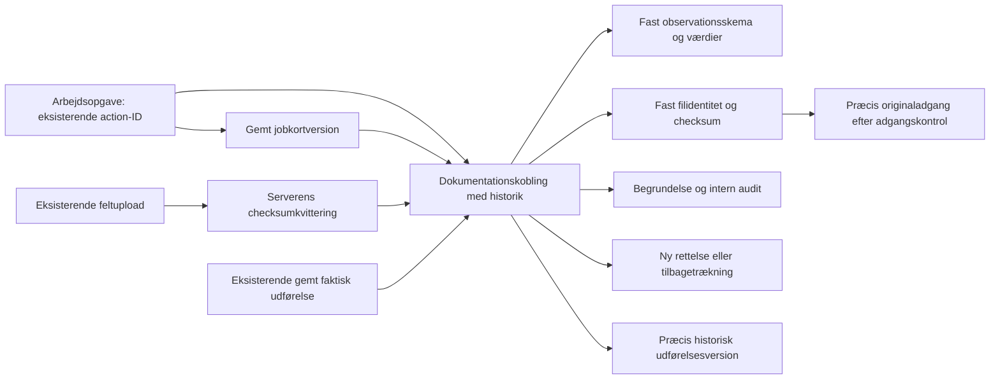

# Arbejdsopgave → feltregistrering → originalfoto

S02 / afgrænset D03-leverance · 2. november 2026.

## Seneste leverance: staging og telefonprøve

Efter udtrykkeligt mandat er kandidaten migreret og deployet til **staging**.
Aktuel appkilde er `46bf6dfc96b72866fafc1c1b0333e9ecc8aa2b4e`; offentlig
buildmetadata matcher. Cloudflare-versionen er
`e5bdd8e0-e004-475f-9133-e1fcfd0f06c2`. Produktionsappen er uændret.

[Telefonvejledningen](TELEFONPROEVE_OPGAVER_2026-11-02.md) åbner den klargjorte,
tydeligt mærkede testsag. [Hosted-kvitteringen](opgave-dokumentation-staging-2026-11-02.json)
registrerer miljø, migrationer, CI og begrænsninger. Kildekandidater og
tidligere kontroltrin nedenfor er bevaret som historik.

I hosted Chrome bestod det faktiske forløb med login, plan, jobkort,
udførelse, lokal offlinekø, luk/genåbn af feltsiden uden net, TUS-upload,
serverens checksumkontrol, dokumentationskobling og signeret originalåbning.
Mistet gemmesvar kunne genforsøges uden dublet. Rettelse bevarede tidligere
snapshots, og forkert opgave samt originalåbning efter tilbagetrækning blev
afvist. En afgrænset ekstern testkonto læste dokumentationen og originalen;
kildekatalog, projektmedier og anden opgave var utilgængelige. Efter
tilbagekaldelse blev nye original-links afvist i både UI og RPC.

Prøven fandt en konkret fejl i den genbrugte uploadmotor: TUS satte
Authorization både ved oprettelse og i hooken. Browserens XHR tilføjede de
to værdier, og Storage afviste tokenet. Nu sættes kun ét aktuelt token i
hooken; fallback, afbrydelse, chunks og genforsøg er bevaret. En regression
med appendende transport fejlede før rettelsen og består nu. Reel hosted
upload viste ét Bearer-token uden komma. CI 41428951155 bestod begge jobs:
**3.368 app-tests i 249 filer og 1.471 databasekontroller i 22 filer** samt
typecheck, lint, migrationsreplay, samtidighed, restore, billeddekodning og build.

Den nyeste testkobling er version 3. Den fastholder et synligt syntetisk
PNG på 160 × 96 pixels, 469 bytes. Downloadens SHA-256 og browserens faktiske
billeddekodning er kontrolleret. Den tidligere meget lille tekniske testfil
havde en ugyldig PNG-chunk-CRC; den blev bevaret som historik og erstattet
gennem en ny koblingsversion. Checksumkvittering betyder identiske bytes,
ikke at en fil er et fagligt brugbart eller korrekt kodet billede.

Før/efter-kontrol af eksisterende rækker fandt **ingen slettede eller ændrede**
projekter (50), opgaver (16), workspaceversioner (32), mediereferencer (110)
eller Storage-objektmetadata (252). Tilføjelserne er afgrænsede testdata.
Dette er en metadata-/referencekontrol, ikke en ny restore af alle gamle
originalbytes. Brugerens to dokumentændringer er hashkontrolleret uændrede.
Supabase-advisories har samme seks grupper før/efter; ingen ny eller ændret
gruppe. De eksisterende fund er fortsat åbne.

En telefonbredde på 390 pixels er kontrolleret uden vandret overløb.
**Fysisk telefon, kamera, HEIC og faktisk lukning af telefonbrowseren er
fortsat brugeraccept**. Der er ikke sendt invitationer/mail eller aktiveret
AI, betalt billedbehandling eller baggrundssweeper. PR36 er fortsat kladde.

## Det, som er samlet

Projektets **Plan og opgaver → vælg opgave → Dokumentation** genbruger de
eksisterende gemte jobkort og serververificerede feltfotos. En tilknytning
vælger en bestemt jobkortversion og et bestemt originalfoto. Den kræver en
begrundelse. Rettelse og tilbagetrækning opretter nye versioner; originalen
kopieres eller flyttes ikke.

**Udført arbejde (valgfrit)** lader brugeren vælge en bestemt eksisterende
udførelsesversion på samme opgave. Der vælges ikke automatisk den nyeste.
Planlagte registreringer kan ikke blive til dokumentation for faktisk
udførelse, heller ikke ved direkte API-insert. **Se tilknyttet udførelse**
viser den valgte versions datoer, metode, dækning, mangler og arbejdsgrundlag.
Den indlæses først, når brugeren åbner den. Senere rettelser ændrer ikke den
valgte udførelsesreference.

**Mine opgaver → åbn opgave → Se dokumentation** giver tildelte brugere
læseadgang til opgavens registrerede sammenhænge og præcis originaladgang.
Denne indgang opretter ikke nye registreringer eller projektuploads.

## Hvad bevares og håndhæves

- Opgaveidentitet: `work_orders.action_id` og de eksisterende organisationer,
  projekter og medlems-/opgaverettigheder.
- Observation i denne leverance: en ikke-kladde fra `field_job_versions`.
  Den oprindelige skemadefinition og svar fastholdes i koblingen. Null er
  ukendt; nul og falsk bevares. Tilknytning betyder ikke faglig godkendelse.
- Original: `field_photo_uploads` + en `verified`-kvittering i
  `field_photo_receipts`. Hash, størrelse, Storage-objektets ID, version og
  opdateringstid skal stemme. Filens faktiske bytekontrol genbruges fra den
  eksisterende foto-worker; den gentages ikke i browseren.
- Den nye `work_order_evidence_versions` er koblingshistorik. Sammensatte
  fremmednøgler håndhæver samme opgave/projekt/organisation, også ved direkte
  API-insert. Callerens snapshots og tidspunkt erstattes af databaseværdier.
- Nye versioner kræver forventet version; konkurrerende forfattere får
  konflikt. Samme request-ID og indhold returnerer samme gemning. Ændret
  indhold under samme request-ID afvises. Intern audit sker i samme transaktion.
- Valgfri udførelsesreference genbruger `work_order_execution_bindings` og
  den eksisterende immutable workspace-revision. Samme opgave/projekt/organisation
  håndhæves med den eksisterende sammensatte fremmednøgle. Den nye trigger
  afviser planlagt arbejde som faktisk udførelse. Ukendt metode, dækning og
  udføreridentitet bliver fortsat vist som dokumentationsmangler.
- Kladden og en usikker gemnings identiteter bevares ved fejl og visningsskift.
  En konflikt rebases ikke automatisk: sammenlign historikken, og start en ny
  rettelse fra den aktuelle version. Andre editorers låse frigives ikke af
  dokumentationspanelet.
- Interne projektbidragydere skal også have udførelsesadgang på opgaven for
  at tilknytte. Tildelte eksterne kan læse den konkrete opgaves snapshots,
  men får hverken projektets kildekatalog eller Storage-enumeration.
- Kildevalg og historik bruger begrænsede cursor-sider. Klientens validering
  kontrollerer også lookahead-rækken, ikke kun de viste rækker.

## Præcis originaladgang

`get_work_order_evidence_original` returnerer kun et eksisterende, tilknyttet
snapshot fra en læsbar opgave. Den kontrollerer den aktuelle Storage-identitet.
Seneste tilbagetrækning lukker også adgang fra de ældre rækker i koblingen.
En rettelse ændrer ikke tidligere registreringers betydning; historiske
originalreferencer kan fortsat læses, indtil koblingen trækkes tilbage.

Serverfunktionen tager kun koblings-ID og opgavens scope fra klienten.
Serverens eksisterende Supabase-adminclient signerer den kontrollerede sti,
og brugerens adgang samt objektidentiteten læses igen bagefter. URL'en skal
have samme Supabase-origin, præcis sti og HTTPS. Den gemmes ikke i metadata,
localStorage eller forespørgselscache. Browserbundlen indeholder ikke den
privilegerede signer eller dens nøglehenvisning.

Et udstedt link er en kortvarig adgangsbillet og kan bruges i **op til 60
sekunder**, også hvis adgang tilbagekaldes lige efter udstedelsen. Dette er
ikke øjeblikkelig tilbagekaldelse af allerede udleverede links. Originalens
bytes er ikke proxyet gennem appen. Den eksisterende serverkonfiguration for
`SUPABASE_URL` og adminclienten skal virke i det miljø, der senere prøves;
bygningen alene verificerer ikke miljøets adgang til signering.

Storage-politikkerne er ikke udvidet. Den smalle databasetrigger bruger
ejerrettigheder til at låse det præcise objekt efter bidrags-/opgavekontrol;
brugeren får ikke UPDATE-adgang til objektet.

## Kode og prøver

| Område | Ejer |
|---|---|
| Relation, RLS, canonicalisering og audit | `supabase/migrations/20261102090158_work_order_evidence_bindings.sql` |
| Valg af faktisk udførelse og direkte API-kontrol | `supabase/migrations/20261102094049_work_order_evidence_execution_sources.sql` |
| Input, svar og referencevalidering | `src/lib/work-order-evidence.ts`, `src/services/work-order-evidence-service.ts` |
| Autoriseret servergrænse | `src/lib/work-order-evidence.functions.ts` |
| Begrænset originalsignering | `src/services/work-order-evidence-original.server.ts` |
| Projektvisning | `WorkOrderEvidencePanel`, `ProjectWorkOrdersWorkspace` |
| Ekstern læseindgang | `MyWorkOrders` |
| Præcis historisk udførelsesvisning | `WorkOrderExecutionReference`, eksisterende `get_work_order_execution_binding` og work-order-execution-service |
| Syntetiske databaseprøver | `supabase/tests/database/work_order_evidence.test.sql` |
| Faktisk samtidighed og HTTP 409 | Udvidelse af eksisterende `scripts/database-concurrency/field-job-concurrency.test.mjs` |

Applikationscommit: `5739c85b59376478d2ff39770808d3942eb487df`.
[Kladde PR36](https://github.com/JESRI-C/freyra-hub/pull/36) bygger oven på
[navigationskladde PR35](https://github.com/JESRI-C/freyra-hub/pull/35).

Lokalt bestod typecheck, ændrede filers lint og **69 tests i fem filer**:
servicegrænse, originalsigner, dokumentationspanel, projektnavigation og
Mine opgaver. JavaScript-syntaksen i det udvidede samtidighedsscript er
kontrolleret. `npm run build:staging` bestod med ovenstående SHA og staging
i den tilbage-læste `freyra-build.json`. De 191 browser-JS-filer indeholder
ingen `supabaseAdmin`, `SUPABASE_SERVICE_ROLE_KEY` eller
`signWorkOrderEvidenceOriginal`-markør. Dette erstatter ikke hosted prøver.

Den tidligere testkø er afviklet. På `e716533` bestod begge jobs i
[CI-kørsel 41421195287](https://github.com/JESRI-C/freyra-hub/actions/runs/41421195287):
**3.353 applikationstests i 249 filer**, 1.458 databasekontroller i 22 filer,
tom migration, reel PostgreSQL-samtidighed, restore, databaselint, typecheck,
lint, foto-workerens syntetiske billeddekodning og build.

Den efterfølgende udførelseskobling ligger i applikationscommit
`72d4c8486295848740d384c58006f545fb82f3f6`. Lokalt bestod typecheck,
ændrede filers lint og **108 målrettede tests i syv filer**.
[CI-kørsel 41423470242](https://github.com/JESRI-C/freyra-hub/actions/runs/41423470242)
har allerede bestået hele databasejobbet: **1.471 databasekontroller i 22
filer**, tom migration, 29 generelle samtidighedsscenarier, 21 job-/opgave-
scenarier, seks fotoscenarier, restore, databaselint og oprydning. Det samlede
applikationsjob bestod også: **3.367 tests i 249 filer**, typecheck, lint,
beregningskilder, foto-workerens billeddekodning og build.

Staging-bygningen bestod lokalt med præcis `72d4c84…` i de tilbage-læste
buildmetadata. Alle 191 browser-JS-filer er kontrolleret uden privilegerede
signer/admin-markører. En lokal Chrome-prøve af de faktiske komponenter og
den byggede CSS bestod ved **320, 390 og 1.280 pixels**: intet vandret
overløb, synlige knapper mindst 44 pixels høje, historisk udførelse og
redigeringsformular. Serverfunktionerne var syntetiske hukommelses-fixtures;
det er hverken hosted end-to-end-test eller fysisk telefonacceptance.
Prøven gemmer skærmbilleder og resultat under ignoreret
`tmp/evidence-execution-browser/`.

[Maskinlæsbar kandidatkvittering](opgave-dokumentation-kandidat-2026-11-02.json)
registrerer den præcise testede kode, CI, testomfang og resterende accept.

Kontrollerne har kørt på CI's midlertidige database. Maskinen har fortsat
hverken lokal Docker, PostgreSQL-klient eller installeret WSL. Ingen hosted
database er brugt som erstatning eller ændret af denne leverance.

CI genbruger den eksisterende disposable Supabase-stack: tom migration,
alle pgTAP-prøver, samtidighed med reelle PostgreSQL-låse, HTTP-konflikt,
restore og databaselint. Nye scenarier omfatter konkurrerende kobling,
identisk genforsøg og medlemskab tilbagekaldt før commit. pgTAP omfatter
forkert scope, kladde, uverificeret/ændret original, manipuleret snapshot,
ekstern læseadgang, tilbagetrækning og audit-rollback.

## Næste acceptpunkter og afgrænsning

1. Automatisk kandidatkontrol og det ovenstående hosted forløb er bestået.
   Begge additive migrationer er anvendt på staging; PR36 forbliver kladde.
2. Udvid hosted-prøven med to samtidige projekter og manuel
   konfliktbehandling. Manglende/ændret original er dækket i automatiske
   DB-/serviceprøver; eksisterende originaler er ikke manipuleret i staging.
3. Prøv computer og fysisk telefon: læsning, valg, historik, originalåbning,
   visningsskift med kladde og konto-/projektskift. En automatiseret DOM-prøve
   er ikke fysisk mobil-/kamera-/offline-acceptance.
4. Udvid derefter eksisterende observationer og originaltyper én ad gangen;
   generiske `field_observations` og canonical droneoriginaler er ikke
   automatisk konverteret. Initial foto-position bevares; senere
   positionsrevisioner er ikke implicit gjort til observationsbevis.
5. Brug de præcise relationer i S04/D05 og S05/D07 til udførelse, frosne
   afleveringer, review og rapportkilder. En valgfri eksisterende
   udførelsesrevision kan nu vælges og læses i UI. Denne leverance gør ikke
   koblingen til en færdig aflevering.

**S02/D03 er fortsat delvis.** Ekstern nyregistrering/upload, hele D03,
S04/D05, S05/D07 og salgs-/produktionsacceptance er ikke lukket. Staging er
migreret og deployet; der er ikke merget, ændret produktion, sendt mail eller
kaldt betalte datakilder. Ingen original
eller tidligere udviklet funktion er slettet. Brugerens to eksisterende
Jobs/Geotag-dokumentændringer er hashkontrolleret uændrede.
