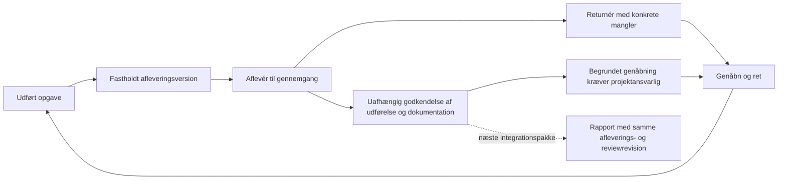

# Aflevering, returnering og uafhængig gennemgang

2. november 2026 · S04/D05b · Kun det autoriserede testmiljø.

En udført opgave kan nu afleveres som en bestemt gemt afleveringsversion.
En anden autoriseret reviewer kan godkende den registrerede udførelse og
dokumentationen eller returnere med konkrete mangler. Genåbning, rettelse,
ny udført-status og ny aflevering bevarer alle tidligere versioner.
Godkendelsen vurderer ikke automatisk naturens effekt.

[Prøv den klargjorte testsag](https://gofreyra-p0-staging.gofreyra-jesri-staging.workers.dev/app/projects/342591a9-5e90-4e34-8777-934a8d2a68dd?tab=handlinger&task=f2df70e2-c60c-46f2-b824-a7ec818422ce&work=submission)
med dit eksisterende testlogin. Den er mærket **TEST · Gennemgang af
aflevering 3ebd6f50**. Version 1 er returneret; version 2 har en syntetisk
testgodkendelse. Der er ingen faktisk naturindsats eller kundeaccept.

## Genbrug og afgrænsning

| Del | Eksisterende grundlag og leveret forbindelse |
|---|---|
| Identitet | Samme organisation, projekt, `actions.id`, plan, tildeling, udførelse og originalreferencer. Ingen parallel opgave eller filkopi. |
| Datamodel | `work_order_lifecycle_versions` udvides additivt med afleveringsreference og reviewomfang. Eksisterende frosne afleveringer, låse, audit, RLS og RPC genbruges. |
| Brugerflade | Aflevering på opgaven og Se afleveringsversioner i Mine opgaver. Samme kontrolkomponent, statusord og handlinger. En eksplicit reviewer kan gennemgå uden udførelses-/gemmeret. |
| Adgang | Aktiv læse- og relevant handlingsret kontrolleres under lås, også før genfinding af en gammel kvittering. Egen udførelse, dokumentation, registrering eller aflevering må ikke selvreviewes. |
| Versioner | Godkendelse kræver præcis aktuelt afleveret version og uændrede kilder. Et forældet materiale kan returneres med mangler. Genåbning af godkendt arbejde kræver projektansvarlig. |
| Originaler | Eksisterende Storage-objekt og kvittering kontrolleres og låses under godkendelse. Åbning genbruger signer med aktuel adgang; ingen signeret URL lagres i historikken. |
| Kladdesikkerhed | Notat, forventet version og request-ID fastholdes ved usikkert svar. Samme genforsøg giver én kvittering. Eksisterende editorlåse beskytter mod opgaveskift og parallelle formularer. |
| Historik | Seneste fem faglige gennemgange vises med afleveringsversion og omfang. Hele historikken findes i eksisterende paginerede status/logbog, som også viser afleverings-/reviewreferencer. |

Kontrakt: `src/lib/work-order-review.ts`, eksisterende lifecycle-kontrakt og
`work-order-submission.functions.ts`. Service: `work-order-review-service.ts`.
UI: `WorkOrderReviewControls`, `WorkOrderSubmissionPanel`, `MyWorkOrders`
og `WorkOrderStatusPanel`. Migration: `20261102213116_work_order_submission_review.sql`.
Ældre normaliserede statuskald og deres idempotente kvitteringer bevares.

## Kontrol og testbevis

Kilde `2e04787f13a042b36df44b3b3bb2a4bb4a25f6f3`, kladde
[PR40](https://github.com/JESRI-C/freyra-hub/pull/40) oven på PR39.
[CI 41535229142](https://github.com/JESRI-C/freyra-hub/actions/runs/41535229142)
bestod **3.418 app-tests/256 filer og 1.568 databasekontroller/24 filer**,
typecheck, lint, frisk migrationsreplay, reelle samtidigheds-/HTTP-prøver,
dump/restore og build. Den nye samtidighedsprøve viser faktisk venten på
originalmetadata, konkurrerende reviewbeslutninger, samme genforsøg og
medlemskabstilbagekaldelse før commit. Testdatabasen er disponibel; staging
er ikke nulstillet.

Staging har 46 migrationer. Den nye migrations SQL er hashafstemt med Git,
og migrationsnummeret er afstemt uden at ændre gamle ledgerposter.
Worker `ade3d174-87f1-4d64-8f5f-bf668c88a93c` og offentlig buildmetadata
matcher ovenstående kilde. [Maskinkvittering](review-staging-receipt-2026-11-02.json)
fastholder identiteter og resultater.

Faktisk hosted browser/API bestod: aflevering, afvisning af selvreview,
ændret dokumentation, afvisning af forældet godkendelse, returnering,
genåbning, ny udført-status, version 2 og uafhængig godkendelse. Et mistet
godkendelsessvar beholdt notat og samme request-ID; databasen og audit har
præcis én godkendelse. Originaldownload matchede SHA-256. `0` og `false`
er bevaret. Reviewerens Mine opgaver virker uden udførelsesret. Tilbagekaldt
adgang skjuler cache/historik ved opdatering og afviser genforsøget. Alle
midlertidige reviewrettigheder er lukket igen.

Skærmbilleder er gennemgået ved 1280, 390 og 320 pixels uden vandret
overflow. Eksisterende status/logbog viser reviewomfanget. Ingen observerede
JavaScript-sidefejl i den efterfølgende læseprøve. Browserens telefonmål
erstatter ikke en fysisk telefonprøve.

Bevaringskontrollen fandt nul ændrede eller manglende gamle rækker i de
52 projekter, 23 opgaver, 117 mediereferencer, 37 workspaceposter, 260
Storage-objekter, 19 statusversioner, tre afleveringer og 16 adgangsversioner.
Én mærket testopgave og dens nye historik er tilføjet. Statussammenligningen
udelader kun de to nye nullable kolonner; Storage udelader adgangstid.
Begge brugerændrede Jobs/Geotag-dokumenter har uændret SHA-256.

Sikkerhedsadvisors har samme 21 enkeltfund før og efter. Performance har
ét nyt endnu ubrugt indeks, som understøtter den nye sammensatte FK; det
bevares. Der er ingen ny uindekseret FK. Eksisterende fund er ikke erklæret
løst. [Advisors og forklaringer](https://supabase.com/docs/guides/database/database-linter).

## Næste arbejdspakke

**S04/D05 er delvis.** Næste konkrete mangel er versionsbundne krav efter
opgavens profil/kategori ud over det eksisterende kerneregelsæt og gemte
obligatoriske skemafelter. Genbrug skabeloner og eksisterende opsætning;
opfind ingen faglige metoder. Derefter bindes rapportrevisionen til samme
aflevering/review i S05. Selvstændige afvigelsers alvor/ejer/frist og
lukningsbevis er fortsat åbne.

Kalender/gentagelser, timer/materialer, booking/ruter, administration,
import/eksport og integrationer indgår fortsat i S13–S16. Øvrige fagmoduler
er bevaret. Fuld Skyhost-paritet, rapportkæden, fysisk telefon, faglig
accept og Jespers brugbarhedsaccept er ikke afsluttet. Ingen merge,
produktion, beskedafsendelse eller betalt udbyder er aktiveret.
