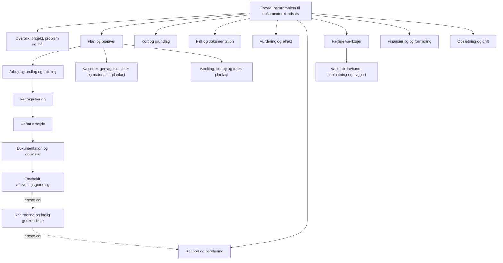

# Hele Freyra: programkort og fælles visning

2. november 2026 · S00/S01/S11 og den samlede Skyhost-mapping.

## Hvad er kortlagt?

Alle 878 aktuelle JS-/TS-filer i `src`, deres statiske lokale imports og
93 routedefinitioner er inventeret. De 71 kanoniske produktsidevisninger,
20 projektværktøjer og fem opgavedele har en navngiven destination. Ingen
fundne produktsider mangler en mapping. Tekniske endpoints, layouts og
login/valg er klassificeret særskilt; de tælles ikke som naturfaglige funktioner.

Programoverblik indeholder **115 punkter**, ikke 115 færdigaccepterede
funktioner. Nogle er forskellige indgange til samme eksisterende arbejdsrum.
Fem punkter er eksisterende integrationskandidater, 13 er planlagt
restarbejde, og det tidligere planlagte review er nu delvist leveret via
[S04/D05b](OPGAVE_GENNEMGANG_SAMLING.md). Dets eksisterende kort-ID er bevaret,
og indgangen åbner samme opgaves Aflevering. Alle 68 eksisterende
Jobs/Geotag-krav har sporbar placering. JOB-05/JOB-09 og QA-01–04 har nu
konkrete kode-, migrations-, test- og resthenvisninger for denne leverance.
Opsætning fra Skyhost-kilden, som mangler selvstændige krav-ID'er, er
registreret som supplerende scope.

[Den komplette kortlægning](program-map/inventory-2026-11-02.json) indeholder
hver fil og dens hash, route/guide, projektmål, krav/kode/tests, de ti
Skyhost-jobområder, integrationer og sammenligning med tidligere træer.
`node scripts/map-program.mjs` genskaber inventaret lokalt uden netværk,
databasekald eller læsning af credentials. Registrerede ældre kravstatusser
bevares som historiske; mapping hæver dem ikke til nutidig accept.

## Det fælles programkort

Den søgbare udgave findes under **Programoverblik** i hovedmenuen på
computer og telefon. Områdevalg, fritekst og status filtrerer samme liste.
En tom søgning kan nulstilles. Projektværktøjer åbner det valgte naturprojekt.
Uden valgt projekt går linket til projektvalg. Byggeri og lavbund får deres
egne projektvalg; naturprojektets ID genbruges ikke i et andet fagdomæne.

## Samme måde at vise formål og resultat

`WorkspaceGuide` viser det samme mønster i de eksisterende appvisninger,
projektværktøjer og fem opgavedele:

1. **Formål:** Hvilket spørgsmål arbejder brugeren med?
2. **Arbejde:** Hvad bruges værktøjet til?
3. **Resultat:** Hvad får brugeren ud af dette trin?

Den eksisterende projektoversigt bevarer projektlederens samlede forløb.
De øvrige guides og programkortet læser samme præsentationsregister, så
ordvalg og destination ikke vedligeholdes som uafhængige parallelle lister.
Eksisterende editorer, felter, tabeller, fagmoduler og serverkontroller er
bevarede. Fælles præsentation er ikke en ny autorisationsmodel.

Opgavedele ligger nu i `work-order-navigation.ts`. De fem oprindelige
editorer genbruges, og `work=evidence` samt `work=submission` er tilføjet
til eksisterende linkvalidering. `task`, `round` og opgaveidentitet kan
følge det præcise værktøjslink; gammelt `step` erstattes af målvisningen.
Lokale visningsskift bevarer fortsat monterede editorer og deres kladder.

## Skyhosts præcise ti jobfaner

| Skyhost-område | Plads i Freyra | Rest før paritet |
|---|---|---|
| Detaljer | Arbejdsgrundlag, tildeling og udført arbejde | Kundekontakter, jobtyper, egne felter, nummerserier, kalender/gentagelse |
| Lokationer | Fotopunkter og projektkort | Flere joblokationer, rækkefølge, besøgskrav og køretid |
| Kort | Projektkort og Kort og zoner | Fælles filtre/totaler, polygonvalg og job-/besøgsvisning |
| Logbog | Status/noter under arbejdsgrundlag samt revisionsspor | Samlet bilagslog, typefiltre og beskedforløb |
| Geotag | Feltregistrering og Dokumentation | Fuld ekstern skrive-/filvej, kategorier, faser og geografiske forslag |
| Timer | Planlagt tids-/aktivitetsforløb | Estimat, forbrug, rest, begrænsninger og registreringshistorik |
| Materialer | Planlagt katalog og jobforbrug | Varer, enheder, mængder og økonomireferencer |
| Booking | Planlagt ressourcebooking | Maskiner/køretøjer/værktøj, tidsrum og konfliktkontrol |
| Ruter | Planlagt registreret kørsel; besøgsplan er særskilt | Jobkørsel, km/tid og kobling til timer/stempelur |
| Tjeklister | Skemaer og fastholdt afleveringsgrundlag | Konfigurerede kategori-/statuskrav og review |

I Programoverblik kan man skifte til **Skyhosts ti jobområder**. Det er den
kortlagte rækkefølge og funktionelle placering. Fire fuldt planlagte
områder og restarbejdet i de øvrige vises uden falske gemme-/aktiveringsknapper.
Skyhost Jobs-opsætning, Geotag-kategorier, kunder, nummerserier,
import/eksport, økonomi/løn og dagsrapport er stadig med i leverancen.

## Kode, som endnu ikke er koblet på

97 produktionsfiler er ikke nået fra deklarerede ruter i den simple
importgraf. Det omfatter standard-UI, framework-entrypoints, alternative
komponenter, datahjælpere og konkrete integrationskandidater. Det er
**ikke** 97 skjulte færdige funktioner og aldrig en sletteliste.

| Genbrugskandidat | Gennemlæst kode | Nødvendig samling før aktiv brugerhandling |
|---|---|---|
| Vandløbets centerlinje/delstrækninger | WatercoursePanel og watercourse-service | Fælles kort, kladdelås, aktør-/projektscope og opgaverelation |
| Stedbundne vandløbsobservationer | WatercourseObservationPanel og watercourse-observations | Reviewrolle, billed-/udførelsesbinding og cacheidentitet |
| Artsgenkendelse | SpeciesRecognitionFlow og eksisterende artsfunktion | Scope, reel udbyderprøve og faglig kontrol |
| AI-rapportudkast | AiReportDraft og eksisterende rapportudkastfunktion | Frosne projektkilder, scope og udbyderprøve |
| Dronebehandlingsjob | drone-jobs-service og drone-processing | Eksisterende blokeret manifestjob er ikke en afprøvet worker-/udbyderdrift |

De fem vises som **Afventer samling** med formål og resultat. Øvrige
hjælpe-/prototypefiler er med i det tekniske inventar. Alternative alarm-,
kort- og vurderingskomponenter undersøges i deres respektive pakker; en
allerede dækket funktion skal ikke få en ekstra, konkurrerende indgang.

Tre tidligere TypeScript-træer er sammenlignet igen: 599, 650 og 656 filer.
De har ingen filstier, som mangler i den aktuelle kode. Indholdsforskelle
er registreret og bevares. Det gamle JSX-prototypespor har 16 særskilte
filstier og bevares som selvstændigt historisk spor. Ingen automatisk
merge, sletning eller omklassificering er udført.

## Kontrol og afgrænsning

Det aktuelle inventar er genskabt efter S04/D05b, visningskontrollen og
sikkerhedsleverancen 3. november: 601 produktionsfiler og
276 test-/supportfiler samt genereret routetræ. Der er fortsat nul
umappede produktsider og 98 undersøgelseskandidater. Den nye HTTP-hjælper
bruges fra serverindgangen, som ikke er en produktside i importkortet.
Den oprindelige
præsentationsleverances bevis nedenfor er historisk; gennemgangsleverancen er dokumenteret særskilt. Nyeste visningskode og browserprøve
fremgår af [visningskontrollen](VISNINGSKONTROL_2026-11-03.md).

De målrettede prøver bestod, herunder alle produktsiders mapping,
eksakte opgave-/rundelinks, fremmede fagdomæners projektvalg, ukendt URL,
planlagte områder uden aktive links, tomt filter og eksisterende
kladde-/mobil-/offline-/opgaveprøver. Berørt ESLint og staging-build bestod.

Kilde `92c638baa0cdabd8d09b12569b86afd35268a327` bestod
[CI 41510845863](https://github.com/JESRI-C/freyra-hub/actions/runs/41510845863):
3.404 apptests/254 filer og 1.516 databasekontroller/23 filer samt fuld
typecheck, lint, build, frisk migrationstest, samtidighed og restore.
Staging-build og scriptets syntaks/lint bestod lokalt. Den samlede
menukontrol bevarer alle 17 gamle indgange og Programoverblik som nummer 18.

Staging-Worker er `4acbcaaa-83bb-4372-a13c-ed4286c0d667`; offentlig
buildmetadata matcher kilden. [Browserkvitteringen](program-map/hosted-receipt-2026-11-02.json)
og `scripts/test-program-map-staging.mjs` fastholder en faktisk, læsende
prøve med den eksisterende syntetiske testsag: eksakte filterfeltnavne,
Skyhost-søgning til eksisterende værktøjer, ingen aktive links til planlagte
områder, tomt filter/nulstilling, korrekt projekt, alle ti jobområder,
320/390 pixels uden vandret overflow, samme forklaringer i globalt
arbejdsrum/projekt/opgave og direkte links til Dokumentation/Aflevering.
Browseren gav ingen JavaScript-sidefejl. Skærmbilleder er gennemgået.

[Åbn Programoverblik i testmiljøet](https://gofreyra-p0-staging.gofreyra-jesri-staging.workers.dev/app/program)
med det eksisterende testlogin. [PR39](https://github.com/JESRI-C/freyra-hub/pull/39)
er fortsat en kladde oven på PR38. De to brugerændrede dokumenters SHA-256
er kontrolleret uændret. Ingen projektdata, originaler, tidligere
versioner eller gamle kodetræer blev skrevet i browserprøven.

Statisk kortlægning beviser ikke, at alle
eksisterende skærme har bestået ende-til-ende-, kilde-, fag- eller
kundeaccept. Den opdaterede samlede plan og Skyhost-restliste gælder
fortsat. Ingen databaseændring eller produktionsændring er en del af
denne præsentationsleverance. Brugerens to Jobs/Geotag-dokumenter bevares.
