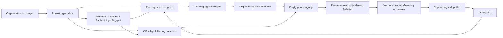

# Freyra: udviklingsplan for at samle og færdiggøre programmet

Version 1.8 · 3. november 2026 · Produktejer: Jesper Riel · Teknisk udførelse: udviklingsansvarlig.

**Aktuelt SaaS-mål og bevis:** [50-brugerprøven](SAAS_50_BRUGERE_2026-11-03.md)
afprøvede 50 forskellige konti i otte organisationer. Den fandt og rettede
en reel spærring for den tildelte feltmedarbejders udførelse. Alle otte
forløb når nu uafhængig gennemgang på staging, og adgangsgrænserne er genprøvet.
Kilde `5cdb5ef…`, draft PR43. Kvalitetsmålet for helheden er en tydelig, praktisk
brugeroplevelse på niveau med førende SaaS-systemer. Dineros opgavebaserede
introduktion bruges som reference. Den tekniske prøve lukker ikke S05, fuld
Skyhost-paritet, fysisk telefon, kundeaccept eller drift og salg.

**Seneste sikkerhedsleverance (S11):** [Kode- og sikkerhedskontrol](SIKKERHEDSKONTROL_2026-11-03.md)
samler de konkrete pakkerettelser, cachebeskyttelse, bevarede historiske
rapportkontrolsummer og genprøven af navigation/originaler/roller. Runtime-
audit er nul; udviklingsværktøjer og navngivne PostGIS-/Auth-/engine-opgaver
er fortsat åbne. Dette ændrer ikke S04/S05's faglige restarbejde eller gør
programmet generelt produktionsgodkendt. Kildekandidat `ce2ff55…`, draft PR42.

**Seneste visningsleverance:** [Kontrol af hele programkortet](VISNINGSKONTROL_2026-11-03.md)
retter menumarkering, et pilotbundet kortlink, fælles danske betegnelser,
opgavetotal og afgrænsningen af den faste Haderslev-rapportskabelon. Kilde
`e4d71ec…` er på staging. Alle 97 aktive destinationer kontrolleres på
computer og telefonbredder; syv indgange har kun bevis frem til projektvalg,
fordi den anvendte konto mangler bygge-/lavbundsprojekter. Der opfindes ingen
fagdata. Fuld faglig datavisning, fysisk telefon og brugeraccept er fortsat åbne.

**Mål:** Freyra skal dække den fulde kortlagte funktionalitet i Skyhost Jobs og Geotag og samle den med Freyras eksisterende fagmoduler. Kunden kan planlægge, fordele, udføre, kontrollere og dokumentere et naturprojekt i ét sammenhængende program, inklusive de kortlagte driftsfunktioner. Eksisterende kode genbruges med samme projekt-, opgave-, fil- og versionsidentitet på computer og telefon. Alle eksisterende fagområder bevares og får en tydelig plads; funktioner åbnes i takt med dokumenteret anvendelighed.

Dette er den samlende leveranceplan. Den erstatter ikke fagkravene i F01–F29 eller Jobs/Geotags D00–D10 og 68 eksisterende krav. [Skyhost-paritet og restarbejde](SKYHOST_PARITET_OG_RESTARBEJDE_2026-11-02.md) præciserer det fulde mål efter Jespers korrektion: kalender, gentagelser, timer, materialer, booking, ruter og opsætning indgår i den samlede leverance. De eksisterende kravregistre er acceptgrundlag; planen her styrer rækkefølge, integration, navigation, genbrug og oprydning. Den starter ikke en ny implementering af allerede løste krav.

**Aktuel prioritet efter brugerprøve:** Jesper fandt fortsat formål og
betjening forvirrende. Projektlederens forløb er valgt som hovedindgang, og
S01/S11's brugeraccept er genåbnet. [Forløb og acceptkriterier](PROJEKTLEDER_FORLOEB_2026-11-02.md)
styrer næste prøve. Kilde `c93ad03…` introducerede problem og mål,
grundlag, plan, udførelse, vurdering og dokumentation som samlet indgang.
Automatiske kontroller og browserprøve er tekniske beviser; Jespers
brugbarhedsvurdering er fortsat åben. Kilde `06c438b…` er nu på staging med
[frosne afleveringsgrundlag](OPGAVE_AFLEVERING_SAMLING.md), bestået gennem
app, database, genforsøg og afgrænset ekstern læsning. S04/D05 er delvis.
Kilde `2e04787…` tilføjer nu [versionsbundet faglig gennemgang](OPGAVE_GENNEMGANG_SAMLING.md)
på staging: aflevering, uafhængig godkendelse/returnering og genåbning på samme
opgave. Versionsbundne fagkrav og rapportkilder er næste integrationsarbejde.

**Kortlægning og fælles præsentation:** Kilde `92c638b…` er nu på staging
med [Programoverblik og ensartede forklaringer](PROGRAMKORT_OG_ENSARTET_VISNING_2026-11-02.md).
Alle 71 kanoniske produktsidevisninger, 20 projektværktøjer, fem opgavedele
og 68 eksisterende krav er placeret. Skyhosts ti jobområder, fem konkrete
integrationskandidater, 13 planlagte områder og én delvis gennemgangsfunktion
er synlige med deres faktiske afgrænsning. Det aktuelle inventar indeholder
878 kilde-/testfiler; tre ældre TypeScript-træer er fortsat bevaret og sammenholdt.
CI og faktisk læsende browserprøve bestod. Eksisterende kode, menuindgange,
projekt-/opgaveidentitet og originaler bevares. Fuld funktionel paritet og
Jespers brugbarhedsaccept er fortsat åbne.

**Teknisk del fra den tidligere leverance:** Navigationen og den afgrænsede S02-kobling er i det
autoriserede testmiljø på appkilde `46bf6df…`. Login → plan → registrering →
udførelse → offlinefoto → verificeret original → versionsbundet dokumentation
er prøvet med rigtig hosted UI og database. Afgrænset ekstern læsning og
tilbagekaldelse bestod. [Telefonprøven er klargjort](TELEFONPROEVE_OPGAVER_2026-11-02.md).
Fysisk telefonaccept er næste trin; S02/D03 er fortsat delvis. Produktionsappen
er uændret. [Leverance og bevis](OPGAVE_DOKUMENTATION_SAMLING.md).

## 1. Udgangspunkt og bevis

Lokal reference: `codex/work-order-ux-v1`, `2b122fe4518fc3673a6c8db0450b2073c5a166d3` i dette checkout. Ved start var der eksisterende ændringer i `JOBS_GEOTAG_KRAVMATRIX.md` og `JOBS_GEOTAG_TESTLEVERING.md`; de bevares.

GitHub er læst 2. november: [PR34](https://github.com/JESRI-C/freyra-hub/pull/34) er åben draft og har samme head som den lokale kode. Den bygger på [PR33](https://github.com/JESRI-C/freyra-hub/pull/33), der igen bygger på PR32 osv. De seneste otte åbne PR'er er undersøgt; det er ikke en udtømmende audit af alle grene. Ingen merge eller deploy er udført i denne planopgave. Et mergeable-flag er ikke en frigivelsesgodkendelse.

Kodeinventaret fra 2. november viser 831 JS/TS-kodefiler i nyeste src-træ, heraf 257 testfiler, én genereret routefil og 573 øvrige kildefiler; 153 er servicefiler. Der er 92 routedefinitioner inklusive layouts og tekniske endpoints, 17 hovedmenuindgange og 14 projektfaner. Fem lokale kodetræer er sammenholdt. Ældre TypeScript-træer har ingen almindelige filstier, som mangler i det nyeste, men deres indhold er forskelligt. Det gamle JSX-dashboard er et separat historisk spor.

Importgrafens 98 ikke-nåede filer er kandidater til undersøgelse, ikke en sletteliste. Framework-entrypoints, typer, standard-UI, dynamiske opslag og alternative implementationer kan være legitime. Hver oprydningsbeslutning kræver indholdsgennemgang og viden om faktisk anvendelse.

Den færdige [Haderslev-rapport](https://drive.google.com/file/d/1BynA_7pBq91XG96qHuCJ1z8sV_1Wv070/view?usp=drivesdk) er reference for kvaliteten af en leverance. Dens fremstilling rummer også projektspecifikke værktøjer uden for webappen. Vi antager ikke, at rapportknappen allerede automatiserer hele denne produktion.

### Det, som allerede skal genbruges

| Del | Eksisterende hovedkilder | Udviklingsbeslutning |
|---|---|---|
| Organisation/projekt/adgang | `lib/auth.tsx`, `ProjectContextBoundary`, `project-members-service`, `project-nature-access.server.ts` | Én projektkontekst; behold server-/databasekontrol |
| Opgaver | `actions`, `ProjectWorkOrdersWorkspace`, `MyWorkOrders`, work-order-services og revisionstabeller | Samme stabile action-ID; bevar plan, tildeling, udførelse og status som adskilte revisioner |
| Felt og originalfiler | `FieldOfflineWorkspace`, field-offline-/field-photo-services, canonical drone media | Udbyg opgavebinding og rettigheder; opret ingen parallel uploadmotor |
| Undersøgelse/baseline | `MunicipalCaseWorkspace`, `DroneSurveyWorkspace`, `PublicBaselinePanel`, survey/verification-services | Samme runder, kilder og versioner i alle visninger |
| Før/efter | `PhotoComparisonPanel`, photo-comparison og action-execution | Bind til faktisk udførelse og relevante originaler, ikke blot datoer eller tags |
| Rapporter | `ReportWorkspace`, `WorkflowReportPanel`, report-document/workflow-report, eksportfunktioner | Én revisionsbundet kildepakke med formatadaptere; historiske rapporter bevares |
| Tværgående fagmoduler | `ProjectWorkspacePage`, `WorkspaceEntries`, lavbund-, planting-, construction- og nature-services | Domænespecifikke værktøjer på fælles projekt/evidens; ikke en ny dataplatform |
| Kort og datakilder | Aktive kort, baselineadaptere, geo-services, rasterpreview | Ét projektgrundlag med kilder, CRS, dato og dækning |
| Driftskontrol | Eksisterende CI, database-, samtidigheds-, restore- og buildkontroller | Genbrug og luk konkrete bevismangler; opfind ikke en ny parallel teststrategi |

## 2. Sådan skal programmet hænge sammen

### Fælles kontrakter

1. Organisation og projekt følger alle forespørgsler, links, filer, job og eksporter. Opgavespecifik ekstern adgang åbner kun den tildelte opgave og dens tilladte materiale.
2. Plan, faktisk udførelse, observation, modelestimat, review og naturens effekt er forskellige oplysninger. Ukendt er ikke nul eller godkendt.
3. Originalfilen har stabil identitet, checksum, faktisk filtype, optagetid hvis kendt og registreret proveniens. En ny reference må ikke kopiere eller overskrive originalen uden grund.
4. Gemninger bruger eksisterende forventet version og idempotens-ID. Mistet svar kan genforsøges uden dublet. En konflikt giver en vej til sammenligning; ingen skjult last-write-wins på dokumentation.
5. En aflevering fryser de konkrete plan-, tildelings-, udførelses-, skema-, observations- og filrevisioner. Senere rettelser laver nye revisioner.
6. Review knyttes til den afleverede version og en autoriseret reviewer. Godkendelse gælder det angivne omfang; ændret grundlag kræver ny vurdering efter reglerne. Selvreview må ikke kunne omgå den aftalte kontrakt.
7. Rapport, figurer og databilag læser samme frosne snapshot. Nye data ændrer ikke gamle rapporter. Rapportnummer og generatorversion holdes adskilt.
8. Cacheidentitet omfatter de variable, der ændrer data eller adgang: bruger, organisation, projekt og relevante filtre/versioner. Konto-/projektskift og tilbagekaldelse håndteres eksplicit.
9. Hver indlæsning skelner mellem indlæser, tomt resultat, ukendt, fejl og forældet grundlag. En kildefejl bliver ikke en grøn tom tilstand.

Disse er integrationskontrakter oven på nuværende modeller. Tabel-/RPC-ændringer besluttes først efter mapping til de eksisterende skemaer; der er ikke bestilt en omskrivning til en ny arkitektur.

## 3. Navigation og arbejdsro

Programmet skal både give overblik og bevare adgang til de mange værktøjer. Vi samler projektfanerne og trinforløbet om samme projektarbejdsrum. Det guidede forløb bliver en vejledning inde i projektet, ikke en anden app valgt indirekte af et queryparameter.

**Forslag til projektets seks arbejdsområder:**

| Arbejdsområde | Eksisterende funktioner, der samles her |
|---|---|
| Overblik | Status, mangler, ansvarlige, næste handling, aktivitet |
| Plan og opgaver | Planer, tildeling, grupper/puljer, udførelse, logbog |
| Kort og grundlag | Geometri, offentlige kilder, baseline, fotopunkter, miljø-/måledata |
| Felt og dokumentation | Kamera/upload, originaler, observationer, undersøgelser, offlinekø og fotoatlas |
| Vurdering og effekt | Før/efter, fagligt review, scenarier, anbefalinger og metodeprofiler |
| Rapport og opfølgning | Aflevering, rapportversioner, eksport og næste kontrol |

Eksisterende parametre og avancerede værktøjer flyttes først efter en 1:1-mapping. Gamle links fortsætter til samme projekt/opgave/runde/version, og browserens tilbageknap virker. Alle 17 nuværende menuindgange får en dokumenteret destination. Finansiering, audit, indstillinger og fagmoduler må ikke forsvinde som følge af forenklingen; de kan ligge som tydelige værktøjer og organisationsområder.

På telefonen skal brugeren kunne planlægge, tildele, dokumentere, gennemgå og hente rapport. Feltregistrering er hurtig, men resten af programmet må ikke begrænses til desktop. Brugerfladen viser faglige handlinger og forståelige tilstande; buildnumre og databasedetaljer hører til support-/systemvisningen.

## 4. Arbejdspakker i prioriteret rækkefølge

S-ID'erne er integrationspakker. I hver pakke henvises til og opdateres de eksisterende F-/D-krav. Status ved oprettelsen er **planlagt**, medmindre et konkret udført arbejde står i leveranceloggen. Estimater er foreløbige udviklerdage, ikke leveringsløfter. De afstemmes efter S00 og den første faktiske brugerprøve.

### S00 — Fastlæg én aktuel leverancekandidat

**Afhænger af:** intet. **Genbrug:** F00, PR34 og den stablede række. **Skøn:** 0,5–1 dag.

- Genlæs aktuelle remote heads, ancestry, CI og lokale ændringer. Identificér main, kandidat, faktisk staging og produktionsrevision hver for sig. Ingen blind merge/cherry-pick af de ældre kopier.
- Opret en særskilt `codex/`-integrationsgren fra det verificerede head, når arbejdspakken startes. Bevar brugerændringer og registrér dem som særskilt patchgrundlag.
- Registrér kilde-SHA, worker/build, migrationsfingeraftryk og featurekonfiguration i én leverancekvittering uden secrets.
- Kortlæg hvilke allerede løste F-/D-krav der kræver genprøve, og hvilke der reelt mangler.

**Færdig:** En anden udvikler kan identificere og bygge samme kandidat. Versionsukendt miljø er markeret ukendt; det må ikke godkendes ved antagelse.

### S01 — Ét projektarbejdsrum og én navigationsmodel

**Afhænger af:** S00. **Genbrug:** F02/F09, PR34, ProjectTabs, MunicipalCaseWorkspace, GlobalContextBar. **Skøn:** 2–4 dage.

- Lav destinationsmapping for 17 menuindgange, 14 projektfaner og alle guidede trin. Bevar originale URLs med kompatibilitetsmapping.
- Definér en lille typed navigationsbeskrivelse med titel, destination, projektbehov og rækkefølge. Den er UI-metadata, aldrig en autorisationsmotor.
- Saml projekt- og trinvisning uden at genmontere/redde kladder på en anden opgave. Genbrug PR34's opgavevalg og editorlåse.
- Vis næste relevante handling fra faktisk manglende grundlag. Ingen procentstatus, der tæller besøg på sider som færdigt arbejde.

**Færdig:** Samme projekt/opgave/runde åbnes fra menu, opgaveliste, gammelt link og nyt link. Tilbage/frem, refresh og mobilskift mister ikke identitet eller kladde. Alle eksisterende felter har en destination. Konto-/projektskift viser ingen tidligere kundes data.

### S02 — Bind feltdata og originaler til arbejdsopgaven

**Afhænger af:** S00; fælles navigation fra S01 bruges ved integration. **Genbrug:** D03, F05/F13, eksisterende field-photo/offline/canonical-media. **Skøn:** 3–5 dage.

**Udført del, 2. november:** [Opgave, gemt jobkortversion, verificeret feltoriginal og valgfri præcis udførelsesversion](OPGAVE_DOKUMENTATION_SAMLING.md) er implementeret i kladde PR36 og deployet til staging med begge additive migrationer. På `46bf6df…` bestod 3.368 applikationstests, 1.471 databasekontroller, migration fra tom database, reelle samtidighedsprøver, restore, databaselint og build i CI. Hosted-forløbet bestod også offlinekø/luk/genåbn, reel upload, mistet gemmesvar, historik, originalåbning, ekstern læsning og tilbagekaldelse. En konkret dobbelt Authorization-header i den eksisterende TUS-upload blev rettet med regression. Eksisterende data og brugerændringer er bevaret. Pakken er fortsat delvis, især ekstern nyregistrering/upload, øvrige originaltyper og fysisk telefon/kamera/HEIC.

- Map opgave, faktisk udførelse, observation og originalrevision med databasehåndhævet scope. En fototitel, et tag eller URL er ikke relationen.
- Giv en konkret tildelt ekstern udfører læse-/skriveadgang til tilladte observationer og filer uden projektbred adgang.
- Bind lokal kø til bruger, projekt, opgave, kilde-/skema-/udførelsesversion og samme upload-ID ved genforsøg. Synliggør hvis gamle køposter kræver manuel tilknytning; ingen automatisk gætning.
- Håndtér pladsmangel, manglende GPS, ukendt optagetid, HEIC og afbrudt upload med bevaret original og forståelig status.

**Færdig:** En tildelt opgave får præcis de valgte originaler. A og B kan ikke læse hinandens opgaver/filer. Tilbagekaldt udfører kan ikke hente nye links eller sende nye skriverier. En allerede udstedt URL følger den dokumenterede udløbspolitik. To genforsøg giver én fil/observation, og browser-/telefonlukning mister ikke en bekræftet lokal registrering.

### S03 — Samme liste, kort, filtre og totaler

**Afhænger af:** S01; S02 for opgavefotos. **Genbrug:** D04, connect-context, geo-/workspace-services. **Skøn:** 1–3 dage.

- Genbrug fælles scope og filtre for projekt/opgave, periode, lokalitet, status og datakvalitet. Kort, liste og eksport skal beskrive det samme udvalg.
- Indfør fælles query-key-fabrikker dér, hvor eksisterende nøgler reelt divergerer. Konsolidér ét område ad gangen.
- Brug serverpagination, stabile cursors og billedminiaturer. Store originaler hentes efter behov.

**Færdig:** Samme autoriserede filter giver samme mængde og identiteter i liste/kort/eksport. Skift og fejl efterlader ingen fremmede eller fejlagtigt grønne totaler. Test både tomme og delvist fejlede kilder.

### S04 — Versionsbundet aflevering og faglig kontrol

**Afhænger af:** S02. **Genbrug:** D05, F07/F08/F10, work-order lifecycle, checks og audit. **Skøn:** 3–5 dage.

**Udført del:** [Fastholdt afleveringsgrundlag](OPGAVE_AFLEVERING_SAMLING.md)
er implementeret og prøvet på staging. Præcis plan/tildeling/udførelse,
registreringer og originaler fastholdes. [D05b-gennemgangen](OPGAVE_GENNEMGANG_SAMLING.md)
er også på staging: særskilt aflevering, uafhængig godkendelse/returnering,
begrundet genåbning og ny aflevering bevarer tidligere versioner. Ændrede
kilder afviser godkendelse; tilbagekaldt adgang afviser også gamle genforsøg.
CI 41535229142 og faktisk hosted browser/API bestod. Profilspecifikke krav
og samlet faglig-/brugeraccept mangler; S04/D05 er fortsat delvis.

**Næste sammenhængende pakke: S04/D05c.** Kortlæg og genbrug eksisterende
opgaveskabeloners obligatoriske felter, planprofil og kategoriopsætning til
versionsbundne dokumentationskrav. En afleveringsversion skal fastholde den
regelversion, den er kontrolleret imod. Prøv skift af profil/krav, manglende
bilag, gamle afleveringer og ny aflevering efter rettelse. Naturfaglige
metoderegler, som kilderne ikke definerer, må ikke opfindes. Derefter S05:
bind eksisterende rapportrevision til præcis aflevering og review. Samlet
accept gennem rapport/ZIP er fortsat åben.

Første del af D05c viser nødvendige felter og enheder i en gemt afleverings fastholdte registreringer. Visningen bruger jobkortdefinitionen fra hver registrerings snapshot. En komponentprøve viser to afleveringer med forskellige feltkrav og kontrollerer, at den tidligere aflevering stadig viser sit oprindelige krav, og at 0 og Nej bevares. Stagingprøven bestod på kilde b7fd929 og Worker 7b6f1637-132d-4536-91de-64d4b953f571. Enter åbnede den eksisterende afleveringsversion 1 ved 390 og 1280 px. Begge bredder viste de samme tre nødvendige felter og handlingen til originalfotoet uden vandret overflow eller JavaScript-sidefejl. Prøven ændrede ingen opgavedata. Krav for den samlede metodeprofil afventes.

Afleveringshistorikken viser også metodeprofil og planlagt metode fra den fastholdte planversion. Profilnavnene genbruges fra arbejdsgrundlaget. En komponentprøve sammenligner to afleveringer med forskellige profiler, metoder og feltkrav. 51 lokale prøver for plan og aflevering bestod. Stagingprøven bestod på kilde f83feac og Worker 16f1e35c-6d20-4417-92b0-59c0e04b1a43. Ved 1280 og 390 px åbnede rapporten præcis afleveringsversion 3 med den gemte metodeprofil og adgang til originalfotoet. Derefter viste historikken også metodeprofilen på version 2. Ingen vandret overflow eller JavaScript-sidefejl. Prøven læste eksisterende testdata. Fysisk telefon og servervaliderede, profilspecifikke dokumentationskrav afventes.

Faglig gennemgang linker nu til den præcise afleveringsversion for både den aktuelle gennemgang og historikken. Genvejen bruger den samme adgangskontrollerede visning som rapportens kildehenvisning og skjules under igangværende redigering. Komponentprøven kontrollerer, at en tidligere godkendelse efter genåbning stadig åbner sin egen version. Serveren kontrollerer obligatoriske felter fra hver fastholdt jobkortdefinition. Der er endnu ingen defineret binding fra planens metodeprofil til et obligatorisk jobkort. Stagingprøven bestod på kilde 6237ae8 og Worker 53a6d7ed-dd16-427a-8699-8d074492d0aa. Ved 390 og 1280 px åbnede rapporten afleveringsversion 3. Efter Vis alle afleveringsversioner åbnede Enter på gennemgangens genvej version 3 igen på samme opgave, med knappen til originalfotoet. Ingen vandret overflow eller JavaScript-sidefejl. Fysisk telefon afventes.

- Genbrug eksisterende operationel status. Tilføj den manglende aflevering med frosset krav-/evidenssnapshot.
- Lad reviewer returnere med konkrete mangler eller godkende det eksplicitte omfang. Rettelse og genaflevering bevarer gammel historik.
- Håndhæv roller, version, manglende bilag og selvreviewregler server-/databasenært; knapvisning er kun vejledning.

**Færdig:** Manglende obligatorisk dokumentation afviser aflevering med handlingsrettede fejl. Ændret udførelse efter aflevering opdaterer ikke snapshot eller gammel godkendelse. Parallelle reviewers får kontrolleret konflikt, og direkte API/tabelkald kan ikke omgå kontrakten.

Dokumentation viser næste trin ved manglende svar på en aktiv kobling. En læser får besked om, hvem der skal tage over. Hvis brugeren allerede har gemt en nyere registrering, forklarer Freyra, at den skal vælges og koblingen gemmes som ny version. Den eksisterende koblingsformular bevarer det valgte originalfoto. Komponentprøven dækker de to forløb og kladdelåsen. Stagingprøven på kilde 12b370d og Worker 999fe864-9991-4c83-841c-7dbb83e2bd80 bestod. Læsekontoen så vejledningen ved 1280 px. Projektlederen åbnede det manglende felt ved 390 px, gemte registreringsversion 2 og valgte den via den nye vejledning. Dokumentationskobling version 2 brugte samme original og kontrolsum, mens version 1 forblev læsbar. Testkoblingen blev trukket tilbage efter prøven, og den midlertidige kontos adgang blev fjernet og kontoen lukket.

Planoversigt og kalender viser Afleveret · Afventer faglig gennemgang eller Returneret · Afventer rettelse ud fra den seneste gemte opgavestatus. Brugeren kan filtrere til de to statusser og åbne samme opgaves aflevering fra rækken. Efter en faglig statusændring genindlæses planoversigten. Prøverne dækker aflæsning, filter og genvej til den konkrete opgave. Stagingprøve afventes.

### S05 — Samlet rapport fra samme grundlag

Gemte opgaverapporter kan eksporteres som ZIP med PDF, rapportrevision, fastholdte referencer til aflevering og godkendelse, originalreferencer og manifest med SHA-256 pr. fil. Eksporten bruger den gemte rapportrevision. Originalfiler åbnes særskilt via opgaven med aktuel adgang. Appprøven læser ZIP-filen tilbage og kontrollerer PDF, revisionsindhold, kildereferencer og alle filhashes. Første browserprøve viste forskellige pakkehashes på grund af PDF-metadata. Efter fastlåsning af PDF-dato og dokument-id til den gemte rapportrevision bestod genprøven på stagingkilde 1097b3d og Worker 20422ac3-490c-4a0e-820d-e873438f2165. Chrome downloadede rapportversion 1 ved 390 og 1280 px. Begge pakker havde samme SHA-256 2cda5ae4899b5f852841c15c8a5510f91ff258bd95f79921bfa455d74fc661ef, alle fem filhashes matchede manifestet, og pakken pegede på afleveringsversion 3. Fysisk telefon og særskilt eksport af originalfiler afventes.

Opgaverapporten tilbyder en særskilt ZIP med originalfotos. Hver kilde åbnes via den eksisterende adgangskontrol for dokumentationsversionen. Browseren sammenligner bytes med rapportens gemte SHA-256 og afbryder hele eksporten ved fejl eller over 25 MiB originaler. Filnavnene bruger rapportens dokumentationsreferencer, og hver original indgår i manifestet. Lokale prøver kontrollerer indhold, hashfejl, størrelsesgrænse og fravær af signerede links i pakken. Stagingdownload bestod på kilde 39c6d17 og Worker 1e30c3bc-06a3-4731-bed6-21581e44c64e. Chrome downloadede rapportversion 1 med originaler fra afleveringsversion 3 ved 390 og 1280 px. Alle filer matchede manifestet, og alle originaler matchede rapportens kilderegister. Pakkerne havde samme SHA-256 63b90b7db2e92216c0e6173be5f97e86bc6d2ccd3d4507bfe5d94e22324879c2. Ingen midlertidige downloadlinks, vandret overflow eller JavaScript-sidefejl. Fysisk telefon og større leverancer afventer.

I en gemt rapport kan læseren gå direkte til den fastholdte faglige afgørelse. Kildehenvisninger viser kildens titel og åbner den tilsvarende post i samme rapports kilderegister. En reference uden en matchende kilde vises som tekst. Komponentprøven dækker afgørelse, kildematch og manglende kilde. Stagingprøven bestod på kilde 954d2a3 og Worker 1eebb72b-b66e-4523-9e13-2d048bd123be. Ved 390 og 1280 px flyttede Enter tastaturfokus fra rapportens genvej til den faglige afgørelse og derefter fra kildehenvisningen til posten med samme titel. Ingen vandret overflow eller JavaScript-sidefejl. Prøven læste en gemt testrapport. Fysisk telefon afventes.

Hvis projektlederen genindlæser fanen mellem oprettelsen af en opfølgningsopgave og gemning af dens første plan, kan GoFreyra genfinde den valgte kildeplan. Fanen gemmer kun kilde-id og version, afgrænset til konto, organisation, projekt og opgave. Planen læses på ny med aktuel adgang, og referencen fjernes, når planen er gemt. Komponentprøven dækker genåbning, afgrænsning ved kontoskift og gemning med samme kilde. Stagingprøven på kilde e015e35 og Worker e0875067-df04-4117-ac03-89a0c92eeef0 bestod. Testopgaven blev oprettet fra den godkendte aflevering, hvorefter fanen blev genindlæst, før første plan blev gemt. Ved 390 px kunne planen åbnes og gemmes med kildeplanversion 3. Efter genindlæsning ved 390 og 1280 px viste opfølgningen den bevarede instruktion og link til den rigtige kildeopgave. Ingen vandret overflow eller JavaScript-sidefejl i de prøvede visninger. Genoptagelse på en anden enhed kræver særskilt lagring på serveren.

Efter oprettelse af en opfølgende opgave åbner den første plan direkte som kladde. Formularen viser den fastholdte kildeplanversion og beder projektlederen vælge datoer og ansvarlig for opfølgningen. Ved genindlæsning vises Fortsæt med opfølgningsplanen, når kilden er genfundet. 50 lokale prøver bestod, inklusive kilde, automatisk åbning, genoptagelse og gemning. På stagingkilde 44c2719 og Worker d31b4cff-3b66-4642-9c1c-1ef8be191964 oprettede projektlederen en mærket testopgave fra rapportens godkendte grundlag. Ved 390 px åbnede kladden automatisk, viste kildeplanversion 1 og havde tom startdato. Efter lukning og genindlæsning åbnede Fortsæt med opfølgningsplanen kladden med samme kilde. Visningen blev prøvet ved 390 og 1280 px uden vandret overflow eller JavaScript-sidefejl. Gemning viste kildeplanversion 1 på den nye plan. Testopgaven 674d4d78-9a2b-4cae-bfa2-fae142f77381 er bevaret til genprøve. Fysisk telefon afventes.

Handlingen Opret opfølgning fra godkendt plan klargør en opfølgning med den planversion, som godkendelsen bygger på. Den henter den fastholdte aflevering med det eksisterende adgangskontrollerede opslag og kontrollerer afleverings-id, nummer og plan-id. Formularen genbruger den eksisterende oprettelsesvej, som ved gemning knytter opfølgningen til kildeopgaven og kildeplanens version. Prøverne dækker handlingen og klargøring fra en ældre aflevering med nyere historik. Stagingprøven på kilde d32d14a og Worker 22c994e5-4410-480a-9110-ede1b0bbc550 bestod. Ved 390 px åbnede Enter formularen fra den godkendte testaflevering og en mærket opfølgende opgave og plan blev gemt. Efter genindlæsning ved 390 og 1280 px viste opfølgningen kildeplanversion 3, samme instruktion og link til den rigtige kildeopgave. Ingen vandret overflow eller JavaScript-sidefejl i de prøvede visninger. Særskilt lagring af gennemgangens id afventes.

Projektlederen kan også klargøre en opfølgning fra en tidligere godkendelse i gennemgangens historik. Handlingen åbner den fastholdte aflevering og kontrollerer både afleveringsversion og kildeplan før oprettelse. Den gemte opfølgningsplan fastholder fortsat kildeplanen. Komponentprøven dækker en tidligere godkendelse efter genåbning. På stagingkilde 748f2d8 og Worker c220cc54-1fdd-40b4-8589-ce496857a0ad åbnede Enter opfølgningsformularen fra den aktuelle godkendte afleveringsversion 2 med kildeplanversion 1 ved 390 og 1280 px. Returneret version 1 havde ingen opfølgningshandling. Formularen blev lukket uden at oprette en opgave. Efterfølgende opslag viste samme godkendelse og afleveringsversion. Ingen vandret overflow eller JavaScript-sidefejl. Browserprøven af opfølgning fra en tidligere godkendelse afventer en egnet testopgave.

En projektleder kan nu starte opfølgning direkte fra rapportens fastholdte afleveringsvisning, når samme aflevering og kildeplan er godkendt i gennemgangskonteksten. Den eksisterende kontekst omfatter de seneste fem gennemgange. Komponentprøven dækker en tidligere godkendt version med nyere afleveringshistorik samt læseadgang uden opfølgningshandling. På stagingkilde 19691a6 og Worker f29e5795-e9f0-4b5a-a069-f913cab91b6c åbnede testrapporten afleveringsversion 3. Ved 390 og 1280 px åbnede Enter på Opret opfølgning fra denne aflevering formularen med kildeplanversion 1. Formularen blev lukket uden oprettelse. Ingen vandret overflow eller JavaScript-sidefejl. Fysisk telefon og browserprøven med en nyere gennemgang afventes.

Rapportens opfølgningshandling slår nu godkendelsen op på den gemte afleverings og kildeplans id i samme organisation, projekt og opgave. Grænsen på fem gennemgange gælder fortsat historiklisten. Stagingdatabasen bekræftede match for en godkendt aflevering og afviste returneret aflevering, forkert kildeplan og opslag uden login. Komponentprøven kontrollerer, at opslaget bruger den viste version, selv med en nyere aflevering. På stagingkilde 5bf696b og Worker 084e3527-24b2-488c-bdfa-76485342cd81 åbnede Enter fra rapportens afleveringsversion 3 en formular med kildeplanversion 1 ved 390 og 1280 px. En separat returneret afleveringsversion 1 havde ingen opfølgningshandling. Formularen blev lukket uden oprettelse. Ingen vandret overflow eller JavaScript-sidefejl. Fysisk telefon og en browserprøve med mere end fem efterfølgende gennemgange afventes.

**Afhænger af:** S04; S03 for filtreret eksport. **Genbrug:** D07, F10/F11, report_document/revisions, workflowrapport og eksportadaptere. **Skøn:** 2–4 dage.

Efter godkendelse viser gennemgangen en genvej til arbejdsgrundlaget, hvor projektlederen kan se og oprette opfølgende opgaver på samme sag. Genvejen genbruger den eksisterende planvisning, som knytter en opfølgende plan til kildeopgaven og dens planversion. Prøven dækker genvejen efter godkendelse. Stagingprøven på kilde 8fff0c7 og Worker bcc204c1-9f68-4c4a-8055-f06595f2711a bestod. Ved 390 og 1280 px åbnede Enter arbejdsgrundlaget og fokuserede fanen på samme godkendte testopgave. Listen over opfølgende opgaver kunne åbnes, og oprettelsesformularen viste kildeplanens version og næste valg. Formularen blev lukket uden at gemme. Ingen vandret overflow eller JavaScript-sidefejl i de prøvede visninger. En særskilt binding fra opfølgningen til den faglige gennemgang afventes.

Genvejen fra en gemt rapport bærer nu rapportens afleveringsversion. Afleveringspanelet henter versionen direkte via det eksisterende adgangskontrollerede historikopslag, også når nyere versioner findes. Brugeren kan åbne hele historikken fra samme panel. Komponentprøven åbner version 1 og viser derefter den nyere historik. Stagingprøven på kilde bd22b4c og Worker faaf3522-7d88-4c35-ad4f-c763b159ff4c bestod. Den gemte testrapport åbnede samme rapportversion ved genforsøg og kunne hentes som PDF. Ved 320 px åbnede Enter præcis afleveringsversion 1. Det fastholdte grundlag viste handlingen til originalfotoet, og hele historikken kunne åbnes. Et versionsnummer uden en aflevering gav en forklaring. Rapportvisningen blev kontrolleret ved 320, 390 og 1280 px uden vandret overflow eller JavaScript-sidefejl. Prøven brugte én testopgave. En ældre aflevering efter flere nyere versioner er dækket af komponentprøven.

- Bind rapportrevisionen til opgaven og den præcise afleverings-/reviewrevision. Saml det eksisterende input til én kanonisk eksportkontrakt uden at genopfinde rapporttabellerne.
- Afstem PDF, redigerbart dokument, atlas, CSV/GeoJSON og ZIP-manifest mod samme snapshot. Dokumentér eventuelle bevidste formatforskelle.
- Brug Haderslev-rapporten som layout-/indholdsreference. Adskil genanvendeligt layout fra hardkodede kundeafsnit og udokumenterede tal.
- Vælg første formatvej efter en konkret sammenligningsprøve; behold kompatibel genåbning af gamle generatorversioner.

**Færdig:** Rapport v1 genåbner med egne kilder efter inputrettelse og ny v2. Alle originalreferencer og manifesthashes matcher. Forkert projekt/version afvises. Alle 274 fotos kan indgå i et repræsentativt atlas uden at hele originalsamlingen indlæses i browserhukommelsen. Ingen rapport erklæres kundegodkendt uden faktisk review.

### S06 — Gentagelige faglige forløb på fælles kerne

Når en opgave har status Udført, viser Status og logbog genvejen Kontrollér afleveringsgrundlaget. Genvejen åbner Aflevering på samme opgave med tastaturfokus på fanen. Den eksisterende afleveringskontrol afgør, hvad der mangler, før dokumentationen kan sendes til gennemgang. Komponentprøverne dækker status, navigation og fokus. [CI 41729311397](https://github.com/JESRI-C/freyra-hub/actions/runs/41729311397) bestod. På stagingkilde 5359bdc og Worker c2880bca-4f40-4db2-81e2-acaf4bdff401 blev den syntetiske opgave bekræftet udført. Enter åbnede Aflevering på samme opgave ved 1280 og 390 px. Kontrollen viste krav om en gemt registrering med verificeret originalfoto, og gemmeknappen var spærret. Ingen vandret overflow eller JavaScript-sidefejl. Fysisk mobil afventes.

Efter bekræftet gemning af faktisk udførelse på en arbejdsopgave vises Gå til arbejdsgrundlag og status. Genvejen åbner Arbejdsgrundlag på samme opgave med tastaturfokus på fanen. Brugeren kan derefter se den eksisterende statuskontrol og bekræfte udført, når forudsætningerne er opfyldt. Komponentprøven dækker gemmekvitteringen og genvejen. [CI 41727781748](https://github.com/JESRI-C/freyra-hub/actions/runs/41727781748) bestod. På stagingkilde fee83bd og Worker 4b5d14fc-e584-4c24-99cb-fca084589cdc gemte browseren syntetisk udførelsesversion 2. Enter på genvejen gav fokus på Arbejdsgrundlag og viste en aktiv Bekræft udført på samme opgave ved 390 og 1280 px. Serveren viste ingen udførelsesmangler og bevarede status Påbegyndt, da status ikke blev bekræftet under prøven. Ingen vandret overflow eller JavaScript-sidefejl. Fysisk mobil afventes.

Når den eksisterende statuskontrol finder en mangel i udførelsen før Bekræft udført, kan brugeren åbne udførelsesregistreringen på samme opgave. Genvejen flytter tastaturfokus til Udført arbejde og bruger opgavens eksisterende registrering og adgangskontrol. Komponentprøverne dækker serverrapporterede mangler, samme opgave og tastaturfokus. [CI 41726080114](https://github.com/JESRI-C/freyra-hub/actions/runs/41726080114) bestod. På stagingkilde 313b770 og Worker 1e33358b-1d41-4e7a-b390-b77419d70d96 rapporterede serveren manglende udførelse på den påbegyndte, syntetiske opgave. Bekræft udført var spærret. Enter åbnede Faktisk udførelse med fokus på Udført arbejde og samme opgave-id ved 1280 og 390 px. Ingen vandret overflow eller JavaScript-sidefejl. Opgaven er bevaret som påbegyndt til genprøve. Fysisk mobil afventes.

Ved serverrapporterede plan- eller tildelingsmangler før næste statusskift viser Status og logbog en genvej til det eksisterende arbejdsgrundlag for projektledere med redigeringsadgang. Planrettelse åbner en kladde på samme opgave. Tildelingsgenvejen flytter fokus til arbejdsfordelingen. Komponentprøven dækker begge genveje og adgangsgrænsen. [CI 41724331459](https://github.com/JESRI-C/freyra-hub/actions/runs/41724331459) bestod. På stagingkilde ebea102 og Worker c199fcd5-82d4-44fb-af49-5e39a9724f57 havde den mærkede opgave status Planlagt og et nyere grundlag uden instruktion eller tildeling. Enter flyttede fokus til arbejdsfordelingen eller til plankladdens overskrift på samme opgave ved 1280 og 390 px. Begge åbnede kladder blev fortrudt. Ingen vandret overflow eller JavaScript-sidefejl. Fysisk mobil afventes.

Efter en bekræftet gemning af arbejdsfordelingen kan projektlederen vælge Se status og næste trin. Genvejen flytter fokus til samme opgaves status og logbog, hvor den eksisterende serverkontrol viser de mulige statusskift og manglende forudsætninger. Komponentprøven dækker genvejen efter gemning. [CI 41722949589](https://github.com/JESRI-C/freyra-hub/actions/runs/41722949589) bestod. På stagingkilde bc4c50d og Worker ce5909a3-bc76-4a80-8d52-d362f1c46228 gemte projektlederen samme udfører på den mærkede opgave. Enter flyttede fokus til Status og logbog ved 1280 og 390 px med samme opgave-id, uden vandret overflow eller JavaScript-sidefejl. Prøven ændrede ingen status. Fysisk mobil afventes.

Overdragelse til en særskilt modtager bestod på stagingkilde 7c19452. En syntetisk projektleder tildelte den gemte kalenderopgave på planversion 2 til en separat konto med feltrolle. Kontoens opgavesøgning viste først ingen resultater og viste efter tildelingen den præcise opgave med udførelsesadgang. Ved 390 px fandt udføreren opgaven i Mine opgaver og åbnede den med Enter uden vandret overflow eller JavaScript-sidefejl. Den oprindelige tildeling blev gendannet som en ny historikversion, hvorefter opgaven forsvandt fra testudførerens søgning. Testkontoen blev logget ud, medlemskaberne fjernet og kontoen lukket for login. Fysisk mobil afventes.

Når en opgave har fået en ny planversion, peger arbejdsfordelingen på handlingen Gennemgå tildeling til ny plan. Formularen genbruger den seneste tildeling som udgangspunkt og gemmer en ny tildelingsversion mod den aktuelle plan, når projektlederen bekræfter valget. Komponentprøven kontrollerer den aktuelle planversion, den forrige tildelingsversion og den bevarede modtagerliste. [CI 41721212567](https://github.com/JESRI-C/freyra-hub/actions/runs/41721212567) bestod. På stagingkilde 7c19452 og Worker a5bce671-a771-4472-9988-167669a5dc1b viste omplanlægningen genvejen ved 390 og 1280 px. Projektlederen bekræftede samme udfører. Databasen viste tildelingsversion 1 på planversion 1 og tildelingsversion 2 på planversion 2 med samme modtager. Den samme testkonto fandt og åbnede opgaven fra Mine opgaver. Særskilt modtagerkonto og fysisk mobil afventes.

Når en rapport åbner en bestemt afleveringsversion, vises dens gemte grundlag i en særskilt læsevisning med adgang til de eksisterende kildehandlinger. Gennemgang, ny aflevering og opfølgning hører til opgavens aktuelle forløb og bliver tilgængelige via Vis alle afleveringsversioner. Komponentprøven åbner version 1 med version 8 som aktuelt grundlag og kontrollerer overgangen. [CI 41710512765](https://github.com/JESRI-C/freyra-hub/actions/runs/41710512765) bestod. På stagingkilde 3825f93 og Worker 83d04cec-23fa-4968-99db-58600e62c3cf viste rapportlinket alene version 3, det gemte mål og knappen til originalfotoet ved 1280 og 390 px. Enter på Vis alle afleveringsversioner åbnede historikken med version 2 og den aktuelle opfølgningshandling. Ingen vandret overflow eller JavaScript-sidefejl i prøven. Fysisk mobil afventes.

Rapportvisningen genbruger arbejdsgrundlagets liste over opfølgende opgaver for projektbrugere med redigeringsadgang. Listen læser opgavens aktuelle opfølgninger i samme organisation og projekt og åbner den konkrete opfølgende opgave. Visningen ligger uden for den gemte rapporttekst, så aktuelle datoer og opfølgninger ikke ændrer historiske eksporter. Komponentprøven kontrollerer kontekst, læsevisning og adgang. [CI 41708266899](https://github.com/JESRI-C/freyra-hub/actions/runs/41708266899) bestod efter rettelse af testopsætningen. På stagingkilde 5e9f069 og Worker 5d8b9697-a427-4da5-9343-7d8c465c0daf oprettede projektlederen en syntetisk opfølgning fra den godkendte plan. Rapporten viste opgaven én gang ved 1280 og 390 px uden vandret overflow eller JavaScript-sidefejl. Enter åbnede opfølgningens plan, og stagingdatabasen bekræftede den oprindelige opgave og planversion 1 som kilde. Den mærkede opgave er bevaret til genprøve. Fysisk mobil afventes.

Visuel kontrol af PDF-eksporten fra stagingrapporten bestod på den syntetiske sag. Den ene side viste afleveringsmålet under Arbejdsgrundlag og kildehenvisninger og kontrolsummer uden afklipning. Rapportvisningen har fået en særskilt kladdestatus over linjen med den godkendte afleveringsversion. Den gemte rapport og eksportgeneratoren er bevaret. [CI 41703134489](https://github.com/JESRI-C/freyra-hub/actions/runs/41703134489) bestod på 1bff76f. På Worker 717a30f7-189e-44fa-93b4-d4b2acca6671 viste den samme stagingrapport Rapportkladde, Godkendt afleveringsversion 3 og målet højst 5 stk. ved 1280 og 390 px uden vandret overflow eller JavaScript-sidefejl. Fysisk mobil afventes.

Nye rapporter fra en godkendt arbejdsopgave viser målet fra den godkendte afleveringsversion under Arbejdsgrundlag. Den samme rapporttekst følger med i eksport. Databaseprøven i [CI 41701513345](https://github.com/JESRI-C/freyra-hub/actions/runs/41701513345) ændrede det aktuelle mål efter godkendelsen og bekræftede, at den nye rapport viste det oprindelige maksimum på nul som arbejdsgrundlag. Migration 20261103191842 og funktionens adgangsgrænse er bekræftet på staging. På appkilde 2b816fc bestod browserprøven ved 1280 og 390 px uden vandret overflow. En særskilt testbruger godkendte afleveringen ved højst 5 stk. Efter en ændring til højst 9 stk. viste både rapporten og teksten udlæst fra PDF'en det godkendte mål på højst 5 stk. Det midlertidige reviewgrant blev fjernet og testindikatorens mål blev gendannet. Gentag med `node scripts/test-work-order-report-target-staging.mjs --staging` efter afleveringsprøven med indikatormål. Sæt `FREYRA_TEST_REVISION` til stagingversionen og brug Python med pypdf via `FREYRA_TEST_PDF_PYTHON`.

Nye afleveringer fastholder det tilknyttede indikatormål med navn, målværdi, retning og enhed. Historikvisningen læser målet fra afleveringsversionen. Et ændret mål gør det aktuelle afleveringsgrundlag forældet, og historiske versioner forbliver læsbare. Komponentprøven dækker et maksimumsmål på nul. Databaseprøven dækker målændring efter aflevering og afvisning af en forældet indsendelse. App- og databasejob bestod i [CI 41699171042](https://github.com/JESRI-C/freyra-hub/actions/runs/41699171042). På staging er migration 20261103190611 registreret, og funktionsrettighederne er bekræftet. Browserprøven på kilde 2b816fc og Worker 8eb541d0-6372-409e-b3c3-d53f6b115bb2 bestod ved 1280 og 390 px uden vandret overflow. Efter ændring til højst 5 stk. viste første version fortsat højst 0 stk. Prøven dækkede også genforsøg efter mistet svar, adgang til originalfoto og tilbagekaldelse af ekstern adgang. Gentag med `node scripts/test-work-order-submission-staging.mjs --staging --indicator-target` på den registrerede stagingversion med den lokale testopsætning. Faglig vurdering af målopfyldelse og prøve på fysisk mobil afventes.

Arbejdsopgaver med en eksisterende indikatorkobling viser indikatorens navn og aktuelle målværdi, hvis indikatoren kan læses på samme projekt. Genvejen åbner den konkrete målehistorik og bevarer opgave og runde. Fra indikatorfanen kan projektlederen vende tilbage til arbejdsgrundlaget. Komponentprøven dækker mål på 0, projektgrænsen og den præcise genvej. Stagingprøven på kilde 7470343 og Worker 31f1492d-cc41-4428-aec3-14eecabc333e bestod ved 390 og 1280 px. Den mærkede opgave viste målet højst 0 stk. Enter åbnede den konkrete indikators historik, og returlinket åbnede samme arbejdsgrundlag. Ingen vandret overflow eller JavaScript-sidefejl i de prøvede visninger. Testopgaven og indikatoren blev fjernet. Historisk fastholdelse af målet i en faglig vurdering afventes.

Indikatorer kan få en målværdi med retningen mindst eller højst og en fastholdt enhed. Målehistorikken viser, hvordan den seneste registrering i perioden ligger i forhold til målet, når enheden matcher. Målet ændrer ingen alarmgrænser. Appprøven dækker mål på 0 og en registrering i en anden enhed. [CI 41695909863](https://github.com/JESRI-C/freyra-hub/actions/runs/41695909863) bestod efter genkørsel af databasejobbet, som først stoppede på en optaget lokal port. Staging registrerede migration 20261103184801. På kilde 720f17d og Worker a9adb453-6572-464a-bbd0-45f21f85618e blev maksimumsmålet 0 gemt ved 390 px. Databasen viste målets retning og enhed samt uændrede alarmgrænser. En måling på 0 opfyldte målet efter genåbning ved 1280 px. Testindikatoren og målingen blev fjernet. Synliggørelse af den eksisterende indikatorkobling i arbejdsopgaveforløbet afventes.

Ved manuel måleregistrering angiver brugeren den faktiske kilde og målemetode. Begge gemmes i de eksisterende målefelter og vises i historikken. Formularen sætter ingen automatisk konfidens og er skjult for læsebrugere. Komponentprøven dækker felterne og læsevisningen. Stagingprøven på kilde a13fcef og Worker dec933c6-06ea-4be1-99a7-a166dda8da6f bestod. Ved 390 px afventede gemmeknappen både kilde og metode, hvorefter Enter gemte værdien 0. Databasen returnerede 0, den indtastede kilde og metode og tom konfidens. Ved 1280 px viste den genåbnede historik samme kilde og metode. Ingen JavaScript-sidefejl. Testindikatoren og dens måling blev fjernet. Læsevisningen er dækket af komponentprøven.

Før- og eftervurderingen har en genvej til projektets indikatorer og deres målehistorik. Indikatorvisningen fører tilbage til vurderingen på samme sag og bevarer en valgt runde og opgave. Genvejene forbinder projektets arbejdsflader. En eksplicit kobling mellem en bestemt indikator, et naturmål og en udført indsats afventes. Stagingprøven på kilde 5b11e8e og Worker a4b1962d-a071-4cbf-9049-00d330899af0 bestod ved 390 og 1280 px. Enter fulgte begge genveje og bevarede projekt, opgave og det syntetiske runde-id i URL. Ingen vandret overflow eller JavaScript-sidefejl i de prøvede visninger. Prøven dækker navigation, mens indhold fra en valgt gemt undersøgelsesrunde afventes.

Indikatorens målehistorik viser ændringen mellem den første og sidste registrering i den valgte periode, når tidspunkterne er forskellige og kilde, metode og enhed er oplyst og matcher. Målelisten viser den gemte kilde og metode og markerer manglende oplysninger som ukendte. Visningen adskiller ændring i værdier fra vurderingen af indsatsens effekt. Komponentprøven dækker en målt nulværdi og ukendt metode. Stagingprøven på kilde 0ac3bc8 og Worker 713000dc-80cd-4987-9f93-06002c34a372 bestod ved 390 og 1280 px. Perioden på 90 dage viste den registrerede værdi med ukendt metode og forklarede den manglende sammenligning. Enter på 30d viste ændringen fra 0 til 5 stk. med den fælles kilde, metode og enhed. Ingen vandret overflow i dialogen eller JavaScript-sidefejl. Den mærkede testindikator og dens målinger blev fjernet. Kobling til en konkret indsats og faglig vurdering af sammenlignelighed afventes.

**Afhænger af:** S01/S04/S05. **Genbrug:** F15/F16/F21/F26/F27, lavbund, planting, construction og nature-services. **Skøn:** 3–6 dage for teknisk samling; faglige udvidelser estimeres separat.

- Definér små metodeprofiler med obligatoriske input, enheder, kildekrav, beregningsversion og rapportafsnit. Vandløb er første reference; lavbund, beplantning og byggeri kobles på samme projekt-/evidensforløb.
- Bevar eksisterende beregningsfunktioner. Test enhed, koordinatsystem, ukendt/nul, gyldighedsperiode og metodeversion før de bruges i nye resultater.
- Beplantning forbliver valgfri ved grødeskæring. Lavbund/byggeri får egne faglige krav uden at få egne parallelle upload-/auth-/rapportmotorer.

**Færdig:** Ét eksisterende eksempel pr. profil kan gennemføres og genåbnes. Ikke-verificeret potentiale er tydeligt skilt fra målt effekt. Fagperson godkender metodens anvendelse; tekniske tests udgiver ikke en myndighedsafgørelse.

### S07 — Kildeadaptere og behandling som pålidelige job

**Afhænger af:** S00/S02; kan undersøges ved siden af S04. **Genbrug:** F18–F20/F28, baselineadaptere, dronejobs og field-photo-worker. **Skøn:** 2–4 dage for konsolidering; ny provider er særskilt.

- Sammenhold ældre live-data-connectors med aktive baselineadaptere. Vælg ejer for hver konkret kilde; genbrug tests og parserfunktioner, hvor de tilfører værdi.
- Fælles kildekvittering: hentetid, datagyldighed, geografisk dækning, kildeversion, licenshenvisning og fejl. Tilføj kun skemafelter ved et reelt dokumenteret hul.
- Brug eksisterende jobmekanismer først. Lange flertrinsjob får ved behov durable orchestration; simple køjob får idempotent forbrug. Persistér status og resultatversion, så refresh ikke mister arbejdet.
- Fotogrammetri kræver en reel adapterprøve med output, CRS, nøjagtighed og økonomi. Kontrakten alene frigiver ingen ortofoto-funktion.

**Færdig:** Timeout, providerfejl og gentaget købesked giver korrekt status og højst ét accepteret resultat. Fejlet kilde erstattes ikke med eksempeldata. Store filer streames eller behandles i afgrænsede bidder. Provideradgang og driftsomkostning er kendt før aktivering.

### S08 — AI som hjælper på verificerbart grundlag

**Afhænger af:** S02/S04/S05. **Genbrug:** F14/F17, gateway, species-id/photo-review og projektassistent. **Skøn:** 2–4 dage for én afgrænset funktion efter valgte data/provider.

- Vurder først om de frakoblede SpeciesRecognitionFlow og AiReportDraft har unik værdi. Flyt egnede dele ind i de eksisterende arbejdsgange frem for at åbne endnu et parallelforløb.
- Første prioritet er kildebundet teksthjælp og strukturerede udkast. Arts-/billedforslag får særskilt evaluering og menneskeligt review.
- Fasthold serverautorisation, inputgrænser, omkostningsloft, timeout, afbrydelse og logning uden private billeder/tokens. Læst kilde-/modeltekst må ikke instruere værktøjer til at ændre andre projekter.
- Automatisk fotoreview forbliver deaktiveret, indtil den valgte funktion består egne kriterier. Et boolesk flag er ikke et acceptbevis.

**Færdig:** Et fagligt mærket evalueringssæt har på forhånd aftalte kriterier. Utilstrækkeligt grundlag giver afvisning/ukendt og en manuel vej videre. Forslag kan accepteres, rettes eller forkastes med proveniens. AI må ikke selv godkende naturfaglig effekt.

### S09 — Finansiering, offentlig effekt og administration

**Afhænger af:** S01/S05. **Genbrug:** F22/F24, ProjectWorkspacePage, WorkspaceEntries, AccountSettingsPage. **Skøn:** 2–4 dage for samling; abonnement/betalingsintegration separat.

- Saml registrerede scenarier, CO₂/ESRS, finansiering, partnere og effektenheder om eksisterende projektversioner. Ingen dubleret indtastning af samme nøgleoplysning.
- Skeln mellem intern public_page-kladde og en egentlig offentlig udgivelse med eksplicit publiceringshandling og særskilt datagrundlag.
- Vis faktiske abonnements-/aftaledata når de findes. En betalingsleverandør, fakturering eller kvotehåndhævelse må ikke simuleres af den eksisterende statusside.
- Genbrug alarmregler; afklar om NotificationCenter skal integreres i aktivitet/opgaver eller udfases som dublet. Beskedlevering har egen kvittering.

**Færdig:** Gemning/genåbning og rollegrænser virker. Intern kladde lækker ikke offentligt. Ukendt finansiering eller manglende abonnement fremstår ikke som gennemført aftale. Kredithandel er fortsat et selvstændigt produktvalg, ikke en afhængighed for kerneproduktet.

### S10 — Kontrolleret kode- og dokumentationsoprydning

**Afhænger af:** S00; udføres løbende tæt på ændrede områder. **Genbrug:** eksisterende audit og testfiler. **Skøn:** 1–3 dage indledningsvis.

- Klassificér hver kandidat: aktiv, dublet med erstatning, unik genbrugskandidat, framework/build-entrypoint eller historisk produktionsværktøj.
- Fjern beviseligt ubrugte imports og ret vildledende aktuelle dokumentationshenvisninger i små ændringer. Ingen generel formattering af hele repository.
- Konsolidér komponenter ved den aktuelle kaldesti. Bevar kompatibilitetswrapper, når eksterne links/imports eller historiske dokumenter kræver det.
- Slet først en fil, når statiske/dynamiske kald, workers, generatorer, tests og unik adfærd er afklaret. Registrér gammel fil → erstatning → prøve → beslutning i et genbrugsregister. Ingen scripts køres som del af en oprydningsscan.
- Bevar historiske migrationsfiler, rapportversioner, originaler, kundedata og tidligere kodecheckouts. Ingen arkivflytning eller mappeoprydning på grundlag af filantal.
- Dependencies gennemgås separat med licens, sikkerhed, faktisk brug og kompatibilitet; ingen automatisk major-opgradering som sideeffekt.

**Færdig:** Hver flytning/fjernelse har begrundelse og funktionel erstatning eller dokumenteret fravær af brug. Relevant typecheck/lint/test og buildkontrol består. Genbrugskandidater er ikke væk, fordi et værktøj ikke fandt en import.

### S11 — Brugbarhed, tilgængelighed og ydelse

**Afhænger af:** S01–S05. **Genbrug:** eksisterende mobil-/navigationstests og Playwright. **Skøn:** 2–4 dage.

- Prøv de samme fem handlinger med projektansvarlig, udfører og reviewer: find arbejdet, forstå krav, gem dokumentation, håndtér fejl/returnering, find rapport.
- Tastatur, fokus efter navigation/dialog, labels, fejlbeskeder, zoom og berøringsmål afprøves manuelt sammen med automatiske checks. PDF/DOCX får egen vurdering; tilgængelig webside gør ikke automatisk dokumentet tilgængeligt.
- Mål på repræsentativ telefon og datamængde: 50 projekter, 274 fotos samt en syntetisk belastningsprøve med 1.000 opgaver. Datasættene er prøvegrundlag, ikke en påstand om alle kunders størrelse.
- Foreløbige produktbudgetter: almindelig projekt-/opgaveskift p95 under 2 sekunder ved aftalt net, synlig gemmestatus straks og ingen tabt kladde ved fejl. Fastlæg præcis enhed/net/cache før måling; justér budget efter baseline. Større eksport er et job med fremdrift.

**Færdig:** En ny deltager gennemfører uden agenten som betjener; hjælpetrin og misforståelser registreres. Ingen kendt blokering af kerneforløbet ved tastatur eller telefon. Tids-/ydelsesbudgetter har faktisk måling og dokumenteret miljø.

### S12 — Drift, pilot og frigivelse

**Afhænger af:** S00–S05/S11 og de moduler, der indgår i releasen. **Genbrug:** D08/F12/F23/F25, eksisterende CI/runbooks. **Skøn:** 2–4 dage teknisk, plus kundens deltagelse.

- Samlet prøve på én SHA: plan → tildeling → felt/originaler → faktisk udførelse → returnering → ny aflevering → review → rapport/ZIP → genåbning → opfølgning.
- Tilføj negativ prøve med to projekter i samme organisation, en anden organisation, ekstern opgaveudfører, viewer og tilbagekaldt medlemskab.
- Genopret både database og private filer til isoleret miljø. Kontrollér tællinger, hashes og rapportgenåbning. Database-dump alene er ikke fuld gendannelse.
- Afprøv rollback af app og additive migrationers kompatibilitet. Historik må ikke tabes ved rollback. Registrér kendt punkt for genopretning og mål faktisk gendannelsestid.
- Fastlæg ansvarlig for drift, alarmer, backup, support og hændelser samt kundens adgangs-/datavilkår. Login-/recovery-mails skal dokumenteres gennem autoriseret prøve, før de loves; denne planopgave sender ingen mails.

**Færdig:** Releasekvittering har SHA, miljø, migrationsfingeraftryk, checks, faktisk bruger-/faglig accept, mangler, ansvarlig og rollback. Ingen kendte fejl, som kan miste data, åbne fremmed adgang eller forfalske en godkendelse. Uafprøvet er uafprøvet; pilotaccept erstattes ikke af grønt CI.

### S13 — Kalender, kapacitet og gentagne jobs

Afhænger af D02's planer/tildeling og D05's statuskontrakt. Genbrug den samme
opgave, plan, gruppe, pulje og ansvarlige. Lever kalender og omplanlægning,
kapacitet, gentagelse og afhængigheder. JOB-07/08/10 og OPS-05 er påkrævede
for fuld Skyhost-paritet. Datoinddata alene opfylder ikke denne pakke.
Eget estimat følger efter konkret genbrugskontrol.

### S14 — Timer, aktiviteter, materialer og faktureringsgrundlag

Genbrug projekt/opgave, roller, audit og forventet version. Lever aktiviteter,
estimat/forbrug/rest, registreringshistorik, materialer og enheder samt et
kontrollerbart faktureringsgrundlag. OPS-01/02/07 er en del af det samlede
mål. Bogføring/løn kræver den konkrete integration fra S16 og egen kvittering.
Eget estimat følger efter konkret genbrugskontrol.

### S15 — Lokationer, besøg, booking og ruter

Genbrug steder/geometri og samme job. Lever besøgskrav, serviceintervaller,
maskin-/værktøjsreservationer, bookingkonflikter, stoprækkefølge og kørsel.
LOC-02/03 og OPS-03/04 er påkrævede for fuld paritet. Ruteudbyder,
nøjagtighed og pris afprøves før aktivering. Eget estimat følger.

### S16 — Kundestamdata, opsætning og dokumenterede integrationer

Kortlæg kunder/leverandører, kontakter, sagsopgaver, jobtyper, ekstra felter,
nummerserier, materialer, aktivitets-/løntyper, kategoriarkivering/deling og
beskedopsætning til de eksisterende modeller. Suppler 68-kravsregisteret,
hvor den fulde Skyhost-kortlægning viser udækkede funktioner. Import,
økonomi/løn og planlagte rapporter får konkrete adaptere og prøver. De
kortlagte funktioner er i scope; udsendelser og betalte integrationer er
ikke aktiveret af denne planændring. Eget estimat følger.

## 5. Rækkefølge og leverancer

### Freyra hjælper kunden undervejs

**Produktkrav for alle arbejdsgange.** Kunden skal kunne se, hvad Freyra har opdaget, hvad det betyder for arbejdet, og hvad næste skridt er. Hjælpen vises ved opgaven, kalenderen, registreringen eller afleveringen på både computer og telefon. Projektlederen får et samlet overblik over forhold, der kræver handling, med genvej til den berørte opgave. Feltmedarbejderen får den hjælp, vedkommendes rolle og tildeling giver adgang til.

| Trin | Første forløb i arbejdsplanlægningen | Status |
|---|---|---|
| Opdag og forklar | Find opgaver uden startdato og opgaver med uafklarede forudsætninger. Forklar konsekvensen og åbn arbejdsgrundlaget. | Findes i Planoversigt |
| Forbered | Foreslå en startdato ud fra gemte forudsætninger. Vis dato, grundlag og hvad der stadig skal afklares. | Afgrænset datokladde findes. Kapacitet og udstyr mangler i forslaget |
| Arbejd autonomt | Genkontrollér planen i baggrunden ved relevante ændringer. Registrér ét internt opfølgningspunkt for en bekræftet konflikt, og luk punktet, når konflikten er løst. | Planlagt som første afgrænsede mandat |

**Genbrug og grænser.** Start med Planoversigts regler og projektets eksisterende læsninger. Bind hvert fund til organisation, projekt, opgave-ID og grundlagets version. Brug projektassistenten til kildebundne forklaringer, hvor det giver værdi. Eksisterende tjenester afgør dato-, forudsætnings- og adgangsregler. Projektlederen godkender ændringer af datoer, tildeling og reservationer. Faglig godkendelse følger den eksisterende gennemgang. En agent bruger Freyras serverhandlinger og versionskontroller inden for et mandat med en ejer og en stopmulighed.

**Accept for første baggrundsagent.** En ændret forudsætning opretter ét internt opfølgningspunkt på den rigtige opgave. Samtidige kørsler og genforsøg giver samme resultat. En ændret plan genlæses før handling. Fjernet adgang eller stoppet mandat blokerer handlingen. Når grundlaget er rettet, lukkes punktet med bevaret historik. Prøv med to organisationer, en projektleder og en tildelt feltmedarbejder. Kontrollér visning og genveje på mobil og computer. Kilde, tidspunkt og udfald skal kunne gennemgås.

Afleveringskontrollen grupperer nu de konkrete mangler efter arbejdsområde i opgavens rækkefølge. Projektlederen får én genvej pr. område og kan stadig se hver mangel, som serveren fandt. En komponentprøve viser flere mangler i arbejdsgrundlaget før dokumentation, kontrollerer genvejene og bekræfter, at en ufuldstændig aflevering ikke kan gemmes.

Når brugeren vender tilbage efter en rettelse, viser Aflevering, at grundlaget kontrolleres igen. Genveje og gemmehandling afventer kontrollen. Når serverens aktuelle mangelliste er tom, viser Freyra, at grundlaget kan gemmes som en afleveringsversion. Komponentprøven dækker opdateringen fra manglende dokumentation til klar til at gemme.

En skrevet bemærkning kan bevares, mens brugeren følger en genvej fra en kendt mangel og vender tilbage til en ny kontrol. En kladde, der allerede har et komplet grundlag, beholder sin kontrolversion ved faneskift. Usikre gemninger beholder deres genforsøg. Komponentprøver dækker både rettelsesforløbet med bevaret tekst og fastholdelse af grundlaget på en kladde, der var klar.

Browserprøven bestod ved 390 px på kilde a3a26dd og Worker b96d0daf-8984-4bdd-9c59-e7296d12edaf. Projektlederen skrev en bemærkning og åbnede Dokumentation fra den kendte mangel. Prøven tilknyttede den syntetiske dokumentation via det eksisterende API. Tilbage i Aflevering blev grundlaget klart, og den uændrede bemærkning og nye kobling blev gemt i version 1. Første prøvekørsel stoppede i testens klargøring, fordi den forventede en eksisterende kobling. Den bestod efter rettelse af testopsætningen.

Browserprøven i staging bestod ved 390 og 1280 px på kilde a1211f9 og Worker 552fbe7f-66ca-486d-8315-009270c1795e. Den syntetiske opgave viste Arbejdsgrundlag, Udført arbejde og Dokumentation i den rækkefølge. Enter på hver genvej åbnede og fokuserede det rigtige område på samme opgave. Gem afleveringsversion forblev deaktiveret. Prøven ændrede ingen opgavedata.

Datokladden bestod stagingprøven i Chrome ved 390 px på kilde 055fe1f og Worker 4cc912fb-c39d-442c-b014-7c2d19b83928. En syntetisk forudsætning med slutdato 6. januar gav 7. januar i kladden. Planhistorikken var uændret, mens kladden var åben. Projektlederen valgte 8. januar og gemte med begrundelse. Databasen viste den valgte dato som version 2, bevaret instruktion og uændret version 1.

For en gemt opgave uden startdato kan Planoversigt foreslå dagen efter den seneste planlagte slutdato blandt de opgaver, der stadig afventes. Forslaget vises, når alle de afventede opgaver er synlige, har en slutdato og ikke er aflyst, og datoen passer inden for opgavens eventuelle slutdato. Brug datoforslag udfylder startdatoen i datoformularen, hvis den gemte planversion stadig matcher forslaget. Brugeren kan justere datoen og gemmer selv med begrundelse. Bemanding og udstyr skal fortsat tjekkes. Browserprøve af datoforslaget afventes.

Hjælp placeres dér, hvor kunden arbejder. Første regel i Planoversigt finder opgaver uden startdato ud fra den adgangsafgrænsede planlæsning, forklarer hvorfor de ikke er i kalenderen og åbner det relevante udsnit. Samme princip bruges senere til kapacitet, manglende feltdokumentation og afleveringsklarhed.

Planoversigt fremhæver også planlagte opgaver uden en ansvarlig i planen. Genvejen vælger det eksisterende filter Uden ansvarlig for hele projektet. Opgaver med en startdato og uden ansvarlig er markeret i listen, og projektlederen kan åbne arbejdsgrundlaget på samme opgave. Aflyste opgaver tæller ikke med i hjælpen. Komponentprøven dækker filter og navigation. Stagingprøven bestod på kilde e86fd60 og Worker 15c45708-5ecb-4679-94a9-6556a0c8806c i Chrome ved 390 og 1280 px. Tastaturet aktiverede genvejen, og den samme syntetiske opgaves plan kunne åbnes. Ved retur forblev filteret valgt. Prøven fandt ingen vandret overflow i listen eller JavaScript-sidefejl. Første forsøg manglede en opgave med startdato og uden ansvarlig. Efter oprettelse af en mærket testopgave og rettelse af testens filteropslag bestod prøven. Fysisk telefon og den samlede brugeraccept afventes.

Planhjælpen finder også opgaver, der afventer en forudsætning. Genvejen bruger samme projektfilter som kalenderen. Opgaverækken kan åbne det arbejdsgrundlag, der skal afklares, hvis brugeren allerede har adgang til det. Komponentprøven dækker forløbet fra beskeden til forudsætningen. Stagingprøve af planhjælpen afventes.

Browserprøven af afventende opgaver bestod på staging ved 390 og 1280 px, kilde 2bb95cc og Worker 743fd9e1-a864-48d5-9c25-51b8a914726f. Enter på planhjælpens genvej slog projektfilteret til, og opgaverækken åbnede den forventede forudsætnings arbejdsgrundlag. Tilbage til Planoversigt bevarede filteret. Prøven læste eksisterende syntetiske opgaver.

Fra listen over opgaver uden startdato kan projektlederen åbne datoformularen direkte på en gemt plan. Brugeren vælger dato og begrundelse, og gemmehandlingen opretter en ny planversion. Opgaver uden en gemt plan åbnes stadig via arbejdsgrundlaget. Aflyste opgaver viser ingen datohandling i planoversigten. Komponentprøven kontrollerer, at genvejen åbner formularen på den valgte opgave. Stagingprøve af formularforløbet afventes.

Browserprøven af datoformularen bestod ved 390 px på kilde 2bb95cc og Worker 743fd9e1-a864-48d5-9c25-51b8a914726f. Fra planhjælpen fandt projektlederen en syntetisk opgave uden dato og åbnede datoformularen direkte. Første startdato og begrundelse blev gemt som version 2, og arbejdsinstruktionen blev bevaret. Første testkørsel forventede kalenderens URL efter oprettelse fra planoversigten. Efter rettelse af den forventning bestod prøven.

Opfølgningen på samme stagingversion førte den mærkede testopgave helt gennem planændringen. Projektlederen valgte en ansvarlig og gemte med begrundelse ved 390 px. Opgaven forsvandt fra filteret Uden ansvarlig og var stadig tilgængelig uden filteret. Efter genindlæsning ved 1280 px viste version 2 en registreret ansvarlig, og den gemte person var valgt i planformularen. Version 1 viste fortsat uafklaret ansvar. Startdato og instruktion var bevaret i begge versioner. Første læseprøve forventede personens navn, mens planoversigten viste den generelle tekst Registreret person. Kontrollen af den valgte person blev gennemført i formularen uden at gemme igen. Prøven dækker planens ansvarlige. Operativ tildeling og adgang håndteres i deres egne forløb.

I arbejdsgrundlaget har planens ansvarlige og arbejdsfordelingen nu hver sin tydelige betegnelse. Arbejdsfordelingen viser de tildelte udførere eller puljens mulige udførere og hvem der har overtaget opgaven. En tildeling med reference til en tidligere planversion vises med en forklaring. Visningen genbruger tildelingshistorikken og projektets tilgængelige personoplysninger. Komponentprøven dækker pulje, personvisning og reference til tidligere plan. Stagingprøven på kilde 29f9136 og Worker 0706c34c-376a-42af-80f6-12ebec63b548 bestod. En mærket opgave viste planansvar, afventende overtagelse og den person, der kunne overtage, ved 390 og 1280 px uden vandret overflow. Testkontoen åbnede og overtog samme opgave i Mine opgaver ved 390 px. Arbejdsfordelingen viste derefter, hvem der havde overtaget. Ingen JavaScript-sidefejl. Prøven brugte samme testkonto til de to trin. Visningen af en tildeling på en tidligere planversion er dækket af komponentprøven.

I Mine opgaver får en bruger med udførelsesadgang en genvej fra instruktionen til opgavens status og logbog. Efter overtagelse vises genvejen, når den opdaterede opgaveliste bekræfter udførelsesadgangen. Genvejen åbner og fokuserer det eksisterende panel på samme opgave. Ved uafklarede forudsætninger forklarer teksten, at medarbejderen kan følge opgaven, mens arbejdet afventer. Komponentprøven dækker skiftet efter overtagelse og tastaturfokus. Stagingprøven bestod på kilde b756f16 og Worker 070c6541-ae70-47f0-801e-ea1b81b0f123. Enter åbnede og fokuserede Status og logbog på den overtagne testopgave ved 390 og 1280 px. En mærket note blev gemt ved 390 px og læst tilbage på samme opgave efter genindlæsning ved 1280 px. Ingen vandret overflow eller JavaScript-sidefejl i de prøvede visninger. Prøven brugte samme konto som i overtagelsesprøven. En efterfølgende prøve a20e79f2 på samme stagingversion brugte en særskilt midlertidig feltkonto. Mine opgaver viste kun den mærkede opgave med direkte adgang. Feltkontoen gemte en note ved 390 px, og projektlederen læste den i opgaven ved 1280 px. Efter tilbagekaldelse viste feltkontoens opgaveliste ingen opgaver. Testmedlemskaber blev fjernet, kontoen lukket og nyt login afvist. De indledende forsøg med en ekstern konto på en allerede overtaget puljeopgave nåede ikke loggen. Testkontiene fra de forsøg blev også lukket. Fysisk telefon afventes.

Mine opgaver har titelsøgning med det valgte statusfilter. Søgningen beholder brugerens valg ved retur fra en opgave og søger blandt alle de opgaver, den eksisterende adgangskontrollerede liste kan returnere. App- og serviceprøver dækker søgefelt, filter, retur og RPC-parametre. Databaseprøven dækker adgang, cursor, status og bogstavelig søgning efter specialtegn. Databasejobbet i [CI 41686037852](https://github.com/JESRI-C/freyra-hub/actions/runs/41686037852) bestod frisk migrering, isolation og samtidighed på kilde aa88c2b. Staging registrerede migration 20261103174133. Det lokale migrationsnavn er afstemt til dette id med samme SQL. På Worker d3cb3173-7b4d-4996-9cb7-8f021bf02a96 fandt Enter den mærkede opgave med store bogstaver ved 390 og 1280 px. Retur bevarede søgningen. Aflyste skjulte det aktive resultat, og Ryd søgning nulstillede feltet. Ingen vandret overflow eller JavaScript-sidefejl i de prøvede visninger. Fysisk telefon afventes.

Agenter indføres i tre trin. Først opdager de forhold og viser kilden og næste handling. Derefter kan de forberede en kladde med de konkrete ændringer. Til sidst kan de udføre særskilt aktiverede handlinger inden for et afgrænset mandat for organisation og projekt. Planændringer, tildelinger og faglig godkendelse bruger de eksisterende roller og versionskontroller. Afsendelse, betalte udbydere og produktion følger de aftalte godkendelsesgrænser.

Før en baggrundsagent aktiveres, skal der være ejer, tilladte handlinger, mulighed for at stoppe den, sporbar beslutning og kildegrundlag samt sikre genforsøg. Prøver skal dække tilbagekaldt adgang, ændret plan under kørsel, dubletter og mulighed for at gennemgå resultatet. Første leverance er hjælp i Planoversigt. Baggrundskørsel og autonome ændringer er planlagt.

| Leverance | Pakker | Observerbart resultat |
|---|---|---|
| A: Fælles retning og arbejdsrum | S00, S01 samt lille S10 | Én kandidat, alle værktøjer placeret, én stabil projekt-/opgaveidentitet |
| B: Komplet dokumentationskæde | S02 → S04 → S05; S03 undervejs | Planlagt arbejde bliver til versionsbundet, gennemgået dokumentation og rapport |
| C: Et program, kunden kan arbejde i | S11 og S12 for kernen | Computer/telefon, adgang, genopretning og reel pilotprøve på samme release |
| D: De øvrige eksisterende muligheder | S06, S07, S08, S09 i valgt prioritet; S10 løbende | Fagprofiler, kilder, AI og administration koblet på samme kerne |

**Kritisk vej:** S00 → S02 → S04 → S05 → S11/S12. S01 skal være færdig før samlet brugeraccept. D06-import er et tilvalgsspor, som ikke blokerer egne originaler. S08's AI og ny fotogrammetri må ikke blokere manuel faglig dokumentation. S06–S09 leveres hver med egen accept; ingen brede moduler erklæres færdige samlet.

Det tidligere skøn på **26–50 udviklerdage** gjaldt de tidligere beskrevne samlingspakker uden S13–S16, ny stor fagmodel, betalingsintegration eller fotogrammetrileverandør. Det er historisk planlægningsgrundlag med betydelig usikkerhed og må ikke bruges som tidsløfte for fuld Skyhost-paritet. Drifts-/opsætningsområderne skal have konkret genbrugskontrol og egne estimater, hvorefter samlet rækkefølge og omfang reestimeres. En første pilot er én etape og lukker ikke resten af målet.

### Første arbejdsdag

1. Afslut S00's versions-/kravmapping og identificér præcis valgt appversion.
2. Tag eksisterende skærme gennem de fem brugerhandlinger og registrér højst de vigtigste konkrete brud. En tidligere browserafvisning omgås ikke; en manglende UI-prøve markeres som sådan.
3. Lever en lille S01-ændring med destinationsmapping/kompatible links eller et konkret rettet brud, afhængigt af fundene. Kør relevante regressioner.
4. Specificér S02's manglende relationer med eksisterende tabel-/RPC-navne og negative adgangscases. Start den første sammenhængende kodepakke, når grundlaget er verificeret.

Det er en arbejdsrækkefølge, ikke en påstand om, at disse fire trin er udført i denne planopgave.

## 6. Teknisk kvalitet og relevante krav

“Alle gældende krav” omsættes til et kravregister med kilde, anvendelighed, ansvarlig, kontrol og bevis. Vi erklærer ikke generel lovmedholdelighed på grundlag af kodeoprydning.

| Område | Udviklingskrav / afklaring | Bevis |
|---|---|---|
| Adgang | Mindste rettighed, afvisning som udgangspunkt, kontrol på hver serveroperation, database-/Storage-scope | Positive/negative rolleprøver gennem faktisk klient/API, ikke kun policytekst |
| Persondata | Afklar roller, formål, opbevaring/sletning, databehandler-/underleverandørgrundlag og evt. overførsler for den konkrete kundeleverance | Produktejer/dataansvarlig dokumenterer anvendelighed; udvikler implementerer besluttede kontroller |
| Tilgængelighed | WCAG 2.2 AA som produktmål; ved offentlig leverance afklares konkret EN 301 549-/kontraktkrav og dokumentformat | Tastatur-/skærmlæser-/mobilprøve og relevant automatisk kontrol; ikke en generel certificering |
| Dataintegritet | Immutable revisioner, scope-FK, idempotens, samtidighed og verificerede originaler | DB-/service-/HTTP-konflikttests og hashes |
| Kilder og metoder | Kildedato, faktisk dækning, enheder, faktor-/metodeversion, licens og fagligt review | Gemte input/resultater; negative cases for ukendt, forkert enhed og forkert geometri |
| Afhængigheder | Lockfile, kendte sårbarheder, licenser og kompatibilitet | Reviewbar dependencyændring og relevante checks; ingen blind audit-fix |
| Drift | Reproducerbart build, strukturerede fejl, ingen secrets i browser/logs, restore og rollback | Releasekvittering, faktisk alarm-/restoreprøve og navngivet ejer |
| Kommerciel brug | Aftalt omfang, support, dataansvar og pris; abonnement/fakturering skal være faktisk implementeret eller håndteret via aftalt proces | Produktejerens konkrete tilbud/aftale og dokumenteret driftsparathed |

## 7. Test og definition af færdig

En arbejdspakke er først færdig, når den konkrete brugerhandling virker, genåbnes på korrekt version og består relevante negative cases. “Kode skrevet”, “side åbner”, “CI grøn”, “hosted afprøvet” og “kunde accepteret” er separate statusfelter.

| Ændring | Mindste relevante kontrol |
|---|---|
| Ren import-/dokumentationsoprydning | Diff, typecheck/lint af berørt kode; ingen tests, der blot spejler tekst |
| Navigation/kladder | Eksisterende route-/mobil-/workspaceprøver og repræsentativ browserprøve |
| Data-/adgangsrelation | Service-/komponenttests, frisk lokal/disponibel migrationsreplay, pgTAP, faktisk klient/API og relevante samtidigheds-/Storage-prøver |
| Upload/offline | Faktiske filbytes/hash, netbrud, browserluk, lagergrænse, konto-/adgangsskift og genforsøg |
| Rapport | Faktisk eksport, renderet layout, kilder/versioner/hash, gammel rapport efter inputændring og genåbning |
| Samlet kandidat | Eksisterende fulde app-/worker-/databasegates, build, restore og ende-til-ende-prøve på samme kandidat |

Genbrug scripts fra package.json og `.github/workflows/ci.yml`: `npm run typecheck`, `npm run lint`, `npm test -- --maxWorkers=1 --no-file-parallelism`, `npm run verify:faktorer` og relevante worker-/buildkontroller. `npm run preflight:staging` går forud for stagingbuild. Eksisterende test:e2e kræver autoriseret miljø og originale testfiler; manglende opsætning er ikke et grønt skip. Database reset/replay må kun køres i disponibel lokal/CI-database, aldrig som almindelig hosted klargøring.

## 8. Styring, ansvar og ændringspraksis

- **Udviklingsansvarlig:** holder kontrakter, genbrugsregister, backlog, integration, tests og leverancekvittering ajour. Tekniske pakker kan udføres uden nye generelle spørgerunder inden for det aftalte scope.
- **Jesper som produktejer:** afgør kundeprioritet, brugeroplevelsens mål, tilbud og hvilke moduler en konkret release omfatter.
- **Faglig reviewer/kundebruger:** vurderer metode og indhold og afprøver egen arbejdsgang. Rollen udpeges før accept, ikke som blokering for al kodeudvikling.
- **Drifts-/dataansvarlig:** navngives før kundedrift og ejer support, adgang, backup, hændelser og relevante aftaler.

Arbejd i små, sammenhængende ændringer med én pakke som hovedformål. Læs nyeste kode/krav før næste pakke. Brug stakkens eksisterende model; en ny abstraktion kræver et konkret gentaget problem. Refaktorér tæt på den funktion, der ændres. Udvid skema additivt og afprøv kompatibilitet; historiske migrationer omskrives ikke.

Ved manglende eksternt input fortsættes uafhængige tekniske opgaver med tydeligt syntetiske data. Betalte providerkald, ekstern beskedafsendelse, offentlig publicering, hosted migration, merge og produktionsdeploy er ikke udført eller automatisk frigivet af denne plan. De konkrete skridt skal være reviewbare og følge det gældende mandat.

Hver leverancekvittering registrerer S-/F-/D-/krav-ID, problem og ændring, genbrugt kode, revision, miljø, tests/resultat, faktisk UI-/kundeaccept, begrænsninger og næste pakke. En pakke, der allerede er dækket, lukkes ved bevis og genbrug.

## 9. Kilder og inspiration anvendt i planen

Kilder er læst/søgt 2. november 2026. De er metodegrundlag, ikke bevis for at Freyra allerede opfylder dem.

- [TanStack Query: query keys](https://tanstack.com/query/latest/docs/framework/react/guides/query-keys): cacheidentitet skal dække de variable, der bestemmer data. Det understøtter S03's scopearbejde.
- [Supabase: testing overview](https://supabase.com/docs/guides/local-development/testing/overview) og [RLS-prøver](https://supabase.com/docs/guides/database/postgres/testing-row-level-security): afprøv tilladt og afvist adgang gennem roller og applikationsklienten. Eksisterende migrations-/RLS-tests genbruges.
- [Cloudflare: Workers best practices](https://developers.cloudflare.com/workers/best-practices/workers-best-practices/): flyt lang behandling ud af requestforløbet; vælg kø eller flertrinsworkflow efter behov. Det er en beslutningsregel, ikke en bestilling på ny infrastruktur.
- [Playwright: best practices](https://playwright.dev/docs/best-practices): afprøv brugerens synlige handlinger og isolér testdata.
- [OWASP: authorization](https://cheatsheetseries.owasp.org/cheatsheets/Authorization_Cheat_Sheet.html): mindste rettighed, afvisning som udgangspunkt og kontrol på hver operation.
- [W3C: WCAG 2.2](https://www.w3.org/TR/WCAG22/): produktmål for tilgængelighed. [Digitaliseringsstyrelsens lovgivningsoversigt](https://digst.dk/tilsyn/webtilgaengelighed/lovgivning/) beskriver den offentlige standardsammenhæng; konkret anvendelighed skal afklares for leverancen.
- [Datatilsynet: rollefordeling](https://www.datatilsynet.dk/regler-og-vejledning/grundlaeggende-begreber/rollefordeling-dataansvarlig-og-databehandler): aftaler og ansvar skal følge den konkrete databehandling.

Internt grundlag: README, F00_AFSTEMNING, PAKKESTATUS, JOBS_GEOTAG_ARBEJDSFLOW, JOBS_GEOTAG_KRAVMATRIX, JOBS_GEOTAG_TESTLEVERING, eksisterende CI samt kodeinventaret fra denne samtale. Ældre statusnotater bruges med dato; nyere kode og faktisk afprøvning afgør aktuel status.

### S05 - opfølgning på 50-brugerprøven

På grenen `codex/saas-report-followup` kan projektredaktøren danne og genåbne en rapport fra den konkrete faglige godkendelse under opgavens aflevering. Rapporten gemmer afleveringsversion, kontrolsum og gennemgangens id. Databasen henter det frosne grundlag med eksisterende opgaveadgang. Originalerne bevares i afleveringen og refereres med kontrolsummer. Rapporten gemmes som kladde i biblioteket, mens opgavens faglige godkendelse vises særskilt.

33 målrettede app-tests bestod lokalt. [CI 41591951370](https://github.com/JESRI-C/freyra-hub/actions/runs/41591951370) bestod med app- og databasegates, frisk migrering, isolationsprøver, samtidighed og restore. Browserprøven på staging oprettede og genåbnede samme gemte rapport efter genforsøg, kontrollerede 1280, 390 og 320 px og downloadede en gyldig PDF. Build `6ead16f`, Worker `c825ce92-aa7d-4260-9844-70ccdd9fc47d` og stagingmigration `20261103064836`. Rapporten viser originalernes kontrolsummer. Åbning af originalfiler foregår fortsat i opgaven. Brugergennemgang på fysisk telefon, de øvrige fagprojekter og resten af frigivelseskriterierne fra 50-brugerrapporten er åbne.

Opfølgning på visningen. Afleveringen viser rapporten som næste skridt, og tidligere godkendelser blandt de seneste fem gennemgange kan stadig åbnes efter genåbning. Rapporten angiver den godkendte afleveringsversion, har direkte PDF-eksport og linker tilbage til opgaven og originalerne. 35 målrettede tests bestod, herunder historisk godkendelse og direkte PDF-adgang.

### S13 - projektets planoversigt

Under Arbejdsopgaver kan projektlederen skifte mellem Opgaveliste og Planoversigt. Den nye visning sorterer efter den senest gemte planlagte start, viser perioder og markerer opgaver uden dato. Opgaven åbner i det eksisterende Arbejdsgrundlag. Datoerne kommer fra de versionsførte planer gennem den eksisterende projekt- og opgaveadgang. Kalendervisning, kapacitet, gentagelser og afhængigheder afventer særskilt udvikling.

Kalendervisningen bruger de samme gemte planer som Planoversigt. Projektlederen kan bladre mellem måneder, finde dage med planlagt arbejde og filtrere listen til en dag. Perioder vises på alle dage i perioden, også på tværs af måneder. Opgaver åbner i Arbejdsgrundlag. Kapacitet, gentagelser og opgaveafhængigheder står fortsat åbne.

Projektredaktører kan filtrere Planoversigt og Kalender efter den ansvarlige i den seneste plan eller finde opgaver uden ansvarlig. Den eksisterende projektpersonliste bruges til navne. Det valgte filter gælder både kalenderens markeringer og listen, og Planoversigt viser også de ansvarliges udaterede opgaver. Filteret viser arbejdsfordelingen. Målt kapacitet, gentagelser og opgaveafhængigheder er fortsat åbne.

Kalenderen markerer dage, hvor mindst to opgaver med overlappende planperioder har samme ansvarlige. Markeringen kan læses med skærmlæser. Vælg dagen for at finde de berørte opgaver. Beregningen følger det valgte ansvarligfilter og bruger planlagte datoer. Arbejdstimer, tilgængelighed og faktisk kapacitet afventer.

På en markeret dato kan projektlederen vælge Vis kun overlappende opgaver på dagen. Listen viser opgaver for ansvarlige med flere samtidige opgaver og bevarer de øvrige filtre. Kalenderens markeringer og kapacitetsvisning bruger stadig hele det valgte kalenderudsnit. Komponentprøven filtrerer tre opgaver til de to med overlap og gendanner dagens fulde liste. [CI 41715800454](https://github.com/JESRI-C/freyra-hub/actions/runs/41715800454) bestod. På stagingkilde 730b681 og Worker 171ff61c-9da5-4c09-8959-516aa4d390f0 viste 12. november 2026 14 opgaver. Mellemrum på filteret gav 13 ved både 1280 og 390 px og gendannede 14 ved næste tryk. Datoens overlapmarkering blev bevaret. Ingen vandret overflow eller JavaScript-sidefejl i prøven. Den mærkede testopgave uden ansvarlig er bevaret til genprøve. Fysisk mobil afventes.

Opret arbejdsopgave på valgt dato åbner den første plankladde med kalenderdatoen udfyldt, når projektlederens adgang og opgavens planhistorik er bekræftet. Brugeren gennemgår og gemmer planen særskilt. Komponentprøven dækker datoen, fortrydelse og en opgave med en allerede gemt plan. [CI 41717415153](https://github.com/JESRI-C/freyra-hub/actions/runs/41717415153) bestod. På stagingkilde 5020388 og Worker 8e16bdde-eff4-4298-ad90-f3c05d0bc1cc åbnede den nye opgave plankladden automatisk med 12. november 2026 ved 390 px. Efter gemning og genindlæsning ved 1280 px viste opgaven den gemte plan. Stagingdatabasen bekræftede datoen i planversion 1. Ingen vandret overflow eller JavaScript-sidefejl. Den mærkede testopgave er bevaret til genprøve. Fysisk mobil afventes.

Efter gemning af en arbejdsplan kan projektlederen vælge Gå til arbejdsfordeling. Genvejen flytter fokus til den eksisterende tildeling på samme opgave. Komponentprøven dækker gemmekvittering og fokus. [CI 41719338066](https://github.com/JESRI-C/freyra-hub/actions/runs/41719338066) bestod. På stagingkilde 9f5f102 og Worker 2e41b3fe-3e15-499c-b5fd-a350c107fd3c flyttede Enter fokus til tildelingen på samme opgave ved 390 og 1280 px uden vandret overflow. I en separat prøve åbnede projektlederen tildelingsformularen på den gemte testopgave og fortrød uden at gemme. Fysisk mobil afventes.

Planformularens advarsel har en udfoldelig liste med titel og gemt periode for de opgaver, som overlapper kladden. Listen bruger projektets eksisterende adgangsafgrænsede opgaveliste og kalenderens datoformat. Den kan læses i formularen, mens kladden er åben. Komponentprøven dækker titel og periode samt udeladelse af aflyste opgaver, andre ansvarlige og den opgave, der redigeres. [CI 41713602013](https://github.com/JESRI-C/freyra-hub/actions/runs/41713602013) bestod. På stagingkilde 59245f8 og Worker aad043f7-b1a8-4aa8-898b-90afec450dbb åbnede Enter listen ved 1280 og 390 px. Den viste titlen på den syntetiske opgave og perioden 5.–6. januar 2027, mens kladden beholdt sin foreslåede dato. Ved skift til 8. januar forsvandt listen. Begge kladder blev fortrudt. Ingen vandret overflow eller JavaScript-sidefejl i prøven. Fysisk mobil afventes.

Planformularen bruger den samme kalenderregel og viser, hvor mange andre opgaver den valgte planansvarlige har i den foreslåede periode i projektet. Aflyste opgaver og den opgave, der redigeres, er udeladt. Beskeden opdateres, når dato eller ansvarlig ændres. Gemning er fortsat mulig ved sammenfald. Komponentprøven kontrollerer, at beskeden forsvinder, når opgaven flyttes til en dato uden overlap. [CI 41712170773](https://github.com/JESRI-C/freyra-hub/actions/runs/41712170773) bestod. På stagingkilde b209ea4 og Worker 093054ba-c421-4105-ae98-c35294a26434 viste formularen overlap den 5. januar 2027 ved 1280 og 390 px med gemmeknappen aktiv. Ved tilbagevenden til den 8. januar forsvandt beskeden. Prøven fortrød kladden begge gange og viste ingen vandret overflow eller JavaScript-sidefejl. Fysisk mobil afventes.

Arbejdsopgaver læser projektets opgaver i sider med 200 rækker gennem den eksisterende adgang, så den tidligere afvisning over 500 opgaver er fjernet. Søgning i Opgaveliste og Planoversigt dækker hele projektudvalget. Listen viser op til 40 opgaver ad gangen og kan udvides. Automatiske prøver med 1.001 opgaver dækker sidegrænser, søgning og åbning af den sidste opgave. Faktisk belastning med 1.000 opgaver på en fysisk telefon afventer.

Omplanlægning findes i Arbejdsgrundlag på en opgave med en gemt plan. Handlingen åbner kun datofelter og ændringsårsag, genbruger samme versionshistorik og opdaterer kalenderen ved gemning. Tilbageknappen bevarer den valgte kalenderdag eller planoversigt. Den fulde planredigering er stadig tilgængelig fra samme arbejdsgrundlag.

Programoverblikket viser Projektkalender og Planoversigt som eksisterende funktioner under Arbejdsopgaver og Skyhost-referenceområdet Detaljer. Links åbner den konkrete visning på det valgte projekt. Visningen bliver i projektets URL ved genindlæsning og opgaveskift. Kapacitet og tilgængelighed står som en separat planlagt funktion.

Arbejdsgrundlag kan gemme et valgfrit timeestimat på den enkelte planversion. Kalender og Planoversigt viser estimat for hele opgaven og summen for det filtrerede udvalg med antal manglende estimater. Der sker ingen fordeling af estimatet på dage. Sammenligning med faktisk tilgængelighed og timeregistrering afventer. Tidligere planer uden estimat bevares. En appversion fra før denne ændring kan ikke læse en plan, der har fået feltet, så tilbageførsel skal ske til en version, der kan læse det.

Stagingprøven gemte 2,75 timer i en ny planversion og viste estimatet, summen og en anden opgave uden estimat efter genindlæsning ved 390 px. Appbuild `c7b4fea`, Worker `d87dc2a6-f53d-4fd4-81c1-26ec2b138f81`, migration `20261103073529`. Typekontrol og 65 målrettede tests samt CI-databasejobbet bestod.

Kalenderens dags- og månedsudsnit viser nu den andel af estimatet, der falder i det valgte udsnit. Freyra fordeler timeestimatet ligeligt over planperiodens kalenderdage, inklusive weekender. Planoversigt viser fortsat hele opgavens estimat. Fordelingen er beregnet ud fra planperioden. Medarbejdernes tilgængelighed og faktiske timer afventer.

Projektledere kan angive tilgængelige timer for en projektperson på en bestemt dato. Vælg den ansvarlige og dagen i kalenderen. Freyra sammenholder den projektbundne tid med kalenderens beregnede estimat, viser eventuelt overskud af planlagte timer og viser kun ledig estimeret tid, når alle viste opgaver har estimat. Nul timer kan gemmes. Ændringer danner nye versioner, og samtidige ændringer afvises. Planer på andre projekter, arbejdstidsaftaler, fravær og registreret tid indgår endnu ikke.

Stagingprøven gemte nul timer, viste 0,92 timers overskridelse, gemte derefter to timer i en ny version og viste 1,08 timer ledig estimeret tid. Den seneste version var bevaret efter genindlæsning ved 390 px. Appbuild `a4fe3f4`, Worker `af8507bc-e2f5-47c0-8bab-0f001f26907b`, migration `20261103074620`. 51 målrettede tests, typekontrol og CI-databasejobbet bestod.

### S14 - faktisk arbejdstid på opgaven

Under Mine opgaver kan en udfører registrere dagens samlede arbejdstid i minutter på sin tildelte opgave. Rettelser med årsag danner en ny version. En rettelse til nul kan bruges til at tilbageføre en fejl. Opgavens id, bruger, dato og organisation er fastholdt, og samtidige rettelser kontrolleres. De seneste 20 tidligere versioner kan læses i visningen. Samlet forbrug for projektlederen, aktiviteter og faktureringsgrundlag afventer.

Stagingprøven gemte 90 minutter, rettede til 75 minutter og genåbnede begge versioner efter genindlæsning ved 390 px. Appbuild `d29357e`, Worker `5ed68751-5eb2-4757-8563-73c5c52361dc`, migration `20261103075400`. Typekontrol, 53 målrettede tests og databaseisolationsprøverne bestod.

Projektledere kan se Timeoverblik under Udført arbejde på den konkrete opgave. Databasen summerer den seneste registrering pr. udfører og dato og viser den sammen med estimatet fra den seneste plan. Ingen registrering er en særskilt tilstand fra registreret nul. Der vises rest eller overskridelse, når begge tal findes. Projektoversigt på tværs af opgaver, godkendelse af timer, aktiviteter og faktureringsgrundlag afventer.

Stagingprøven viste 75 registrerede minutter efter en rettelse fra 90 og adskilte en opgave uden estimat fra en opgave med 2,75 timers estimat og ingen registreret tid. Prøven kørte ved 390 px. Appbuild `6142416`, Worker `d7530ec6-78e4-4e94-9562-bbbfbf440f2c`, migration `20261103080030`. Databasens CI-job bestod. Programoverblikkets test er ajourført med den aktive timeregistrering.

Projektets Timer viser registreret og estimeret tid på tværs af opgaver for projektledere. Seneste registrering pr. udfører og dato tæller. Titelsøgning og et filter for overskredne estimater afgrænser udvalget og dets summer. Manglende registreringer og estimater vises særskilt, og rækker åbner Timeoverblik under Udført arbejde. Registreringerne er fortsat operative. Timegodkendelse og faktureringsgrundlag afventer.

Stagingprøven ved 390 px fandt 75 registrerede minutter via titelsøgning, kontrollerede filteret for overskridelser og åbnede det præcise timeoverblik. Browserens lokale søgeudsnit nulstilles ved åbning og tilbagevenden fra opgaven. Appbuild `a8fdfdc`, Worker `50da968b-95f0-453d-8794-082590b754db`, migration `20261103080719`. 50 målrettede tests, typekontrol og databaseisolationsprøverne bestod.

Opfølgning på timeoversigten. Søgning, filter og antal indlæste rækker bevares, når projektlederen åbner en opgave og vender tilbage til Timer. Oversigten kan opdateres fra samme visning og viser en tydelig tom tilstand ved et udvalg uden resultater.

Projektledere kan godkende registreret tid under Timeoverblik på opgaven. Vælg datoen og godkend en bestemt version fra en anden udfører. Godkendelsen lagrer tidspunkt og godkender uden at ændre registreringen. Udføreren kan se status og tidligere godkendelser under Mine opgaver. En rettelse skal gennemgås særskilt, og en forældet version kan ikke godkendes. Aktivitetskategorier og faktureringsgrundlag afventer.

Stagingprøven ved 390 px godkendte version 1 med en anden konto end udføreren og viste version 2 som afventende efter rettelse. Den midlertidige udføreradgang blev lukket efter prøven. Appbuild `a5e7d83`, Worker `3d5b39b0-c9f1-4c78-85dc-e4e0452b9169`, migration `20261103081849`. 31 målrettede tests, typekontrol og CI-databasejobbet bestod.

Timer kan danne et CSV-grundlag med aktuelt godkendt arbejdstid for en periode på op til 31 dage og 5.000 linjer. Udtrækket hentes i én databaseforespørgsel og viser antal linjer og timer før download. Hver linje kan spores til opgave, udfører, dato, tidsversion og godkendelse. Ældre godkendelser udgår, når registreringen rettes, indtil den aktuelle version er godkendt. Rettelser til nul udelades. Satser, fakturakladder og afsendelse afventer.

Stagingprøven ved 390 px viste tomt udtræk, mens den seneste syntetiske rettelse afventede godkendelse. Efter godkendelse indeholdt CSV’en præcis én linje med 75 minutter, opgave-id og tidsversion 2. Appbuild `f3e93ce`, Worker `9861b653-2713-44cb-8f47-1fc6144827e6`, migration `20261103082419`. Typekontrol, 29 målrettede tests og CI-databasejobbet bestod.

Faktureringsgrundlaget kan beregne DKK-beløb med en valgfri, indtastet timesats for alle linjer i udtrækket. Beløb beregnes fra godkendte hele minutter og afrundes pr. linje til nærmeste øre. Samlet beløb vises før CSV-download. Satsen nulstilles ved ændring af perioden. Gemte aftalesatser, momsberegning, fakturakladder og fakturahistorik afventer.

Projektledere kan gemme et beregnet faktureringsgrundlag fra godkendte timer og en indtastet DKK-timesats. Databasen genhenter den godkendte tidsperiode, sammenholder tidsversionerne med forhåndsvisningen og beregner beløbet på ny. Den gemte version kan genåbnes fra de seneste 20 grundlag og eksporteres med de samme linjer, sats og beløb. En ny beregning kan gemmes særskilt. Grundlaget har ingen fakturanummerering, moms, afsendelse eller bogføring.

Stagingprøven bestod i Chrome ved 390 px på Worker `dfb86151-6665-4a55-b6a3-2534e62d6238`, bygget fra `47122ab`. Projektlederen beregnede 75 godkendte minutter fra tidsversion 2, fik afvist en sats med tre decimaler, gemte grundlaget ved 499,99 DKK/time, genåbnede det efter genindlæsning og hentede en CSV med 624,99 DKK. Databasejobbet bestod frisk migrationsreplay, isolation, samtidighed og restore. Stagingmigrationen er registreret som `20261103083452`.

Under Timer kan projektlederen nu kontrollere udtrækkets linjer i appen før gemning. Visningen viser opgave, dato, tidsversion, timer og eventuelt beløb. Den deler lange udtræk i sider på 20 linjer og bruger samme datagrundlag, når et gemt udtræk genåbnes. Efter gemning viser Freyra, hvor grundlaget kan åbnes igen.

Chrome-prøven ved 390 px viste tidsversion 2 og 624,99 DKK før gemning og efter genåbning. CSV havde de samme 75 minutter og samme beløb. Der var ingen vandret rulning i prøven. Kilde `77eabc4`, staging-Worker `d60f48e8-d6ea-496b-9c85-c108678d5c36`.

Timer viser, hvor mange af de seneste registreringer der afventer godkendelse. Projektlederen kan filtrere listen og åbne den eksisterende godkendelse direkte på en relevant arbejdsdato. Freyra vælger den ældste afventende dato med en andens tid først, da en bruger ikke kan godkende sin egen tid. En rettelse til en tidligere godkendt registrering afventer igen.

Godkendelsesoversigten er verificeret på staging. I Chrome ved 390 px filtrerede projektlederen til afventende timer, åbnede den rigtige opgave på arbejdsdatoen 29. oktober, godkendte tidsversion 1 og gik tilbage med filteret bevaret. Den godkendte registrering forsvandt fra udvalget. Testkontoens midlertidige opgaveadgang blev tilbagekaldt. Kilde `59db520`, Worker `e96a293e-f7be-431f-92c2-041c0cf3e57e`, migration `20261103085753`. [CI 41606854976](https://github.com/JESRI-C/freyra-hub/actions/runs/41606854976) bestod app- og databasejob.

Kalenderen viser en genvej med antal opgaver uden planlagt dato inden for det valgte ansvarligfilter. Genvejen åbner Planoversigt med kun de udaterede opgaver, og filteret bevares, når brugeren åbner en opgave og går tilbage. Planoversigt kan også slå filteret til og fra direkte. Den eksisterende navigationstest dækker forløbet.

På staging åbnede kalendergenvejen alle fem udaterede opgaver i testprojektet ved 320, 390 og 1280 px. Filter og antal var bevaret efter åbning og tilbagevenden. Ingen vandret rulning blev målt. Kilde `a027d51`, Worker `d30b410e-ced4-41c6-b05b-66a037e55a13`.

### S14 - materialeforbrug på arbejdsopgaven

Mine opgaver har en materialeregistrering for udførere med opgaveadgang. Registrér materialets navn, mængde og enhed. En rettelse af mængden kræver en årsag og danner en ny version. Nul kan bruges til at tilbageføre en mængde. Projektledere læser seneste version af hver registrering under Udført arbejde på samme opgave. Den første leverance bruger fritekst til materialets navn og seks faste enheder. Materialekatalog, visning af tidligere versioner, prisreferencer og samling med faktureringsgrundlaget står åbne.

Stagingprøven i Chrome ved 390 px registrerede 2,5 kg som udfører, rettede mængden til 1,25 kg med årsag og åbnede samme opgave som projektleder. Projektlederen så version 2, mens begge versioner og udførerens id var bevaret i databasen. Den midlertidige opgaveadgang blev tilbagekaldt. Kilde `774231a`, Worker `893c005c-d955-4118-9040-03f767778207`, migration `20261103090958`. Typekontrol, 28 målrettede tests, staging-build og [databasejobbet](https://github.com/JESRI-C/freyra-hub/actions/runs/41608267078) bestod.

Udfører og projektleder kan nu åbne Tidligere versioner på en rettet materialelinje. Historikken viser mængde, enhed, tidspunkt og eventuel begrundelse for hver gemt version. Den indlæses først, når den åbnes, og læses i sider under samme opgaveadgang.

På staging viste udførerens og projektlederens visninger den aktuelle mængde på 0,75 kg samt version 2 på 1,25 kg og version 1 på 2,5 kg. Prøven kontrollerede begrundelse og tidspunkt i Chrome ved 390 px. Kilde `68d681c`, Worker `9be64248-1937-4747-8f80-89a7cb77305f`. Typekontrol, 28 målrettede tests og staging-build bestod.

Under Udført arbejde kan projektlederen vedligeholde et projektbundet materialekatalog med navn og enhed. Udføreren kan søge og vælge aktive katalogmaterialer ved registrering på en opgave eller indtaste materialet selv. Navn og enhed fastholdes på forbrugsversionen. Arkiverede katalogmaterialer kan ikke vælges til nyt forbrug, men eksisterende forbrug kan stadig læses og korrigeres. Prisreferencer og faktureringsgrundlag for materialer står åbne.

På staging oprettede projektlederen et katalogmateriale i kg, og udføreren valgte det og gemte 2,5 kg. Arkivering fjernede katalogvalget for nye registreringer. Udføreren rettede den eksisterende linje til 1,25 kg, og begge versioner bevarede katalogets id. Genaktivering blev også prøvet. Browserprøven kørte i Chrome ved 390 px. De syntetiske katalogmaterialer blev arkiveret, og den midlertidige opgaveadgang blev tilbagekaldt. Kilde `27788bc`, Worker `9e14a725-c932-46c2-a1c5-5895d9248655`, migration `20261103092112`. [Databasejobbet](https://github.com/JESRI-C/freyra-hub/actions/runs/41609831779) bestod.

Projektets materialekatalog har enhedspriser i DKK uden moms. Projektlederen kan angive eller fjerne den aktuelle pris og se de seneste 20 tidligere priser. Hver ændring gemmes med en ny version, tidspunkt og ansvarlig. Nul kroner er en gyldig pris. Udføreren har fortsat adgang til navn og enhed via materialekataloget, mens priserne kræver projektlederadgang. Beregning og eksport af materialeforbrug til faktureringsgrundlaget står åbne.

På staging gemte projektlederen 19,95 DKK/kg, ændrede prisen til 0,00 DKK/kg og fjernede den derefter. Ved genåbning viste historikken alle tre versioner. Udføreren kunne læse katalogmaterialet, mens prisforespørgslen gav nul rækker. Prøven kørte i Chrome ved 390 px. Testmaterialet blev arkiveret, og den midlertidige opgaveadgang blev tilbagekaldt. Kilde `4a02377`, Worker `2ad56c34-641b-4d04-8a02-4bd50cbad3f4`, migration `20261103092935`. [Databasejobbet](https://github.com/JESRI-C/freyra-hub/actions/runs/41611024041) bestod.

Under Arbejdsopgaver → Timer kan projektlederen åbne Faktureringsgrundlag for materialer. Perioden følger datoen for den første registrering i dansk tidszone, og den seneste mængdeversion anvendes med prisen fra første registrering. Tilbageførte linjer udelades. Udtræk og CSV viser mængde, pris, beløb uden moms og status for linjer uden pris. CSV knytter beløbet til præcise mængde- og prisversioner. Gemte kombinerede grundlag med både timer og materialer står åbne.

Stagingprøven i Chrome ved 390 px viste 24,94 DKK for 1,25 kg ved den oprindelige enhedspris på 19,95 DKK. Katalogprisen var ændret til 30,00 DKK inden rettelsen af mængden. CSV indeholdt samme beløb og id'erne for mængdeversion 2 og prisversion 1. Udførerens forsøg på at hente projektudtrækket blev afvist. Testmaterialet blev arkiveret, og den midlertidige opgaveadgang blev tilbagekaldt. Kilde `bc32203`, Worker `c5fc402a-f573-4b13-8ad8-1528e8dd491b`, migration `20261103093557`. [Databasejobbet](https://github.com/JESRI-C/freyra-hub/actions/runs/41611873194) bestod.

I Udtræk godkendte timer kan projektlederen vælge at medtage materialer fra samme periode. Visningen viser subtotaler og et samlet beløb for timer og prissatte materialer. Materialer uden pris har tomme beløbsfelter og tydelig status i visning og CSV. Et samlet grundlag gemmer både time- og materialelinjerne, herunder prisreferencer, og kan genåbnes fra samme historik som de tidligere grundlag med kun timer. Databasen beregner begge udtræk igen ved gemning og afviser ændrede kildeversioner. Materialeudtrækket kan fortsat bruges separat.

Stagingprøven i Chrome ved 390 px gemte et samlet grundlag med godkendte timer og en materialelinje på 1,25 kg til 24,94 DKK. Efter at den aktuelle materialelinje blev tilbageført til nul, viste det genåbnede grundlag stadig den gemte mængde og pris. Den genhentede CSV var byteidentisk og indeholdt referencer til begge linjetyper. Kilde `6a66f31`, Worker `4e33ddbd-4eed-42af-b14f-a3b6be83b867`, migration `20261103094246`. [CI](https://github.com/JESRI-C/freyra-hub/actions/runs/41612777142) bestod begge job.

### S15 - flere besøg på arbejdsopgaven

Stoplisten på besøgskortet viser gemte koordinater og lader brugeren kopiere dem til egen navigation. Hvis browseren afviser adgang til udklipsholderen, kan koordinaterne markeres og kopieres manuelt. Stop uden position har ingen kopihandling. Komponentprøven dækker den gemte position, en afvist kopiering og et stop uden position. Stagingprøven på kilde 7d300dd og Worker 76c07f51-7c9a-4ef8-b81c-814ad992c115 bestod i Chrome ved 390 og 1280 px. Enter kopierede den viste testposition ved mobilbredde, og udklipsholderens værdi blev læst tilbage. Ved afvist adgang på computer viste Freyra den manuelle vej, og koordinaterne forblev synlige. Stop uden position viste ingen kopihandling. Ingen vandret overflow eller JavaScript-sidefejl i de prøvede visninger. Fysisk telefon afventes.

Besøgsstatus viser næste stop uden udfald på den aktuelle plan, både fra arbejdsgrundlaget og Mine opgaver. Genvejen flytter fokus til det nummererede stop med den eksisterende registreringshandling. Registrerede gennemførte og oversprungne stop tæller som afklarede, og historiske planversioner får ingen genvej. Komponentprøve dækker fokus på stop 2 med bevaret nummer og filtrering. Stagingprøve af genvejen afventes.

Browserprøven bestod ved 390 px på kilde f8f5593 og Worker 3de93d8b-f3e0-486e-ab7f-1fdfa3804f27. En ekstern testkonto åbnede Mine opgaver og flyttede fokus til stop 3 med Enter. Efter gemt besøgsudfald pegede genvejen på stop 4. Databasen bekræftede udfaldsversion 1 på den gemte plan, og den midlertidige opgaveadgang blev trukket tilbage.

Besøgskortet forbinder nu nummererede nabostop med en stiplet linje ud fra den eksisterende planrækkefølge. Hvis et stop mangler position, bevares dets nummer, og linjen brydes. Visningen bruger projektets gemte lokaliteter. Beregnet kørevej og rejsetid afventer en ruteudbyder. Lokal komponentprøve dækker både en tegnet forbindelse og et hul. Kortet skal afprøves i staging.

Browserprøven bestod ved 390 og 1280 px på kilde 1cd42ca og Worker fcd162d3-6e02-4ecb-8f81-eaa2177bc097. Tre syntetiske stop med ukendt position i midten viste to nummererede markører og ingen forbindelseslinje. Med en midlertidig testposition i midten viste kortet to stiplede forbindelser. Testpositionen blev gendannet efter prøven.

Arbejdsgrundlag kan gemme op til 20 ekstra besøg fra projektets eksisterende lokaliteter i den rækkefølge, projektlederen vælger. Lokalitetens id og navn bevares i planversionen. Den eksisterende hovedlokalitet bruges fortsat. Udføreren kan læse rækkefølgen i Mine opgaver. Arbejdsplaner fra tidligere versioner kan fortsat læses af den nye app. En app fra før denne ændring kan ikke læse planer med de nye besøgsfelter. Kortvisning af stoppene, besøgskrav, booking og ruteoptimering står åbne.

I Chrome ved 390 px valgte projektlederen to syntetiske projektsteder, byttede deres rækkefølge og gemte en ny planversion. En separat, tildelt udfører åbnede Se arbejdsgrundlag i Mine opgaver og så samme rækkefølge. Den midlertidige opgaveadgang blev tilbagekaldt. Kilde `77f408e`, Worker `20ed4a34-c80f-4ec7-b72b-e6c76eb3e19b`, migration `20261103095037`. Typekontrol, staging-build, 34 målrettede tests og [databasejobbet](https://github.com/JESRI-C/freyra-hub/actions/runs/41613874170) bestod.

I Arbejdsgrundlag kan projektlederen åbne Vis besøg på kort. Freyra bruger projektstedernes aktuelle koordinater og viser hovedlokalitet og ekstra besøg med numre fra den gemte rækkefølge. Den nummererede liste kan centrere kortet på et stop. Steder uden koordinater beholder deres nummer og vises med en forklaring. Kortet genbruger Freyras kortkomponent med OpenStreetMap som startbaggrund. Ruteoptimering, besøgsregistrering og booking står åbne.

Stagingprøven i Chrome ved 390 px viste de to forventede markørnumre på et testprojekt, mens stoppet mellem dem var synligt i listen med Ingen kortposition. Prøven aktiverede centreringen fra listen, kontrollerede at tegneværktøjerne var skjult og fandt ingen vandret rulning. Kilde `9d2fe63`, Worker `0956a45a-8c42-4188-abbd-25e68c72ce83`. Typekontrol, staging-build og 26 målrettede tests bestod.

I Mine opgaver vises Besøgsstatus, når den gemte plan har lokaliteter. Udføreren kan registrere et stop som gennemført eller sprunget over. Et sprunget besøg og alle rettelser kræver en begrundelse. Projektlederen kan læse det seneste udfald for hvert stop under Arbejdsgrundlag. Registreringerne gemmes med udfører, tidspunkt og præcis planversion. En ny plan viser egne besøgsstatusser, og historikken for tidligere planversioner bevares i databasen. Visning af tidligere udfald i appen, besøgskrav, booking og ruteoptimering står åbne.

I Chrome ved 390 px registrerede en tildelt udfører et syntetisk besøg som gennemført og rettede det til sprunget over. Prøven kontrollerede kravet om begrundelse. Projektlederen så rettelsen på samme planversion, og begge udfald var bevaret med udførerens id. Den midlertidige opgaveadgang blev tilbagekaldt. Kilde `e4b21b8`, Worker `b89dfeb6-e43d-45ec-bed4-256f3dcf9dc7`, migration `20261103100433`. Typekontrol, staging-build, 17 målrettede tests og [databasejobbet](https://github.com/JESRI-C/freyra-hub/actions/runs/41615766385) bestod.

Et rettet stop viser Tidligere udfald med status, version, tidspunkt og begrundelse. Projektlederen kan også åbne besøg fra en tidligere planversion i Arbejdsgrundlag. Historikken indlæses ved åbning og læses med opgavens eksisterende adgang. Ældre planer kan gennemgås uden at redigere deres registreringer.

I Chrome ved 390 px åbnede projektlederen et stoppes rettede og oprindelige udfald. Efter gemning af en ny planversion fandt projektlederen begge udfald på den tidligere plan, med tidspunkt på den oprindelige registrering. Kilde `98d0f4a`, Worker `41588dcd-35fa-493c-b62b-113ca4ef48a8`. Typekontrol, staging-build, 18 målrettede tests og [begge CI-job](https://github.com/JESRI-C/freyra-hub/actions/runs/41616577490) bestod.

Besøgsstatus viser antal gennemførte og oversprungne stop samt antal uden udfald for den viste planversion. På den aktuelle plan kan udfører og projektleder filtrere til stop uden udfald. Listen beholder stopnumrene fra arbejdsgrundlaget, også når mellemliggende stop er skjult.

I Chrome ved 390 px filtrerede en tildelt udfører til stop uden udfald, registrerede et stop som sprunget over og så tællerne opdatere. Stoppet forsvandt fra det filtrerede udvalg. Filteret var stadig valgt, og stopnummeret var bevaret, da hele listen blev vist igen. Kilde `ebbca11`, Worker `3b284b73-d2d7-48d2-bd67-c124f4091d9a`. Staging-build og 19 målrettede tests bestod.

Under Arbejdsgrundlag kan projektlederen åbne Booking af udstyr på en gemt opgave. Organisationens udstyrsliste kan udvides med køretøj, maskine eller værktøj. Reservationen omfatter hele dage, og planens datoer bruges som forslag. Databasen forhindrer overlappende reservationer af samme udstyr på tværs af projekter. Brugeren ser en konfliktbesked uden det andet projekts reservationsdetaljer. En aflysning frigiver datoerne og bevarer den oprindelige reservation med aflyser og tidspunkt. Bookingoversigt på tværs af udstyr, visning for udføreren og reservationer på klokkeslæt står åbne.

I Chrome ved 390 px oprettede projektlederen syntetisk udstyr og reserverede det i to dage. En dobbeltbooking blev afvist med en forståelig konfliktbesked. Efter aflysning kunne samme datoer reserveres igen. Begge reservationer blev afsluttet som aflyst og kunne stadig ses i historikken. [Databasejobbet](https://github.com/JESRI-C/freyra-hub/actions/runs/41618273560) bestod, herunder konflikt på tværs af projekter og adskillelse af organisationer. Kilde `be07dea`, Worker `c76739fd-5fb8-4499-ba56-4e6c6cbf631c`, migration `20261103102219`.

Mine opgaver viser Reserveret udstyr for en udfører med aktiv opgaveadgang. Ved åbning henter Freyra kun aktive reservationer for den konkrete opgave og viser udstyrets navn, type og datoer. Aflyste reservationer vises i projektlederens historik. Udførerens opslag giver hverken adgang til organisationens katalog, rå reservationsrækker eller andre opgaver. Projektoversigt for booking og reservation på klokkeslæt står åbne.

I Chrome ved 390 px viste Mine opgaver værktøjets navn og de to reserverede datoer for en separat, tildelt udfører. Efter aflysning og genindlæsning forsvandt reservationen fra udførerens visning. Udførerens direkte opslag i kataloget og reservationstabellen gav nul rækker, og den midlertidige opgaveadgang blev tilbagekaldt. Kilde `f0ce607`, Worker `b77d6a69-15e7-4254-b1a4-3e5c771dbf62`, migration `20261103102758`. Typekontrol, staging-build, 19 målrettede tests og [databasekontrollens isolationstrin](https://github.com/JESRI-C/freyra-hub/actions/runs/41619062957) bestod.

Projektlederen kan åbne Booking under Arbejdsopgaver eller fra programkortet. Oversigten viser projektets reservationer, der overlapper den valgte periode, og kan filtreres på udstyr og aflysninger. En reservation åbner opgavens bookingpanel direkte. Filtre bevares, når brugeren går tilbage, og gemning eller aflysning opdaterer oversigten. Oversigten bruger de eksisterende reservationsrækker og projektadgang. Reservation på klokkeslæt og oversigt for flere projekter står åbne.

I Chrome ved 390 px fandt projektlederen en reservation, der overlappede den valgte dato, åbnede den præcise opgave og aflyste reservationen. Tilbage i oversigten var dato og udstyrssøgning bevaret. Den aflyste reservation var tilgængelig via filteret Vis også aflyste reservationer. Kilde `3c91f1b`, Worker `9bb80222-7a9f-4a0e-a334-a9a8781a32fa`. Typekontrol, staging-build og 31 målrettede tests bestod.

## Ledighed før reservation

Når projektlederen vælger udstyr og en gyldig periode på en gemt arbejdsopgave, viser bookingpanelet resultatet af et opslag på tværs af organisationens projekter. Opslaget returnerer kun ledigt eller optaget. Databasen afgør stadig, hvem der får reservationen, hvis to brugere gemmer samtidigt. Aflysninger frigiver perioden, og reservationshistorikken bevares. Databaseprøver for overlap, tilstødende datoer, aflysning og fremmed organisation er tilføjet. I Chrome ved 390 px viste staging perioden som ledig, gemte reservationen og viste derefter perioden som optaget med gemmeknappen slået fra. Aflysning frigav perioden, og begge aflyste reservationer blev bevaret i historikken. 3.471 app-tests bestod lokalt. [Databasejobbet](https://github.com/JESRI-C/freyra-hub/actions/runs/41621052629) bestod med frisk migrering, isolation, samtidighed og genoprettelse. Kilde 6c3ddbb, Worker 3fcd7ef3-65ab-4745-b986-f5d5ad4b8d84 og stagingmigration 20261103104203.

Fra projektets bookingoversigt kan projektlederen nu vælge en eksisterende arbejdsopgave og åbne dens booking, også før den første reservation er oprettet. Det bruger samme opgave, adgang og bookingpanel som opslag fra en eksisterende reservation. Oversigten bevarer filtrene på vej tilbage. Hvis projektet endnu ingen arbejdsopgaver har, forklarer oversigten, at der først skal oprettes en opgave med gemt arbejdsgrundlag.

I Chrome ved 390 px åbnede opgavevælgeren den valgte opgaves bookingpanel fra en oversigt uden matchende reservationer. Søgningen var bevaret ved retur, og siden kunne bruges uden vandret rulning. Typekontrol, lint, staging-build og 21 målrettede tests bestod. Kilde 2d55278 og Worker 5762e4c8-403b-4c17-9a2d-d0cbcea3348b.

Bookingoversigten har genveje til I dag, Denne uge og Denne måned. Den valgte genvej markeres, og en dansk uge følger mandag til søndag. Manuelle datoer, udstyrssøgning og aflysningsfilter kan fortsat kombineres med periodevalget.

I Chrome ved 390 px satte I dag samme start- og slutdato. Denne uge satte mandag til søndag. Perioden og udstyrssøgningen var bevaret efter retur fra den valgte opgaves booking. Staging-build, lint og 21 målrettede tests bestod. Kilde 63fcd4e og Worker f93f6bde-ec4a-4474-817d-6bae97920611.

## Jobkortets nødvendige felter

Jobkortet viser over formularen, hvor mange nødvendige felter i den valgte skabelonversion der er udfyldt. Den, der kan redigere, kan vælge et manglende felt for at sætte fokus direkte i det. Nul og nej tæller som svar. Ufuldstændige registreringer kan fortsat gemmes, og tidligere versioner bevares. 21 målrettede tests bestod, herunder feltfokus, kladder, læseadgang og offlinearbejdsrummet. I Chrome ved 390 px på staging satte genvejen fokus i det manglende felt, og udfyldning øgede tælleren med én. Staging-build og typekontrol bestod. Kilde cd81e35 og Worker 6d5a3e24-70bd-49ee-95a7-58654d2049a8. Databasen kontrollerer allerede nødvendige svar i hver aktiv dokumentationskoblings fastholdte registreringsversion ved aflevering. Udvidede skematyper og deres fagregler står fortsat åbne.

Aflevering viser nu en genvej ved hver serverrapporteret mangel. Genvejen åbner Arbejdsgrundlag, Udført arbejde eller Dokumentation på samme opgave. For mangelfulde registreringer forklarer Freyra, hvor den tilknyttede version ses, og at en rettet feltregistrering skal tilknyttes på ny. Genvejene låses, mens afleveringen har ændringer eller en gemning afventer kvittering.

I Chrome ved 390 px førte en afleveringsmangel til Arbejdsgrundlag på samme opgave. Fokus fulgte med, og Aflevering kunne genåbnes. Staging-build, typekontrol, lint og 36 målrettede tests bestod. Kilde a97e115 og Worker 4ba97cd0-c0b0-4ebd-89c7-e1dc4cf369ea.

På den seneste aktive dokumentationskobling vises manglende nødvendige svar og status Til ekstra vurdering ud fra den fastholdte registreringsversion. Brugeren får den konkrete feltbetegnelse og besked om at gemme en rettelse og vælge den nye version via Ret kobling. Nul og nej tæller fortsat som svar. 19 målrettede tests bestod. I Chrome ved 390 px på staging viste den tilknyttede registrering præcis den manglende feltbetegnelse og behovet for gennemgang. Nul stod som et udfyldt svar. Den syntetiske kobling blev derefter trukket tilbage med bevaret historik. Staging-build bestod. Kilde b82a9ae og Worker 1ab9ff8d-8184-4e98-8c5a-098fb7b618f2.

Ved en mangelfuld, aktiv dokumentationskobling kan brugere med skriveadgang åbne Feltregistrering direkte på samme opgave. Genvejen bruger arbejdsopgavens eksisterende navigation, flytter fokus og låses under redigering af koblingen. 32 målrettede tests og lint bestod. I Chrome ved 390 px førte genvejen til Feltregistrering med fokus på det aktive trin. Den syntetiske registrering blev rettet, gemt og tilknyttet som ny dokumentationsversion. Manglen forsvandt, mens den tidligere kobling og samme original med identisk kontrolsum blev bevaret. Testkoblingen blev trukket tilbage. Staging-build bestod. Kilde 48e7d68 og Worker 02d940cb-2950-4b9c-a1c0-aca404572d18.

Efter en komplet feltregistrering er gemt med status Registreret af medarbejder, kan brugeren vælge den nye version direkte ved en mangelfuld, aktiv dokumentationskobling på samme opgave. Freyra åbner Ret kobling med den nye version og det eksisterende originalfoto valgt. Begrundelse og eksplicit gemning kræves stadig. Genvejen gælder en registrering gemt i det åbne arbejdsrum. 37 målrettede tests, typekontrol og staging-build bestod. I Chrome ved 390 px åbnede genvejen Ret kobling med registrering version 2 og samme originalfoto valgt. Gemning fjernede manglen og bevarede version 1 og fotoets kontrolsum. Den syntetiske kobling blev trukket tilbage. Kilde afde580 og Worker 0e97eaef-bcf3-403d-9302-4b4d8bbbf549.

Offlinejobkortet bruger samme oversigt over nødvendige svar som Feltregistrering. Udføreren kan se, hvor mange svar der mangler, og gå direkte til feltet, også i den lokalt gemte opgavepakke. Tælleren genbruger valideringen af nul og nej. Offlinekladdens lokale gemning, synkronisering og konfliktbehandling bruger de eksisterende mekanismer. 22 målrettede tests og lint bestod. Browserprøve uden net afventer.

Stagingprøven ved 390 px bestod for feltgenvej, tæller og lokal gemning uden net. Efter genåbning viste jobkortet den gamle værdi. Editoren kunne åbne med serverversionen fra opgavepakken, før den lokale kø var læst. Rettelsen venter på køen for den aktuelle bruger og sag. En test med forsinket kølæsning bekræfter, at den gemte kladde åbner med det manglende svar, og 11 målrettede tests bestod. Genprøven bestod på staging i Chrome ved 390 px med afbrudt netforbindelse. Brugeren fjernede et nødvendigt svar, gik direkte til feltet og gemte kladden lokalt. Efter lukning og genåbning uden net viste jobkortet stadig det manglende svar og de bevarede værdier nul og nej. Prøven synkroniserede ikke kladden. Kilde ca3daec og Worker 4bc09f2e-7c36-4d74-a8a1-2c7f4e64024a.

En separat syntetisk browserprøve på samme stagingrevision dækkede genforbindelse. Efter lokal gemning og genåbning uden net blev automatisk afsendelse slået til med net. Køen viste serverkvittering, og læsning med den almindelige bruger bekræftede præcis én ny registreringsversion. Kladde, manglende svar, nul og nej var bevaret sammen med den tidligere version. Køopdatering og genindlæsning skabte ingen dublet. Chrome ved 390 px, kilde ca3daec og Worker 4bc09f2e-7c36-4d74-a8a1-2c7f4e64024a.

Når en offlinejobregistrering rammer en versionskonflikt, viser jobkortet opgavepakkens svar og telefonens bevarede svar med samme faglige feltnavne. Ved ændret skabelon vises de lokale svar med den oprindelige skabelons feltnavne. Genbrug af de lokale svar som ny kladde kræver samme skabelon og en opdateret opgavepakke med en nyere serverversion. 8 målrettede tests og lint bestod. Browserprøven med en reel versionskonflikt afventer.

Stagingprøven nåede en reel versionskonflikt, men køen blev stående på Sender og kontrollerer. En direkte HTTP-prøve af samme forældede versionsnummer afventede også, mens PostgREST viste gentagne korte transaktioner. Feltregistreringens RPC er ændret til den eksisterende Freyra-konvention PT409, så den forventede konflikt får HTTP 409. Online og offline klienter genkender begge fejlkoder under overgang. Frisk databaseafspilning og isolationstest bestod. Stagingmigreringen er 20261103114624. Den direkte HTTP-prøve og browserens afsendelse returnerede begge straks 409/PT409. I Chrome ved 390 px bevarede køen kladden og krævede en opdateret opgavepakke. Brugeren kunne derefter sammenligne svarene, vælge den lokale kladde og gemme version 3. Versionshistorikken bekræftede, at version 1 og 2 var bevaret. Kilde 3a4c3b1 og Worker 07917617-e56c-483f-9191-3326ac0267ea. HTTP-regressionstesten bestod i CI-jobbets samtidighedstrin på en frisk, lokal PostgREST-instans.

Feltkøen viser nu serverens versionsnummer og registreringsstatus for modtagne jobkort. Hjælpeteksten skelner mellem en gemt jobkortversion, en kontrolleret originalfil og den faglige gennemgang i opgaven. 14 målrettede tests og lint bestod. Chromeprøven ved 390 px på staging viste Gemt som version 2 · Kladde både efter synkronisering og efter genindlæsning. Serverens status og versionsnummer matchede kvitteringen, og der blev oprettet præcis én ny version. Staging-build bestod. Kilde 7a28b32 og Worker 6d270fda-160f-4365-bea2-88f95dea97d4.

Loginformularen viser nu fejl ved selve handlingen. Ved HTTP 429 fortæller den, at brugeren skal vente og prøve igen, og lader oplysningerne stå i formularen. Beskeden ryddes ved nyt forsøg eller skift mellem login, kontooprettelse og nulstilling. Seks målrettede tests og lint bestod. Browserprøven i Chrome ved 390 px bestod på staging med simuleret HTTP 429 og efterfølgende 400. Oplysningerne blev bevaret, og nulstillingsvisningen ryddede beskeden. Kilde 4beea9a og Worker 098af030-23d1-40e2-9d5e-3a0aaa9d5b21.

Loginfelterne har nu eksplicit tilknyttede etiketter. Glemt adgangskode er en særskilt handling, og Vis adgangskode er med i tabrækkefølgen. Seks målrettede tests og lint bestod. Chromeprøven ved 390 px bestod på staging. Felterne blev fundet via deres etiketter, Tab flyttede fokus til Vis adgangskode, og Enter viste og skjulte adgangskoden uden at sende formularen. Glemt? var en særskilt knap, og HTTP 429-forløbet bestod igen. Kilde b507cdb og Worker c98a23d4-0d73-493b-86bc-8a8b8f932c2a.

I projektkalenderen kan projektlederen vælge en dato og oprette en arbejdsopgave på den dag. Freyra åbner opgavens arbejdsgrundlag og foreslår datoen i den første plan. Datoen kan ændres, før planen gemmes. En allerede gemt plan bruger sine egne datoer. 31 målrettede tests bestod. Chromeprøven på staging ved 390 px oprettede en syntetisk arbejdsopgave fra en valgt kalenderdag, kontrollerede det foreslåede felt, gemte planen og genåbnede samme opgave fra kalenderen med den gemte dato. Staging-build bestod. Kilde 9e12e2c og Worker 31ec865d-1e5f-4904-9864-cb4be2a9cf41.

Kalenderens genvej I dag går til dags dato og viser dagens opgaver med de aktuelle filtre. Valgt dato vises i tekst, og Vis hele måneden fjerner dagvalget. 22 målrettede tests og lint bestod. I Chrome ved 390 px på staging gik I dag fra næste måned til dags dato og bevarede ansvarligfilteret. Vis hele måneden fjernede kun datoafgrænsningen. Staging-build bestod. Kilde 058f2f3 og Worker 7fb9d41d-c18c-48f8-910d-5a69c877fd80.

Planlagte opgaver har en genvej til Omplanlæg datoer fra Kalender og Planoversigt for brugere med planadgang. Genvejen åbner den eksisterende datoformular på den konkrete plan. Datoændringen gemmes med begrundelse som en ny version, og de øvrige planfelter følger den gemte plan. 32 målrettede tests bestod. I Chrome ved 390 px på staging åbnede kalendergenvejen datoformularen direkte på den syntetiske opgave. Datoen blev ændret med en begrundelse, og den genåbnede plan version 2 havde den nye dato og den oprindelige arbejdsinstruktion. Staging-build bestod. Kilde bd84957 og Worker e9fd58d2-99d3-4d21-a3e4-5e1287f20192.

Den særskilte browserprøve af Planoversigt bestod også på staging i Chrome ved 390 px. Genvejen åbnede datoformularen på samme opgave. Ændringen blev gemt som planversion 2 med den oprindelige arbejdsinstruktion bevaret. Kilde bd84957 og Worker e9fd58d2-99d3-4d21-a3e4-5e1287f20192.

Projektkalenderen har nu samme titelsøgning som opgavelisten. Søgning afgrænser opgaver og estimat i den viste liste, mens kalenderens planmarkeringer og sammenligning med ansvarliges tilgængelige tid fortsat medregner alle opgaver i den valgte periode for filteret. 23 målrettede tests og lint bestod. I Chrome ved 390 px på staging viste en præcis titel én opgave. En søgning uden match viste nul opgaver, mens datoen stadig var markeret med planlagt arbejde. Rydning viste opgaven igen. Staging-build bestod. Kilde 48b1363 og Worker 15778f65-5476-4c28-ab43-a1433ddd9b5b.

## Opfølgende arbejdsopgaver

Fra en gemt arbejdsplan kan projektlederen oprette en særskilt opfølgende opgave. Første plankladde genbruger instruktioner, metode, lokaliteter, besøgsrækkefølge og øvrige planfelter. Datoer og ansvarlig vælges på ny. Oprettelsen gemmer opgaven, og plankladden gemmes efter brugerens gennemgang. Kildeplanens titel og version fremgår af opgavebeskrivelsen. 34 målrettede tests bestod. Chromeprøven ved 390 px bestod på staging. Den opfølgende opgave havde sit eget id, genbrugte arbejdsinstruktionen og viste tomme datoer og ansvarlig. Planen blev gemt med en ny dato og genåbnet efter genindlæsning. Staging-build bestod. Kilde c979984 og Worker eebfe805-e83e-44a7-81a7-148135115460. Automatiske serier og egentlige afhængigheder afventer.

Når den første plan for en opfølgende opgave gemmes, bindes den til kildeplanens præcise versions-id. Referencen følger senere planversioner. Arbejdsgrundlaget viser kildens versionsnummer og en genvej til kildeopgaven for brugere med planadgang. Migrationen afviser en kilde fra et andet projekt. 38 målrettede app-tests bestod. Migreringen kunne afspilles fra en tom database. Efter rettelse af teststrengene bestod CI-trinene for migration, isolation, samtidighed og gendannelse. I Chrome ved 390 px på staging viste den opfølgende opgave kildeplanens versionsnummer efter genindlæsning og efter gemning af en senere planversion. Linket åbnede den præcise kildeopgave, hvor den oprindelige plan stadig var version 1. Kilde ce2729d, Worker d54b3612-9e48-44b4-aaa0-db40f48abd5c og stagingmigration 20261103124419.

På en opfølgende opgaves arbejdsgrundlag kan projektlederen folde den historiske kildeplan ud. Freyra henter den først, når brugeren åbner visningen, og kontrollerer både versionsnummer og det gemte versions-id. Nyere versioner på kildeopgaven ændrer dermed ikke det viste grundlag. Linket til selve kildeopgaven er fortsat tilgængeligt. 21 målrettede tests og lint bestod. Chromeprøven på staging ved 390 px ændrede kildeopgavens instruktion i planversion 2. Den opfølgende opgave viste stadig planversion 1 og dens oprindelige instruktion. Staging-build bestod. Kilde 2cf8e64 og Worker 6d7a85ce-eac4-480f-9e86-12f6e0865eea.

Kildeopgavens arbejdsgrundlag har en liste over opfølgende opgaver med gemt plan. Listen hentes ved åbning med brugerens projektadgang, viser den kildeplanversion hver opfølgning bygger på og åbner den konkrete opgave. Senere ændringer af en opfølgningsplan giver ingen dubletter i listen. 35 målrettede tests, typekontrol og lint bestod. I Chrome ved 390 px på staging viste kildeopgaven præcis én række efter en ændring af opfølgningsplanen. Rækken viste kildeplanversion 1 og åbnede den rigtige opgave. Staging-build bestod. Kilde fc1735a og Worker 868299a2-61dc-4b5a-ba38-d0f620aca08c.

### S13 – Ugentlig serie fra en gemt plan

Under Arbejdsopgaver → Arbejdsgrundlag → Opret ugentlig serie vælger projektlederen start og 2–12 opgaver og ser datoerne før oprettelse. Hver opgave bevarer varighed, fagligt arbejdsgrundlag og reference til den gemte kildeversion. Ansvarlig vælges pr. opgave. Serien gemmes samlet via de eksisterende opgaver og planversioner og vises under Opfølgende opgaver og i Kalender. Der er tilføjet test for genforsøg, afvist fremmed kilde, læseadgang og rollback. Første leverance er afgrænset til ugentlige serier med et fast antal opgaver. Andre intervaller og samlet omplanlægning af serien er åbne.

Ved stagingprøven oprettede projektlederen to ugentlige opgaver fra planversion 1. Efter genindlæsning kunne begge opgaver åbnes fra kildeopgaven med hver sin planlagte dato, og den præcise kildeinstruktion kunne læses fra den nye opgave. Chrome ved 390 px viste hele arbejdsgrundlaget uden vandret rulning. Første prøve fandt et id-format, som databaseprøven accepterede, men appen afviste. Rettelsen genererer standardformaterede UUID'er. De to fejlramte syntetiske poster er bevaret i det oprindelige testprojekt, hvor opgave- og kalendervisningen derfor fortsat kan fejle. Genprøven brugte et separat syntetisk projekt. Kilde 8634524, Worker 3e919776-ee3c-4e0c-b6fd-8c02736feb55 og migrationer 20261103130843 og 20261103131023.

Kildeopgavens liste viser dato eller periode fra den seneste gemte plan for hver opfølgning. Datoerne kommer fra samme læsning som projektkalenderen. Listen beholder opgavens genvej og kildeplanversion ved en fejl i datolæsningen og tilbyder et genforsøg. Den målrettede regressionstest skelner to opgaver med samme titel på deres datoer.

Stagingprøve på kilde 29d77db og Worker 981a3710-c83b-40e0-943c-921cc7db0d6e. Chrome ved 390 px viste to links med samme titel og hver sin dato. Efter omplanlægning fra 15. til 16. november viste kildelisten den nye dato. Staging-build, typekontrol, lint og 37 målrettede app-tests bestod. Ved første udrulning blokerede et manglende JavaScript-svar login. Staging blev midlertidigt rullet tilbage, og genprøven bestod med den nye version aktiv.

### S13 – Gentagelsesintervaller

Projektlederen kan vælge hver dag, hver uge, hver anden uge eller hver måned under Opret gentagne opgaver. Datoerne vises som i kalenderen før oprettelse. Ved månedlig gentagelse bruges den valgte dag eller månedens sidste dag. Den oprindelige dag genbruges i efterfølgende måneder. Planens varighed og kildeversion bevares. Eksisterende ugentlige klientkald bruger fortsat samme identiteter ved genforsøg. Ændring og aflysning af en hel serie er stadig åben.

Månedlig serie er verificeret i Chrome ved 390 px på staging. Fra kildeplanen oprettede projektlederen 31. januar, 28. februar og 31. marts 2027. Alle tre datoer stod i forhåndsvisningen og kunne efter genindlæsning åbnes som separate opgaver fra kildelisten. Staging-login, build, typekontrol, lint og 38 målrettede app-tests bestod. CI kontrollerede månedsskifte, varighed, dagligt interval, hver anden uge, genforsøg og rollback. Kilde 793655c, Worker 952731a9-2d42-4c9a-aec8-0ab5d113b983 og stagingmigration 20261103132540.

### S13 – Serier i opfølgningslisten

Nye serier får en gemt identitet og rækkefølge. Kildeopgaven samler de tilhørende opgaver under interval og antal og viser de aktuelle datoer. Opgaver uden registreret serietilhørsforhold vises enkeltvis. Tilhørsforholdet gemmes i samme transaktion som planerne og læses under samme adgang som den første planversion. Samlet ændring og aflysning af en serie afventer særskilt udvikling.

På staging oprettede projektlederen to serier fra samme kildeplan. Efter genindlæsning viste Chrome ved 390 px den ugentlige og månedlige serie hver for sig, med to nummererede opgaver og hver sin aktuelle dato. Ældre opfølgninger blev vist enkeltvis. Typekontrol, lint, staging-build, 15 målrettede app-tests og CI-trinnet for databaseisolation bestod. Kilde bb3b0d3, Worker 98b5b069-8186-4b7b-a6e0-dc2ff88e991b og stagingmigration 20261103133127.

### S13 – Flyt hele serien

På en serie med alle opgaver og aktuelle planer indlæst kan projektlederen flytte alle datoer med samme antal kalenderdage. Forhåndsvisningen viser de nye datoer. Brugeren angiver en årsag, som gemmes i den enkelte opgaves planhistorik. Databasen gemmer flytningen samlet og afviser en forældet plan, en påbegyndt eller lukket opgave og en aktiv udstyrsreservation. Samlet aflysning af en serie afventer særskilt udvikling.

I Chrome ved 390 px på staging flyttede projektlederen den ugentlige serie fra 5. og 12. maj til 7. og 14. maj. Efter genindlæsning viste begge opgaver de nye datoer, en anden serie beholdt sin dato, og den oprindelige plan kunne findes i historikken. Databaseprøven bestod for stale planer, afvist læser, genforsøg og samlet rollback ved reservation. Typekontrol, lint og staging-build bestod. Kilde 4bba7a5, Worker 1108e446-10c5-4f9a-8c2d-d4788999fc54 og migration 20261103133845.

### S13 – Aflys hele serien

Projektlederen kan bekræfte aflysning af en hel serie med én årsag. Hver opgave får den eksisterende status Aflyst og beholder plan og historik. Kalenderen udelader aflyste opgaver fra aktive datoer og belastning. En aktiv reservation, en påbegyndt opgave eller en forældet plan afviser hele aflysningen. En aflyst opgave kan ikke få en ny reservation.

I Chrome ved 390 px aflyste projektlederen to månedlige opgaver fra samme serie. Efter genindlæsning viste begge Aflyst med deres oprindelige dato. Den ugentlige serie på samme kildeopgave var fortsat aktiv. Databaseprøven bekræftede adgang, samme genforsøg, årsag i historikken og afvisning ved aktiv reservation. 38 målrettede app-tests, typekontrol, lint og staging-build bestod. Kilde b9f64f5, Worker 52883372-4413-4b21-9a28-1760f046a5c7 og migration 20261103134841.

### S13 – Forudsætning for opstart

Under Arbejdsgrundlag kan projektlederen vælge én forudgående opgave i samme projekt. Ændring og fjernelse tilføjer en version. En uafsluttet forudsætning vises ved Registrer start, og den normale statusovergang afvises i databasen, indtil den forudgående opgave er udført, afleveret eller godkendt. En ekstern udfører får kun adgang til oplysninger om en forudgående opgave, som vedkommende allerede må se. Cirkulære afhængigheder afvises.

I Chrome ved 390 px valgte projektlederen en anden opgave som forudsætning. Efter genindlæsning viste arbejdsgrundlaget Afventer og et link til den valgte opgave. Databaseprøven bekræftede, at den normale startregistrering blev afvist, at et genforsøg genbrugte versionsnummeret, og at forbindelser på tværs af projekter samt en cirkel med tre opgaver blev afvist. 26 målrettede app-tests, typekontrol, lint og staging-build bestod. Kilde ce82afe, Worker 3ff2576c-6105-4e99-af2d-1fc0c0760446 og migration 20261103135520.

### S13 – Forudsætninger i planoversigt og kalender

Planoversigt og kalender viser opgaver, der afventer en forudsætning. Opgaverækken viser den forudgående opgaves navn, når det er tilgængeligt i projektlisten. Kalenderens datoer får en synlig markering og en tilgængelig beskrivelse. En ændring i forudsætning eller status opdaterer de eksisterende planlæsninger.

Kalendermarkeringen blev verificeret i Chrome ved 390 px på staging. Den gemte forudsætning markerede 1. november, og den valgte dato viste den forudgående opgaves navn. 38 målrettede app-tests, typekontrol, lint og staging-build bestod. Kilde a8be890 og Worker 53d4a263-7974-45cb-bffb-7efc71b98a7d.

### Arbejde efter RES-metoden

Freyra bruger observation → produktregel → implementering → test fra [RES](https://github.com/alextnetto/res). Den eksisterende Skyhost-kortlægning og kravregistret leverer referencefunktionerne. Ved hver ændring gemmes kildens observation, Freyras valgte regel, adgangsgrænsen og et reproducerbart scenarie i de eksisterende udviklingsdokumenter. Offentlig dokumentation og allerede indsamlet materiale er kilder til denne runde. Ingen nye Skyhost-sessioner blev gennemført.

#### Kommunens acceptforløb

Slutmålet er, at en kommune selv kan gennemføre en natur- og driftssag fra afgrænsning og mål til dokumenteret indsats, faglig vurdering og opfølgning. Tabellen forbinder slutmålet med de eksisterende pakker og prøver. Status beskriver omfanget af den dokumenterede prøve. Ved release samles resultaterne på én identificeret apprevision og databaseversion.

| Forløb og kravkilde | Produktregel og reproducerbar acceptprøve | Bevis og åbent arbejde |
|---|---|---|
| Sag og plan, S01/S02/S03, projektlederens forløb | Projektlederen opretter en sag, gemmer en kortafgrænsning, førtilstand og målbart mål og tildeler en opgave. Genåbn ved telefon- og computerbredde, og kontrollér samme kommune, sag, mål, opgave og status. | [Projektlederens forløb](PROJEKTLEDER_FORLOEB_2026-11-02.md) og 50-brugerprøven dækker dele. Samlet prøve med kommunens egne data og en ny bruger afventes. |
| Feltarbejde, D03/S02 og Skyhost Jobs/Geotag | Feltmedarbejderen åbner samme opgave, finder stedet og gemmer en tjekliste, måling, observation og stedfæstet original. Afbryd net før kvittering, luk appen og genoptag. Sammenlign historik, filhash og antal registreringer efter genforsøg. | Staging har særskilt bevis for offlinekø, upload og rolleadskilt logbog. Samlet prøve på fysisk telefon, med kamera og stedfæstelse, afventes. |
| Biodiversitet og kilder, S06/S07/S08 og fagprofilerne | Vælg en metode og et mål. Vis arts- og habitatfund, felt- og droneoriginaler, GIS, offentlige kilder og sensorobservationer med metode, sted, tid, kilde og kvalitet. Brug et kendt eksempel med manglende data og en modelberegning. Fagpersonen skal kunne identificere hver kildetype, usikkerheden og forskellen mellem observeret ændring og dokumenteret effekt. | Eksisterende natur-, baseline- og overvågningsmoduler genbruges. Kildekæde, egnethed af metoder og godkendelse på repræsentative sager afventes. |
| Aflevering og faglig gennemgang, S04/D05 | Fagpersonen returnerer en aflevering med en konkret mangel. Projektlederen retter og genafleverer. Kontrollér, at gamle afleveringer, kravgrundlag og originaler kan læses, og at egen- og forældet godkendelse afvises. | [Aflevering](OPGAVE_AFLEVERING_SAMLING.md) og [gennemgang](OPGAVE_GENNEMGANG_SAMLING.md) har stagingbevis. Profilspecifikke dokumentationskrav og faglig accept afventes. |
| Rapport og opfølgning, S05/S06 | Genskab en godkendt rapport og dens kildepakke efter ændring af live-data. Sammenlign versioner og filhashes, og åbn den opfølgningsopgave, der udspringer af vurderingen, på samme sag. | 50-brugerprøven dækker rapportkladder, gemte rapporter og afgrænset adgang. Samlet afstemning af eksportformater, faglig rapportaccept og opfølgning afventes. |
| Driftsforløb, S13–S16 og Jobs/Geotag-kravregistret | Kør en gentagen opgave med tjekliste, logbog, timer, materialer, booking og besøg/rute. Kontrollér ændringer, adgang, dubletter og bevarede registreringer på den fælles opgave. | Funktionernes enkelte beviser og rester står i [paritetskortlægningen](SKYHOST_PARITET_OG_RESTARBEJDE_2026-11-02.md). Samlet driftsprøve og fuld dækning af registret afventes. |
| Tværgående brugeroplevelse, S01/S11 | En ny bruger starter med en sag, finder næste handling og går tilbage til samme kontekst og kladde. Kør scenariet på computer og fysisk telefon med rollerne fra de tre forløb. | Programkort og browserprøver dækker dele. Kommunens brugeraccept kræver egne brugere, opgaver og udstyr. |
| Drift og salg, S12 | Gendan database og originale filer i et isoleret miljø. Kør adgangs- og versionsprøver igen. Lad en kommune gennemføre opstart og finde supportvejledningen uden udviklerhjælp. | [50-brugerprøven](SAAS_50_BRUGERE_2026-11-03.md) dokumenterer tidligere tekniske kontroller. Samlet bevis på releasekandidaten, kundeopstart, support og produktionsbeslutning afventes. Detaljeret brugeropsætning, invitationer og rolleadministration føres særskilt. |

Skyhost beskriver arbejdsplanlægning, timeregistrering og GPS-billeddokumentation som praktiske arbejdsopgaver. Freyras regel er, at registreringerne åbnes fra den relevante opgave og føres tilbage til samme sag. Dineros vejledning starter med konkrete arbejdsopgaver og adskiller bilag, der afventer handling, fra bogførte bilag. Freyras regel er at vise afventende handling og gemt status dér, hvor den aktuelle rolle arbejder. [Skyhost Jobs og Geotag](https://skyhost.dk/kundeservice-erhverv/) · [Dineros introduktion](https://dinero.dk/support/godt-i-gang/)

Næste pakke på den kritiske vej er S04/D05c. Start med at spore eksisterende skabelonkrav til de fastholdte registreringer i afleveringen. Brug derefter den eksisterende afleveringskontrol til at føre brugeren til manglende dokumentation og fastholde det kontrollerede kravgrundlag. Prøven skal åbne en gammel aflevering efter ændrede krav og kontrollere, at en ny aflevering bruger det nye grundlag.

Registrér fire særskilte afgørelser med dato, ansvarlig, omfang og bevis. Teknikeren godkender system, adgang, fejlhåndtering og restore. Fagpersonen godkender metode, kilder og konklusioner. Kommunen godkender brugerforløb, fysisk mobil og opstart. Produktejeren træffer produktionsbeslutning med de tre godkendelser og dokumenteret supportberedskab som grundlag.

Første eksempel er næste handling ved afventende planlagt arbejde. Stagingprøven viste, at kalenderen markerede opgaven og viste forudsætningens navn. Freyra-reglen er, at en kendt forudsætning i samme projekt kan åbnes direkte fra den afventende opgaverække. Handlingen genbruger arbejdsgrundlaget og respekterer låsen for igangværende redigering. En app-test åbner forudsætningen fra Planoversigt og kontrollerer opgave-id'et. Handlingen er udviklet ud fra den observerede Freyra-brugerrejse. Der er ingen selvstændig verifikation af samme genvej i Skyhost.

Genvejen blev verificeret i Chrome ved 390 px på staging. Fra både den valgte kalenderdato og Planoversigt åbnede Åbn forudsætning den samme gemte opgave med dens arbejdsgrundlag. Staging-login og build bestod. Kilde d9930ed, Worker eaf26b8f-1fb7-4e46-a9b4-55588389183b.

### S13 – Flere forudsætninger for opstart

Projektlederen kan gemme op til 12 opgaver fra samme projekt i én version. Arbejdsgrundlaget viser hver forudsætning med status, mens kalender og planoversigt viser de opgaver, der stadig afventes. Startregistreringen kræver, at alle er udført, afleveret eller godkendt. Tidligere enkeltstående forudsætninger kan fortsat læses, og gamle klienter afvises, hvis de forsøger at overskrive en liste med flere forudsætninger.

I Chrome ved 390 px tilføjede projektlederen en ekstra forudsætning til en eksisterende. Begge stod i arbejdsgrundlaget efter genindlæsning, og planoversigten viste to afventende forudsætninger med genveje. 50 målrettede app-tests, typekontrol, lint og staging-build bestod. CI fandt en forkert afgrænset kolonnereference i projektkontrollen. Efter rettelsen bestod databaseprøven for projektgrænser, dubletter, genforsøg, kompatibilitet og en cirkel gennem en sekundær forudsætning. Appkilde 8a890a4, SQL-rettelse 53aa919, Worker cb1019ab-3ff0-4ff8-bafb-c74b01818ed9 og stagingmigration 20261103141925.

RES-opfølgning på planlægningen. Kalenderen viste før de afventende opgaver i det valgte udsnit. Genvejen Se afventende opgaver i hele projektet åbner Planoversigt med et filter, som også finder udaterede opgaver. Filteret kan slås fra og kombineres med titel, ansvarlig og dato. Kalenderens markeringer viser stadig alt planlagt arbejde i kalenderudsnittet. Den målrettede app-test kontrollerer projektgenvejen, en udateret opgave og nulstilling.

Browserprøve på staging i Chrome ved 390 px. Genvejen åbnede Planoversigt med filteret valgt og viste den afventende opgave med begge forudsætninger. Da filteret blev slået fra, kom de øvrige opgaver tilbage. Login og staging-build bestod. Kilde 56457d6, Worker cfdae410-1d8f-450e-843d-dd708702c16f.

RES-opfølgning fra feltmedarbejderens side. Mine opgaver viser Afventer forudsætninger på opgavekortet før åbning. Opgavens instruktion kan fortsat læses. Ventestatus beregnes fra samme kontrol som Registrer start og tilføjes til den eksisterende adgangsafgrænsede side. Svaret indeholder ingen identiteter for de forudgående opgaver.

Stagingprøven brugte en eksisterende testkonto og en tildelt syntetisk opgave. API-svaret viste ventestatus og indeholdt ingen forudsætnings-id'er. Chrome ved 390 px viste ventestatus før åbning, og instruktionen var tilgængelig efter åbning. 46 målrettede tests, typekontrol, staging-build og databaseisolation bestod. Kilde c894649, Worker b8110c36-21fc-421d-b615-9041b75baba0 og migration 20261103143042.

RES-opfølgning på aflysninger. Mine opgaver viser Aflyst på kortet og giver fortsat adgang til instruktion, status og logbog. Kortet tilbyder ikke overtagelse eller ny feltregistrering på aflyste opgaver. Aflysningsstatus læses fra den eksisterende versionsførte status.

Stagingprøven brugte et allerede aflyst syntetisk besøg, som blev tildelt testkontoen for at kontrollere visningen. Chrome ved 390 px viste Aflyst før åbning. Efter åbning var instruktion og logbog tilgængelige, mens overtagelse, timer og fotogenvej var skjult. 47 målrettede tests, typekontrol, staging-build og databaseisolation bestod. Kilde bf19093, Worker 5567de1a-96c1-4854-8db4-3355ca0d593c og migration 20261103143711.

RES-opfølgning på feltarbejdslisten. Mine opgaver har filtrene Alle, Aktive, Afventer og Aflyste. Serveren filtrerer i den eksisterende adgangsafgrænsede liste før den viste side afgrænses. Når en opgave lukkes, vender brugeren tilbage til samme filter. Aktive udelader afventende, udførte, afleverede, godkendte og aflyste opgaver. Alle beholder adgang til historikken.

I Chrome ved 390 px skiftede testkontoen mellem Afventer og Aflyste og så kun opgaver i den valgte gruppe. Efter åbning af en aflyst opgave kom brugeren tilbage til samme filter. 48 målrettede tests, typekontrol, lint og staging-build bestod. Den første databasekørsel fandt en syntaksfejl. Efter rettelsen bestod afspilning og databaseisolation, inklusive filtrering før sidegrænse og fortsættelse. Appkilde 85f9e37, SQL-rettelse b8005b5, Worker 120c17e4-f131-42e7-8341-cbe92161ec3f og migration 20261103144619.

Aflysning og overtagelse bruger samme opgavelås. Når en opgave er aflyst, afviser databasen en ny puljeovertagelse, også fra en fane der stadig viser den gamle handling. En afvist overtagelse tilføjer ingen tildelingsversion.

Databaseisolation bestod på en frisk database. En stagingprøve brugte den normale overtagelsesfunktion med en kvalificeret kandidat på et aflyst syntetisk besøg. Funktionen returnerede PT409 for aflysningen, og prøven fandt stadig kun den oprindelige tildelingsversion. Prøvens midlertidige tildeling blev rullet tilbage. Kilde 90360dd og stagingmigration 20261103145155.

En ny udførelsesversion kan ikke gemmes efter aflysning, heller ikke fra en tidligere åbnet fane. Kontrollen kører under opgavelåsen. Afvisning ruller den tilhørende arbejdsrumsrevision tilbage. En identisk genafsendelse kan fortsat hente en registrering, der allerede var gemt inden aflysningen.

Databaseprøven på en frisk database bekræftede en gemt udførelsesversion før aflysning, afvisning af en ny version efter aflysning og genlæsning af den oprindelige kvittering. På staging afviste den normale udførelsesfunktion et gyldigt forsøg på det aflyste syntetiske besøg. Ingen arbejdsrumsrevision blev oprettet. Første stagingprobe manglede kildeangivelse og blev korrigeret, før aflysningskontrollen blev verificeret. Kilde f4056a3 og stagingmigration 20261103145545.

Nye timer og materialer på aflyste opgaver afvises under opgavelåsen. Også nye rettelsesversioner afvises. Tidligere poster bevares, og en identisk genafsendelse kan læse sin oprindelige kvittering. Appen viser en konkret aflysningsbesked, hvis en postering fra en ældre visning afvises.

Databaseisolation bestod for nye poster, rettelser og bevaret historik. På staging afviste databasen begge nye poster på det aflyste syntetiske besøg, og der blev ikke gemt forbrug. I en særskilt Chrome-prøve ved 390 px blev begge danske fejlbeskeder verificeret med simulerede konfliktsvar. Login, typekontrol, lint og staging-build bestod. Kilde cbf0a19, Worker 6e9fe063-d0ab-485d-8e6c-de9ce481b26c og migration 20261103150043.

Aflyste opgaver afviser nye feltregistreringer efter samme opgavelås som aflysningen. Den tidligere registrering kan læses. Når telefonen modtager afvisningen, beholder den kladden og eventuelle afhængige kladder med forklaring om aflysningen. Den aflyste kladde kan eksporteres, men sættes ikke til automatisk eller manuelt genforsøg.

På staging afviste databasen en gyldig ny feltregistrering på den aflyste testopgave uden at tilføje en version. Login med testkontoen og kontrol af den udrullede kilde bestod. Kilde 5c320d1, Worker 559b1618-1a20-4843-9199-8d80e0e5cbe7 og stagingmigration 20261103150750.

RES-opfølgning på telefonens kø. Gennemgangen af køens tæller viste, at kladder bevaret efter aflysning stadig talte som afventende. Freyra viser nu de bevarede kladder særskilt og beholder eksporten i samme kø. En lokal komponentprøve med én aflyst og én aktiv kladde kontrollerer begge tællere, eksport og fravær af en genforsøgsknap på den aflyste kladde. Skyhost-kortlægningen er reference for jobforløbet. Denne særskilte køvisning er en Freyra-regel.

### Ældre opgaver i planoversigt og kalender

Faneskiftet på den godkendte ældre testopgave blev efterprøvet i staging på kilde 7ec3b38. Ved 390 og 1280 px åbnede knappen Aflevering rapporthandlingen fra arbejdsgrundlaget. Enter på Arbejdsgrundlag åbnede logbogen igen. Opgave-id'et i adressen var det samme, og ingen JavaScript-sidefejl blev registreret. Det tidligere stop kunne ikke genskabes i dette scenarie. Prøven brugte den godkendte syntetiske opgave.

Den ældre opgaves afleveringsversion 1 blev godkendt af en særskilt syntetisk gennemgangskonto via Mine opgaver ved 390 px. Den midlertidige gennemgangsadgang blev fjernet, og et nyt opslag med samme konto blev afvist. Projektlederen kunne hente rapportkladde 1 fra den godkendte aflevering. Genforsøg åbnede samme rapport, PDF-download bestod, og tastaturlinket førte tilbage til samme opgaves aflevering. Rapporten blev prøvet ved 1280, 390 og 320 px uden JavaScript-sidefejl. Kilde 7ec3b38. Godkendelse og rapport er verificeret med syntetiske data. Faneskiftet fra arbejdsgrundlaget og en fysisk telefontest afventes.

Afleveringskontrollen på den ældre syntetiske opgave viste først manglende ansvar, metodeprofil og udført status. Efter klargøring gennem de eksisterende API'er var mangellisten tom. Via det direkte afleveringslink i Chrome ved 390 px blev afleveringsversion 1 gemt og sendt til faglig gennemgang. Den fastholdt planversion 3, udførelsesversion 2, feltregistrering 3 og originalens kontrolsum. Status Afleveret overlevede genindlæsning, og testkontoen fik ingen godkendelsesknap til eget arbejde. Første forsøg via fanen kom ikke videre fra arbejdsgrundlaget. Direkte link bestod. Kilde 7ec3b38. Uafhængig godkendelse og rapport på denne opgave afventes.

Den synkroniserede kladde blev i staging fulgt af registreringsversion 3, udførelsesversion 1 og dokumentationskobling 1 på samme ældre opgave. Prøven brugte de eksisterende autentificerede databasefunktioner og bevarede version 1 og 2. Browseren viste koblingen og registreringens værdier. Originalen kunne åbnes fra dokumentationspanelet, og filens SHA-256 matchede den gemte kontrolsum. Kilde 7ec3b38. Selve oprettelsen af udførelse og kobling blev prøvet gennem API'et. Aflevering afventes.

Den overtagne syntetiske opgave blev klargjort til offlinebrug i staging. Ved 390 px med nettet slået fra gemte testkontoen en kladde, lukkede siden og genåbnede kladden uden net. Efter genforbindelse viste køen serverkvittering. Databasen viste præcis én ny kladdeversion på samme opgave-id, bevaret version 1 og uændrede svar 0 og Nej. Genindlæsning og køopdatering tilføjede ingen ekstra version. Kilde 7ec3b38. Prøven brugte Chrome med simuleret offlineforbindelse. Fysisk telefon og den efterfølgende aflevering afventes.

I staging blev den ældre syntetiske opgaves planversion 2 tildelt en pulje med testkontoen som kandidat. Ved 390 px viste Mine opgaver den som ledig. Testkontoen overtog opgaven og så den gemte instruktion. Databasen viste samme opgave-id, planbinding og tildelingsversion 2 med testkontoen som udfører. Prøven genoptog den gemte tildeling efter en ventefejl i browserprøven. Kilde 7ec3b38. Offline synkronisering og aflevering på denne opgave afventes.

På staging gemte projektlederen en tydeligt mærket instruktionsrettelse som planversion 2 på den eksisterende syntetiske gentagelse. Chrome ved 390 px viste den rettede instruktion og logbogens planversion 2 efter genindlæsning. Databasens planhistorik returnerede samme opgave-id, den indtastede begrundelse og en uændret version 1. Kilde 7ec3b38, Worker a6ec7958-2ff6-4db3-9506-41d93ef79482. Prøven dækker planredigering. Tildeling, offline synkronisering og aflevering på denne opgave afventes.

Stagingprøve på kilde 7ec3b38 og Worker a6ec7958-2ff6-4db3-9506-41d93ef79482. Planoversigt og kalender åbnede på det syntetiske projekt. Direkte link til den ældre gentagne opgave viste gemt instruktion, planversion 1 og oprettelseshændelsen i logbogen. Chrome ved 1280, 390 og 320 px viste arbejdsgrundlaget uden vandret overflow eller JavaScript-sidefejl. Første prøve fandt teksten i skærmbilledet, men testens tekstmatch krævede en tekst uden den viste etiket. Efter rettelse af tekstmatchet bestod prøven. Der blev ikke ændret opgavedata. Redigering, feltsynkronisering og aflevering på selve den ældre opgave afventes.

Udførelse, dokumentationskoblinger, aflevering, faglig gennemgang og rapportens opgavereference accepterer det gemte opgave-id. Den logiske arbejdsrumsreference kan arve samme id. En lokal afleveringsprøve kontrollerer det ældre id gennem de fastholdte kilder. Foto-, adgangs- og versionskontroller ligger fortsat i det eksisterende forløb. Samlet stagingprøve af denne kombination afventes.

Feltregistrering læser og sender jobkortversioner med det ældre opgave-id. Den samme reference accepteres i telefonens arbejdspakke og kladdekø. Lokale prøver dækker historik, gemmekald og køens krav om matchende kvittering før næste version. Staging og fysisk telefon afventes.

Tildeling og Mine opgaver bruger nu det samme gemte opgave-id som planoversigten. Den lokale prøve viser, at en ældre opgave kan læses på feltlisten og bruges ved sideskift, mens et svar til en anden bruger afvises. Tildeling og overtagelse af den ældre opgave skal fortsat prøves i staging.

Status og logbog bruger også det gemte opgave-id. Logbogens oprettelseshændelse kan læses, når dens kilde-id er det ældre opgave-id. Øvrige hændelser kræver fortsat almindelige versions-id'er. Lokal serviceprøve dækker både status og den oprindelige oprettelseshændelse.

Tidlige ugegentagelser brugte et hashbaseret opgave-id som både opgave- og anmodnings-id. Arbejdsgrundlaget læser nu den oprindelige planversion og accepterer den samme opgave som mål for en rettelse. Den lokale serviceprøve læser version 1 og kontrollerer, at en ny version sendes med samme opgave-id, forventet version 1 og et nyt anmodnings-id. Stagingprøve af selve rettelsen og øvrige opgaveområder afventes.

Planoversigt og kalender bruger nu samme validering af gemte opgave-id'er som opgavelisten. Det gælder også id'et på en forudgående opgave. En lokal prøve dækker en ældre planlagt opgave, hvis udførte status skal fjerne den fra ventelisten på en anden opgave. Prøven dækker planoversigtens datalæsning. De enkelte handlinger på ældre opgaver skal verificeres særskilt.

### Fra aflevering til næste handling

Rapporthandlingen på en godkendt aflevering angiver nu, at den klargør en rapportkladde for den viste afleveringsversion. Status vises under klargøringen og efter kvittering. Den gemte rapport åbnes på sin konkrete version, hvor PDF kan hentes. Komponentprøven dækker kvittering, versionslink og eksisterende rollekrav. Browserprøve af de nye tekster afventes.

Browserprøven bestod på kilde 596bdc5 og Worker adf6fef4-4388-49f0-a8e7-03f0c6ccd29c. Klargøringen viste kvittering og link til den gemte rapportversion 1 på den godkendte syntetiske opgave. Genforsøg gav samme link, PDF-download bestod, og tastaturet førte tilbage til samme afleveringspanel. Chrome ved 1280, 390 og 320 px viste rapporten uden vandret overflow eller JavaScript-sidefejl.

Uden en valgt opgave åbner genvejen fra Overblik nu opgavelisten, også hvis projektet sidst viste kalenderen. Listen forklarer, hvad brugeren skal vælge. En lokal prøve vælger en opgave og kontrollerer, at dens aflevering åbner. Browserprøve af denne ændring afventes.

Stagingprøven bestod på kilde b07885a og Worker 260ad86e-3ac4-48f3-987d-dbc317db56b7. Ved 390 og 1280 px åbnede genvejen opgavelisten trods den tidligere kalendervisning. Brugeren kunne søge efter en konkret testopgave og åbne dens aflevering med rapporthandlingen. En på forhånd valgt opgave blev bevaret ved tastaturaktivering. Ingen JavaScript-sidefejl. Første forsøg på at vælge et søgeresultat brugte en ufuldstændig knaptekst. Prøven bestod med knappens fulde navn.

Projektets Overblik har et særskilt trin for opgavens aflevering og faglige gennemgang. Genvejen åbner det eksisterende afleveringspanel og fører et eventuelt valgt opgave-id og en runde med videre. Eksemplet på projektforløbet viser også afleveringen mellem udførelse og rapport. Komponentprøven dækker knappen og ruten med en allerede valgt opgave.

Browserprøven i staging bestod på kilde 517fdb4 og Worker 60499b50-1787-4dba-9563-7ec98f55184c. Ved 390 og 1280 px åbnede genvejen med Enter afleveringen på den valgte syntetiske opgave og viste rapporthandlingen. Uden valgt opgave åbnede genvejen opgavelisten. Der var ingen JavaScript-sidefejl. Prøven brugte Chrome og simuleret mobilbredde.

En afleveret opgave forklarer, hvem der tager over, når brugeren ikke selv kan gennemgå den. En returneret aflevering viser begrundelsen og forklarer, om brugeren selv kan genåbne opgaven, eller om en anden med adgang skal gøre det. Visningen bruger de samme tilladelser og den samme afleveringsversion som handlingsknapperne. Komponentprøven dækker begge visninger af en returneret aflevering. Browserprøve på staging afventes.

Stagingprøven på kilde fc8659f stoppede, før afleveringspanelet kunne åbnes. Ét ældre opgave-id, som PostgreSQL accepterer, blev afvist af opgavelistens strengere UUID-validering. Opgavelisten og dens sidecursor accepterer nu det gemte id-format. Rettelsen bevarer id'er og projektafgrænsning. Den lokale regressionstest dækker et ældre id på sidegrænsen. Den samlede browserprøve skal køres igen efter udrulning af rettelsen.

Browserprøven bestod efter rettelsen på kilde 995e650, staging-Worker 80c88355-96a4-4d7a-89b6-ca35e84a7e09. Projektlederen så begrundelse og genåbningshandling. Den eksterne faglige gennemgår så vejledningen uden genåbningsknap. Efter rettelse og genaflevering blev version 2 godkendt. Version 1 og originalfotoets kontrolsum blev bevaret. Prøven kontrollerede afvist selvgodkendelse, afvist godkendelse af forældet grundlag, gentagelse efter mistet svar og fjernet adgang. Rapportkladden brugte den godkendte aflevering, åbnede samme rapportversion ved genforsøg, eksporterede en PDF og førte via tastaturet tilbage til opgaven. Chrome ved 1280, 390 og 320 px havde ingen vandret overflow i de prøvede visninger. Prøven brugte syntetiske data og browserbredder. Fysisk telefon, bred SaaS-accept og faglig kundeaccept afventes.
