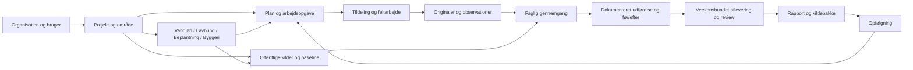

# Freyra: udviklingsplan for at samle og færdiggøre programmet

Version 1.8 · 3. november 2026 · Produktejer: Jesper Riel · Teknisk udførelse: udviklingsansvarlig.

**Aktuelt SaaS-mål og bevis:** [50-brugerprøven](SAAS_50_BRUGERE_2026-11-03.md)
afprøvede 50 forskellige konti i otte organisationer. Den fandt og rettede
en reel spærring for den tildelte feltmedarbejders udførelse. Alle otte
forløb når nu uafhængig gennemgang på staging, og adgangsgrænserne er genprøvet.
Kilde `5cdb5ef…`, draft PR43. Kvalitetsmålet for helheden er en tydelig, praktisk
brugeroplevelse på niveau med førende SaaS-systemer. Dineros opgavebaserede
introduktion bruges som reference. Den tekniske prøve lukker ikke S05, fuld
Skyhost-paritet, fysisk telefon, kundeaccept eller drift og salg.

**Seneste sikkerhedsleverance (S11):** [Kode- og sikkerhedskontrol](SIKKERHEDSKONTROL_2026-11-03.md)
samler de konkrete pakkerettelser, cachebeskyttelse, bevarede historiske
rapportkontrolsummer og genprøven af navigation/originaler/roller. Runtime-
audit er nul; udviklingsværktøjer og navngivne PostGIS-/Auth-/engine-opgaver
er fortsat åbne. Dette ændrer ikke S04/S05's faglige restarbejde eller gør
programmet generelt produktionsgodkendt. Kildekandidat `ce2ff55…`, draft PR42.

**Seneste visningsleverance:** [Kontrol af hele programkortet](VISNINGSKONTROL_2026-11-03.md)
retter menumarkering, et pilotbundet kortlink, fælles danske betegnelser,
opgavetotal og afgrænsningen af den faste Haderslev-rapportskabelon. Kilde
`e4d71ec…` er på staging. Alle 97 aktive destinationer kontrolleres på
computer og telefonbredder; syv indgange har kun bevis frem til projektvalg,
fordi den anvendte konto mangler bygge-/lavbundsprojekter. Der opfindes ingen
fagdata. Fuld faglig datavisning, fysisk telefon og brugeraccept er fortsat åbne.

**Mål:** Freyra skal dække den fulde kortlagte funktionalitet i Skyhost Jobs og Geotag og samle den med Freyras eksisterende fagmoduler. Kunden kan planlægge, fordele, udføre, kontrollere og dokumentere et naturprojekt i ét sammenhængende program, inklusive de kortlagte driftsfunktioner. Eksisterende kode genbruges med samme projekt-, opgave-, fil- og versionsidentitet på computer og telefon. Alle eksisterende fagområder bevares og får en tydelig plads; funktioner åbnes i takt med dokumenteret anvendelighed.

Dette er den samlende leveranceplan. Den erstatter ikke fagkravene i F01–F29 eller Jobs/Geotags D00–D10 og 68 eksisterende krav. [Skyhost-paritet og restarbejde](SKYHOST_PARITET_OG_RESTARBEJDE_2026-11-02.md) præciserer det fulde mål efter Jespers korrektion: kalender, gentagelser, timer, materialer, booking, ruter og opsætning indgår i den samlede leverance. De eksisterende kravregistre er acceptgrundlag; planen her styrer rækkefølge, integration, navigation, genbrug og oprydning. Den starter ikke en ny implementering af allerede løste krav.

**Aktuel prioritet efter brugerprøve:** Jesper fandt fortsat formål og
betjening forvirrende. Projektlederens forløb er valgt som hovedindgang, og
S01/S11's brugeraccept er genåbnet. [Forløb og acceptkriterier](PROJEKTLEDER_FORLOEB_2026-11-02.md)
styrer næste prøve. Kilde `c93ad03…` introducerede problem og mål,
grundlag, plan, udførelse, vurdering og dokumentation som samlet indgang.
Automatiske kontroller og browserprøve er tekniske beviser; Jespers
brugbarhedsvurdering er fortsat åben. Kilde `06c438b…` er nu på staging med
[frosne afleveringsgrundlag](OPGAVE_AFLEVERING_SAMLING.md), bestået gennem
app, database, genforsøg og afgrænset ekstern læsning. S04/D05 er delvis.
Kilde `2e04787…` tilføjer nu [versionsbundet faglig gennemgang](OPGAVE_GENNEMGANG_SAMLING.md)
på staging: aflevering, uafhængig godkendelse/returnering og genåbning på samme
opgave. Versionsbundne fagkrav og rapportkilder er næste integrationsarbejde.

**Kortlægning og fælles præsentation:** Kilde `92c638b…` er nu på staging
med [Programoverblik og ensartede forklaringer](PROGRAMKORT_OG_ENSARTET_VISNING_2026-11-02.md).
Alle 71 kanoniske produktsidevisninger, 20 projektværktøjer, fem opgavedele
og 68 eksisterende krav er placeret. Skyhosts ti jobområder, fem konkrete
integrationskandidater, 13 planlagte områder og én delvis gennemgangsfunktion
er synlige med deres faktiske afgrænsning. Det aktuelle inventar indeholder
878 kilde-/testfiler; tre ældre TypeScript-træer er fortsat bevaret og sammenholdt.
CI og faktisk læsende browserprøve bestod. Eksisterende kode, menuindgange,
projekt-/opgaveidentitet og originaler bevares. Fuld funktionel paritet og
Jespers brugbarhedsaccept er fortsat åbne.

**Teknisk del fra den tidligere leverance:** Navigationen og den afgrænsede S02-kobling er i det
autoriserede testmiljø på appkilde `46bf6df…`. Login → plan → registrering →
udførelse → offlinefoto → verificeret original → versionsbundet dokumentation
er prøvet med rigtig hosted UI og database. Afgrænset ekstern læsning og
tilbagekaldelse bestod. [Telefonprøven er klargjort](TELEFONPROEVE_OPGAVER_2026-11-02.md).
Fysisk telefonaccept er næste trin; S02/D03 er fortsat delvis. Produktionsappen
er uændret. [Leverance og bevis](OPGAVE_DOKUMENTATION_SAMLING.md).

## 1. Udgangspunkt og bevis

Lokal reference: `codex/work-order-ux-v1`, `2b122fe4518fc3673a6c8db0450b2073c5a166d3` i dette checkout. Ved start var der eksisterende ændringer i `JOBS_GEOTAG_KRAVMATRIX.md` og `JOBS_GEOTAG_TESTLEVERING.md`; de bevares.

GitHub er læst 2. november: [PR34](https://github.com/JESRI-C/freyra-hub/pull/34) er åben draft og har samme head som den lokale kode. Den bygger på [PR33](https://github.com/JESRI-C/freyra-hub/pull/33), der igen bygger på PR32 osv. De seneste otte åbne PR'er er undersøgt; det er ikke en udtømmende audit af alle grene. Ingen merge eller deploy er udført i denne planopgave. Et mergeable-flag er ikke en frigivelsesgodkendelse.

Kodeinventaret fra 2. november viser 831 JS/TS-kodefiler i nyeste src-træ, heraf 257 testfiler, én genereret routefil og 573 øvrige kildefiler; 153 er servicefiler. Der er 92 routedefinitioner inklusive layouts og tekniske endpoints, 17 hovedmenuindgange og 14 projektfaner. Fem lokale kodetræer er sammenholdt. Ældre TypeScript-træer har ingen almindelige filstier, som mangler i det nyeste, men deres indhold er forskelligt. Det gamle JSX-dashboard er et separat historisk spor.

Importgrafens 98 ikke-nåede filer er kandidater til undersøgelse, ikke en sletteliste. Framework-entrypoints, typer, standard-UI, dynamiske opslag og alternative implementationer kan være legitime. Hver oprydningsbeslutning kræver indholdsgennemgang og viden om faktisk anvendelse.

Den færdige [Haderslev-rapport](https://drive.google.com/file/d/1BynA_7pBq91XG96qHuCJ1z8sV_1Wv070/view?usp=drivesdk) er reference for kvaliteten af en leverance. Dens fremstilling rummer også projektspecifikke værktøjer uden for webappen. Vi antager ikke, at rapportknappen allerede automatiserer hele denne produktion.

### Det, som allerede skal genbruges

| Del | Eksisterende hovedkilder | Udviklingsbeslutning |
|---|---|---|
| Organisation/projekt/adgang | `lib/auth.tsx`, `ProjectContextBoundary`, `project-members-service`, `project-nature-access.server.ts` | Én projektkontekst; behold server-/databasekontrol |
| Opgaver | `actions`, `ProjectWorkOrdersWorkspace`, `MyWorkOrders`, work-order-services og revisionstabeller | Samme stabile action-ID; bevar plan, tildeling, udførelse og status som adskilte revisioner |
| Felt og originalfiler | `FieldOfflineWorkspace`, field-offline-/field-photo-services, canonical drone media | Udbyg opgavebinding og rettigheder; opret ingen parallel uploadmotor |
| Undersøgelse/baseline | `MunicipalCaseWorkspace`, `DroneSurveyWorkspace`, `PublicBaselinePanel`, survey/verification-services | Samme runder, kilder og versioner i alle visninger |
| Før/efter | `PhotoComparisonPanel`, photo-comparison og action-execution | Bind til faktisk udførelse og relevante originaler, ikke blot datoer eller tags |
| Rapporter | `ReportWorkspace`, `WorkflowReportPanel`, report-document/workflow-report, eksportfunktioner | Én revisionsbundet kildepakke med formatadaptere; historiske rapporter bevares |
| Tværgående fagmoduler | `ProjectWorkspacePage`, `WorkspaceEntries`, lavbund-, planting-, construction- og nature-services | Domænespecifikke værktøjer på fælles projekt/evidens; ikke en ny dataplatform |
| Kort og datakilder | Aktive kort, baselineadaptere, geo-services, rasterpreview | Ét projektgrundlag med kilder, CRS, dato og dækning |
| Driftskontrol | Eksisterende CI, database-, samtidigheds-, restore- og buildkontroller | Genbrug og luk konkrete bevismangler; opfind ikke en ny parallel teststrategi |

## 2. Sådan skal programmet hænge sammen

### Fælles kontrakter

1. Organisation og projekt følger alle forespørgsler, links, filer, job og eksporter. Opgavespecifik ekstern adgang åbner kun den tildelte opgave og dens tilladte materiale.
2. Plan, faktisk udførelse, observation, modelestimat, review og naturens effekt er forskellige oplysninger. Ukendt er ikke nul eller godkendt.
3. Originalfilen har stabil identitet, checksum, faktisk filtype, optagetid hvis kendt og registreret proveniens. En ny reference må ikke kopiere eller overskrive originalen uden grund.
4. Gemninger bruger eksisterende forventet version og idempotens-ID. Mistet svar kan genforsøges uden dublet. En konflikt giver en vej til sammenligning; ingen skjult last-write-wins på dokumentation.
5. En aflevering fryser de konkrete plan-, tildelings-, udførelses-, skema-, observations- og filrevisioner. Senere rettelser laver nye revisioner.
6. Review knyttes til den afleverede version og en autoriseret reviewer. Godkendelse gælder det angivne omfang; ændret grundlag kræver ny vurdering efter reglerne. Selvreview må ikke kunne omgå den aftalte kontrakt.
7. Rapport, figurer og databilag læser samme frosne snapshot. Nye data ændrer ikke gamle rapporter. Rapportnummer og generatorversion holdes adskilt.
8. Cacheidentitet omfatter de variable, der ændrer data eller adgang: bruger, organisation, projekt og relevante filtre/versioner. Konto-/projektskift og tilbagekaldelse håndteres eksplicit.
9. Hver indlæsning skelner mellem indlæser, tomt resultat, ukendt, fejl og forældet grundlag. En kildefejl bliver ikke en grøn tom tilstand.

Disse er integrationskontrakter oven på nuværende modeller. Tabel-/RPC-ændringer besluttes først efter mapping til de eksisterende skemaer; der er ikke bestilt en omskrivning til en ny arkitektur.

## 3. Navigation og arbejdsro

Programmet skal både give overblik og bevare adgang til de mange værktøjer. Vi samler projektfanerne og trinforløbet om samme projektarbejdsrum. Det guidede forløb bliver en vejledning inde i projektet, ikke en anden app valgt indirekte af et queryparameter.

**Forslag til projektets seks arbejdsområder:**

| Arbejdsområde | Eksisterende funktioner, der samles her |
|---|---|
| Overblik | Status, mangler, ansvarlige, næste handling, aktivitet |
| Plan og opgaver | Planer, tildeling, grupper/puljer, udførelse, logbog |
| Kort og grundlag | Geometri, offentlige kilder, baseline, fotopunkter, miljø-/måledata |
| Felt og dokumentation | Kamera/upload, originaler, observationer, undersøgelser, offlinekø og fotoatlas |
| Vurdering og effekt | Før/efter, fagligt review, scenarier, anbefalinger og metodeprofiler |
| Rapport og opfølgning | Aflevering, rapportversioner, eksport og næste kontrol |

Eksisterende parametre og avancerede værktøjer flyttes først efter en 1:1-mapping. Gamle links fortsætter til samme projekt/opgave/runde/version, og browserens tilbageknap virker. Alle 17 nuværende menuindgange får en dokumenteret destination. Finansiering, audit, indstillinger og fagmoduler må ikke forsvinde som følge af forenklingen; de kan ligge som tydelige værktøjer og organisationsområder.

På telefonen skal brugeren kunne planlægge, tildele, dokumentere, gennemgå og hente rapport. Feltregistrering er hurtig, men resten af programmet må ikke begrænses til desktop. Brugerfladen viser faglige handlinger og forståelige tilstande; buildnumre og databasedetaljer hører til support-/systemvisningen.

## 4. Arbejdspakker i prioriteret rækkefølge

S-ID'erne er integrationspakker. I hver pakke henvises til og opdateres de eksisterende F-/D-krav. Status ved oprettelsen er **planlagt**, medmindre et konkret udført arbejde står i leveranceloggen. Estimater er foreløbige udviklerdage, ikke leveringsløfter. De afstemmes efter S00 og den første faktiske brugerprøve.

### S00 — Fastlæg én aktuel leverancekandidat

**Afhænger af:** intet. **Genbrug:** F00, PR34 og den stablede række. **Skøn:** 0,5–1 dag.

- Genlæs aktuelle remote heads, ancestry, CI og lokale ændringer. Identificér main, kandidat, faktisk staging og produktionsrevision hver for sig. Ingen blind merge/cherry-pick af de ældre kopier.
- Opret en særskilt `codex/`-integrationsgren fra det verificerede head, når arbejdspakken startes. Bevar brugerændringer og registrér dem som særskilt patchgrundlag.
- Registrér kilde-SHA, worker/build, migrationsfingeraftryk og featurekonfiguration i én leverancekvittering uden secrets.
- Kortlæg hvilke allerede løste F-/D-krav der kræver genprøve, og hvilke der reelt mangler.

**Færdig:** En anden udvikler kan identificere og bygge samme kandidat. Versionsukendt miljø er markeret ukendt; det må ikke godkendes ved antagelse.

### S01 — Ét projektarbejdsrum og én navigationsmodel

**Afhænger af:** S00. **Genbrug:** F02/F09, PR34, ProjectTabs, MunicipalCaseWorkspace, GlobalContextBar. **Skøn:** 2–4 dage.

- Lav destinationsmapping for 17 menuindgange, 14 projektfaner og alle guidede trin. Bevar originale URLs med kompatibilitetsmapping.
- Definér en lille typed navigationsbeskrivelse med titel, destination, projektbehov og rækkefølge. Den er UI-metadata, aldrig en autorisationsmotor.
- Saml projekt- og trinvisning uden at genmontere/redde kladder på en anden opgave. Genbrug PR34's opgavevalg og editorlåse.
- Vis næste relevante handling fra faktisk manglende grundlag. Ingen procentstatus, der tæller besøg på sider som færdigt arbejde.

**Færdig:** Samme projekt/opgave/runde åbnes fra menu, opgaveliste, gammelt link og nyt link. Tilbage/frem, refresh og mobilskift mister ikke identitet eller kladde. Alle eksisterende felter har en destination. Konto-/projektskift viser ingen tidligere kundes data.

### S02 — Bind feltdata og originaler til arbejdsopgaven

**Afhænger af:** S00; fælles navigation fra S01 bruges ved integration. **Genbrug:** D03, F05/F13, eksisterende field-photo/offline/canonical-media. **Skøn:** 3–5 dage.

**Udført del, 2. november:** [Opgave, gemt jobkortversion, verificeret feltoriginal og valgfri præcis udførelsesversion](OPGAVE_DOKUMENTATION_SAMLING.md) er implementeret i kladde PR36 og deployet til staging med begge additive migrationer. På `46bf6df…` bestod 3.368 applikationstests, 1.471 databasekontroller, migration fra tom database, reelle samtidighedsprøver, restore, databaselint og build i CI. Hosted-forløbet bestod også offlinekø/luk/genåbn, reel upload, mistet gemmesvar, historik, originalåbning, ekstern læsning og tilbagekaldelse. En konkret dobbelt Authorization-header i den eksisterende TUS-upload blev rettet med regression. Eksisterende data og brugerændringer er bevaret. Pakken er fortsat delvis, især ekstern nyregistrering/upload, øvrige originaltyper og fysisk telefon/kamera/HEIC.

- Map opgave, faktisk udførelse, observation og originalrevision med databasehåndhævet scope. En fototitel, et tag eller URL er ikke relationen.
- Giv en konkret tildelt ekstern udfører læse-/skriveadgang til tilladte observationer og filer uden projektbred adgang.
- Bind lokal kø til bruger, projekt, opgave, kilde-/skema-/udførelsesversion og samme upload-ID ved genforsøg. Synliggør hvis gamle køposter kræver manuel tilknytning; ingen automatisk gætning.
- Håndtér pladsmangel, manglende GPS, ukendt optagetid, HEIC og afbrudt upload med bevaret original og forståelig status.

**Færdig:** En tildelt opgave får præcis de valgte originaler. A og B kan ikke læse hinandens opgaver/filer. Tilbagekaldt udfører kan ikke hente nye links eller sende nye skriverier. En allerede udstedt URL følger den dokumenterede udløbspolitik. To genforsøg giver én fil/observation, og browser-/telefonlukning mister ikke en bekræftet lokal registrering.

### S03 — Samme liste, kort, filtre og totaler

**Afhænger af:** S01; S02 for opgavefotos. **Genbrug:** D04, connect-context, geo-/workspace-services. **Skøn:** 1–3 dage.

- Genbrug fælles scope og filtre for projekt/opgave, periode, lokalitet, status og datakvalitet. Kort, liste og eksport skal beskrive det samme udvalg.
- Indfør fælles query-key-fabrikker dér, hvor eksisterende nøgler reelt divergerer. Konsolidér ét område ad gangen.
- Brug serverpagination, stabile cursors og billedminiaturer. Store originaler hentes efter behov.

**Færdig:** Samme autoriserede filter giver samme mængde og identiteter i liste/kort/eksport. Skift og fejl efterlader ingen fremmede eller fejlagtigt grønne totaler. Test både tomme og delvist fejlede kilder.

### S04 — Versionsbundet aflevering og faglig kontrol

**Afhænger af:** S02. **Genbrug:** D05, F07/F08/F10, work-order lifecycle, checks og audit. **Skøn:** 3–5 dage.

**Udført del:** [Fastholdt afleveringsgrundlag](OPGAVE_AFLEVERING_SAMLING.md)
er implementeret og prøvet på staging. Præcis plan/tildeling/udførelse,
registreringer og originaler fastholdes. [D05b-gennemgangen](OPGAVE_GENNEMGANG_SAMLING.md)
er også på staging: særskilt aflevering, uafhængig godkendelse/returnering,
begrundet genåbning og ny aflevering bevarer tidligere versioner. Ændrede
kilder afviser godkendelse; tilbagekaldt adgang afviser også gamle genforsøg.
CI 41535229142 og faktisk hosted browser/API bestod. Profilspecifikke krav
og samlet faglig-/brugeraccept mangler; S04/D05 er fortsat delvis.

**Næste sammenhængende pakke: S04/D05c.** Kortlæg og genbrug eksisterende
opgaveskabeloners obligatoriske felter, planprofil og kategoriopsætning til
versionsbundne dokumentationskrav. En afleveringsversion skal fastholde den
regelversion, den er kontrolleret imod. Prøv skift af profil/krav, manglende
bilag, gamle afleveringer og ny aflevering efter rettelse. Naturfaglige
metoderegler, som kilderne ikke definerer, må ikke opfindes. Derefter S05:
bind eksisterende rapportrevision til præcis aflevering og review. Samlet
accept gennem rapport/ZIP er fortsat åben.

- Genbrug eksisterende operationel status. Tilføj den manglende aflevering med frosset krav-/evidenssnapshot.
- Lad reviewer returnere med konkrete mangler eller godkende det eksplicitte omfang. Rettelse og genaflevering bevarer gammel historik.
- Håndhæv roller, version, manglende bilag og selvreviewregler server-/databasenært; knapvisning er kun vejledning.

**Færdig:** Manglende obligatorisk dokumentation afviser aflevering med handlingsrettede fejl. Ændret udførelse efter aflevering opdaterer ikke snapshot eller gammel godkendelse. Parallelle reviewers får kontrolleret konflikt, og direkte API/tabelkald kan ikke omgå kontrakten.

### S05 — Samlet rapport fra samme grundlag

**Afhænger af:** S04; S03 for filtreret eksport. **Genbrug:** D07, F10/F11, report_document/revisions, workflowrapport og eksportadaptere. **Skøn:** 2–4 dage.

- Bind rapportrevisionen til opgaven og den præcise afleverings-/reviewrevision. Saml det eksisterende input til én kanonisk eksportkontrakt uden at genopfinde rapporttabellerne.
- Afstem PDF, redigerbart dokument, atlas, CSV/GeoJSON og ZIP-manifest mod samme snapshot. Dokumentér eventuelle bevidste formatforskelle.
- Brug Haderslev-rapporten som layout-/indholdsreference. Adskil genanvendeligt layout fra hardkodede kundeafsnit og udokumenterede tal.
- Vælg første formatvej efter en konkret sammenligningsprøve; behold kompatibel genåbning af gamle generatorversioner.

**Færdig:** Rapport v1 genåbner med egne kilder efter inputrettelse og ny v2. Alle originalreferencer og manifesthashes matcher. Forkert projekt/version afvises. Alle 274 fotos kan indgå i et repræsentativt atlas uden at hele originalsamlingen indlæses i browserhukommelsen. Ingen rapport erklæres kundegodkendt uden faktisk review.

### S06 — Gentagelige faglige forløb på fælles kerne

**Afhænger af:** S01/S04/S05. **Genbrug:** F15/F16/F21/F26/F27, lavbund, planting, construction og nature-services. **Skøn:** 3–6 dage for teknisk samling; faglige udvidelser estimeres separat.

- Definér små metodeprofiler med obligatoriske input, enheder, kildekrav, beregningsversion og rapportafsnit. Vandløb er første reference; lavbund, beplantning og byggeri kobles på samme projekt-/evidensforløb.
- Bevar eksisterende beregningsfunktioner. Test enhed, koordinatsystem, ukendt/nul, gyldighedsperiode og metodeversion før de bruges i nye resultater.
- Beplantning forbliver valgfri ved grødeskæring. Lavbund/byggeri får egne faglige krav uden at få egne parallelle upload-/auth-/rapportmotorer.

**Færdig:** Ét eksisterende eksempel pr. profil kan gennemføres og genåbnes. Ikke-verificeret potentiale er tydeligt skilt fra målt effekt. Fagperson godkender metodens anvendelse; tekniske tests udgiver ikke en myndighedsafgørelse.

### S07 — Kildeadaptere og behandling som pålidelige job

**Afhænger af:** S00/S02; kan undersøges ved siden af S04. **Genbrug:** F18–F20/F28, baselineadaptere, dronejobs og field-photo-worker. **Skøn:** 2–4 dage for konsolidering; ny provider er særskilt.

- Sammenhold ældre live-data-connectors med aktive baselineadaptere. Vælg ejer for hver konkret kilde; genbrug tests og parserfunktioner, hvor de tilfører værdi.
- Fælles kildekvittering: hentetid, datagyldighed, geografisk dækning, kildeversion, licenshenvisning og fejl. Tilføj kun skemafelter ved et reelt dokumenteret hul.
- Brug eksisterende jobmekanismer først. Lange flertrinsjob får ved behov durable orchestration; simple køjob får idempotent forbrug. Persistér status og resultatversion, så refresh ikke mister arbejdet.
- Fotogrammetri kræver en reel adapterprøve med output, CRS, nøjagtighed og økonomi. Kontrakten alene frigiver ingen ortofoto-funktion.

**Færdig:** Timeout, providerfejl og gentaget købesked giver korrekt status og højst ét accepteret resultat. Fejlet kilde erstattes ikke med eksempeldata. Store filer streames eller behandles i afgrænsede bidder. Provideradgang og driftsomkostning er kendt før aktivering.

### S08 — AI som hjælper på verificerbart grundlag

**Afhænger af:** S02/S04/S05. **Genbrug:** F14/F17, gateway, species-id/photo-review og projektassistent. **Skøn:** 2–4 dage for én afgrænset funktion efter valgte data/provider.

- Vurder først om de frakoblede SpeciesRecognitionFlow og AiReportDraft har unik værdi. Flyt egnede dele ind i de eksisterende arbejdsgange frem for at åbne endnu et parallelforløb.
- Første prioritet er kildebundet teksthjælp og strukturerede udkast. Arts-/billedforslag får særskilt evaluering og menneskeligt review.
- Fasthold serverautorisation, inputgrænser, omkostningsloft, timeout, afbrydelse og logning uden private billeder/tokens. Læst kilde-/modeltekst må ikke instruere værktøjer til at ændre andre projekter.
- Automatisk fotoreview forbliver deaktiveret, indtil den valgte funktion består egne kriterier. Et boolesk flag er ikke et acceptbevis.

**Færdig:** Et fagligt mærket evalueringssæt har på forhånd aftalte kriterier. Utilstrækkeligt grundlag giver afvisning/ukendt og en manuel vej videre. Forslag kan accepteres, rettes eller forkastes med proveniens. AI må ikke selv godkende naturfaglig effekt.

### S09 — Finansiering, offentlig effekt og administration

**Afhænger af:** S01/S05. **Genbrug:** F22/F24, ProjectWorkspacePage, WorkspaceEntries, AccountSettingsPage. **Skøn:** 2–4 dage for samling; abonnement/betalingsintegration separat.

- Saml registrerede scenarier, CO₂/ESRS, finansiering, partnere og effektenheder om eksisterende projektversioner. Ingen dubleret indtastning af samme nøgleoplysning.
- Skeln mellem intern public_page-kladde og en egentlig offentlig udgivelse med eksplicit publiceringshandling og særskilt datagrundlag.
- Vis faktiske abonnements-/aftaledata når de findes. En betalingsleverandør, fakturering eller kvotehåndhævelse må ikke simuleres af den eksisterende statusside.
- Genbrug alarmregler; afklar om NotificationCenter skal integreres i aktivitet/opgaver eller udfases som dublet. Beskedlevering har egen kvittering.

**Færdig:** Gemning/genåbning og rollegrænser virker. Intern kladde lækker ikke offentligt. Ukendt finansiering eller manglende abonnement fremstår ikke som gennemført aftale. Kredithandel er fortsat et selvstændigt produktvalg, ikke en afhængighed for kerneproduktet.

### S10 — Kontrolleret kode- og dokumentationsoprydning

**Afhænger af:** S00; udføres løbende tæt på ændrede områder. **Genbrug:** eksisterende audit og testfiler. **Skøn:** 1–3 dage indledningsvis.

- Klassificér hver kandidat: aktiv, dublet med erstatning, unik genbrugskandidat, framework/build-entrypoint eller historisk produktionsværktøj.
- Fjern beviseligt ubrugte imports og ret vildledende aktuelle dokumentationshenvisninger i små ændringer. Ingen generel formattering af hele repository.
- Konsolidér komponenter ved den aktuelle kaldesti. Bevar kompatibilitetswrapper, når eksterne links/imports eller historiske dokumenter kræver det.
- Slet først en fil, når statiske/dynamiske kald, workers, generatorer, tests og unik adfærd er afklaret. Registrér gammel fil → erstatning → prøve → beslutning i et genbrugsregister. Ingen scripts køres som del af en oprydningsscan.
- Bevar historiske migrationsfiler, rapportversioner, originaler, kundedata og tidligere kodecheckouts. Ingen arkivflytning eller mappeoprydning på grundlag af filantal.
- Dependencies gennemgås separat med licens, sikkerhed, faktisk brug og kompatibilitet; ingen automatisk major-opgradering som sideeffekt.

**Færdig:** Hver flytning/fjernelse har begrundelse og funktionel erstatning eller dokumenteret fravær af brug. Relevant typecheck/lint/test og buildkontrol består. Genbrugskandidater er ikke væk, fordi et værktøj ikke fandt en import.

### S11 — Brugbarhed, tilgængelighed og ydelse

**Afhænger af:** S01–S05. **Genbrug:** eksisterende mobil-/navigationstests og Playwright. **Skøn:** 2–4 dage.

- Prøv de samme fem handlinger med projektansvarlig, udfører og reviewer: find arbejdet, forstå krav, gem dokumentation, håndtér fejl/returnering, find rapport.
- Tastatur, fokus efter navigation/dialog, labels, fejlbeskeder, zoom og berøringsmål afprøves manuelt sammen med automatiske checks. PDF/DOCX får egen vurdering; tilgængelig webside gør ikke automatisk dokumentet tilgængeligt.
- Mål på repræsentativ telefon og datamængde: 50 projekter, 274 fotos samt en syntetisk belastningsprøve med 1.000 opgaver. Datasættene er prøvegrundlag, ikke en påstand om alle kunders størrelse.
- Foreløbige produktbudgetter: almindelig projekt-/opgaveskift p95 under 2 sekunder ved aftalt net, synlig gemmestatus straks og ingen tabt kladde ved fejl. Fastlæg præcis enhed/net/cache før måling; justér budget efter baseline. Større eksport er et job med fremdrift.

**Færdig:** En ny deltager gennemfører uden agenten som betjener; hjælpetrin og misforståelser registreres. Ingen kendt blokering af kerneforløbet ved tastatur eller telefon. Tids-/ydelsesbudgetter har faktisk måling og dokumenteret miljø.

### S12 — Drift, pilot og frigivelse

**Afhænger af:** S00–S05/S11 og de moduler, der indgår i releasen. **Genbrug:** D08/F12/F23/F25, eksisterende CI/runbooks. **Skøn:** 2–4 dage teknisk, plus kundens deltagelse.

- Samlet prøve på én SHA: plan → tildeling → felt/originaler → faktisk udførelse → returnering → ny aflevering → review → rapport/ZIP → genåbning → opfølgning.
- Tilføj negativ prøve med to projekter i samme organisation, en anden organisation, ekstern opgaveudfører, viewer og tilbagekaldt medlemskab.
- Genopret både database og private filer til isoleret miljø. Kontrollér tællinger, hashes og rapportgenåbning. Database-dump alene er ikke fuld gendannelse.
- Afprøv rollback af app og additive migrationers kompatibilitet. Historik må ikke tabes ved rollback. Registrér kendt punkt for genopretning og mål faktisk gendannelsestid.
- Fastlæg ansvarlig for drift, alarmer, backup, support og hændelser samt kundens adgangs-/datavilkår. Login-/recovery-mails skal dokumenteres gennem autoriseret prøve, før de loves; denne planopgave sender ingen mails.

**Færdig:** Releasekvittering har SHA, miljø, migrationsfingeraftryk, checks, faktisk bruger-/faglig accept, mangler, ansvarlig og rollback. Ingen kendte fejl, som kan miste data, åbne fremmed adgang eller forfalske en godkendelse. Uafprøvet er uafprøvet; pilotaccept erstattes ikke af grønt CI.

### S13 — Kalender, kapacitet og gentagne jobs

Afhænger af D02's planer/tildeling og D05's statuskontrakt. Genbrug den samme
opgave, plan, gruppe, pulje og ansvarlige. Lever kalender og omplanlægning,
kapacitet, gentagelse og afhængigheder. JOB-07/08/10 og OPS-05 er påkrævede
for fuld Skyhost-paritet. Datoinddata alene opfylder ikke denne pakke.
Eget estimat følger efter konkret genbrugskontrol.

### S14 — Timer, aktiviteter, materialer og faktureringsgrundlag

Genbrug projekt/opgave, roller, audit og forventet version. Lever aktiviteter,
estimat/forbrug/rest, registreringshistorik, materialer og enheder samt et
kontrollerbart faktureringsgrundlag. OPS-01/02/07 er en del af det samlede
mål. Bogføring/løn kræver den konkrete integration fra S16 og egen kvittering.
Eget estimat følger efter konkret genbrugskontrol.

### S15 — Lokationer, besøg, booking og ruter

Genbrug steder/geometri og samme job. Lever besøgskrav, serviceintervaller,
maskin-/værktøjsreservationer, bookingkonflikter, stoprækkefølge og kørsel.
LOC-02/03 og OPS-03/04 er påkrævede for fuld paritet. Ruteudbyder,
nøjagtighed og pris afprøves før aktivering. Eget estimat følger.

### S16 — Kundestamdata, opsætning og dokumenterede integrationer

Kortlæg kunder/leverandører, kontakter, sagsopgaver, jobtyper, ekstra felter,
nummerserier, materialer, aktivitets-/løntyper, kategoriarkivering/deling og
beskedopsætning til de eksisterende modeller. Suppler 68-kravsregisteret,
hvor den fulde Skyhost-kortlægning viser udækkede funktioner. Import,
økonomi/løn og planlagte rapporter får konkrete adaptere og prøver. De
kortlagte funktioner er i scope; udsendelser og betalte integrationer er
ikke aktiveret af denne planændring. Eget estimat følger.

## 5. Rækkefølge og leverancer

| Leverance | Pakker | Observerbart resultat |
|---|---|---|
| A: Fælles retning og arbejdsrum | S00, S01 samt lille S10 | Én kandidat, alle værktøjer placeret, én stabil projekt-/opgaveidentitet |
| B: Komplet dokumentationskæde | S02 → S04 → S05; S03 undervejs | Planlagt arbejde bliver til versionsbundet, gennemgået dokumentation og rapport |
| C: Et program, kunden kan arbejde i | S11 og S12 for kernen | Computer/telefon, adgang, genopretning og reel pilotprøve på samme release |
| D: De øvrige eksisterende muligheder | S06, S07, S08, S09 i valgt prioritet; S10 løbende | Fagprofiler, kilder, AI og administration koblet på samme kerne |

**Kritisk vej:** S00 → S02 → S04 → S05 → S11/S12. S01 skal være færdig før samlet brugeraccept. D06-import er et tilvalgsspor, som ikke blokerer egne originaler. S08's AI og ny fotogrammetri må ikke blokere manuel faglig dokumentation. S06–S09 leveres hver med egen accept; ingen brede moduler erklæres færdige samlet.

Det tidligere skøn på **26–50 udviklerdage** gjaldt de tidligere beskrevne samlingspakker uden S13–S16, ny stor fagmodel, betalingsintegration eller fotogrammetrileverandør. Det er historisk planlægningsgrundlag med betydelig usikkerhed og må ikke bruges som tidsløfte for fuld Skyhost-paritet. Drifts-/opsætningsområderne skal have konkret genbrugskontrol og egne estimater, hvorefter samlet rækkefølge og omfang reestimeres. En første pilot er én etape og lukker ikke resten af målet.

### Første arbejdsdag

1. Afslut S00's versions-/kravmapping og identificér præcis valgt appversion.
2. Tag eksisterende skærme gennem de fem brugerhandlinger og registrér højst de vigtigste konkrete brud. En tidligere browserafvisning omgås ikke; en manglende UI-prøve markeres som sådan.
3. Lever en lille S01-ændring med destinationsmapping/kompatible links eller et konkret rettet brud, afhængigt af fundene. Kør relevante regressioner.
4. Specificér S02's manglende relationer med eksisterende tabel-/RPC-navne og negative adgangscases. Start den første sammenhængende kodepakke, når grundlaget er verificeret.

Det er en arbejdsrækkefølge, ikke en påstand om, at disse fire trin er udført i denne planopgave.

## 6. Teknisk kvalitet og relevante krav

“Alle gældende krav” omsættes til et kravregister med kilde, anvendelighed, ansvarlig, kontrol og bevis. Vi erklærer ikke generel lovmedholdelighed på grundlag af kodeoprydning.

| Område | Udviklingskrav / afklaring | Bevis |
|---|---|---|
| Adgang | Mindste rettighed, afvisning som udgangspunkt, kontrol på hver serveroperation, database-/Storage-scope | Positive/negative rolleprøver gennem faktisk klient/API, ikke kun policytekst |
| Persondata | Afklar roller, formål, opbevaring/sletning, databehandler-/underleverandørgrundlag og evt. overførsler for den konkrete kundeleverance | Produktejer/dataansvarlig dokumenterer anvendelighed; udvikler implementerer besluttede kontroller |
| Tilgængelighed | WCAG 2.2 AA som produktmål; ved offentlig leverance afklares konkret EN 301 549-/kontraktkrav og dokumentformat | Tastatur-/skærmlæser-/mobilprøve og relevant automatisk kontrol; ikke en generel certificering |
| Dataintegritet | Immutable revisioner, scope-FK, idempotens, samtidighed og verificerede originaler | DB-/service-/HTTP-konflikttests og hashes |
| Kilder og metoder | Kildedato, faktisk dækning, enheder, faktor-/metodeversion, licens og fagligt review | Gemte input/resultater; negative cases for ukendt, forkert enhed og forkert geometri |
| Afhængigheder | Lockfile, kendte sårbarheder, licenser og kompatibilitet | Reviewbar dependencyændring og relevante checks; ingen blind audit-fix |
| Drift | Reproducerbart build, strukturerede fejl, ingen secrets i browser/logs, restore og rollback | Releasekvittering, faktisk alarm-/restoreprøve og navngivet ejer |
| Kommerciel brug | Aftalt omfang, support, dataansvar og pris; abonnement/fakturering skal være faktisk implementeret eller håndteret via aftalt proces | Produktejerens konkrete tilbud/aftale og dokumenteret driftsparathed |

## 7. Test og definition af færdig

En arbejdspakke er først færdig, når den konkrete brugerhandling virker, genåbnes på korrekt version og består relevante negative cases. “Kode skrevet”, “side åbner”, “CI grøn”, “hosted afprøvet” og “kunde accepteret” er separate statusfelter.

| Ændring | Mindste relevante kontrol |
|---|---|
| Ren import-/dokumentationsoprydning | Diff, typecheck/lint af berørt kode; ingen tests, der blot spejler tekst |
| Navigation/kladder | Eksisterende route-/mobil-/workspaceprøver og repræsentativ browserprøve |
| Data-/adgangsrelation | Service-/komponenttests, frisk lokal/disponibel migrationsreplay, pgTAP, faktisk klient/API og relevante samtidigheds-/Storage-prøver |
| Upload/offline | Faktiske filbytes/hash, netbrud, browserluk, lagergrænse, konto-/adgangsskift og genforsøg |
| Rapport | Faktisk eksport, renderet layout, kilder/versioner/hash, gammel rapport efter inputændring og genåbning |
| Samlet kandidat | Eksisterende fulde app-/worker-/databasegates, build, restore og ende-til-ende-prøve på samme kandidat |

Genbrug scripts fra package.json og `.github/workflows/ci.yml`: `npm run typecheck`, `npm run lint`, `npm test -- --maxWorkers=1 --no-file-parallelism`, `npm run verify:faktorer` og relevante worker-/buildkontroller. `npm run preflight:staging` går forud for stagingbuild. Eksisterende test:e2e kræver autoriseret miljø og originale testfiler; manglende opsætning er ikke et grønt skip. Database reset/replay må kun køres i disponibel lokal/CI-database, aldrig som almindelig hosted klargøring.

## 8. Styring, ansvar og ændringspraksis

- **Udviklingsansvarlig:** holder kontrakter, genbrugsregister, backlog, integration, tests og leverancekvittering ajour. Tekniske pakker kan udføres uden nye generelle spørgerunder inden for det aftalte scope.
- **Jesper som produktejer:** afgør kundeprioritet, brugeroplevelsens mål, tilbud og hvilke moduler en konkret release omfatter.
- **Faglig reviewer/kundebruger:** vurderer metode og indhold og afprøver egen arbejdsgang. Rollen udpeges før accept, ikke som blokering for al kodeudvikling.
- **Drifts-/dataansvarlig:** navngives før kundedrift og ejer support, adgang, backup, hændelser og relevante aftaler.

Arbejd i små, sammenhængende ændringer med én pakke som hovedformål. Læs nyeste kode/krav før næste pakke. Brug stakkens eksisterende model; en ny abstraktion kræver et konkret gentaget problem. Refaktorér tæt på den funktion, der ændres. Udvid skema additivt og afprøv kompatibilitet; historiske migrationer omskrives ikke.

Ved manglende eksternt input fortsættes uafhængige tekniske opgaver med tydeligt syntetiske data. Betalte providerkald, ekstern beskedafsendelse, offentlig publicering, hosted migration, merge og produktionsdeploy er ikke udført eller automatisk frigivet af denne plan. De konkrete skridt skal være reviewbare og følge det gældende mandat.

Hver leverancekvittering registrerer S-/F-/D-/krav-ID, problem og ændring, genbrugt kode, revision, miljø, tests/resultat, faktisk UI-/kundeaccept, begrænsninger og næste pakke. En pakke, der allerede er dækket, lukkes ved bevis og genbrug.

## 9. Kilder og inspiration anvendt i planen

Kilder er læst/søgt 2. november 2026. De er metodegrundlag, ikke bevis for at Freyra allerede opfylder dem.

- [TanStack Query: query keys](https://tanstack.com/query/latest/docs/framework/react/guides/query-keys): cacheidentitet skal dække de variable, der bestemmer data. Det understøtter S03's scopearbejde.
- [Supabase: testing overview](https://supabase.com/docs/guides/local-development/testing/overview) og [RLS-prøver](https://supabase.com/docs/guides/database/postgres/testing-row-level-security): afprøv tilladt og afvist adgang gennem roller og applikationsklienten. Eksisterende migrations-/RLS-tests genbruges.
- [Cloudflare: Workers best practices](https://developers.cloudflare.com/workers/best-practices/workers-best-practices/): flyt lang behandling ud af requestforløbet; vælg kø eller flertrinsworkflow efter behov. Det er en beslutningsregel, ikke en bestilling på ny infrastruktur.
- [Playwright: best practices](https://playwright.dev/docs/best-practices): afprøv brugerens synlige handlinger og isolér testdata.
- [OWASP: authorization](https://cheatsheetseries.owasp.org/cheatsheets/Authorization_Cheat_Sheet.html): mindste rettighed, afvisning som udgangspunkt og kontrol på hver operation.
- [W3C: WCAG 2.2](https://www.w3.org/TR/WCAG22/): produktmål for tilgængelighed. [Digitaliseringsstyrelsens lovgivningsoversigt](https://digst.dk/tilsyn/webtilgaengelighed/lovgivning/) beskriver den offentlige standardsammenhæng; konkret anvendelighed skal afklares for leverancen.
- [Datatilsynet: rollefordeling](https://www.datatilsynet.dk/regler-og-vejledning/grundlaeggende-begreber/rollefordeling-dataansvarlig-og-databehandler): aftaler og ansvar skal følge den konkrete databehandling.

Internt grundlag: README, F00_AFSTEMNING, PAKKESTATUS, JOBS_GEOTAG_ARBEJDSFLOW, JOBS_GEOTAG_KRAVMATRIX, JOBS_GEOTAG_TESTLEVERING, eksisterende CI samt kodeinventaret fra denne samtale. Ældre statusnotater bruges med dato; nyere kode og faktisk afprøvning afgør aktuel status.

### S05 - opfølgning på 50-brugerprøven

På grenen `codex/saas-report-followup` kan projektredaktøren danne og genåbne en rapport fra den konkrete faglige godkendelse under opgavens aflevering. Rapporten gemmer afleveringsversion, kontrolsum og gennemgangens id. Databasen henter det frosne grundlag med eksisterende opgaveadgang. Originalerne bevares i afleveringen og refereres med kontrolsummer. Rapporten gemmes som kladde i biblioteket, mens opgavens faglige godkendelse vises særskilt.

33 målrettede app-tests bestod lokalt. [CI 41591951370](https://github.com/JESRI-C/freyra-hub/actions/runs/41591951370) bestod med app- og databasegates, frisk migrering, isolationsprøver, samtidighed og restore. Browserprøven på staging oprettede og genåbnede samme gemte rapport efter genforsøg, kontrollerede 1280, 390 og 320 px og downloadede en gyldig PDF. Build `6ead16f`, Worker `c825ce92-aa7d-4260-9844-70ccdd9fc47d` og stagingmigration `20261103064836`. Rapporten viser originalernes kontrolsummer. Åbning af originalfiler foregår fortsat i opgaven. Brugergennemgang på fysisk telefon, de øvrige fagprojekter og resten af frigivelseskriterierne fra 50-brugerrapporten er åbne.

Opfølgning på visningen. Afleveringen viser rapporten som næste skridt, og tidligere godkendelser blandt de seneste fem gennemgange kan stadig åbnes efter genåbning. Rapporten angiver den godkendte afleveringsversion, har direkte PDF-eksport og linker tilbage til opgaven og originalerne. 35 målrettede tests bestod, herunder historisk godkendelse og direkte PDF-adgang.

### S13 - projektets planoversigt

Under Arbejdsopgaver kan projektlederen skifte mellem Opgaveliste og Planoversigt. Den nye visning sorterer efter den senest gemte planlagte start, viser perioder og markerer opgaver uden dato. Opgaven åbner i det eksisterende Arbejdsgrundlag. Datoerne kommer fra de versionsførte planer gennem den eksisterende projekt- og opgaveadgang. Kalendervisning, kapacitet, gentagelser og afhængigheder afventer særskilt udvikling.

Kalendervisningen bruger de samme gemte planer som Planoversigt. Projektlederen kan bladre mellem måneder, finde dage med planlagt arbejde og filtrere listen til en dag. Perioder vises på alle dage i perioden, også på tværs af måneder. Opgaver åbner i Arbejdsgrundlag. Kapacitet, gentagelser og opgaveafhængigheder står fortsat åbne.

Projektredaktører kan filtrere Planoversigt og Kalender efter den ansvarlige i den seneste plan eller finde opgaver uden ansvarlig. Den eksisterende projektpersonliste bruges til navne. Det valgte filter gælder både kalenderens markeringer og listen, og Planoversigt viser også de ansvarliges udaterede opgaver. Filteret viser arbejdsfordelingen. Målt kapacitet, gentagelser og opgaveafhængigheder er fortsat åbne.

Kalenderen markerer dage, hvor mindst to opgaver med overlappende planperioder har samme ansvarlige. Markeringen kan læses med skærmlæser. Vælg dagen for at finde de berørte opgaver. Beregningen følger det valgte ansvarligfilter og bruger planlagte datoer. Arbejdstimer, tilgængelighed og faktisk kapacitet afventer.

Arbejdsopgaver læser projektets opgaver i sider med 200 rækker gennem den eksisterende adgang, så den tidligere afvisning over 500 opgaver er fjernet. Søgning i Opgaveliste og Planoversigt dækker hele projektudvalget. Listen viser op til 40 opgaver ad gangen og kan udvides. Automatiske prøver med 1.001 opgaver dækker sidegrænser, søgning og åbning af den sidste opgave. Faktisk belastning med 1.000 opgaver på en fysisk telefon afventer.

Omplanlægning findes i Arbejdsgrundlag på en opgave med en gemt plan. Handlingen åbner kun datofelter og ændringsårsag, genbruger samme versionshistorik og opdaterer kalenderen ved gemning. Tilbageknappen bevarer den valgte kalenderdag eller planoversigt. Den fulde planredigering er stadig tilgængelig fra samme arbejdsgrundlag.

Programoverblikket viser Projektkalender og Planoversigt som eksisterende funktioner under Arbejdsopgaver og Skyhost-referenceområdet Detaljer. Links åbner den konkrete visning på det valgte projekt. Visningen bliver i projektets URL ved genindlæsning og opgaveskift. Kapacitet og tilgængelighed står som en separat planlagt funktion.

Arbejdsgrundlag kan gemme et valgfrit timeestimat på den enkelte planversion. Kalender og Planoversigt viser estimat for hele opgaven og summen for det filtrerede udvalg med antal manglende estimater. Der sker ingen fordeling af estimatet på dage. Sammenligning med faktisk tilgængelighed og timeregistrering afventer. Tidligere planer uden estimat bevares. En appversion fra før denne ændring kan ikke læse en plan, der har fået feltet, så tilbageførsel skal ske til en version, der kan læse det.

Stagingprøven gemte 2,75 timer i en ny planversion og viste estimatet, summen og en anden opgave uden estimat efter genindlæsning ved 390 px. Appbuild `c7b4fea`, Worker `d87dc2a6-f53d-4fd4-81c1-26ec2b138f81`, migration `20261103073529`. Typekontrol og 65 målrettede tests samt CI-databasejobbet bestod.

Kalenderens dags- og månedsudsnit viser nu den andel af estimatet, der falder i det valgte udsnit. Freyra fordeler timeestimatet ligeligt over planperiodens kalenderdage, inklusive weekender. Planoversigt viser fortsat hele opgavens estimat. Fordelingen er beregnet ud fra planperioden. Medarbejdernes tilgængelighed og faktiske timer afventer.

Projektledere kan angive tilgængelige timer for en projektperson på en bestemt dato. Vælg den ansvarlige og dagen i kalenderen. Freyra sammenholder den projektbundne tid med kalenderens beregnede estimat, viser eventuelt overskud af planlagte timer og viser kun ledig estimeret tid, når alle viste opgaver har estimat. Nul timer kan gemmes. Ændringer danner nye versioner, og samtidige ændringer afvises. Planer på andre projekter, arbejdstidsaftaler, fravær og registreret tid indgår endnu ikke.

Stagingprøven gemte nul timer, viste 0,92 timers overskridelse, gemte derefter to timer i en ny version og viste 1,08 timer ledig estimeret tid. Den seneste version var bevaret efter genindlæsning ved 390 px. Appbuild `a4fe3f4`, Worker `af8507bc-e2f5-47c0-8bab-0f001f26907b`, migration `20261103074620`. 51 målrettede tests, typekontrol og CI-databasejobbet bestod.

### S14 - faktisk arbejdstid på opgaven

Under Mine opgaver kan en udfører registrere dagens samlede arbejdstid i minutter på sin tildelte opgave. Rettelser med årsag danner en ny version. En rettelse til nul kan bruges til at tilbageføre en fejl. Opgavens id, bruger, dato og organisation er fastholdt, og samtidige rettelser kontrolleres. De seneste 20 tidligere versioner kan læses i visningen. Samlet forbrug for projektlederen, aktiviteter og faktureringsgrundlag afventer.

Stagingprøven gemte 90 minutter, rettede til 75 minutter og genåbnede begge versioner efter genindlæsning ved 390 px. Appbuild `d29357e`, Worker `5ed68751-5eb2-4757-8563-73c5c52361dc`, migration `20261103075400`. Typekontrol, 53 målrettede tests og databaseisolationsprøverne bestod.

Projektledere kan se Timeoverblik under Udført arbejde på den konkrete opgave. Databasen summerer den seneste registrering pr. udfører og dato og viser den sammen med estimatet fra den seneste plan. Ingen registrering er en særskilt tilstand fra registreret nul. Der vises rest eller overskridelse, når begge tal findes. Projektoversigt på tværs af opgaver, godkendelse af timer, aktiviteter og faktureringsgrundlag afventer.

Stagingprøven viste 75 registrerede minutter efter en rettelse fra 90 og adskilte en opgave uden estimat fra en opgave med 2,75 timers estimat og ingen registreret tid. Prøven kørte ved 390 px. Appbuild `6142416`, Worker `d7530ec6-78e4-4e94-9562-bbbfbf440f2c`, migration `20261103080030`. Databasens CI-job bestod. Programoverblikkets test er ajourført med den aktive timeregistrering.

Projektets Timer viser registreret og estimeret tid på tværs af opgaver for projektledere. Seneste registrering pr. udfører og dato tæller. Titelsøgning og et filter for overskredne estimater afgrænser udvalget og dets summer. Manglende registreringer og estimater vises særskilt, og rækker åbner Timeoverblik under Udført arbejde. Registreringerne er fortsat operative. Timegodkendelse og faktureringsgrundlag afventer.

Stagingprøven ved 390 px fandt 75 registrerede minutter via titelsøgning, kontrollerede filteret for overskridelser og åbnede det præcise timeoverblik. Browserens lokale søgeudsnit nulstilles ved åbning og tilbagevenden fra opgaven. Appbuild `a8fdfdc`, Worker `50da968b-95f0-453d-8794-082590b754db`, migration `20261103080719`. 50 målrettede tests, typekontrol og databaseisolationsprøverne bestod.
